# UNIX高级编程-p20-P20-Week-04,-Segment-5----etc-passwd--BV1hPuVz8EWS_p20-

Hello and welcome back to CS631 Advanced programminging in the UniX Environment。

We've previously discussed the different UI associated with an account in this video segment。

 we try to answer the awkward question inevitably asked by Uni users。Mommy， where do U come from？

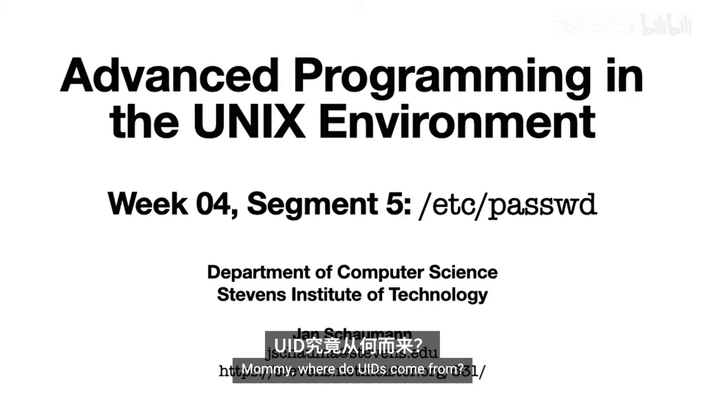

As we know， the UniX system uses numeric UIs to make all access decisions， computers like numbers。

 but humans tend to like strings better， so we also have user names。

The password database maps these username to user IDs and thus provides the local accounts on the system。

Traditionally， this user database is found in the F Etsy Pass and contains the following fields。

 which map into a struck pass data structure used by the functions performing the loups。Theyer。

The username， a simple string。A hash password， although we will later see that this data nowadays resides in a separate file。

The numerical U idea。To an America Group I。A common field known as the geos field stored as a PW geos。

Where the name Gecoos derives from the general comprehensive operating system。

 a remnant of the early Uniix days where compatibility with geos's machines was desirable。

We have an initial working directory。And an initialelle。

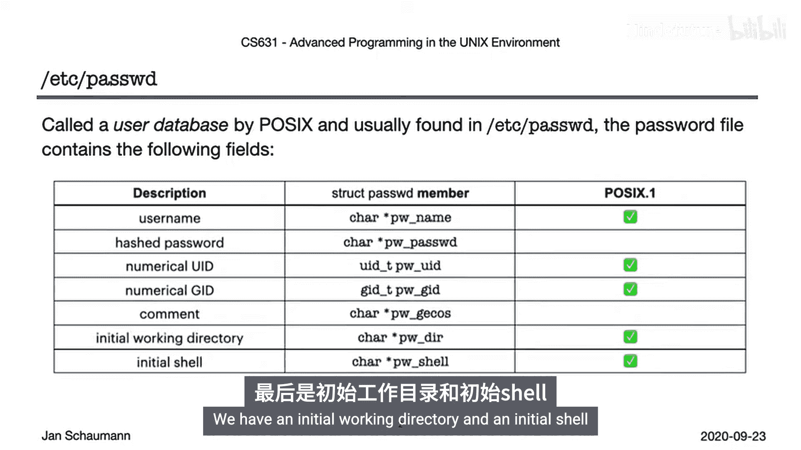

The user database and Goodold Unix tradition is a plain text file found under Etsy Pass with linely limited entries containing colon separated fields。

This， of course， means that none of the fields can contain a core。

Your typical Esy Pass file will contain entries for the super user route。

 a number of service accounts used specifically and entirely for the purposes of privilege separation and the number of human user accounts。

The first field is the username。The second field， as we said， is the hashed password。

 But as we see here， we primarily find asterisk risk in this place。This is because nowadays。

 the hash password is stored in a separate file。We'll get back to this in our next video segment。

Then we have the UI and the group ID。Followed by the geckos。In the early days of Eix。

 the Geos field was commonly used to include not just the full name of the user。

 but also their office location and work and home phone numbers separated by a commas within this field。

Nowadays， it is mostly used to fill in a full name that some services or tools in the Uni system may use。

For example， when sending mail， the user's full name is filled into the from field from here。Next。

 we have the Home directory。This is the directory that the login process uses to set as the current working directory of the user when they log in。

And finally， we have the shell， the program that the login program executes on behalf of the user when they log in。

Okay， now looking at this password database， we should find a few odd things that we have to go over to better understand the format。

He said that this file is the user database， defining the local accounts in the system。

So we should expect there to be always exactly one username being mapped to one UI。

But right here at the beginning， we see that we have two accounts with the same UID。

And one of them is root know this。This is no mistake having multiple accounts with the same U ID is rarely desired。

 but it is not an error in the system。What this means practically is that there are two username that when authenticated will have the effective and real U I of 0。

 Once logged in， the two accounts are completely indistinguishable from one another。 since remember。

 the system only looks at the U I， not at the username to make access decisions。

We'll see a second why we might want to have two accounts with the same I D。

Let's first look at a few more others in this file。

We mentioned that we have a password field with a placeholder for the patch password。

But this field can also be empty。Which means that this account doesn't have a password。

Anybody can log in as this user。But this is probably not what you want。 Again。

 the system allows for this to happen because who's the system to tell you who to grant access to。

Next， the login shell can be set to any program。Since we have a number of service accounts that we only use for privilege separation。

 that is to our process to have a dedicated UI and not have any other privileges。

 but that we do not ever want to allow to log in interactively。

 we can set the login shell to Aspen no login。As spin no login simply returns false when executed。

 meaning a user managing to log in as this user will immediately be logged out again。

But you can set this shell to any program。Our time note over here， for example。

 will simply execute the date comment when she logs it。

Privilege escalation here would require the use of a sonic screwdriver， I suppose。

But you can also leave the login shellll blank as shown here， in this case。

 the system will default to business H。Your initial working directory is normally set to your home directory。

But you can leave that blankk too， in which case the initial current working directory becomes root。

The Geos field allows for the expansion of the EmP to the capitalized username。

We'll see that in action in a minute。As well as to provide for the additional information as previously mentioned。

But of course， you can also leave that field blank if you like。

Multiple identical group IDs simply means that these users are in the same primary group。

 which is rather normal。But having multiple entries for the same username is most decidedly not normal。

We demonstrate why this is a bad idea in a minute as well。

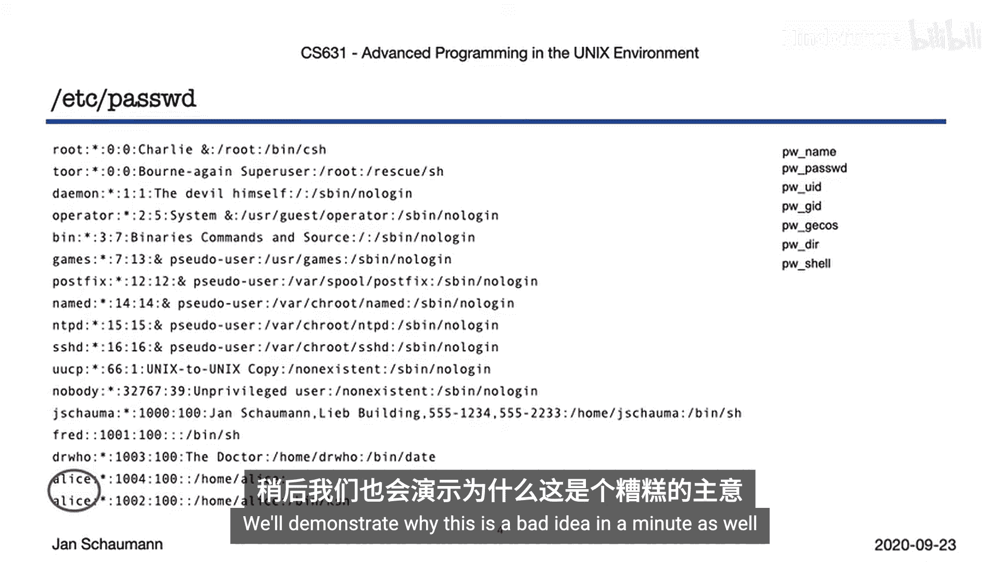

Okay， let's illustrate all the different weirdes we may encounter an Esy Pass First。

 let's illustrate the use of having a second account with the same UI for route。The tour account。

 the B again super user。Suppose you are working as route and accidentally manage to corrupt your login shellll in some way。

you have a problem。You can't log in anymore。Nowow what。Well， with a tour account。

 you can still log in since the tour account has a different login shell。

 a statically linked shelf on the rescue set of tools。Once you log in as tour， you are rude。Wait。

 how does that work。Don't you remember the system only cares about your UI and tour is UI is 0。

 So as far as the system is concerned， you are the superus。

So you can now go ahead and fix your broken shell。After which you can log out and logging in as route will work again。

Needhe。Note though that the use of the To account is a BSD inhered account。

Most non BSD systems do not have this account present or enabled。Okay。Next。

 let's take a look at Fred。Fret doesn't have a password hash。

 meaning anybody can become ft without having to provide a password。Probably not what you want。

 but okay。All right。Next， we'll check our doctor， who。Remember。

 the doctor has the date command at her login shell。So when we log in as the doctor。

 that command is executed and upon termination of the command。

 we are logged out again and arebe being our usual boring self。

Here we see the date command being executed， as that is the login shell of the doctor。Okay， up next。

 Aliceli。Alllice has no login show that we can still log in as her。

Here we are using the login command merely to illustrate the different method of logging in as a user。

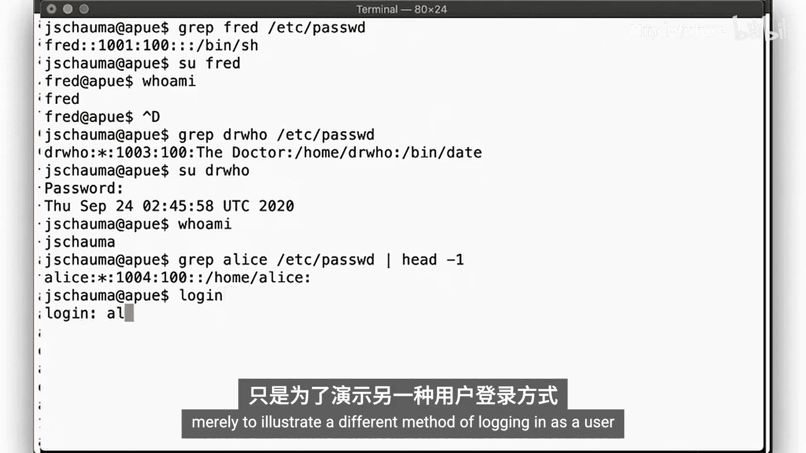

That is what the system does when you log it。 We'll come back to this programme in a future lecture。

 though。Anyway， as promised， Alice gets been as age as her shell， because it's the default。

 If no shell is specified an Esy password。

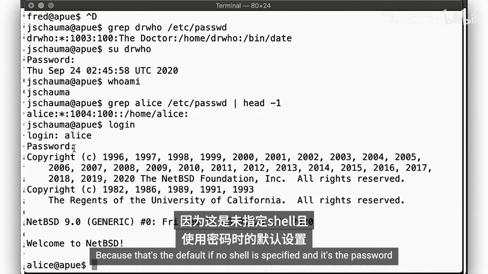

But remember， there was something funky going on with Alice。Besides not having a show。

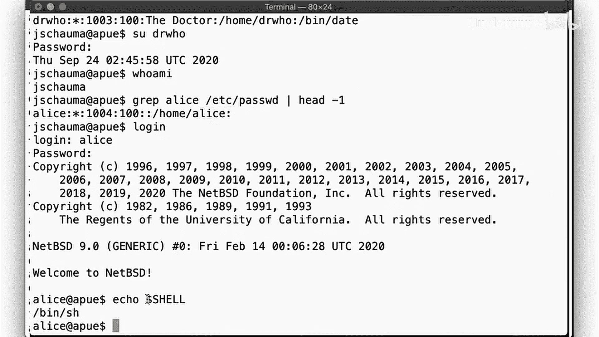

We have two accounts for Ellis， both within the same home directory。And so here are our files。

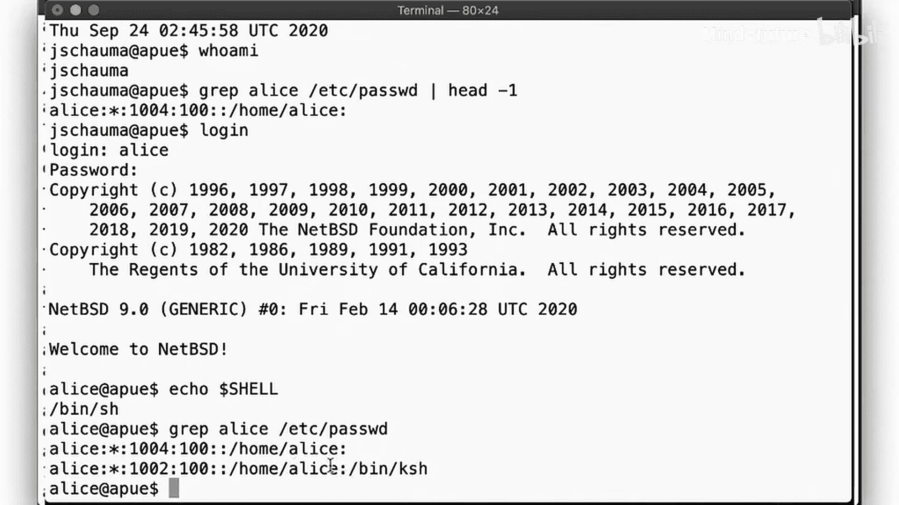

All our palaceless。But Ellis is not allowed to create a file in our own home directory。

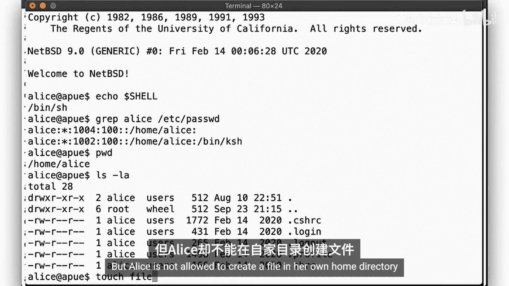

We said the Uni system only cares about America deed。

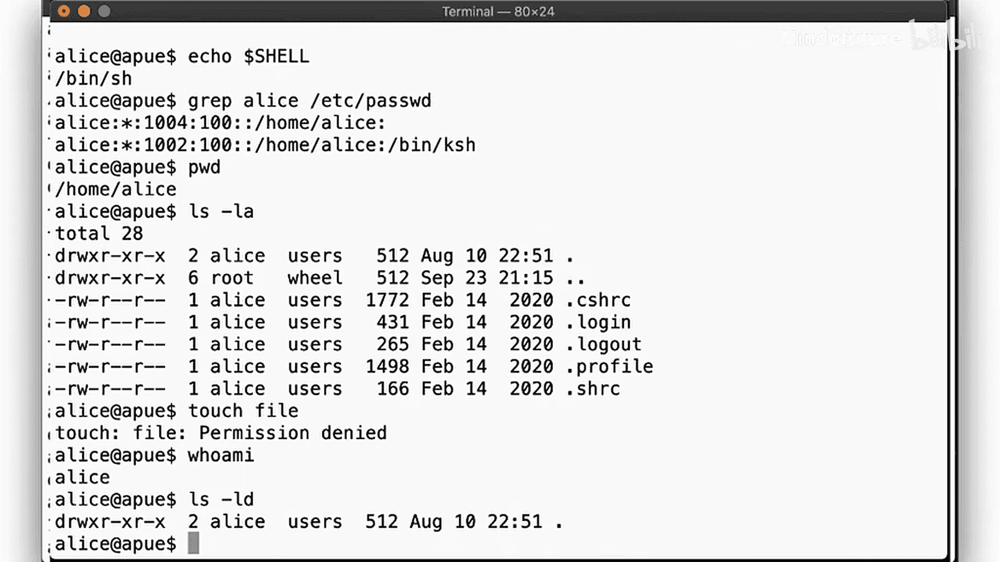

So let's take a look at those。Okay， so the directory is owned by UID 1002， but we are UID 1004。

Which explains why we can't create a fire here。We can tell the tutorial accounts apart because we are looking at the username。

 but the system checks the body only。So having two accounts with the same username is probably a bad idea。

Okay， now finally， let's check out the geckos field in action。

The finger command can be used to find that information about a user。As we see here。

 the ampers in the geckos field for root was translated into the uppercase name。

 So we end up with Charlie Root。Why Charlie Root， Good question。

 I wasn't able to find an authoritative answer， but rumor has it that the account was indeed named after the baseball player Charlie Root。

Eunix's history of folklore is weird。Let's look at the information for user J Shamer。

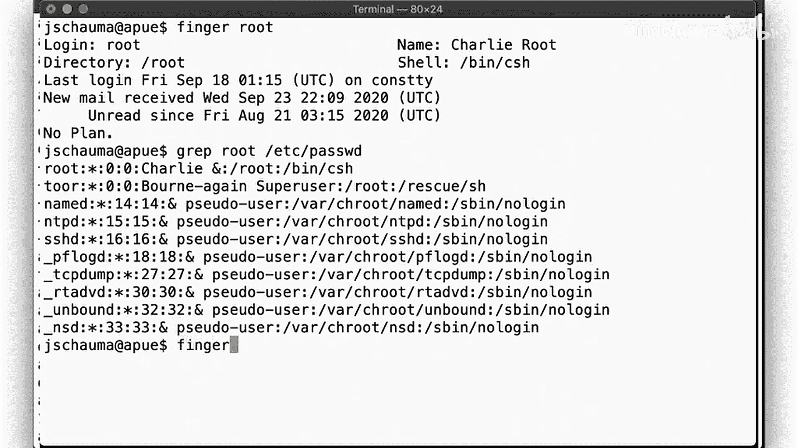

Note how the finger command was able to parse out the geckos information from the traditional comma separated values。

 and you see my office location and phone numbers displayed here。By the way。

The finger command can also be used over the network to query another system。

 or that system offers the finger D service。That might look like so。Ha look at that。

 I apparently still have my old dot plan in dot project files on my system。

The ones that I used here at Stevenevens when I was a system administrator almost 20 years ago， wild。

This information is no longer accurate， I'm afraid。Okay。That's enough for this short video。

 Let's recap。The user database， a text based file name Etsy Pass。

 contains colon and separated fields。Most of those fields may be empty。An empty password。

Field means no password。 This is probably a bad idea。

An empty home directory means you'll be dropped into slash when you log it。

An empty shell means you get business age。Some of the fields may be duplicated in the fire。

 This is not always a error。Multiple users sharing the same primary group is completely normal。

 for example。Multiple user names for the same UI is generally quite rare。

 but we've seen how it can be useful。Multiply Us for the same username， however。

 is virtually guaranteed to be a mistake and lead to unexpected errors。All right。

 next time we' take a look at the various functions we use to handle these user ID lookouts。

 as well as how to get information about groups。Thanks for watching， cheers。

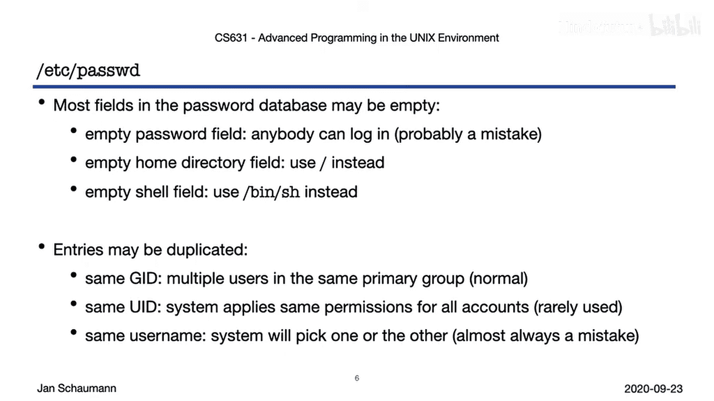