# UNIX高级编程-p21-P21-Week-04,-Segment-6---getpwuid(2)-and--etc-groups--BV1hPuVz8EWS_p21-

Hello and welcome back to CS631 Advance programming in the UniX Environ。In our last segment。

 we talked a lot about the Etsy Pass file and the various curious accounts and fields we might encounter。

 but we didn't really talk about the library functions used to look up account information。

Well rectify this with this video。We'll also take a look at the group database and the library functions to perform lookups against that。

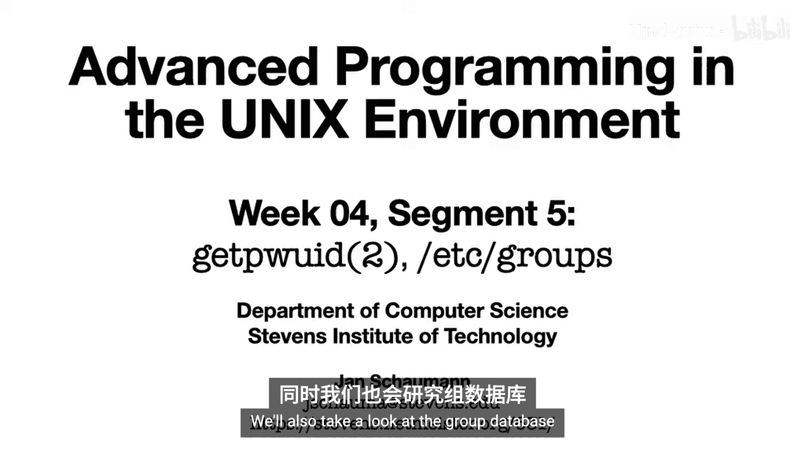

But let's first remind us what the password database looks like。As a text based file。

 performing lookups should be easy， and we could imagine processing the file one line at a time。

So what do the library functions to look up user information look like？Well。

 we have a few functions for starters。😊，Here we show the two functions used to look up a user's account information by UID and by username。

They each will return astruct password on success， which contains all the fields we've seen in the file et Pass。

Note that on some platforms， the star password contains additional fields。For example。

 on BSD systems， you may also find a login class and logical grouping of accounts to assign certain resource limits。

 for example， as well as an account expiration date or a password change time。

Since this information is not stored in its password， where does that live？

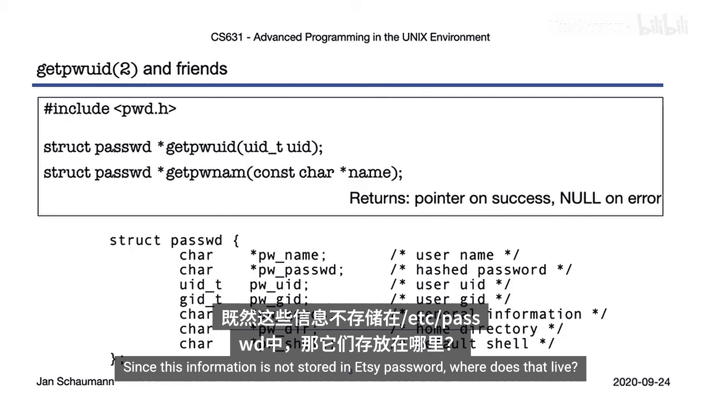

The answer is the master password file also found under Etsy。

This file contains all the fields from Etsy password， plus the additional fields。

This file also includes the encrypted， well hashed password。

 which we noted is not actually present an E password， where we only find the asterisk placeholder。

This is because Ey Pass needs to be readable by all users to allow get PWUID and get PWM calls to succeed without super user privileges。

The Pass file itself is then generated from the Ey master Pass file using certain tools。

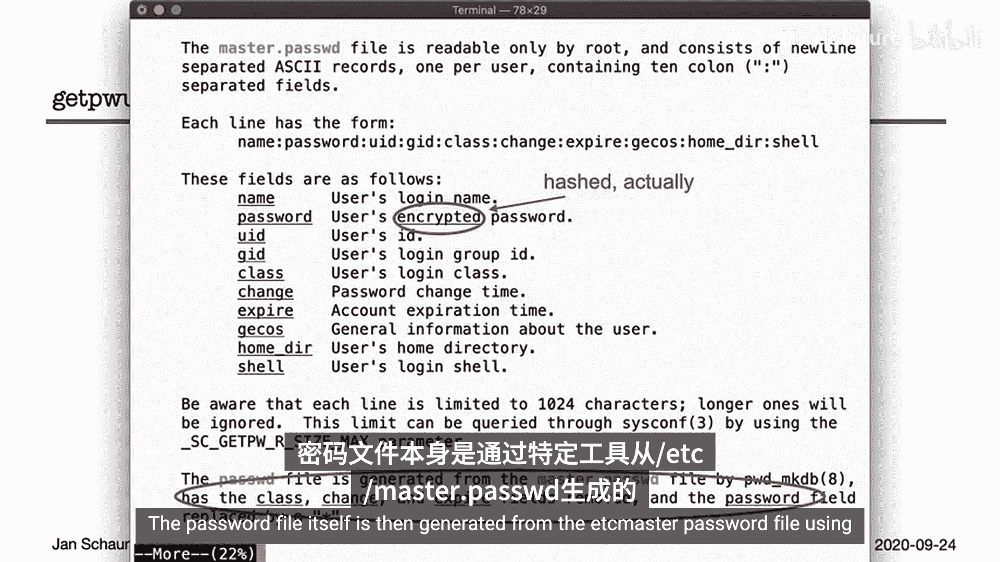

Now， for example， consider your LS command when running LSl。

 it will print out the username of the file owners。But as you know。

 thestruct stat does not include the username， only the UID。ナです。

You actually only have the numeric ID in order for LS to translate the ZIDs into names。

 it needs to call get PWU ID for each。So if Etsy Passwood was not readable by everybody。

 Els couldn't do this。

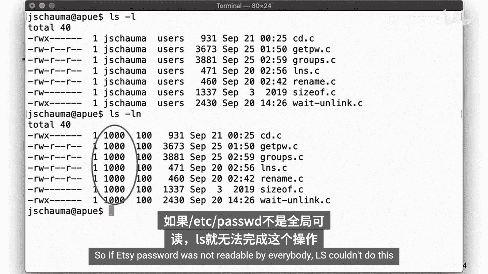

But since Etsy Pass has a password field， doesn' it mean that any user could see the other users albeit hash passwords。

And then stage an off on dictionary attack and correct the passwords in that spare time。

This doesn't sound so good， so we moved the password hash into Esy master Pass。

 where we could then also add additional fields without breaking compatibility with the old Esy Pass format。

Not over here， we do see the hash password entry in the master password file。

But that requires super user privileges。Other Uni systems may use a similar approach Linux for example。

 uses Esyshadow and get PWUID and friends do not return the additional information。For those systems。

There are a bunch of separate library functions， including the getPWM equivalent。

 get SPPM shown here。According， this function will likely fail if you are not UI0。As it sea shadow。

 like its see master Perwood， is readable only by root， for the same reasons。

Now with gettPWUI and gettPWMm， you can look up an individual user's password file data。

 but what if you want to iterate over all the entries。

 similar to how you might want to iterate over all directory entries？For that， we have get PWN。

Gett PWN willll read the password database sequentially， but in an order that is opaque to you。

 that is even though it may look to you like it goes in the text or that you observe in the file and you should not rely on that。

Set PW and rewinds the stream back to the beginning and endPWN closes it。

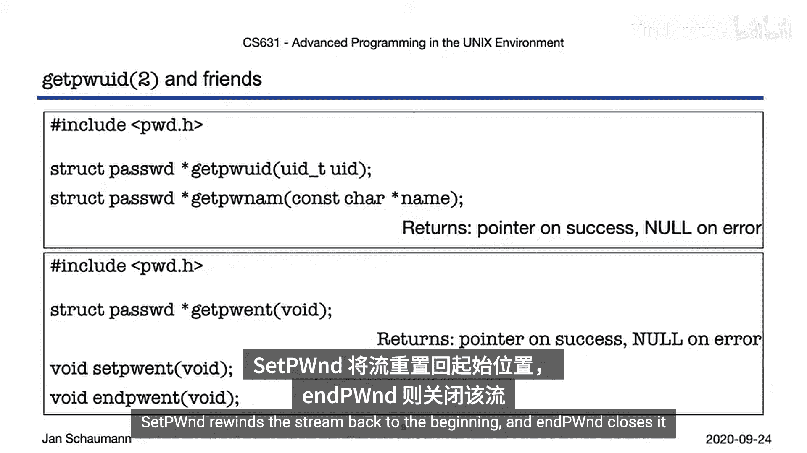

Let's see those called in action。Here's a simple program to look up the user's information and print it in the format we used from Etsy Pass。

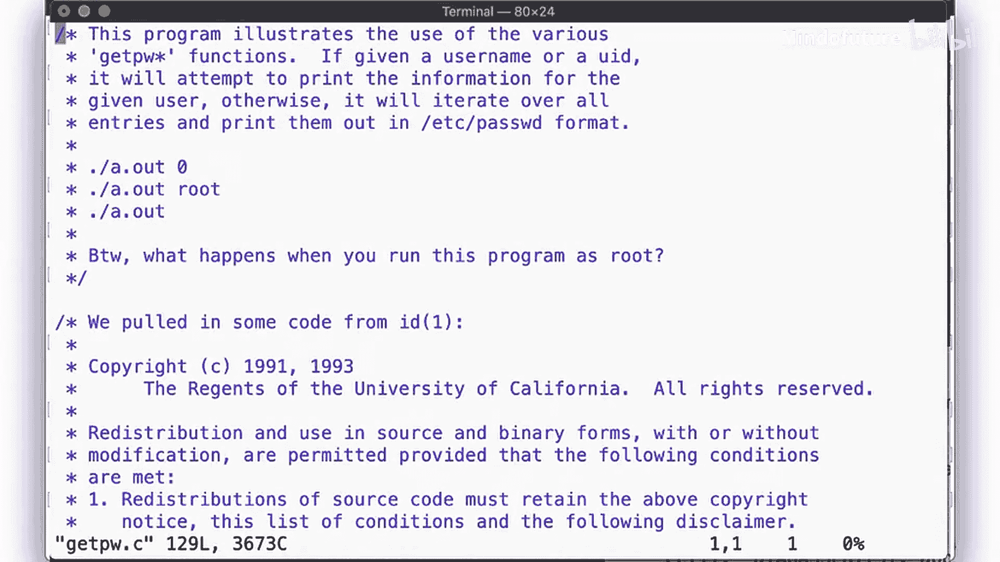

We allow the program to iterate over the entire database or to look up an individual user。

Looping over all entries is rather straightforward。As we will see。There。

 all we do is we simply loop over get BW end and call it until it returns null。

Printing the information then only requires formatting the members of the struck password。

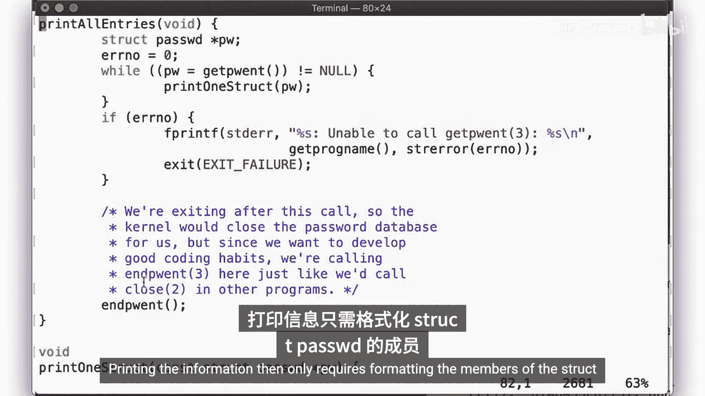

But to ensure we don't accidentally dereence now than Sefold， we had a simple assertion over here。

If we're given an argument， we have to decide if it's a username or a UID。

 so we are borrowing the Who function from userBin ID。

 which we first attempt to look up the input as a name and if that fails。

 try to convert it to a string and then look up the user by ID。Okay。

 now if we run it without arguments， we basically get back our Etsy Pass file。This will look like so。

If we look up the user with UI0， we get Pe root。And if we look up user1。Well， no surprise。

 we will get the devil himself。Likewise， looking up the user by username gives us the expected result。

But。Remember， we had two aes。Which one did we get？As before， we got pe UI 1004。

Which shows that gettPWN will only give you a single user if multiple users are found。

 just like gettPWUID gave you only root and not root and tour。First Metro wins。Certainadly。

 we have no avocado。Anyway， now let's get my users's information。😊。

Note that the password field here is an asterisk， but if we run this program with EU idea0。

 then we get the hash password。That is， get PWM will provide you with us information from Metsy Masterster password if you are EUuI0。

But return to you an asterisk if you are a mere mortal。And yes。

 you can now pause the video here to my password has should start cracking it， good luck。

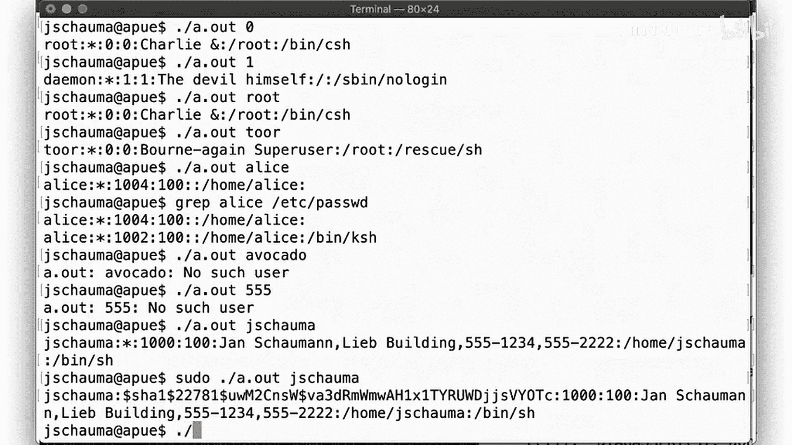

Remember Fred？Fred didn't have a password。But here we get master risk。

But Esy password doesn't have a password set。

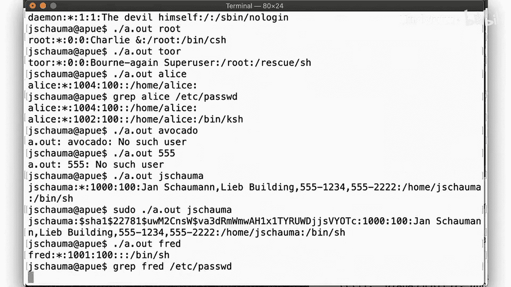

And if we run with EUu at0， then we get no password。And again。

The ask for the risk is not actually retrieved from the password file。

 but handed to you by getPWNM based on your EUuI。If it is zero。

 you get whatever is an Etsy master password， otherwise you get an asterisk risk regardless of what is in that field。

 an Etsy master password or Etsy Pass。

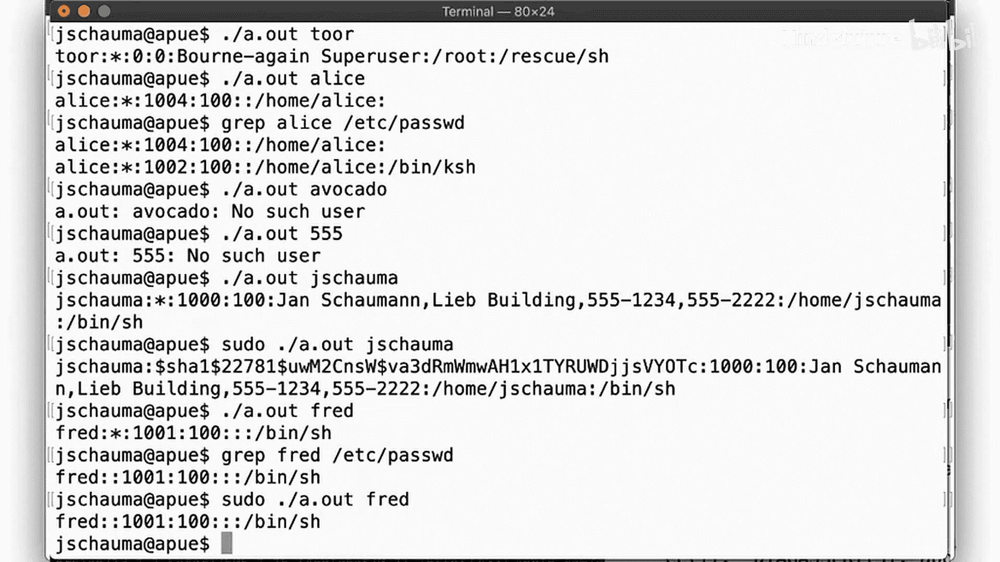

Okay， so much for the password database， but we also discussed groups and group membership。For that。

 we have another database file et group。Much like Esy Pass， ets a group contains a group name。

 a hash password field， an America Group ID， and finally an array of username identifying the members of the group。

But wait， why is there another field for a password hash？

Of course this goes back to the olden days of Unix once more。

 it used to be the case that a user could only be a member of a single group at one time。

 so if they wanted to access the file owned by another group they would have to change their group。

To change your group， you'd run the new group command and provide the group password。Nowadays。

 we have supplementary groups， but the new group commence still exists and works。Here。

 let's demonstrate。

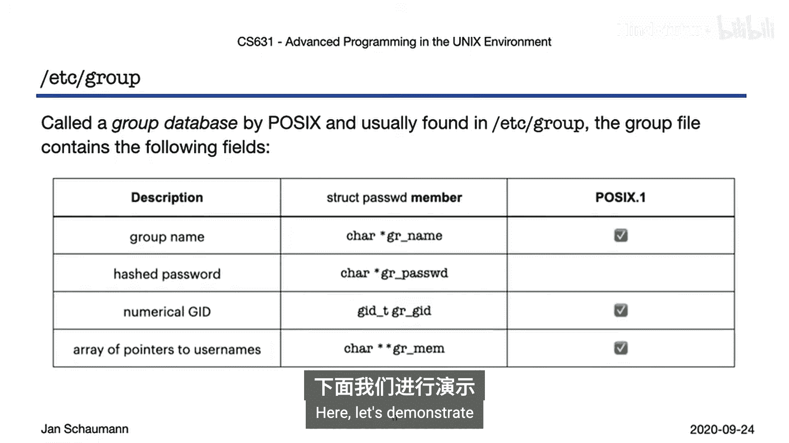

Here we see a file owned by the group guest。Of which user J Shaalma is not a member。

 so can read the file。But the new group command can change your primary group ID。

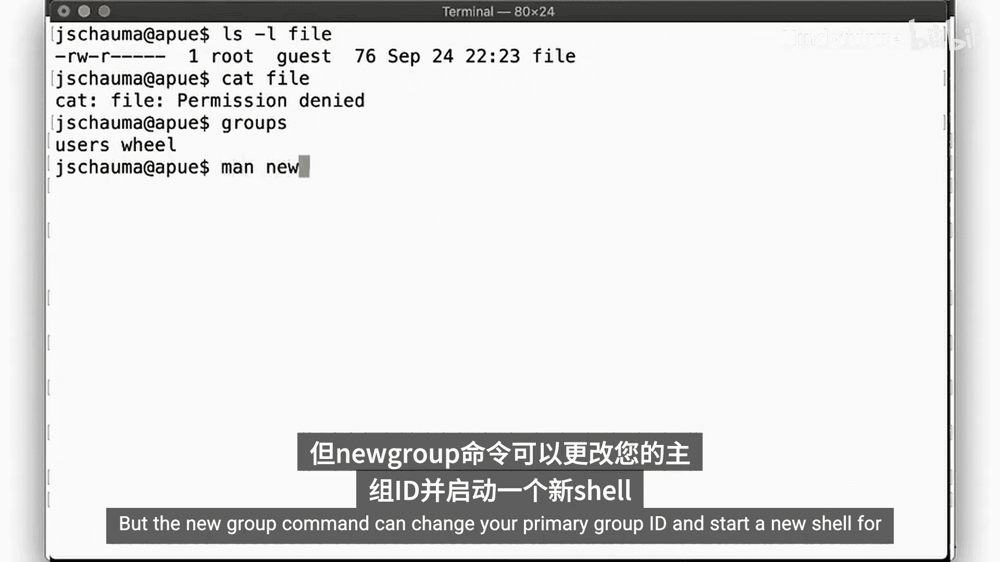

And start a new show for you。If there is a password hash in the group file。

 then the user has to provide that password。Okay， let's give it a spin。New group guest。Okay。

 we enter our password。And look at that， I'm now in the group guested。And of course。

 can now read the file。But note that the Etsy group fire does not show me as a member。

And that shows the password hash， unlike Esy Pass。Don't we have a separate file for the group password hassh。

 maybe et'dy master group？The answer is no， group passwords are hardly ever used and supplementary group membership sufficiently solves the problem of granting the access without requiring managing group passwords。

So you will likely never run into this， but hey， this class is also intended to give you sufficient geek crs to impress other unx nerds。

 even if that's not practically useful， You're welcome。Now， let's see。

The group games doesn't seem to have a password。

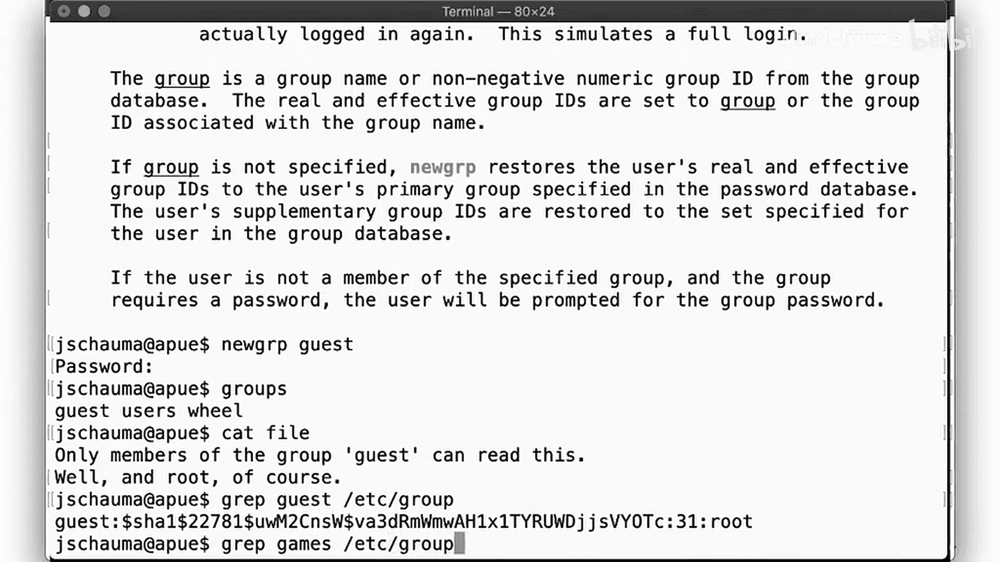

Can I become a member of that group？New group says。

 sorry and doesn't understand an empty password field。But note that even on failure。

 the new group command still started a new shell。

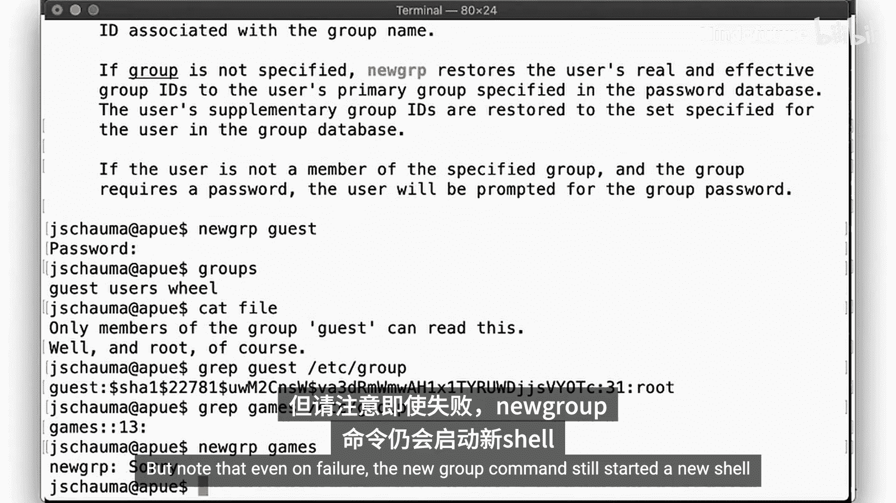

Oh well， as I said， it's a rarely encounter too。

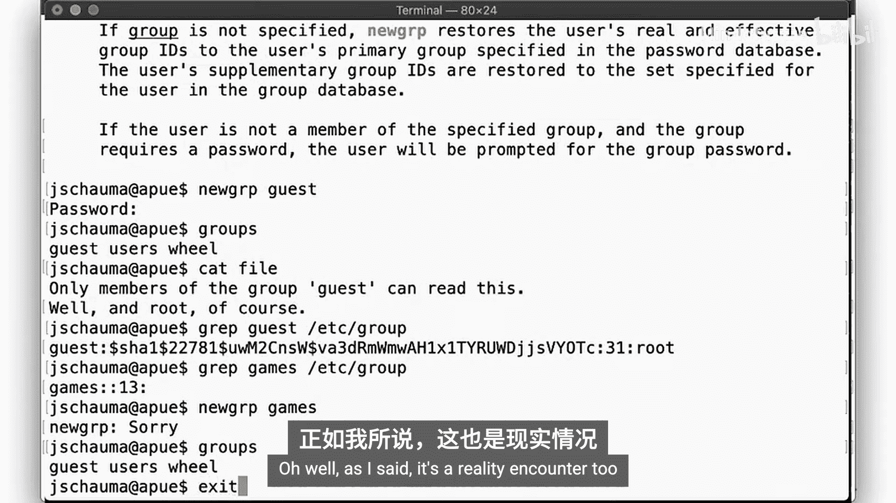

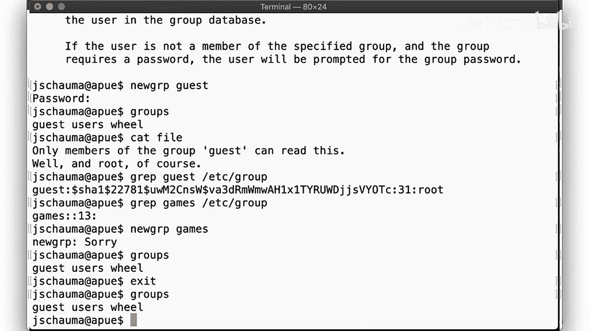

Okay， now how do we get group information from Esy Group？Just by get PW now and get PW UI。

 you get your entries。For the Etsy group using the functions， gett GRgit and gett GRNe。

And you can back astruct group。And just like for E password。

 you can also iterate over the whole Esy group file sequentially using getG or E。

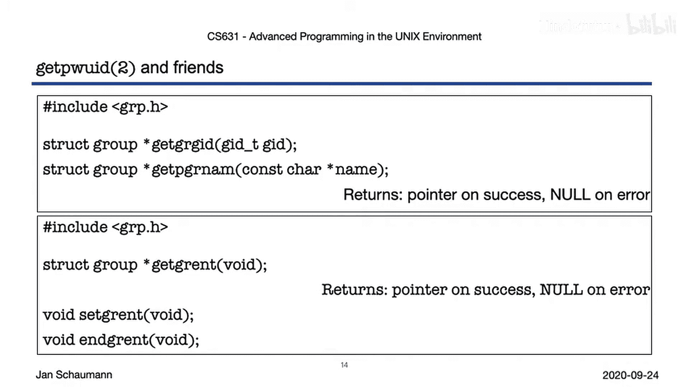

But groups are somewhat complicated， as we know we have a primary group ID。

 which is the group ID listedited Esy Pass。And we can have a number of supplementary groups。

 as listed at the Ntzi Group。Now Posss provides us with a get group search call。

 but it does not define whether or not that includes your primary good。

 so if you want to get all groups you're a member of， you need to also look at that C password。

The more comprehensive get group list function is non standard。

 so check if your Uni version supports it before relying on it。

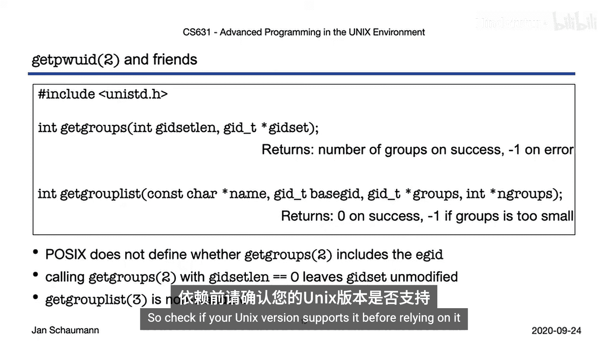

Here， let's implement the group's command。Youll find that is surprisingly more complex than handling user information。

As before， we handle arguments based on username or user ID。

But since we don't know how many groups the user is a member of。

 we have to dynamically allocate space for all groups。

And so we start out with a Ciscon to determine a reasonable max。If you are given a username or UI？

Then we can call get group list。

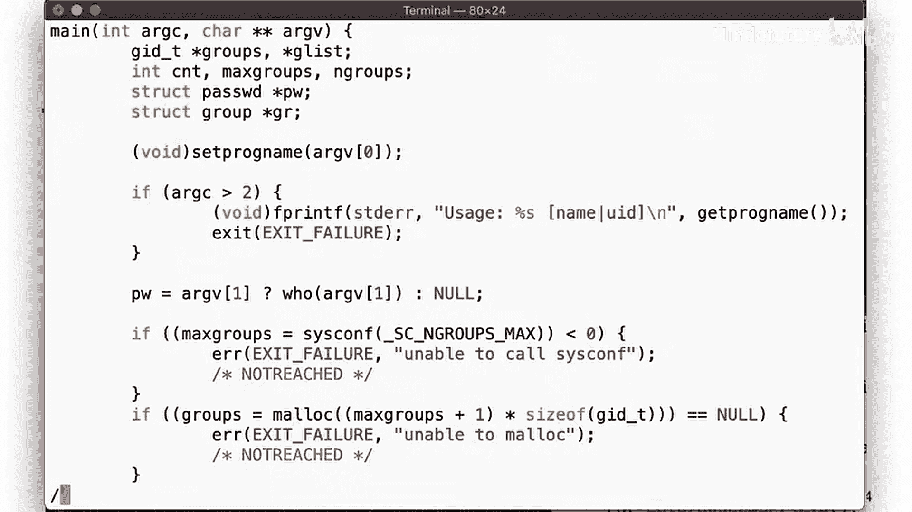

But it's possible that the number of groups they use as a member of doesn't fit into an initially allocated array of groups。

 so if that fails， we have to allocate more memory and then call it again。

If we were't past an argument， we first get the primary get。

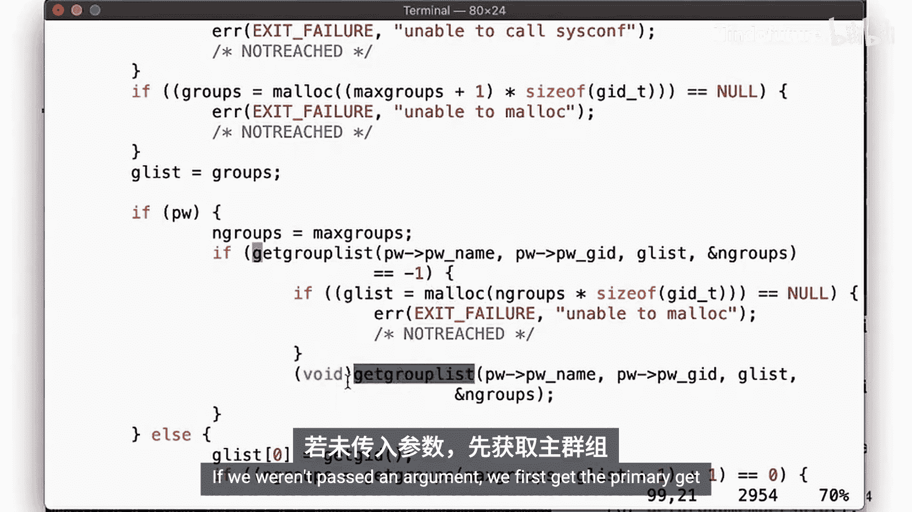

And then called get groups。Finally， we have a list of group ideas。

 but we want to print out the group names。So we have to call get Grgi for each and then print out the names。

Okay， let's run it。This looks good。What group is Ru a member of okay？Let's confirm。

Here we see my username is not included in the Etsy group for entry for my primary Git。

 because my primary Gi is included Etsy Pass。Now let's change our group membership。

And see if our program behaves。Yep， good。We exit the new group shell and back to normal。There we go。

Oh， and one more thing。The ID command includes similar functionality to the group's command。

If you look at the iNots， you should find that they are the same command。

 that this ID is a program that was written to behave differently based on how it is called。

 it looks at AV0 and behaves one way if it's called ID， another way if it's called groups。

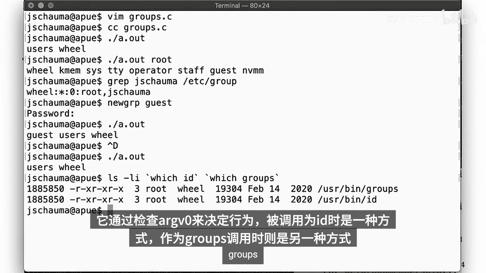

A neat little trick。All right。We've seen two of the critical system databases， N Pass and Eygroup。

The functions used to access the data in them are similar。

 and so it should come as no surprise that we have other similar functions to access other system resources。

The general pattern here is we have a certain resource that is described in a plain textt file on the Etsy。

 and for each we have library functions that retrieve the resource into a data structure。

These functions generally follow the getF by bar pattern to allow you to look up things。

We'll see several of these functions in future lectures。All right。Let's recap what we learned。

Handing the data from Etsy Pass is relatively straightforward。

The password hash is kept in a separate file that only EUuI0 can access。On BSD systems。

 this file is called that CM master password and they get PW functions that automatically provide you with a hash。

On other systems， you may find the file et seahaow and need to use different functions。

We noted that groups can have passwords， this is rarely seen。

 but an interesting thing to keep in mind。And we've learned that iterating over a user's groups is surprisingly more of a pain than iterating over their password data。

The functions we saw here are all illustrative of a consistent approach to system resources。

 and we'll see a few more similar calls in the future。ok。This wraps up this video segment。

In our next session， we'll try to make sense of time itself， but P word。

 time is an illusion and five times doubly so。

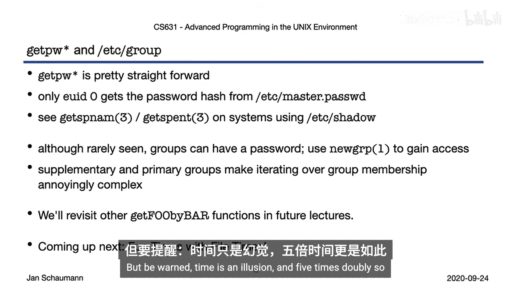

And that， cheer。