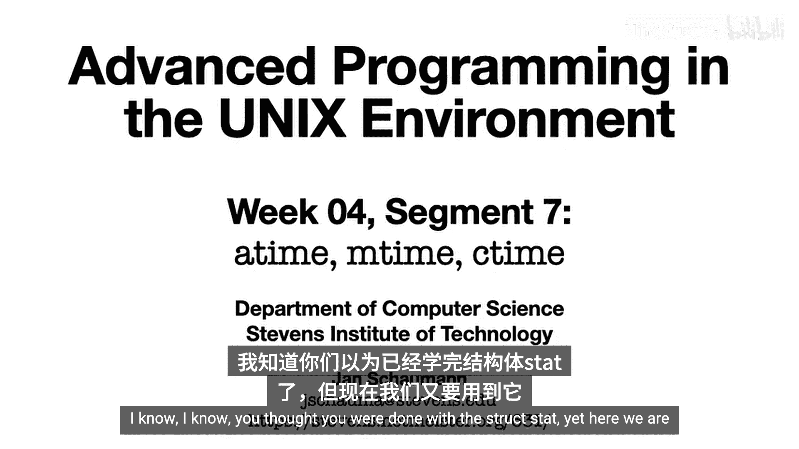
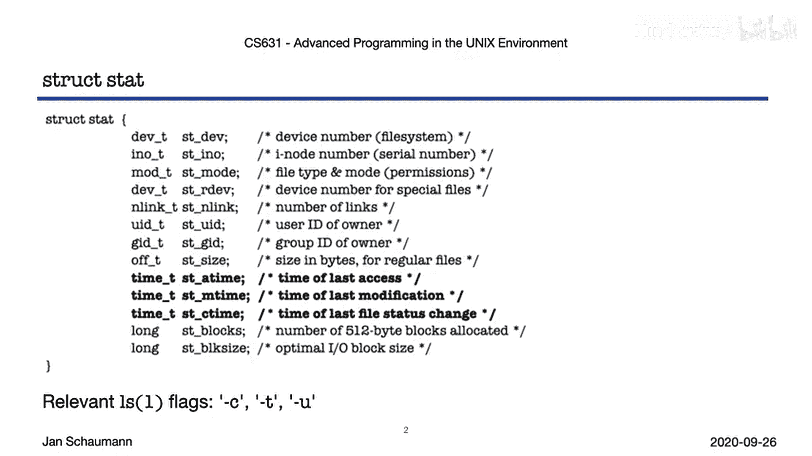
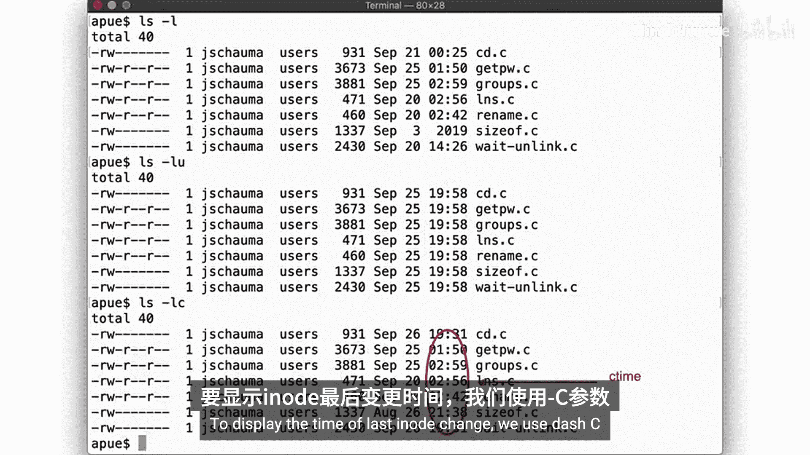
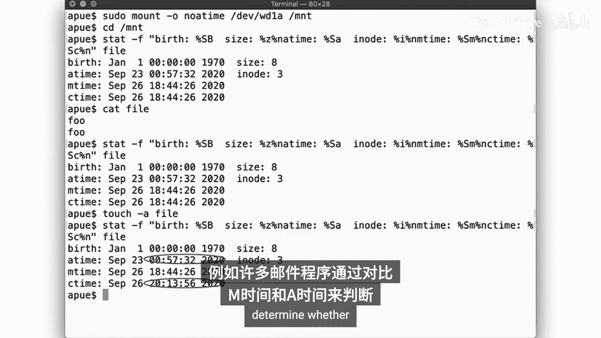
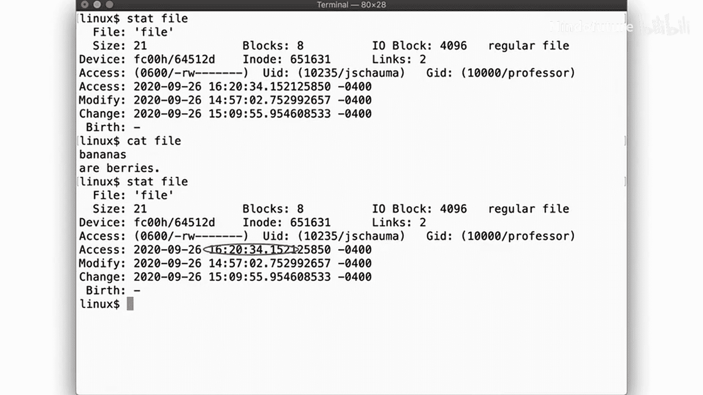
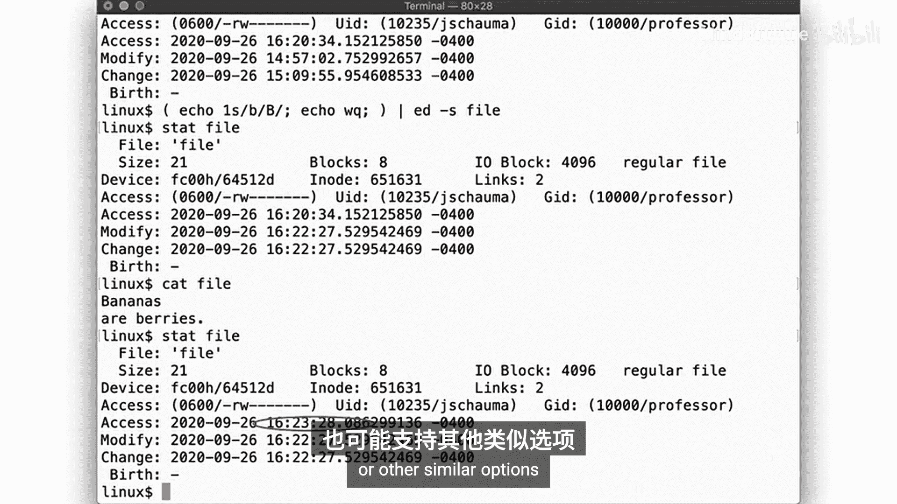
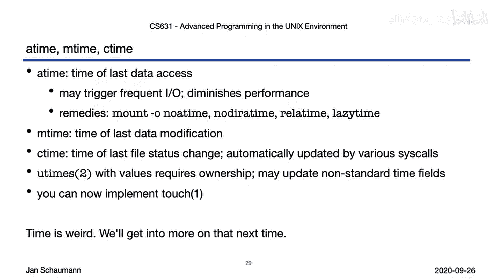

# UNIX高级编程-p22-P22-Week-04,-Segment-7---atime,-mtime,-ctime--BV1hPuVz8EWS_p22-

Hello and welcome back to CS631 Advanced programminging and the UniX Environment。

Today we'll start looking a little bit closer into what our systems think of time。

 something that experts most accurately describe as a big ball of wbbly， wobbly， timey， wy stuff。

I know I know you thought you were done with thestructstead yet here we are again。

So let's look at it。We have at least three time related fields， the file is A time。

 M time and C time。With the aid time representing the time of last excess。Well。Data access， really。

Recon our visualization of the data structures representing a fire。

 accessing the data blocks pointed to from the inode and the Vn structure is what we're talking about here。

Then end is' the time of last modification。Again， data modification。

And the time of last file status changed， the C time。

This represents a change in the structurestead itself， more or less。

All three of these commands can be displayed using the LS command， as I'm sure you know by now。

So trivial example。By default， lets use the files M time when displaying or sorting by date。

If you specify the U flag， you get the A time。In this example。

 the AM for all these files is identical because I recently recreated the APU code Tball。

 archiving the files requires reading them， so no surprise all files have the A time updated。

To display the time of last I change， we use dash C。

Let's take a look at how the timests change when we perform common operations。

We create a new file and use stat to display the file times。

This file system in use here supports an ILd birth time， so we display that too。

Note that all four times shown here are identical， this should make sense since creating the file implies access。

 a modification of the file data， as well as modification of the new file's Inot data。

If we then cut the file， we read it， meaning we are accessing the file data blocks and the A time gets updated。

If we add pen to the fire， we are obviously writing data to the fire， so the M time is updated。

We are extending the file and size， so at the very least the ST size field of the I changes。

 so our see time is updated as well。Now， those operations seem straightforward。

Let's look at what happens when we change something about the fire。

Creating a second heartling to the fire increment the ST End field。

 so necessarily requires an update of the sea time。But since we don't do anything to the data。

 the atom and M time remain unchanged。Similarly， changing permissions only modify the ST mode。

 and again the C time is updated， but the Aom and M time remain the same。

Changing fight ownership follows along the same lines with the same result。Okay。

 now we have a fire that's owned by Fred with no right permissions for anybody but the owner。

The touch command by default touches the its A time and M time。But not surprisingly。

 you can modify these members of the str stat of Fred's file without right permissions。

But if you do have Read andW permissions， you can change those timests。

That makes sense since if you have read permissions。

 you could just open the file and read a few bytes and that would update the A time。

 and if you have write permissions， you could write to the file and that would update the M time。

Either way， making those changes also update the C time。Since now。

 something about the file has changed。But the touch command also allows you to set these timests to any date。

 not just the current time。Let's try to set those times of the epoch。But that fails。

 even though we have right permissions。That also should make sense we have right permissions to the file。

 but we are not the owner， so modifying those timests to arbitrary dates seems reasonable to restrict to the owner。

If we are the owner， we can set those timests。Note that in this case。

 the birth time was changed as well。Whenever the M time is modified to a date that's before the current birth time。

 the birth then is updated to match to avoid as appearing to require time travel to modify a fire before it is created。

Also note that the CT1 was updated when we said the other times。

There is no option for us to set the sea time。Think about it。

 changinging the times in the change of the file status information and the C time tracks whenever the file status information changed。

 So if you could update the C time to an arbitrary date。

 it would immediately have to be set to the current time to reflect that change in the file status。

We can also touch to selectively update one or the other times， A time or M time。

And each time the sea time would be updated as promised。Once for a time。And once for the M time。Okay。

 so we saw how the M time was updated when we appended data to the file。

 which included a change to the ST size field。But what if we don't append data and merely change some data in place？

Here we use a good friend Ed to flip a single bite and the various time fields are。

Updated all three of them。This is because to make the change， we have to first read the file。

 which updated the A time， make the change， then write the file， which updates the M time。

 and so all three times have been changed。Here， let's read the file again。

 and this time keep a close eye on the C time。Reading the file changes the A time as we observed。

Where the sea time did not change。But wait， the C time should be updated whenever anything about the file changes。

 so a change to the A time should trigger up it of the C time， shouldn't it？After all。

 that's exactly what we saw when we call touch。Well。

 it turns out that C time and A time are a little bit trickier than that。

A mere update of the A time as a side effect of any of the file operations such as a read does not update the C time。

 an intentional modification of the A time by way of easyG touch， however does。

POSex has an all system called a note about which of the time field it should update if any。

By the way， we just use the addline editor to edit the file in place。

This wasn't done to impress the Eunuch's Ys， well not only anyway。

I might thing to use the set command with a dash eye flag to either file in place。Here。

 and it looked like that。Now， what's that？All times are the same now， even the birthtime。

That suggests。That's right， this file is a different file now。

Said I does not actually edit a file in place， it creates a temporary file。

 then replaces the current file with a temporary file。

Dpenending on the version of set that may include creating a new file or truncating the old file。

Anyway， so let's think a bit more about the A time。

Any read on any file would trigger an update of the A time。

 which the file system then has to write to disk。That means that you constantly are triggering comparatively expensive IO。

This not only impacts overall IO performance， but especially on solid state drives this can actually reduce the lifespan of the drive。

So let's find a way to avoid this Many file systems support a amount option to disable A time updates altogether。

 no a time。And str us out with our separate disk。Here we see a file with the various times as displayed。

Reading the file here will。Not update the a time。Even trying to explicitly update the A time via the touch command does not update the A time。

No A time means no A time。But the touch command， even though it did not actually change the A time。

 did not fail and the C time update。Was done as if the atum had been changed。

That is the touch command is not aware of the file system's mind or behavior。

 and is called to make the change， and that is all。So why don't we use no I time everywhere？Well。

 sometimes it is useful to know when a file was last accessed and some programs do in fact depend on that。

For example， many male programs use the comparison of the M time to the A time to determine whether or not there is a new male in a given file。

But there are other ways to solve the dilemma with the a time and its impact on performance。

Let's take a look at the Linux system。Here we see the output of a stat command differ between the different Uni versions。

 as usual， compare the manual pages for the details。But， we see。

That reading the file here does not update the A time。

So perhaps this file system also has the no8 time option enabled。

Writing to the file like we did before， updates the M time and C time here。But not the Aine。

 even though clearly we did read the file。But and this is where it gets interesting。

 reading the file now does update the a time。This is a default behavior on mu Linux systems these days。

 and the Ps amount option is known as relative time or relative A time。To this。

 the A time is only updated if the M time or C time is newer than the A time。

 or if the A time is older than 24 hours。This allows the file system to continue to support applications that depend on the a time change。

 but do not have to thrash the disc with IO and read only operations。

Different versions of Uniix and different file systems may or may not support this or other similar options。

Okay， so having seen the touch command in action， we then might ask just how it manages to perform the actions and the answer is provided by the U time family of functions。

As with other calls we've seen before， we can get the familiar variations。

 L U times to operate on the Slink， F U times to operate on the fileless scripture。

 and the U time an S variation。The second argument to u times is the two element array of time values。

 one for the A time and one for the M time。If you pass a null， then you get the current time。

 and for that， right permissions are sufficient as we've seen。If you do pass a time value。

 the function sets the at and M time accordingly but requires ownership of the final question。

Either way， C time is set to the current time as something was modified about the fire。Finally。

 there are variations that allow for nanosecond precision。

And the U time end as at call supports those via the time spec instead of the timebell argument。

All right， time for an intermission， let's recap。The A time is a bit odd。

 it describes the time of last data access。That logic seems to have a number of negative side effects。

 so that we have found ways to work around that by amount options and different implementations。

The M time makes a bit more sense whenever we write to the file， it gets updated。

The C time indicates when anything about the file has changed。

 and it's the only field we can't influence the different system calls were trigger update automatically thematic knee。

Calling U timess says that the timesstem requires file ownership and with all that we've covered here。

You can now implement a touch command， or at least take a look at the sources from the NPPSD operating system。

Oh， and by the way， bananas really are berries， botanically speaking。Anyway。

 that's it we're out of time for today， but we're not done with time by far more on this big ball of wbbly。

 wobbly， tiny wyy stuff in our next video。Until then， thanks for watching。Jes。

