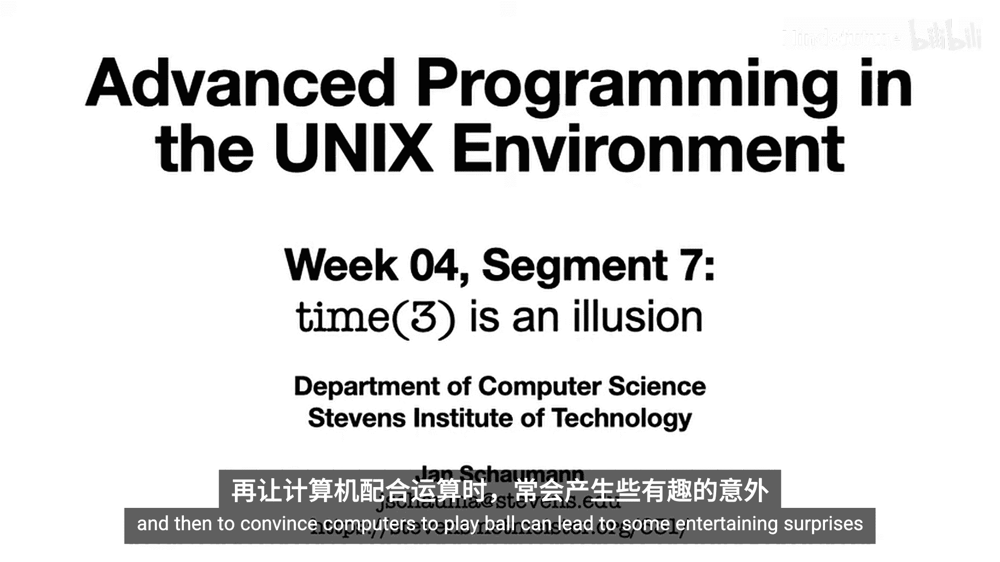
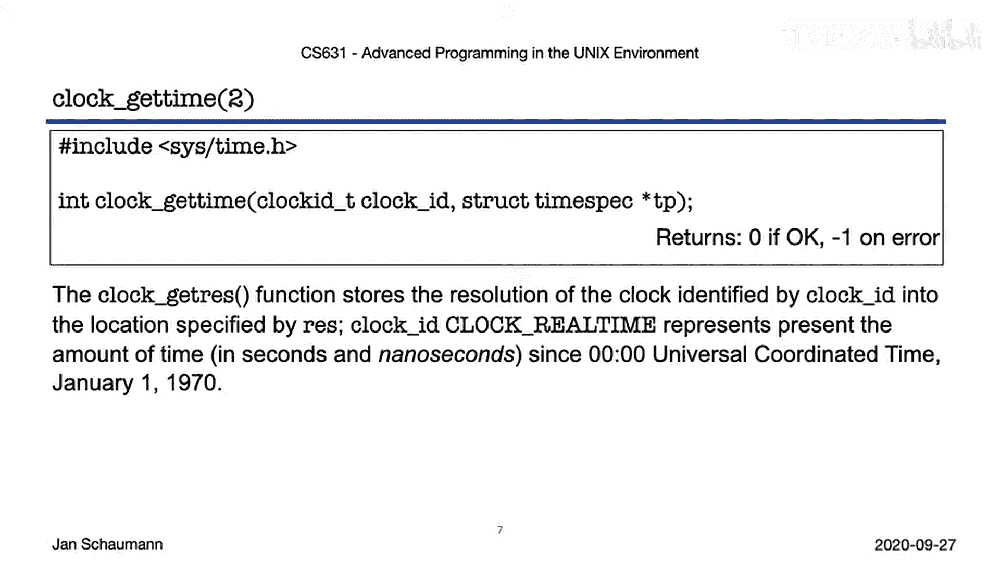
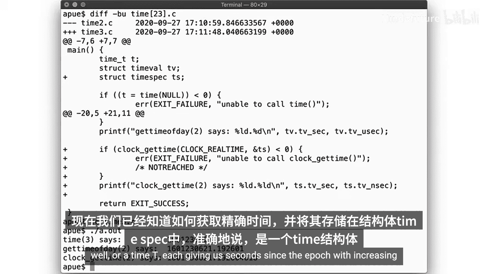
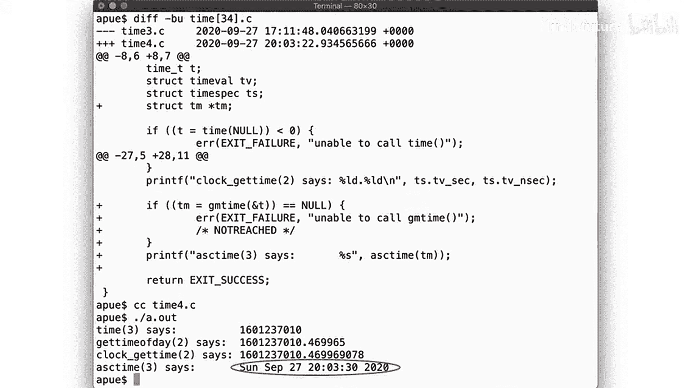
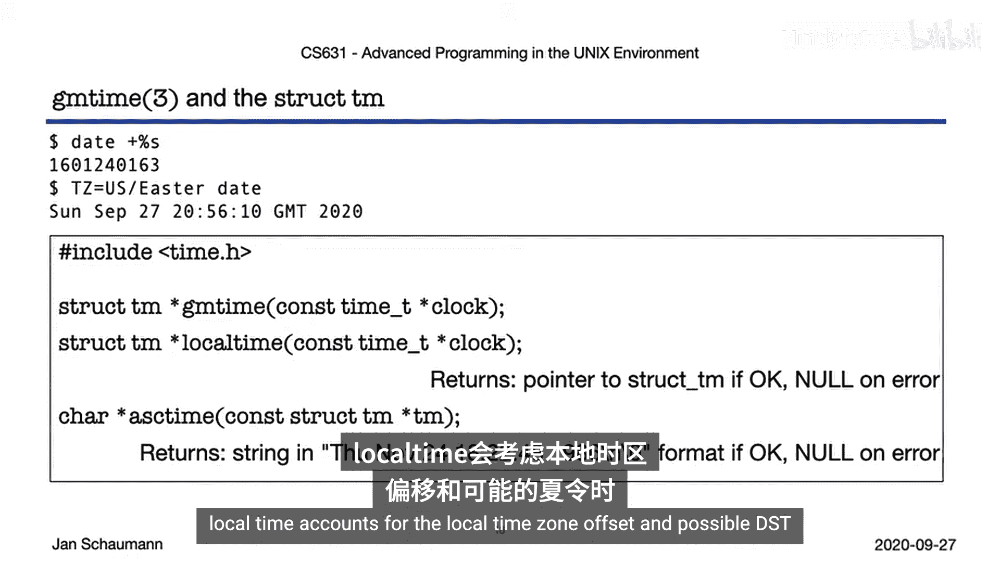
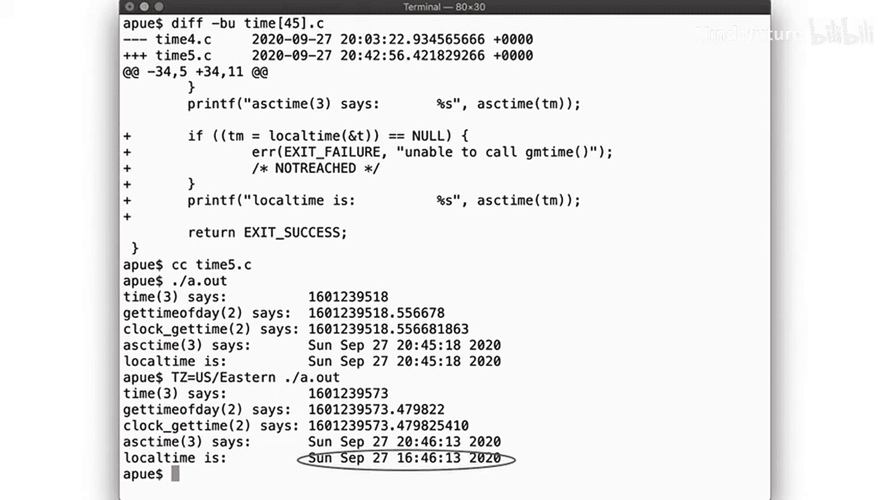
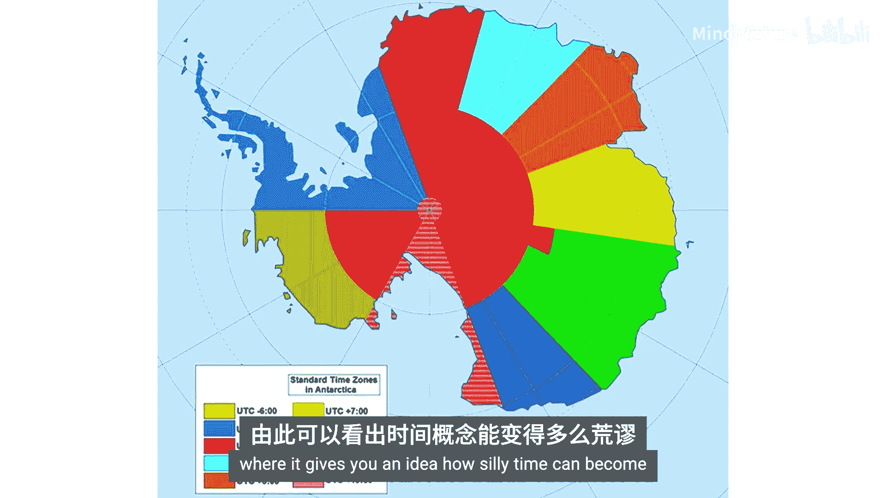
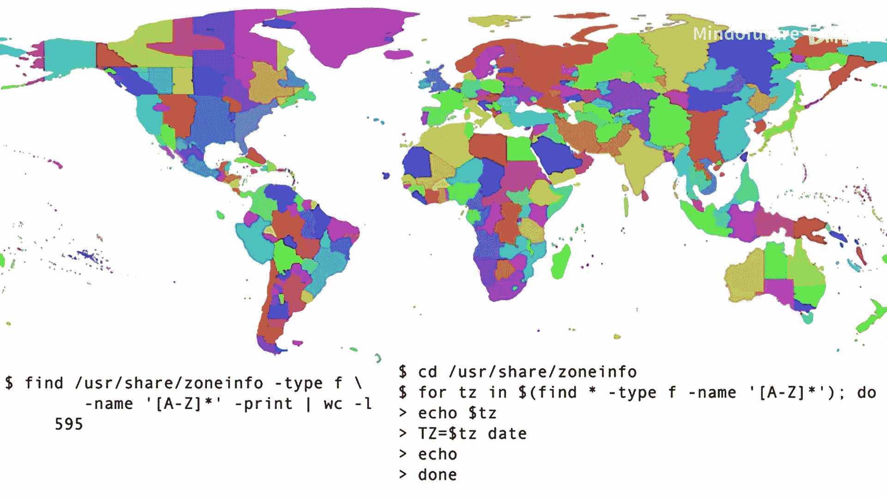
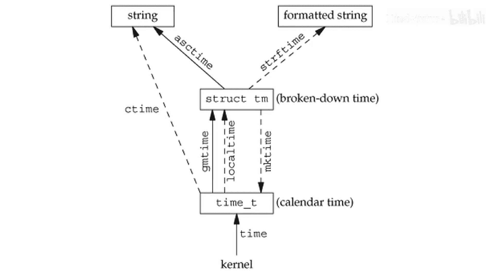

# UNIX高级编程-p23-P23-Week-04,-Segment-8---time(3)-is-an-illusion--BV1hPuVz8EWS_p23-

Hello and welcome back to CS631 Advance programminging in the UniX environmentvironment。

Last time we revisited thestruct stat with a focus on the A time M time and C time members。

We noticed that things involving time can get a little confusing， but to be honest。

 there was nothing compared to what we'll see in this video。Time is weird as a concept by itself。

 but our feeble attempts to make sense of our position in the universe and then to convince computers to play ball can lead to some entertaining surprises。

But first， where does time come from？Well， as far as Uni is concerned。

 the kernelel keeps track of time and provides it to any process asking for it based on counting what crystal oscillations or some such。

 that sounds complicated。 so let's just gloss over that。Anyway。

 as we mentioned in our introductory session， Ex keeps track of time as seconds epsed since the epoch midnight on January 1st。

 197。You can get this count back as an abstract data type time T by calling the time function。

Before he talked about the problem of wrapping a 32 B counter to represent this data type。

 leading to planes floating over the sky and whatnot on January 19，2038。

 So we can gloss over that as well， nice。Okay， here's the code， simple function， simple example。

Call time， print out the time T， which conveniently converts into a long end invoa。

 you get a standard Uni timestamp of the current time a second since the epoch。But wait。

 time is a library function， not a system call， right？

So where does time itself actually get the time from？Easy enough to find out， use the source。

Here we have the implementation of the time function inippsy。

 and it looks like all it does is called get time of day。Here's what that this call looks like。

Like before， we get back what the system thinks the current time is that seconds and microseconds  eappsed since the epoch。

The time valveelstruct has two fields。And the second argument， the struck time zone。

It is onlyon provided for source compatibility this ignored was set to zero by a time of day。

Sounds great， let's give it a try。Here we add to our previous program。

 a call to get time of day and print out the results。As seen in the output here。

 the TV S field is the same as the time T time returned。

 but now we see microsecond granularity via the TVU S field。

But let's go back to the fact that the second field pass to get time of day is being ignored。

 that seems odd， doesn't it？And also consider we've seen that some UniX versions provide。

 for example， the various time fields in thestruct sta with even finite granularity than microseconds。

 namely in nanoseconds， how do we get those？Okay， so here we have the clock get time system call。

 which not at all coincidentally is what positive excess one should use instead of get time of day。

With this call， we pass in thestruct time spec that the ciss call fills in for us。

This function then provides seconds and nanoseconds， sins， yes， of course， the epoch。

Let's add a call to clocketta to our program。The output t looks good。

We even see an increase in microseconds between the call to get time of day and clock at time。

So now we know how to get accurate time， Stton has struck time spec， a struck time well or a time T。

 each giving a second since the epoch with increasing granularity。

All right， so the second since the epoch， typical Uni time step， awesome。But I'm not a computer。

 I'm a human， and as a human， I'd much prefer a more readable date。

 since I don't like to count second since January 1s， 1970。

So how do I turn a time T into a human readable date？First。

 we have to break down the time T into another data structure andstruct TM For that。

 we use the GM time library function。TheGM time function converts the time T to a coordinated universal time。

 AkaA UTC。And the fact that coordinated universal time as abbreviated as UTC really tells you all you need to know about how much sense computers make of time。

The reason for this misnomer is of course， that English speaking countries wanted to use CUT for coordinated universal time。

 while French speaking countries wanted to use T in Viercod， which would be TUSC。

So everybody agreed it should make no sense at all and be called UTC instead。

Successful compromise is whenita party is happy。Anyway。

 let's take a look at what this struckTM looks like。We get fields for seconds， minutes， hours。

 day of month， month， year， etc， etc。But， look at the commentss。

You'll quickly find a few quirky things here。For starters。

 we have the year being represented as a number of the years since 1900。

 not since the year zero or whatever。So while this is not exactly a Y2K remnant。

 it can easily lead to a Y2K issue。Wait， do any of y'all even remember why it's took。

 well look it up。Next， note that we count days from 0 to 365， which adds up to 366 days。Allright。

 that's not so crazy， we have leap days after all， every four years or so。

 we get an extra date and all of a sudden February has 29 days and your calendar app you coded up fails in surprising ways。

But leap years are not the only thing。We also have something called a leap second。

 and this is where things get a bit complicated。We used to define seconds as derived from effectively how a planet moves around the little bit of space we could observe。

 notably that big yellow ball of fire in the sky。But then we change the definition to derive from the electron transition frequency of Casium atoms。

 at this time， standardized as international atomic time。

Or T AI this time from the French name Tomat dumiek International is not always in sync with how our planet bobs through space。

 So every so often， we have to add or remove a second to make the two match。

East discrepancies are observed by the International Earth Rot and Ref system。

 which announces them to the public。So you can subscribe to the announcement mailing list and then every six months youll get one of the coolest emails ever。

 an email from the International Earths rotationt and Ref system to the authorities responsible for the measurement and distribution of time。

Telling you whether or not six months later， the second will be added or removed。

Here we see the email from the last time a leap second was edit in 2016。

And the mail on the right from July， noting that this December we will not at a leap2。

To date fed 27 leap secondsconds since they were introduced as a concert in 1972。

But as fascinating as all that is， having leap seconds adds all sorts of headaches。For starters。

 Possic says that seconds since the epoch monotonically increase and that implementations do not need to account for leap secondss。

And so we get various problems when passing or converting such dates。

Here we see the UniX timestamp that translates to December 31s 2016。23， 5958 translates correctly。

 and so does 235959。But 23 5960， the leap second。Pass as midnight， January 1st， 2017。

And the other way around doesn't work well either。The leaf second time passes as the same epoch timest as a second later。

And then notice that I was struck TM。Has values going up to 61， meaning there are 62 valid values。

But other Uni systems only low up to 61 values。That is because there's a possibility of a double leapsed。

Even though we've not seen months so far。Or rather。

 there appears to happen been some discussion about the possibility of a double leapse and different unit systems interpreted these decisions differently。

And all of that doesn't even account for the possibility of a negative leap second。

 whereby our acute idea of monotonically increasing time gets completely ruined。As I said。

 time is weird。But all right。We know how to break down a time T into astructTM。

 but we still haven't seen how we can format thisstruct TM into this convenient date string。For that。

 we have the ASC time function， which takes astructTM and formats it into a string like this。

So we can extend our program from before and we then finally get the output of the timestamp formatted in a human readable date。

But once we're in the business of representing time is string suitable for human consumption。

Re entering another world of confusion。Let's take another look at our StrTM。

 there was one additional field is DSST， indicating whether or not daylight savings times is in effect。

In fact， there may be further flags not specified by projects in thestructTM that also concerned themselves with this concept of datalight saving time。

 as well as the local time zone， since， as it turns out。

 not all people around the world are located in Greenwich。

 England or anywhere else along the zero Meriddian。

So you probably want to be able to display time in a local time zone。For that。

 we have the local time function。😊，Just like GM time， it breaks the time T into astruct TM。

 but unlike GM time， local time accounts for the local times on offset and possible DST。

Let's add this call to our program。H it doesn't seem to much of a difference here。 Why is that。Well。

 our system is not configured to use a specific time zone， and so。

 like any reasonable production system operates in UTC by default。But fortunately。

 local time is smart enough to honor the TZ environment variable and so we can set the time on to use by specifying。

 for example， US Eastern， in which case we do get the current four hourour time difference to UTC。

Time slots， by the way， are completely in nuts and an enters headache for software engineers everywhere。

Here， have a look at a map displaying the current time zones across the world。

Take some time later on to zoom in and look at how the boundaries run。

Oftentimes they are nearly or completely arbitrary of the actual observers of solar time and instead drawn based on political borders。

And while most are reasonably easy to juggle one hour increments of the zero meridian。

 every now and then you encounter half our increments。

But where things go really wild isnt an antarcticicular there。

 time zones are assigned more or less based on which country owns and operates the research station in a given region。

So the troll Research station is operated by Norway and so it operates in UTC+ 2。

 except during summer when it's on daylight savings time and runs UTC。

And that's when it's actually winter in the southern hemisphere and trying to save any daylight in Antarctica really is not a concert that makes a whole lot of sense。

Of course， this is done to simply keep communications easier with researchers in Norway on the other side of the globe。

 but it gives you an idea how silly time can become。

Tlight savings time itself as all sorts of ridiculous too， First of all。

 most the countries in the world don't even have this concept。

Then there are parts in some countries that do use day savings times that don't。

And then there's the fact that this changes all the time。

Different countries make decisions around when to start an then daylight savings time a surprising frequency。

For example， the US changed the dates and when we switched on and off DST back in 2007。

Europe just voted to get rid of the SDO together starting next year and so on and so on。

So if you want to know how to format time in the manner that honors the time zone and the local data saving time rules。

 you need to know what those rules are and keep them up to date。This is a mini too many mapping。

As shown here。This is an illustration of all the times on data you need to have to manage time for As silly humans who don't put simply count second since January 1st。

 1970。Your Uni system has information stored and the user shares Z info。

This data is provided to you by the operating system。

 but obviously we all need to agree in the data across operating systems。

And so this data is managed by IANA， the Internet Ass numbersumb authority， and yes。

 you actually do need to keep this data up to date on a regular basis。

If you want to check what time it is in a given location。

 you can run through all the available zones like this。

Okay， next let's take a look at how we can manage time that's not the current time。For that。

 we can create our ownstructM， set the various fields as we like， and then call make time。

 and we get back a time T。That is， make time operates in the inverse direction from GM time local time。

And if we have a time T instead ofstruct TM， we can use C times instead of ASc time to print it。Here。

 let's add code to print the date at the epoch。Easy enough。But humans are silly。

 did I mention that sometimes they have different ideas about how they would like dates to be represented。

 and it's not the form sea time spits out。Here， the date command gives output in this format。

And we can ask it to use a different format。This forment， by the way。

 is terrible because in some countries， the first food represents the day and the second one。

 the month， where in others， it's the other way around。

Which is why the only sane human readable time zone format is this Io 8601。

 where date and time are monotonically increasing at the time when information is added at the end。

 But since we're not being ridiculous， we don't even use the time zone and instead use Zulu time。

 which seriously stands for UTC。Zulu time just sounds a lot cooler。Anyway。

 so if we want to format astructTM based on the format specified as shown here in the date command。

 then we use STRF time。In practice， it looks like so。We avoid magic numbers。

 define our buffer length as a meaningful named constant。You fill that buffer via your SDRF time。

Nvoa， get our EpoXstruct TM in human readable format。All right。

 I think we've had just about enough with convert time between the different formats。

Here's this entire lecture in a single graphic。😊，Yes。

 I could have just showed you this picture at the beginning and said，  well， that's about it。

 but that wouldn't have been quite as much fun now would it。So the kernel provides you a time T。

 which you can break down into astructTM by a GM time or local time。

 we can convert astruct TM into a time T via make time。

 and we can convert these into human friendly strings via C time， ASC time or STRF time。

Other than that， we note that time is largely in illusion， computers struggle with representing it。

 but most problems derive from humans having different ideas about what it is or should be。

Which means that programming anything that handles time in any way。

 shape or form is likely to hide a number of surprising works。

Check out the link to the falsehoods program I believe about time and the lecture slides。

 it's both entertaining and quite impressive。This discussion also serve as a reminder that all programming touches were as influenced by geopolitical events in often unobvious ways。

And with that， let's call it time for today。Thanks for watching， cheer。

