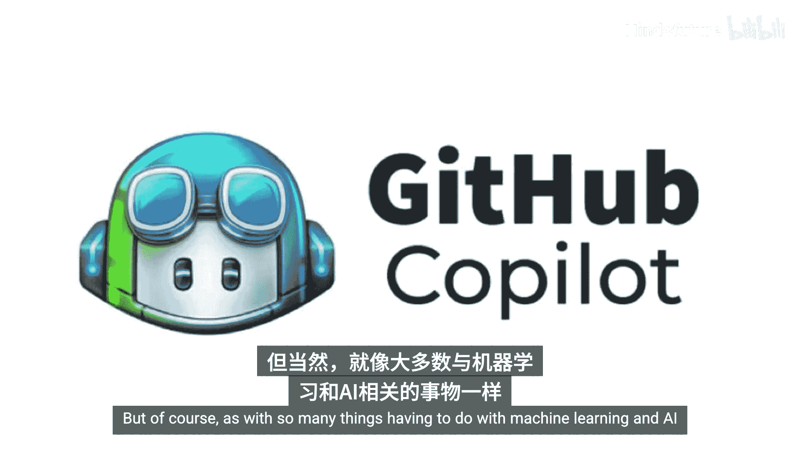
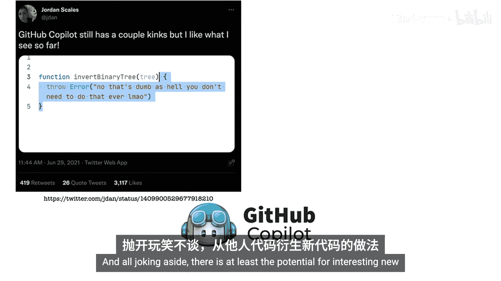
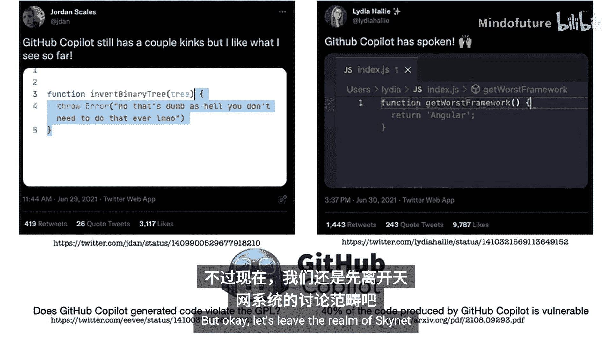
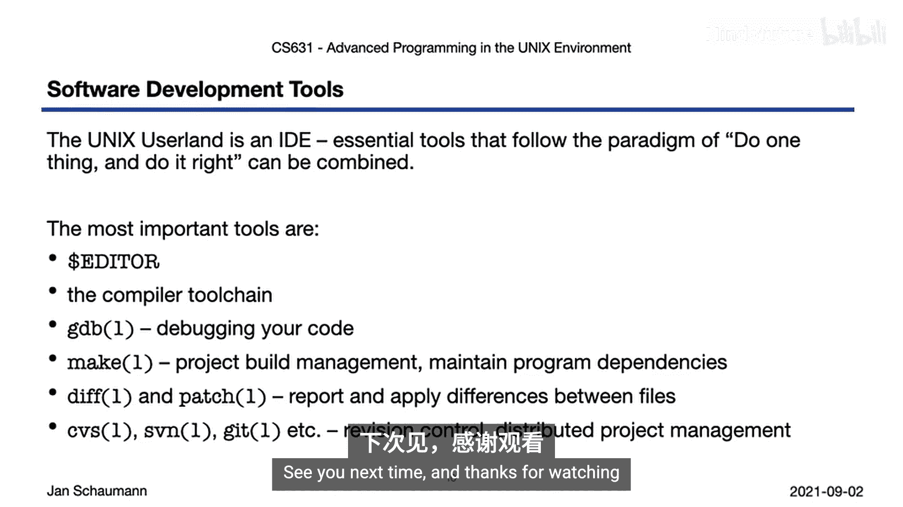

# UNIX高级编程-p24-P24-Week-05,-Segment-1---The-Unix-Development-Environment--BV1hPuVz8EWS_p24-

Hello and welcome back to C S 631 Advance programming in the Unix Enron。 This is week 5 segment 1。

 And by now we've gotten around to writing a bit of code， try to debug a few programs。

 and hopefully got the hang of this whole Unix development thing。😊。

But we want to ensure we use our systems as efficiently as possible。

 And software development obviously goes beyond just writing strange looking characters into a file and cursing that things don't work the way we want them to。

So in this week， well cover a number of different tools that will make your life as a programmer infinitely easier。

And so often， what we learn here can then also be applied in other context。

 and thus is not only tied to Unix or C programming alone。What we cover here should be useful to you。

 even if you are using， say， eclipse on windows。Eclipse is one of the most popular integrated development environments or IDdes used especially but not only by Java programmers。

So what makes for a good I DE。It should probably offer at least an editor。

 which oftentimes supports syntax highlighting of the programming language。

 automated indentation and other formatting tricks。An area where the bugging output can be displayed。

Perhaps a fire browser to load and organize the project's files and maybe a place where documentation can be referenced。

All of this is intended to let you be more efficient when programming。

 and some ideas include additional features like automated code completion。Which recently。

 Gitthub has taken to the next level by providing an extension to Microsoft's visual studio Ie E called Copilot。

 whereby an AI trained on the public code on Gitthub can supposedly help you auto complete all sorts of code blocks。

But， of course， as with so many things having to do with machine learning and AI。

 it doesn't quite work like magic and all joking aside。

There is at least the potential for interesting new complications and dilemmas。

Derived from the concept of deriving code from other sources。 And， of course。

 you have to think about what the input to the machine learning model was。

 writinging code is hard and writing correct code， at least doubly so。

So it really shouldn't come as a surprise that code generated as a result of a large training set containing likely many vulnerabilities。

 Will itself health be vulnerable。But， let's leave the realm of Skynet in the doom of humanity as a result from computers writing themselves。

 Where were we。

Right in the I D。 So Eclipse is an example of an Ide， but notice something when you're writing code。

 what do you spend most of your time on。Thinking in code， writing code， reading code。

But only roughly 30 per cent of your screen real estate here is available for your coat in this single large application。

That is not much in line with the ex philosophy， as we discussed in our earlier videos。

 And I think it might be a bit nicer if your screen real estate could be used more efficiently。

And give you more room for your coat。In a normal Unix terminal， using a common Unix text editor。

 you get a lot fewer distractions。And， of course， depending on what editor you use。

 you can also enable syntax highlighting and get cold completion and all the other goodies as well without sacrificing your concentration in screen space。

😊，But okay， you say that's an editor， not an9E， but I'm going to let you in on a little secret。

The Unix userland is an IeE。The entire O S was designed and developed as an integrated development environment。

 It provides all the independent components as usual individual tools that follow the ex philosophy and do one thing。

 but do that thing well。So to take advantage of this Ide E， this environment。

 we combine our favorite editor。 And note you have the choice of using any editor you like here。

 While in other Ides， the editor will be whatever the Ide E provides。The compiler tool chain。

 consisting of， in our case， when writing C， the pre processorcessor， the compiler。

 the asler and the linker， all of which， again， can be replaced by other implementations。

A debugger to help you。 Well debug and analyze your code。

And a code project built management tool like make allowing you to conditionally rebuil parts of your project tree based on what changed when you edited the different files。

In addition to these， there are also software project management tools that allow you to collaborate with other developers。

 including the fundamental patch and diff tools。As well as code revision control systems such as C V S。

 SV N， or nowadays， near ubiquitously Git。All of these individual tools provide you with a rich development environment for any programming language。

 And since they are small and specifically scoped， they can be replaced with other tools。

 if you so prefer， allowing for significant customization。

To give you just a quick taste of how these tools work together。

 let's look at a really simple example。Here we are opening at a single C file。

 A program we look at in more detail than a future lecture。Now， while we are working on the code。

 we now want to compile the program， but we don't want to leave our editors which windows or have to click on any buttons。

 So instead， we use building commands。That invoke make to build the project。In our case over here。

 that's the execution of the single command invoking the compiler。 But so no， there are errors。

The compiler is being rather helpful here， indicating the file name。

 line and column number where the error occurred， where the function prototy in question is defined and what else might have gotten wrong。

So now， if we had return。We are back in our source code。

 but the editor put the cursor directly on where the error was。

 showing us down here the error output。Now， we can use the editors built in shortcuts to pull up the manual page for the function under the cursor to refresh our memory of how the function should be called。

And when we exit the manual page。We are right back here in the code。

We can fix the first error by correcting the function argument。But remember， there were other arrows。

Now， instead of recompiling the code at this point， we can get a list of the errors displayed。

The first era we just addressed。So now let's jump to the other era。There we are， syntax era。

 a missing semicolon。Once we add that。We write our file and then run make again。And there we go。

 The compiler command is invoked and succeeds。 No errors。Now。

 I know that this was a really simple example。 and B probably still a bit quick。 but don't worry。

 And the following video segments will show a few more details here。

You also want to compare to what we previously showed in the tool tip video for the Ct command。

 as that complements our development environment nicely here。Anyway， so as you can tell。

 your Uni system is itself a fully integrated development environment。

 and well cover each of components shown here in this list in the next couple of videos。😊。

So stay tuned for the next video in this short series on tools that will absolutely make your life while your programming life anyway。

 significantly easier。 If you invest the time to understand them。We'll start with the editor。

 and We'll discuss core functionality required of a decent programme as editor by example of V I slashm。

 but that should translate to any other editor you might prefer。

See you next time and thanks for watching。

Yes。