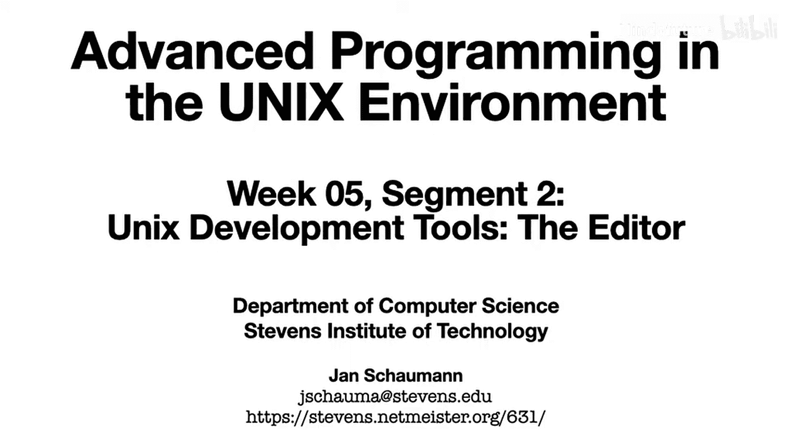
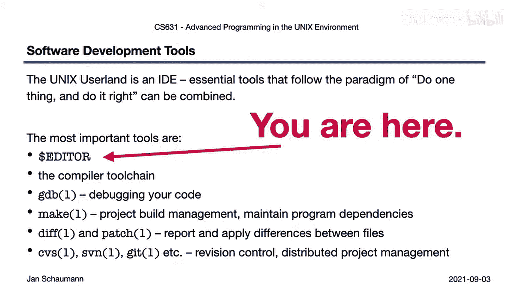
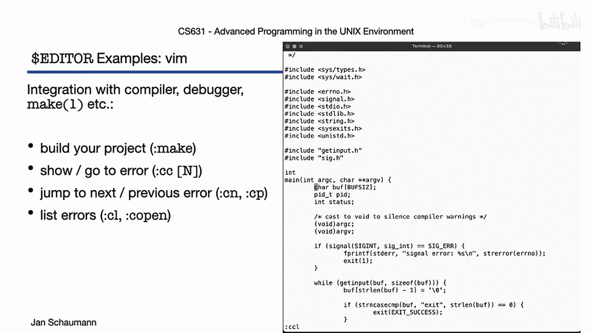
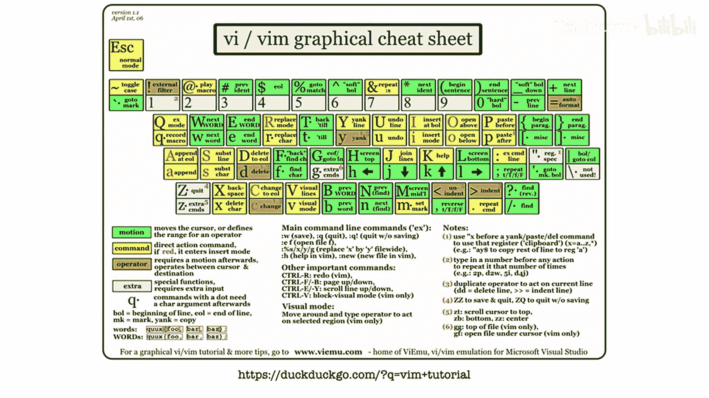
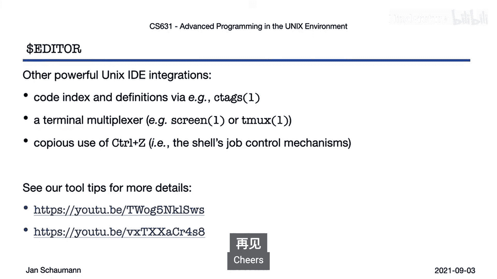

# UNIX高级编程-p25-P25-Week-05,-Segment-2---The-Editor--BV1hPuVz8EWS_p25-

Hello and welcome back to CS631 advancedance programming and the UniX En。That is week 5， segment 2。

 and as promised， we'll begin our discussion of the Unix programming environment as an I D E by looking at perhaps the most critical component。

 the tool that you spent most of your time with， the editor。

To remind you what we set in our introductory video for this week， the Unix user end is， in fact。

 an integrated development environment， and well try to provide a reasonably quick summary of each of these components in this week's videos。

And just for orientation， you are here。 So let's get started。

The code editor you use is your most important tool。 It is where you will spend most of your time。

 both writing code， reading code， staring at code and wondering why it's not doing what you think it should be doing and maneuving through code。

You will be opening multiple files comparing code side by side， copying code and formatting code。

Every programmer has their favourite editor， of course。

 many holy wars have broken out on the Internet about which editor a real programmer should use。

But I'll let you on a little secret。 It doesn't matter。 Use what works for you。

Use the tool you like best that you are most comfortable with， lets you be the most efficient。

Just make sure you know your editor well that you learn what it's capable of。

There's a number of core features that you should take advantage of。

 including things such syntax highlighting for the different proing languages you use。

Efficient keyboard operations， meaning you do not need to move your hands off the keyboard to do your work。

Using the mouse or touchpad to click tiny icons and select options from deeply nested menus takes not only time。

 but leads to a mental context switch。 Use keyboard shortcuts instead。

You want to be able to mark and jump around in your code based on markers。

 you may want to set and use multiple buffers to copy Ynk fold and otherwise juggle code selections or blocks。

You need efficient search and replace functionality。

Want to be able to display multiple code windows side by side or in any other configuration you might want。

Your editorer should offer some level of order completion for standard function cards。

 constants and even repeat code blocks。Let you easily look up the documentation for the library or API you're working on。

And allow you to filter input through external commands。

All of these are basic features of a good programming editor and functionality you want to get a handle on。

 Even if you already have a preferred editor， make sure you do not lazily work around what you don't know and instead invest the time to follow a good tutorial on the ins and outs of your editor。

Now， let's take a look at a few specific examples of operating and using a decent programming editor efficiently。

I'll be demonstrating some core functionality by example of them。 Many。

 but not all of the functionality shown here will also work for plain V I。

And other editors will have functionally equivalent capabilities。First。

 let's talk about moving around code without using a graphical interface。That includes moving up。

 down， left and right using the H， J， K and L keys， which are on your touch type home row。

 So you don't need to move your hands away at all。By the way， the reason that we ended up with H J。

 K and L as the arrow keys in Vim is that vim is derived from V I。 And V I was written by Bill Joy。

 who happened to develop on a terminal that had had a keyboard， and that looked like this。

Note how this keyboard had the arrow keys placed right here on the home room。

So that's why we to this day， use H to go left。 J to go down Kto up and L to go right。Oh。

 and note this key up here in the upper right。That's the home key。

 which also has the Tilde character， which is why we use Tilde as a shortcut or reference for the user's home directory。

Anyway， so in addition to simple movements， we can jump around by words。Search forward or backwards。

 Go to the beginning or end of a line。And page down and up using C D and B respectively。

To center the current line in the middle of the screen。

 we can use Zz or use the T ZB to place it at the top or bottom of the screen。

We can move around within code blocks and jump to the beginning or end or flip through multiple files back and forth。

So what does all this look like， Let's illustrate by example。

Here we are using the code example from our Ct tool tip。

 It is a variation of the simple shell code example from our very first class。

As I go through the example movements， you will see the key combination pop up in the bottom left。

Okay， let's see。First， we're using C D to page down a few times。Control B pages up。

Controrl D pages down。Now we're on this line over here。If we want to jump backwards。

Then we can hit shift B to move backwards by wide space boundary。Or shift W to move forwards。

Lowercase B moves us backwards by word boundary and lower case W forward in the same manner。

Writing code often makes us want to jump between code blocks。

 and one convenient way to do that is to use the jump to paragraph keys。If we had open Bra。

 shift and open record， we will jump backward， one paragraph or code block。

While closing brace will move us forward one paragraph or code block at a time。

But we also differentiate cold blocks， not just by white space。

 Sometimes we want to know just within what large or logical block we are。For that。

 we have a key combination of open bracket， open brace。

Which gets us up here to the opening of the while loop。

Jumping forward by block as we did and then moving up line by line。By a hitting K。

We end up over here。Now， were inside a different block。

 So bracket bras places us at the end of the if statement。

Note that Vim automatically highlights the matching closing brace here。

 and we can easily jump to it by hitting percent。We can move forward。

 jumping to the end of each word。And present again to the matching closing bra。

If we know where we want to go， we can use search。 For example。

 I write my function such that the function name is at the beginning of the line。

 so I can easily jump to any function by searching for the beginning of the line followed by the name。

But now I'd like to see a bit more context without having to scroll the window up and down。

 So I'll send him my display around the current position of the cursor by hitting Z Z。

I'd like to see the function prototype of the get input function， but that is in a different file。

 the get input header。I don't want to lose my context。

 So instead of closing this file and opening a new one， I split my current window。There。

I can keep that split window open and return back to the bottom window by hitting control W twice。

Now， I'd like to view the while loop。 So let's align the display at the top。By hitting Z T。

We can close the upper window。Go to the end of the line by using dollar。

Jump to the end of this block via presentend。And then align this code block at the bottom of the display。

 using Z B。Okay， so these were some examples of some of the most basic motion commands。

Don't worry if you didn't keep track of all of these。Them has a detailed built in manual here。

 Let's take a look at help motion dot text。Inside this held window。

 all the common vim functionality works， too。 But this also adds something you have illustrate。

 we haven't illustrated yet。 jumping to a different files by a special anchors。

Here in this help section。If we want to look at text， object motion。We can move to the index word。

 on the right。And hit control， closing bracket。Which jumps us to the relevant section。

Here we see some of the motion command we just discussed and we can return to where we came from using C T。

So make' sure to consult the manual when you forgot how to move around。

 or if you're thinking to yourself wait， there's got to be a better way to move within my code。Now。

 with basic motion under our belt， let's cover a few common editing tasks。

In order to efficiently jump between arbitrary places in the code， we can set a marker to return to。

And we have to move code around can be helpful to highlight and select blocks。

To indent or format them automatically and to delete or copy sections into a temporary buffer。

 then to pull the code out of the buffers again。When we working with large blocks of code can be useful to height some logical blocks。

 or a few select lines without actually removing them。 For that， we can use so called folds。

 And when we are writing code， we may want to ask our editor to autocomp or at least suggest options。

Again， let's look at a few quick examples。Will use the same code as before， to illustrate。First。

Let's have our editor display line numbers。That can be useful。There， that's better。Now。

 let's go to line number 38。Let's assume that we are working here in this spot right now。

 So we probably want an easy way to go back here。 Remembering line number 38 isn't too difficult。

 but we can also instead set a marker。To do that， we use the M key followed by the marker。 Here。

 we use M A to create a marker。Now that we have decided that we would like to move the code block and storing the signal handle around。

We go up。Hit shift V to entervis mode and then can highlight and select lines like this。

To cut this code block， we can simply delete it。 Heading D will remove the visual block and place it into the default buffer。

After that， we can go up to where we want to enter the code and simply hit P to paste the contents of the default buffer at the current cursor position yea。

Okay， so now to jump back to where we were， let's use our marker。 Remember。

 we had set marker A at line 38。 So hitting apostrophe A will jump us back down there。But。

Let's say we decided that moving the code around was a bad idea。 After all， which， of course。

 now manually reversed the changes as Spdum also has a handy undo functionality。 So let's use that。

You to undo the pasting。You to undocu the code block and we back to where we were before。Now。

 let's go back down here into our while loop。Let's say。

We want to fault the code block involving the if4 blocks here。Let's say a second marker at the end。

 say marker Q。Then jump up to the beginning of the F。In order to hide the code block here。

 we can now create a fold by hitting Z F。Folds can be created from any place to any other place and follows your movements。

We will simply create a fold from where we are to the end of the elses block。

 where we had set the marker。So， if we then。Hit apostrophe Q。

 then will hide the lines of coat in question。Like so。Note。

 and we can maneuvver around the fold using our usual motion keys。Okay。

 so now let's insert some code here。 specifically I'd like to add a test to see if the user entered the special shell built in exit to allow them to exit our a shell。

Let's start。Tap up。Hm。How shall we start。If we hit control N， then then we begin order suggestions。

The first time it correctly guesses that if might be a good start。 So let's use that。Next。

 we know we need a string comparison。 but which one。Let's start with SR， and hit control N again。

Mss your end case compare。 Sure， why not。Let's compare our buffer to you。Exit。Es T。 Olen sounds good。

There。Now the user can exit or shell without having to feed in and or file。Next。

 let's look at the code in full。 So we unfold this code block by moving our cursor into the fold and typing Z A。

Looks good。Let's write the file。O。So now we made a change to our code。

 So we want to build the executable again。Let's see how our editor allows us to do that without having to leave it。

A good coding editor integrates with your other development tools。 Remember， Unix is an IdeE。

So we should be able to run our compiler or thebuggger and build our software from within the editor。

For that， we will take a look at the make functionality that by default will， as the name suggests。

 run the make command。And look at how we can address any errors the compiler discovered using different shortcuts。

Let's start by typing colon make。So our edit window disappears。

 and we get the output from the main command on the shell。

 This shows us that theres some error somewhere when I try to compile the file， get input dot C。Now。

 reading the error messages here， we can determine just what went wrong。

 We need to fix something in that file， get input dot C。But we were editing simple She at sea。

Fortunately， we don't have to exit that file。 If we simply hit return here。

Then Vim puts us directly into the right line and column in the right file where the first error was encountered。

 nice。But wait， by now I already forgot what exactly the error was。Oh good， it's shown down here too。

On， that's a bit truncated。 Let's get the full current arrow by hitting C， C。Okay， that's useful。

 implicit function declaration。 Let's fix that。For the implicit function declaration。

 we need the right header。And what is the correct header for the printer function。Let's look it up。

 using the manual pages。If we had shift K on a function name and vim。

 it will automatically bring up the manual page。 So let's give that a try。H wait， that's printf。

 but it's the She command， not the library function。That doesn't help us。Remember。

 shall command or documented in Section 1 of the manual pages， library functions in Section 3。

Let's exit this manual page of view and then try again。 this time typing 3 K。There we go。

Now we are in section 3 of the manual pages and get the correct documentation of the library function。

 which tells us that we need to include the standard I O header。

Let us quickly check what the errors were that we saw by bringing up the full error list， using C， L。

HaLook at that。 The compiler even told us the right header。

 If only we had paid attention to the error messages。

So it looks like it might be useful to keep the error messages visible and not have them disappear。

 So for that， let's call C open。And we get the error output in this little window at the bottom。Now。

 we can fix the right header， include up here。Write the file。And run， make again。Oh， no。 again。

 we have some errors， but at least we see that we fixed everything that was wrong in get input do C。

The next error is in Si dot C。 So let's go there。All right。 Vi does that automatically for us， neat。

And note that it also automatically updated the error output window down here。

So we can add the missing quotes at the end of this statement and try again。Damn， still some errorss。

Oh， look， we're missing an argument。 Let's add that to。Try again。Okay。

 fix that and another error pops up。Now， we're in a simple sheed C file。Oh。

 looks like we miss type buffes。 Let's delete the extra F here。But wait， what exactly is buffes。

 Where does that come from。We can try to jump to the definition of this constant by using control closing bracket。

 just like in the Ven manualuel。Oops， we didn't save our changes。 Let's write them。

There now control bracket brings us to the definition of bes and control T brings us back again。Okay。

 let's try to build our code once more。There we go。 No errors。

E they compiled as anticipated so we can close the quick fix window。All right。

I think this quickly illustrated how nicely the editor integrates into the environment and allows us to efficiently write our code and fix errors identified by the compiler。

 Of course， there are thousands of other things you can practiceracise。

 And I'll take some time to get the hang of it。 I recommend that you look up and follow a good tutorial for your preferred editor。

 as I said earlier， V I of them are just one example。 I happen to use them because they ubiquitous。

 I never have to worry about whether my preferred editor will be present at any given system。

 But if you have another preference。 that's perfectly fine to you。

You should find that any other good editor offers very similar functionality。Finally。

 there are many other integrations of the error with development tools。

I've covered two of those in separate videos， the Ct utility and the screen multiplexer。

Check out the videos on our course website or this YouTube channel playlist and practice working with your editor。

In our next video， we'll cover the default compiler chain and how we get from C code to the executable。

Until then， thanks for watching。Yes。

