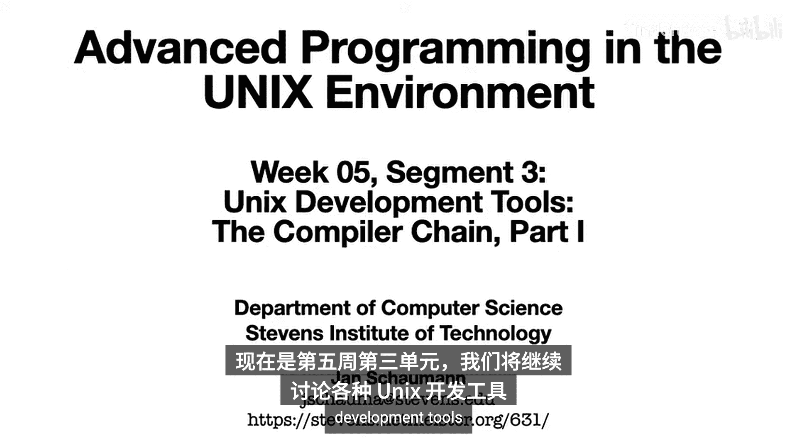
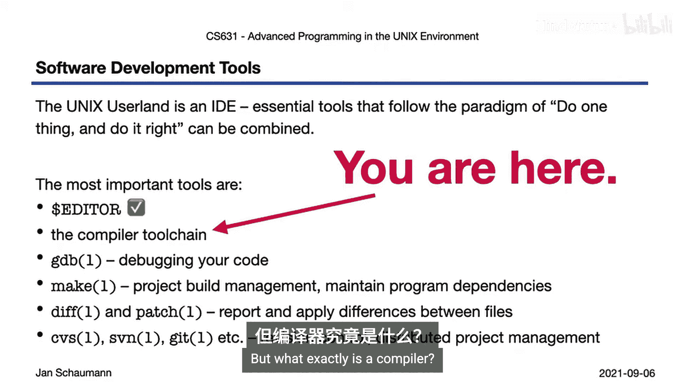
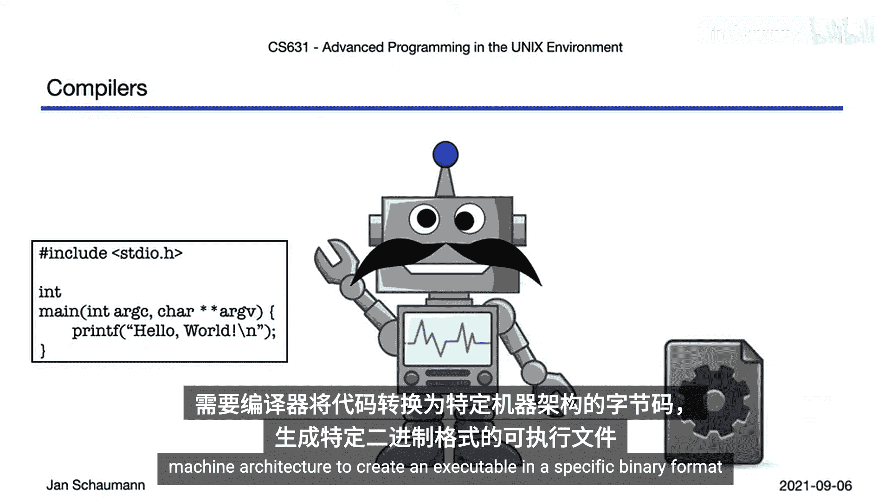
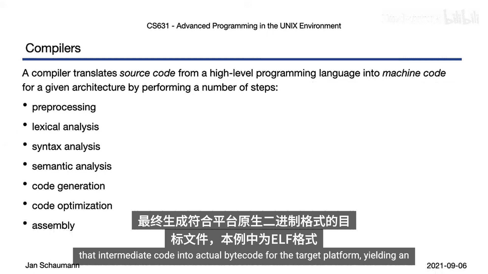
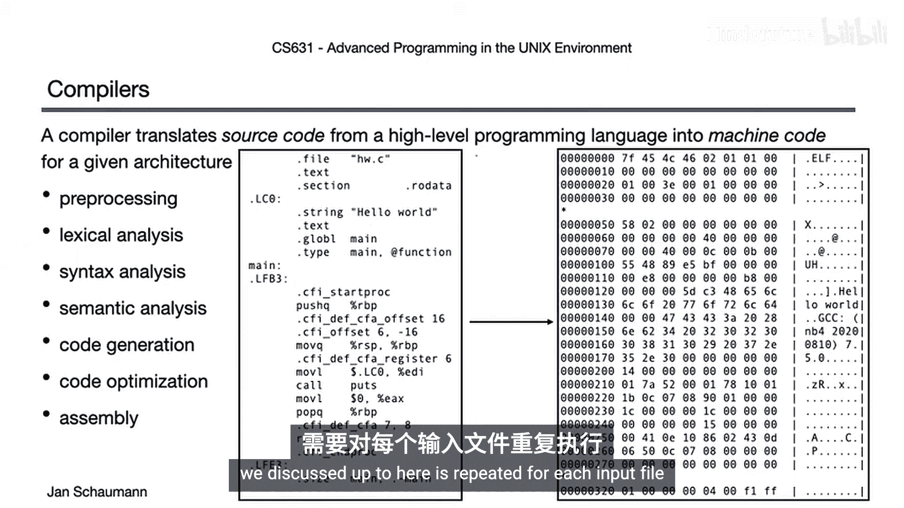
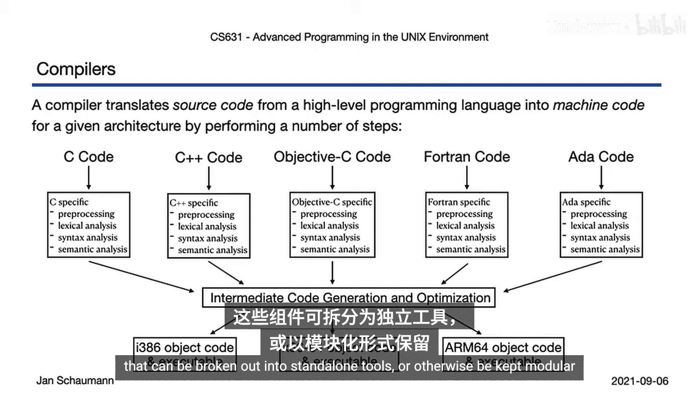
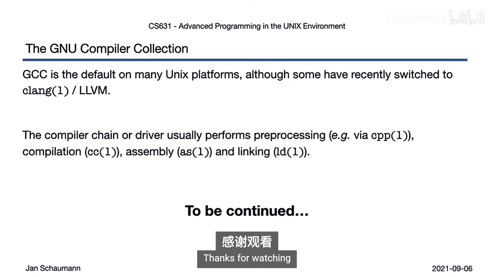

# UNIX高级编程-p26-P26-Week-05,-Segment-3---Compilers-(Part-I)--BV1hPuVz8EWS_p26-

Hello and welcome back to CS631 Advance programming in the UniX Environment。This is week 5 segment 3。

 and we continue our discussion of the various Uni development tools。

 moving on to cover the compiler tool chain。

The various tools in the Unix environment allow us to combine and integrate them with one another to build up a coherent development environment。

 In our last video， we provided a quick summary of the core functionality of your editor。

We're now going to take a look at the compiler tool chain itself。

 a collection of commands and executables that are combined and together provide us with what we commonly and simply call the compiler。

But what exactly is a compiler？

Unlike with an interpreted language， we know that when we write code in a compiled language。

 such as C， we need the compiler to translate our code into byte code for the given target machine architecture。

To create an executable in a specific binary format。

More specifically， a compiler translates source code from a high level programming language into machine code for a given architecture。

We can have different compilers for different source languages。

 and they may be used to generate different code for different target architectures。A few years ago。

 anybody graduating with a degree in computer science would have taken a class in compiler design and written one of these for a small。

 simple language from scratch。In case you haven't done that， or if you have， as a reminder。

 the task of a compiler is generally broken down into a set of distinct steps。

Starting with basic pre processingces of the input。

Many programming languages allow you shortcuts of defined macros or constants or to pull in code from other files via a syntax that is not strictly speaking valid in the given programming language。

For example， take this simple program。Here we have a trivial program。

 but not the first two lines and include statement and a constant definition。

During the pre processing stage， the compiler or the standalone preprocessor program will expand such macros in pulling code from the given header files。

 Thus providing most importantly， the various function forward declarations， as illustrated here。

The pre processorcesor will also replace an defined macros。

 whether those are defined in the input file itself or from any of the included files。

 turning our print statement on the left into the one on the right。

After we have thus pulled in all the code we need to actually compile the program。

 we then enter the next stage。Lexical analysis。That is。

 the compiler has to parse the given input put source and break it into individual tokens。

For example， a statement like this might be analyzed and broken down into a language specific keyword。

A token， a variable identifier， an operator， a number， another token， another variable identifier。

Another token。A string。 and a final do。As you can tell。

 this sort of lexical analysis also allows your editor to perform syntax highlighting， for example。

Once we have broken up the input into tokens， we can then perform syntax analysis。That is。

 we can try to see if the sequence of tokens we have been given even makes sense based on the programming languages synt grammar。

For a simple statement like this， this stage might then catch errors if we forgot joining semico or entclo our parenthses。

 for example。The compiler then builds an abstract synt tree representing the statement。

Which then allows us to perform semantic analysis。During this phase。

 the compile checks not just whether the basic syntax is correct。

 but also whether what we wrote there makes at least some basic logical sense。 For example， suppose。

 instead of， if none greater 42 message equal， we had written。If message greater 42， nu equal。

 then the semantic analysis of this abstract index tree would go ahead and say that， sure。

 the overall logic of the F statement seems right。But that trying to compare a string to a number does not make sense here。

 and neither does try to assign a string to a variable of type int。 So it's going to throw an  error。

If everything checks out though， then we move on to code generation and in many cases。

 code optimization。That is the compiler may be able to improve the efficiency of your code by， say。

 optimizing loops， reducing the evaluation of statements such as loop guarding invariance or removing statements with more effect。

Eliminating redundant statements。And that coat。 so that the coat on the left is turned into the coat on the right by the compiler。

Some optimizations are machine independent， but some other optimizations may depend on the target architecture。

 which is why generally the code optimization takes place after the generation of intermediate code。

Either way， at the code generation stage， the compiler turns our lovely C code over here into an intermediate format。

 say assembly。So now what do we do with this coat。Well， not surprisingly。

 we'll have the compiler perform the actual assembly of that intermediate code into actual bycode for the target platform。

 yielding an object file in the platform's native binary format， Elf in this case。

This series of steps is performed for all the input files。 Remember。

 most software projects consist of more than just a single source file。

 So everything we discussed up to here is repeated for each input file。

We then end up with a set of object files that need to be linked together with the system libraries to create the final executable。

 This usually involves the help of another tool。 The linker。

 which is invoked by the compiler during that final stage。

 and which knows where to look for certain library such as the C run time。

 the Senateed C library called Lipsy and so on。All that together then finally gets us the executable from our input program and completes the series of steps performed by the compiler。

Now， if we look at all these steps， we may notice that they fall into different categories。

 For example， all of these steps up here are necessarily programming language specific。

 That is the pre processingces and the analysis of the code。

 the building of the abstract index stream and assurance of semantic coherence all depend on the programming language in question and will differ if you're using C。

 or if your input source code， the C plus plus or go， perhaps。However。

 once you're past that stage and you're generating intermediate code。

 then that is no longer programming language specific。

 your compiler can conceivably support multiple programming languages via distinct front ends for the different program languages with the same code generation engine。

Finally， the last few steps here were no longer programming language specific now are platform specific。

With this， depending on what the target machine architecture is。

 your compiler will need to generate different output。Here， let's illustrate this。

Let's imagine a compiler that supports multiple programming languages。Obviously， there's C。

 And if you support C， adding support for C plus plus doesn't sound like that much work。

Likewise for objective C。But we can go one step further and add support for other languages that are not like C。

 say Forttran or Ada。Your compiler would need custom code to properly process and analyze each of these different input source code types。

But you can then have codegen and even parts of the code optimization be done in pretty much the same manner。

 while depending the target machine architecture， you would have to generate different types of binary code for I386。

 x8664 or arm platforms。So in a way， your compiler itself is comprised of different components that can be broken out into standalone tools or otherwise be kept modular。

Since programming languages like C are standardized。

 there are a number of different implementations of compilers that includes both commercial and closed source products。

 as well as open source compilers。Some of the more well known compilers are the included C compiler or ICC。

Bland's Tobo C compiler and Microsoft's Visual C++ compiler。

These three examples are commercial close source compilers that you can purchase。

 and they may be available only as part of the integrated development environment rather than as standalone tools。

The more commonly known open source compilers include Klang。

 the C C+ plus an objective C front end for the low level virtual machine or LLVM compiler tool chain。

Cang has in recent years become the default compiler for the freeBSD and Open BSD operating systems on the M64 and I386 platforms at least。

 as well as on Mac OSOS。On these platforms， Kang thus has replaced the other most popular。

 most widely used open source compiler。GCC， the new compiler Collect。

Note here that this name makes explicit， this is not just the new C compiler。

 but a compiler collection supporting multiple front ends， as well as target architectures。

GCC is still the default compiler and most Linux distributions， as well as on netBSD。

 which supports many hardware architectures and platforms that Kang， for example。

 does not offer support for。In our class we therefore use GCC as the default compiler。

But there are other open source compilers as well， for example， PCCC， the portable C compiler。

 which you can install on different Uni systems from their respective package management systems。

PCC was one of the earlier compilers written in the 70s at Bell Labs and reeiveed in the mid 2000 to support modern C standards。

Many other compilers exist in addition and it can be quite useful to try to build your projects using a different compiler from the default。

Many compilers including GCC add or support custom extensions to the language。

 and if you want to write portable code， it's good to know what those are and when to use them as well as when not to。

Having a second compiler installed therefore can help you catch non portable code。

 it can also be interesting to see whether one or the other compiler generates more efficient executables and what types of optimization each one applies。

As theH major， this may be a topic of interest or research to some of you。Now， as noted。

 we' will be using the new compiler collection in this class。

 The set of tools allows you to invoke just a single command。

 C to compile your code and create an executable。But that command is actually a driver that invokes different tools to perform the various steps we just discussed。

We will looking at the details of each of those stages and each of the tools mentioned here in the next couple of videos。

Until then， perhaps take a look at the manual pages for the different tools。

 You'll find that there are literally hundreds of options and flags that are supported。

 which may give you an idea of the complexity of the compiler， but fear not。

 well identify and cover at least the basics。And with that until the next time。 thanks for watching。

 cheerith。

