# UNIX高级编程-p27-P27-Week-05,-Segment-4---The-Preprocessor--BV1hPuVz8EWS_p27-

Hello and welcome back to CS631 Advance programming in the UniX environmentviron。

This is week 5 segment 3， and after we cover the general functionality of a compiler in our last video。

 we'll now take a look at each of the different stages in practice。

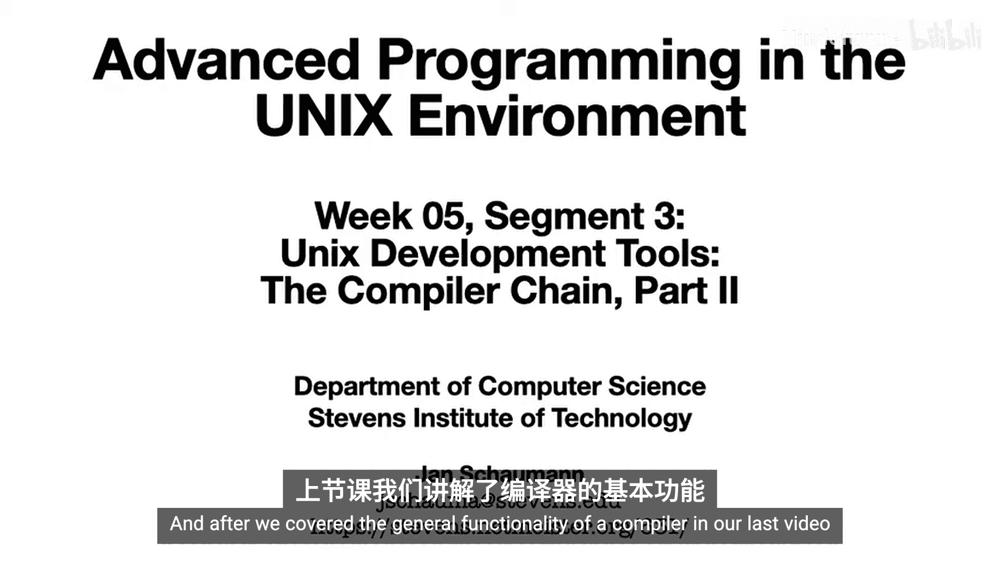

Remember， the compiler is a tool or other， as we'll see in this video。

 a set of tools that turn programming language source code into an executable for a given machine architecture。

Isn't it nice to have a helpful and mustachioiooid fellow like this to help you out。

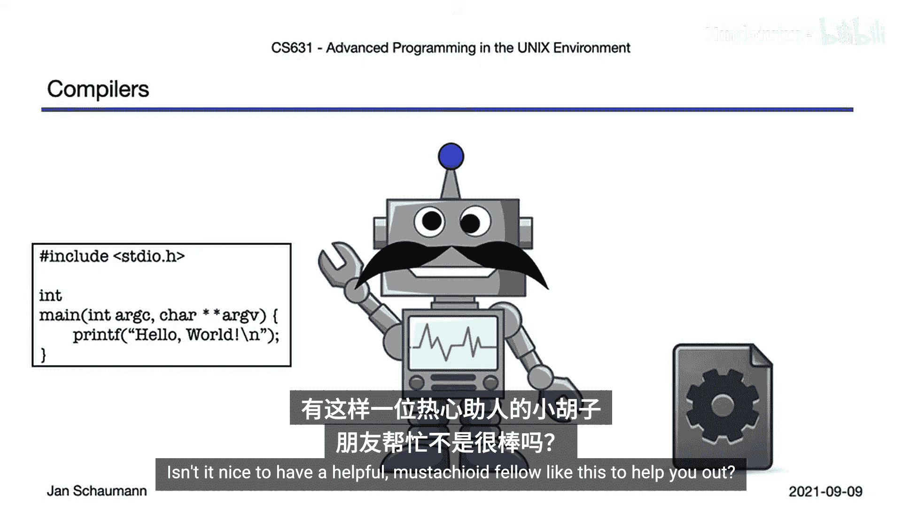

So let's take a look and see what's inside our little friend here。As we mentioned in our last video。

 a compiler actually performs a series of steps， which in the case of the new compiler collection or Gcc。

 is itself broken up across multiple standalone tools。Theres pre processing。

Convalation proper with all its lexical syntax and semantic analysis。Assembly and linking。

Pre processing， as we briefly illustrate it， takes our sourceos code and expands it according to certain rules。

Let's now illustrate this in detail， and by example。

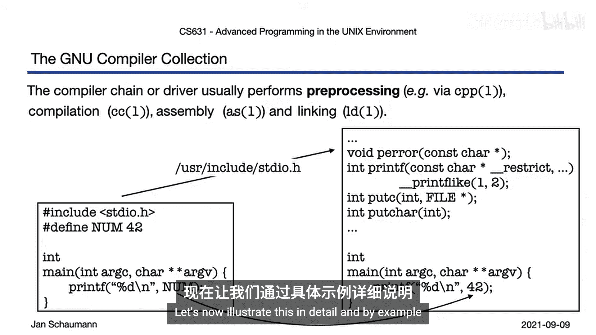

Here we have a file， hell loaded C that looks like so。We are calling Fguan from Maine。

Funk1 calls Fk 2， and Fk 2 simply calls printf。This will then inform us about which particular food item is especially delicious。

We're using the preprocesor directive， if def， defined to illustrate how a CPP may expand this code。

Okay， so first， let's just compile it using C there。Now， we know Avocado is great on anything good。

This is because we had not provided a definition for food。

 So the default definition was used instead。How did Cy do that。Let's take a look at the manual page。

Here， we see confirmed what we had previously mentioned。

 A compiler performs the different steps in order using different input files at each stage。

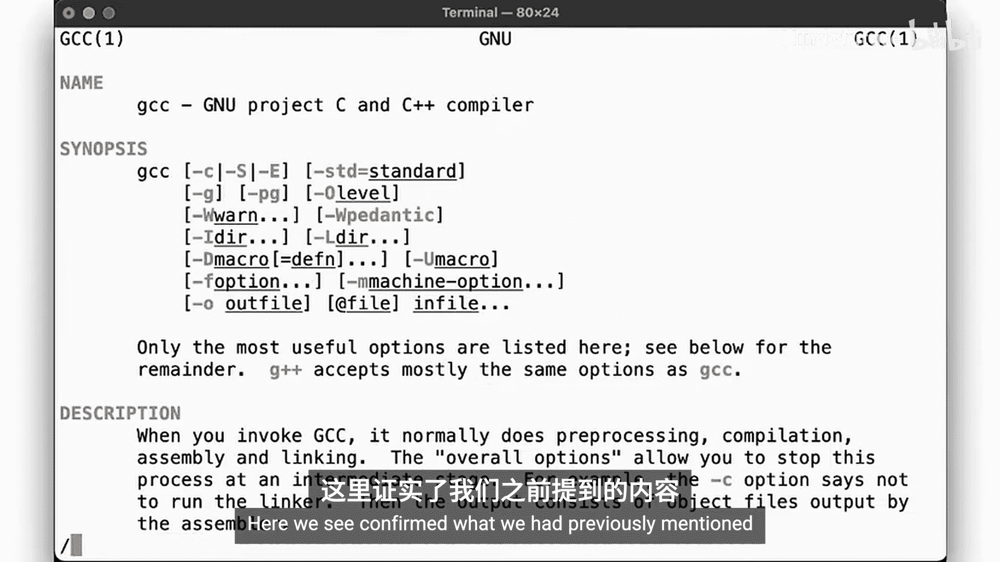

But we had also mentioned that pre processing is actually performed not by C。

 C and by the CPP command， the C preprocessor。C， P， P is automatically invoked by C C， as noted here。

So what does that look like。

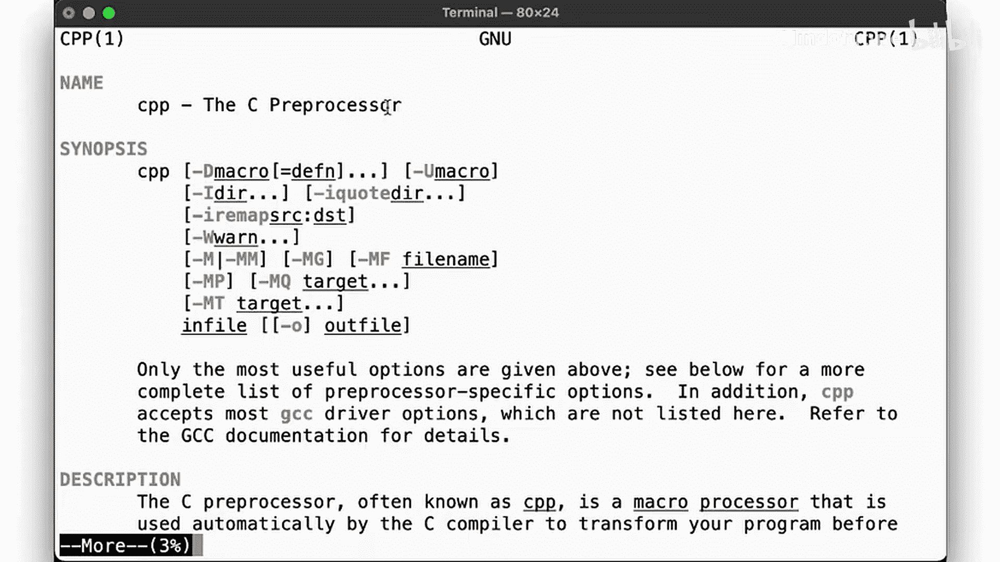

Here， the first display are a source code with line numbers。

We see preprocessed directives on line 21 to 23， as well as on line 19。Now， let's run CPP。There。Okay。

 that's a lot of output all of a sudden。 But our basic sea code remains in place。Now。

 let's scroll up a bit and we see a whole lot of code that we never wrote。These lines are。

 as you probably recognize the forward declarations of the various functions from the standard Iio Heophile。

See over here， we have printernda， for example。Let's run this command again and start at the top。

The C preproor tells us which files its reading。It then shows us that on line 19 of Hello dot C and then pulled in the file user includes the netioor H。

 which in turn appears to have an include statement on line 40。For C depth do H and so on and so on。

So in this way， the preprocesor iterates through all the files and pulls in whatever is found in those headers。

And so we then get the various type and function declarations here。

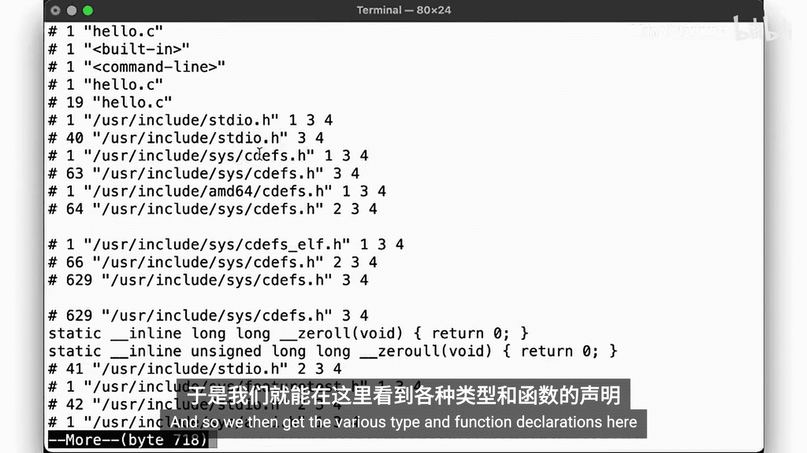

We can instruct CP to leave out the annotations using the D P flag。

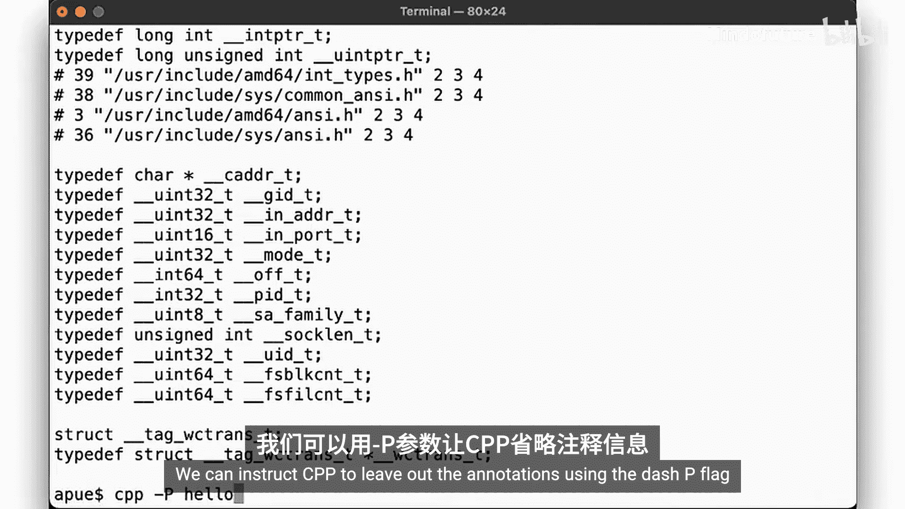

And the output then looks like this。Type tipss andstructs and function prototypes。And， finally。

Our original sea code。A loaded C is obviously a sea source code file。

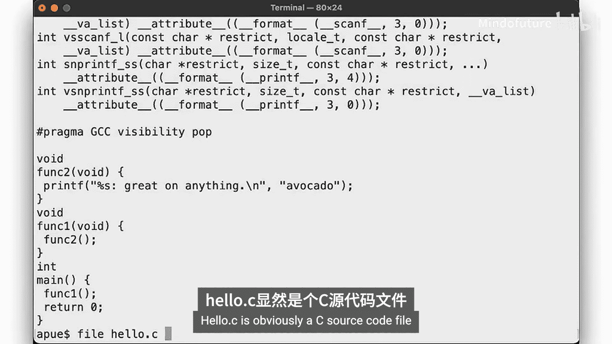

The output of the C preprocesor stored by convention in a file ending in dot I is also C source code。

But the difference here is that Ho dot I contains a lot more sea code。

It contains all the code included from the header files。So it' an easy 10 times at large。

So now can we actually just compile that dot I file。Let's give it a try。Yep， that works。O。So far。

 so good。Now， we know how the include statement works。What about the defined statement。

Note that over here， our output of CPP no longer contains any if F statements。 And instead。

 we see the bare string avocado over here。What happens if we define a different food。

Let's say tomatomato。Look， there it is。But note that this is a bare word， not a string。

We need quotes here。Let's try again。We need to escape the courts here。

 since our show would otherwise eat them and it processes to command prior to execution。There。

So let's see what the differences between our original and this output。There， just that one word。

But do note that we did indeed replace food in place at pre processingces time prior to compilation。

That is， we are changing the actual source code and replacing any occurrence of food with tomato。

The simple replacing means that whatever we define needs to be syntactically correct anywhere it appears。

 which is why we needed to include the quotes in the definition。Okay。

 so now this will produce a program that says tomatoes are great on anything。

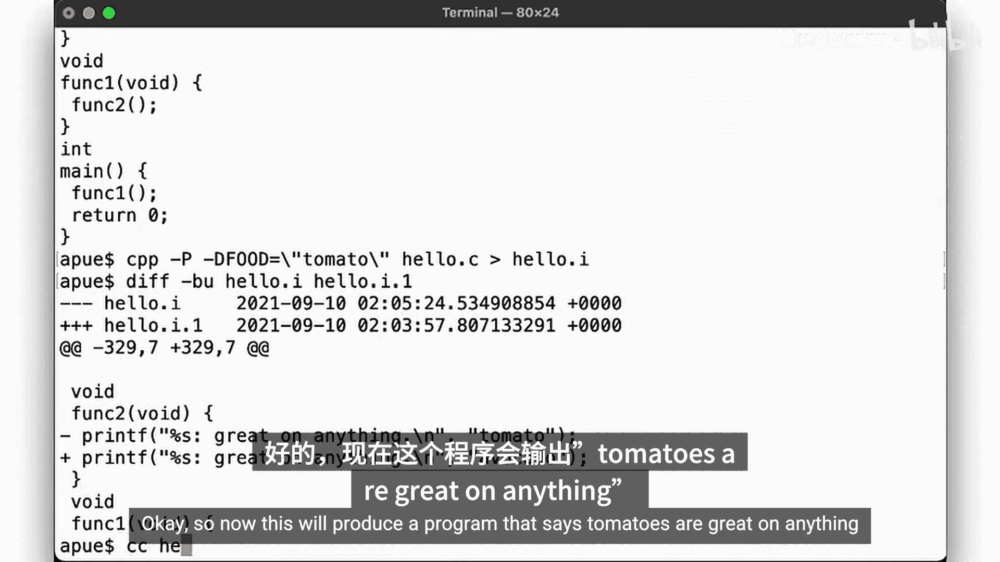

But we never invoked CPP before。 We always only run C。Can we see what C， C does at each stage。

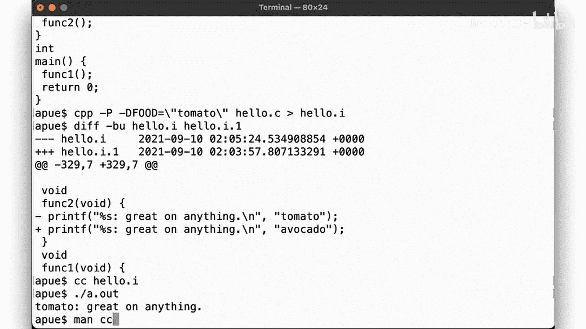

There， if we pass the D E flag， then C C will stop after invoking CPP。

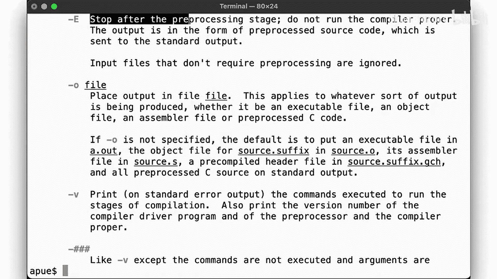

Yep， that looks just like before。Now， let's add the dash V flag to the combine。

 So it shows us exactly what it's doing。We'll ignore the actual output and just look at the compiler's messages。

When we add the dash V flag， the compiler showed us all the details about the execution。

 What version， how it was built， et cetera。It also shows us the compiler flags it used to run。

And there we see that it will use D E， as we had asked it to。But note that it also uses dash wall。

 dash W E， etc ce。We hadn't specified those。 Where do those flags come from。好。Remember。

 when we had set up our virtual machine， we had configured our shell to use an alias for C C。

And we had also added some default C flags to our environment to ensure that whenever we run C， C。

 it will use those flags。So that's where those come from。Let's just unset those， for the moment。

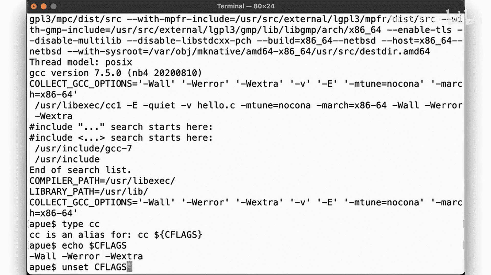

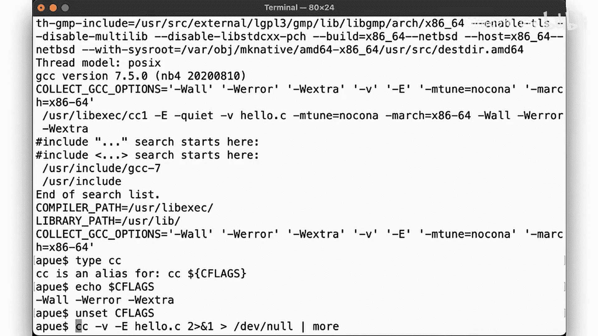

Yep， there we are now， without any of those flags。Except there are some flags we hadn't specified。

 which appear to be default or built in for this compiler。

This allows the compiler to use machine specific options to optimize the code by default。But okay。

 so we run with dash E， and our pre processorcessor now has to find the included headers。For that。

 it uses this path over here， meaning when it sees includes in an Iododet age。

 it will first look in this directory and then under user include。Okay。

So I we're kind of grade than anything， we know。How do we get that to change again。Just like CP P P。

 the compiler also takes a flag named D Ded so that the following will work too。

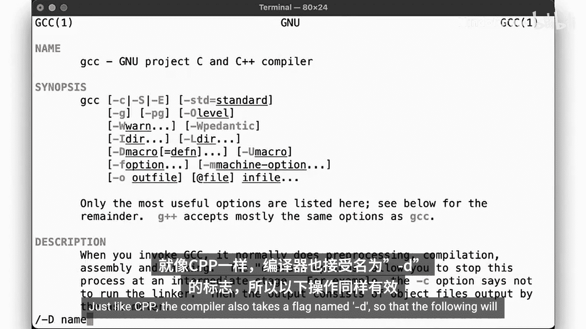

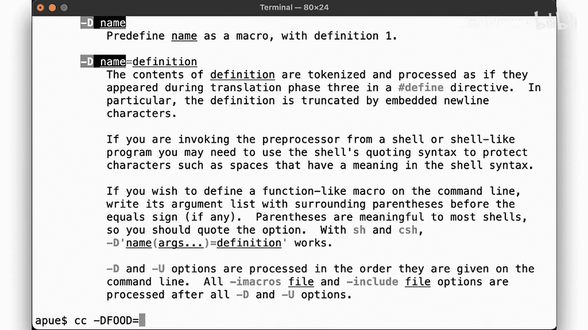

Now， once more in ver bothse。

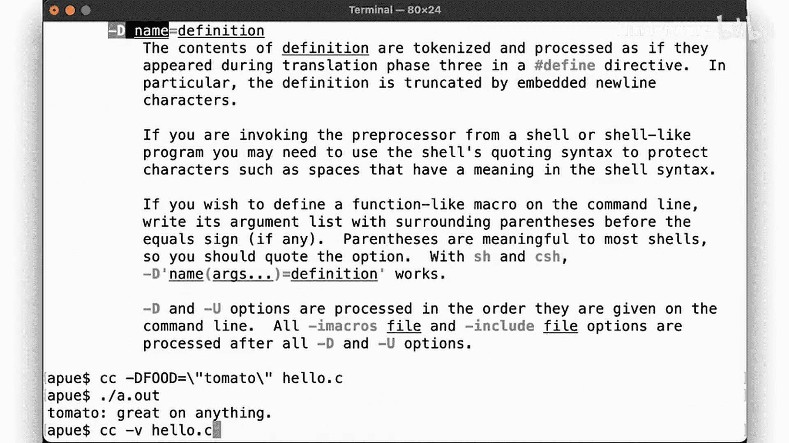

We see the compiler performing all steps， invoking the preproces implicitly。

And then performing compilation and code generation into a temporary dot S file under slash temp。

It then invokes the A S command on that file to create a temporary dot O file。And finally。

 invokes the Lier L D to create the executable。Okay。

 so we observe the first stage of the compilation process， pre processingces via CPP。

We can manually invoke the preprocessor ourselves， if we like。

 It will produce C sourceco without any preprocessor directives suitable to be compiled in by convention written to a file ending in Donai。

We saw that we can define macros or values using the dash D flag。

 both to the preprocesor or to the compiler driver C。

That means that some flags pass to C C may be pass through to the different tools it might invoke。

We'll see other examples of that， in future videos。Finally。

 if we want to observe exactly what the compiler does， we can pass the dash V flag。When doing that。

 we saw the different stages and different tools invoked as Norra de Buff。Now。

 after having covered the pre processing stage of the compilation process。

 we move on to the compilation and code generation。So stay tuned for a next video in the series。

Until then， thanks for watching， cheer。

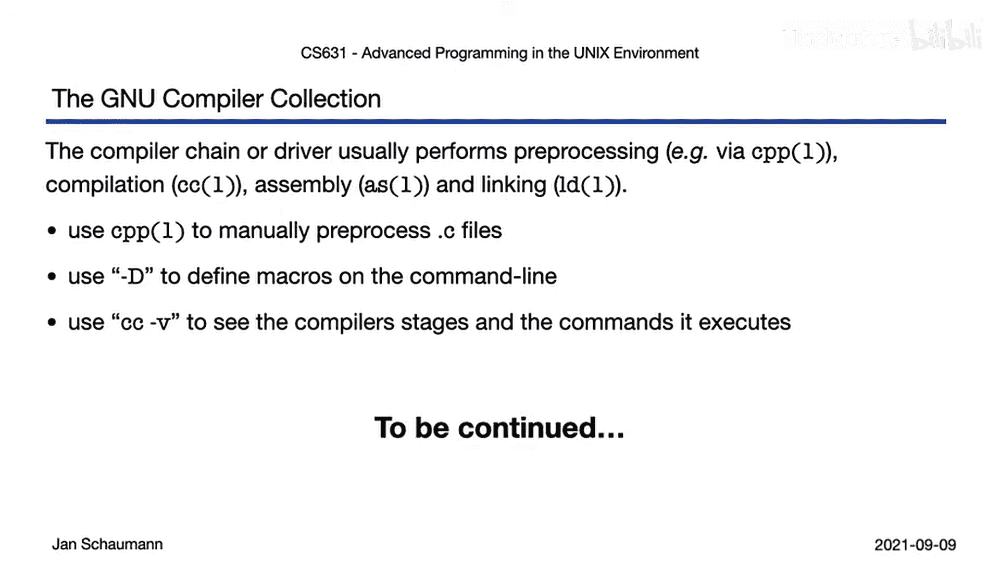