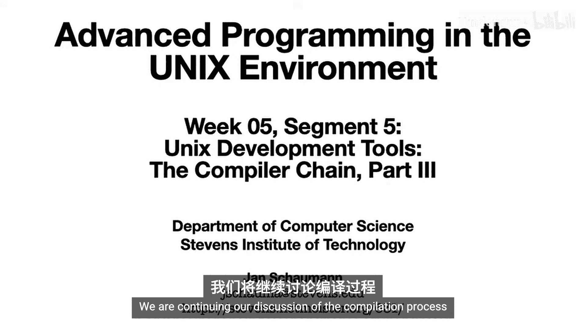
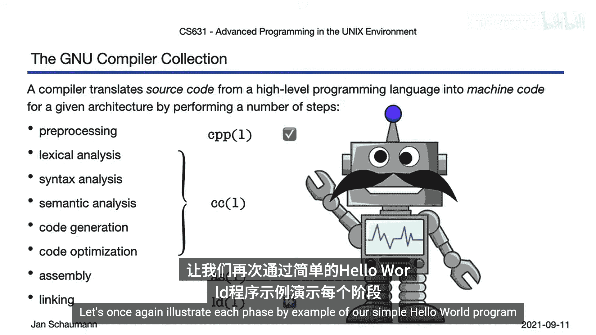
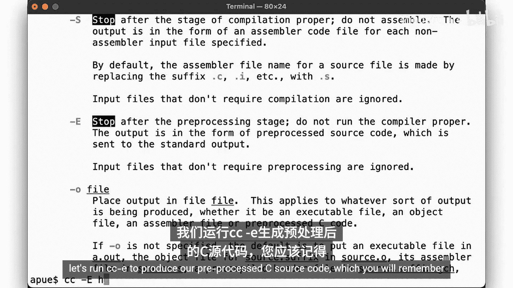
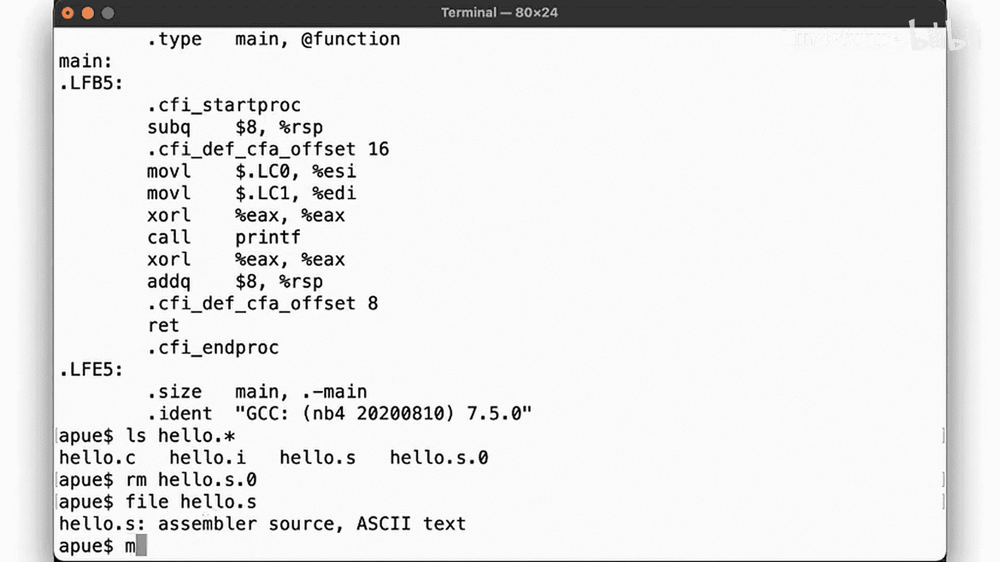
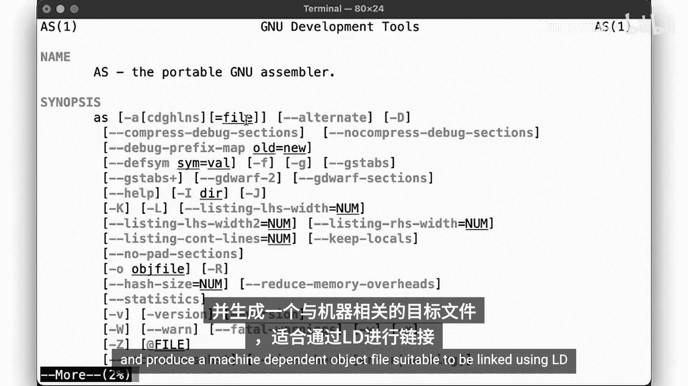
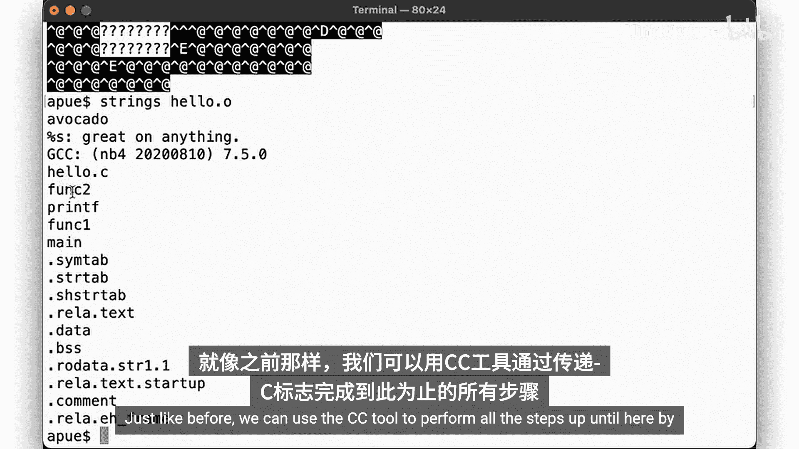
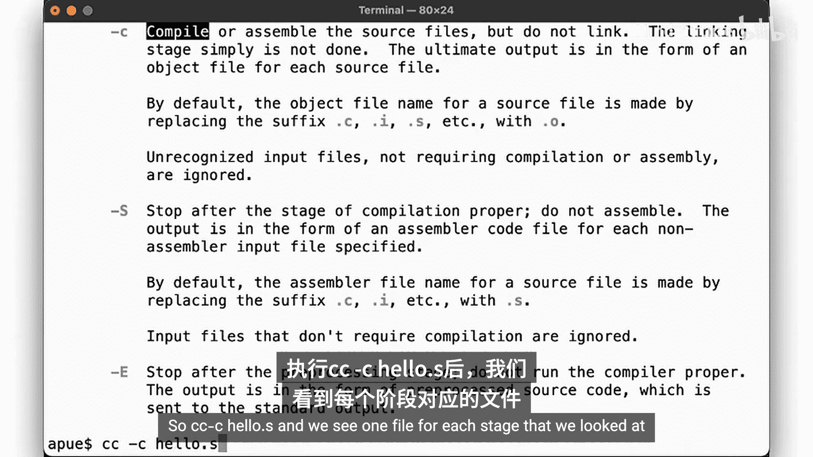
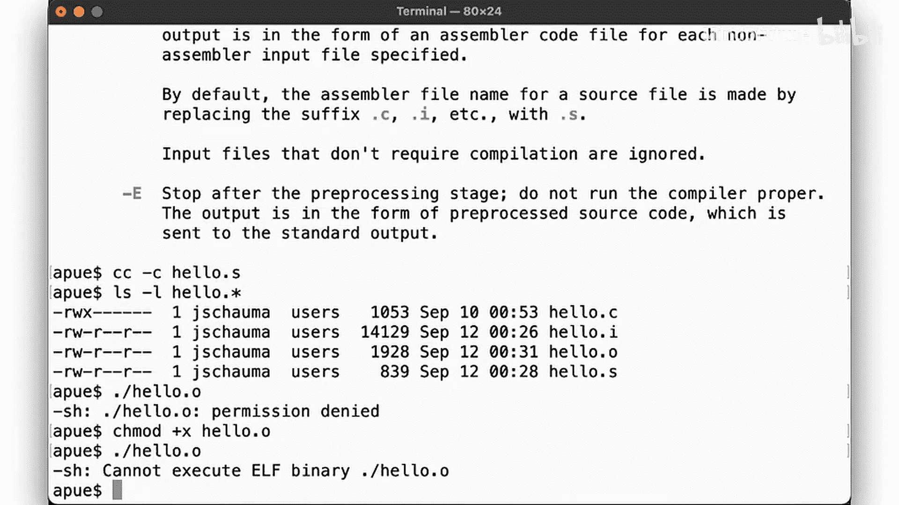
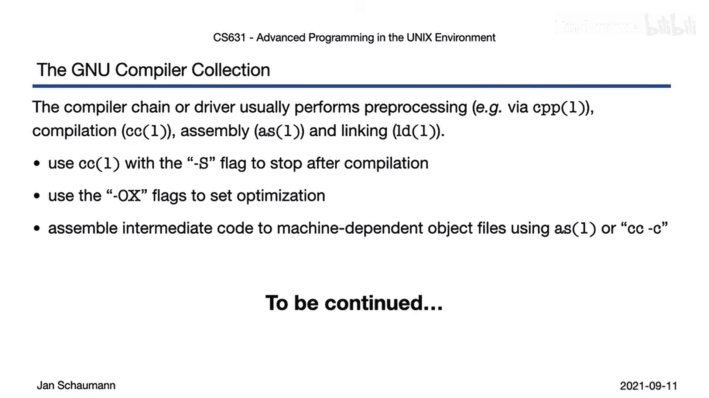

# UNIX高级编程-p28-P28-Week-05,-Segment-5---Compilation-and-Assembly--BV1hPuVz8EWS_p28-

Hello and welcome back to CS 631 Advance programming in the UniX environment。😊，This is week 5。

 segment 5。 and we are continuing our discussion of the compil process。

As we discussed in the previous two videos， we know that the compilation process consists of several stages。

 as shown here。In our last video， we looked at the pre processing stage。

 which we learned could be manually performed using the CPP command line utility。

The next couple of steps in the process are then handled by the C， C command， Per the lexical。

 syn tactic and semantic analysis， as well as a generation of intermediate code and optionally some optimization。

After that， we are left with assembly code， which we can then turn into machine code using the assemblyble invoked using the A S command。

This reproduce a binary object file， which we can then use to create an executable via the linker invoked via the LD command。

This final stage in the compilation process will be covered in our next video。

 leaving these two stages in the middle for today day。Compilation， proper and assembly。

Let's once again illustrate each phase by example of our simple hellello world program。

First， let's cut up the manual page for the compiler once more。As we saw in our last video。

 we can stop the compilation process after each stage。E stops after pre processingcess。

 S stops after compilation。So to pick up where we left off in our last video。Let's run C， C， dash， E。

To produce our pre processcessed C source code。

Which she will remember。Looks like this。Now， we can take that file's input to a next stage。And run C。

 C， dash S， Ho dot I。Yielding the assembly output in file， Ho dot S。So now we have three files。

our initial C source code， dot C， the pre processsed file。

 dot I and the compiled code turned assembly dot S。What does that look like。

Here we see our main function。With the LFB local function begin and LFE Local function end markers。

Main calls funk1an。Which we find up here。And which simply calls funk2。Which， in turn。

 we find up here。And funk 2。Moves L C 0 and L C1 into on reisters。And called Pridef。

L C stands for local constantss。And we see those to find the strings up here。

These are the two arguments we passed to printf。Allright， so we get main calls funk1。

Funk 1 calls funk 2。And funk 2 called printf。Just like our sea coat。

But these calls to funk1 and funk 2 really are rather pointless， aren't they。

 And didn't me say that a compiler might be able to optimizeise or a code at this stage。

I' check the menu page， once more。There。C， C， take several flags to indicate the level of optimization it should employ。

When past these flags， it may then enable an increasing number of optimizations。

 each of which can also be individually turned on via these flags here。

 If you know what you're doing。O。So let's give this a try。We call C， C with。Dash S， dash 03。

And look at the assembly output。Now， our main function no longer calls funk 1 and instead performs the same steps previously done in Fk 2。

 Els 0 and1 are moved into the registrs and printf is called directly。Meaning。

 the compiler has directly determined that calling Fk 1， only to call F 2。

 only to call printf can be left out completely。Okay， now we have turned our C code into assembly。

Nowow what。Well， it's assembly。So let's call the asmbler， A S。

A S is used to take this assembly input in produce a machine dependent object file suitable to be linked using L D。

You invoke airs trivially like this。Now， giving us finally a binary output file in L format for our target platform。

 X 86，64。What does this object file look like。Well， it's a binary format， so we can't just cat it。

 or can we。Well， not surprisingly， we can't make much sense of this file。

 but we do see certain strings here that look familiar。Similarly。

 we can extract any strings from this file using the strings utility。Which shows our local constants。

What we are printing， as well as the function names。Just like before， we can use the C。

 C tool to perform all the steps up until here by passing the dash C flag。

  similar to how we had passed D E and dash S for the previous stage。

So。C， C， dash C， hellello dot S。 And we see one file for each stage that we looked at。

Can we execute the fire now。H no exact permissions。 Let's fix that。HNo luck， as promised。

 the output of this stage is not yet inexecutable， but an object file that can be turned into an executable via the final stage of the compilation process linking。

But let's take a short break here， and recap。We had already covered pre processing in our previous video。

 and we just now saw that we can perform the compil proper by passing the dash Sle to the compiler。

We also observed how the compiler can make our code more efficient by enabling certain optimization techniques based on the dash Oflx。

The stage then produced the intermediate code assembly。

 which we then handed to the A S tool to turn that into an object file。Alternatively。

 we are able to use C， C dash C to perform all the steps up to here as needed。Now。

 all that's left is taking our object file and linking it。But that'll be covered in our next video。

 Thanks for watching。 And until the next time， cheer。

