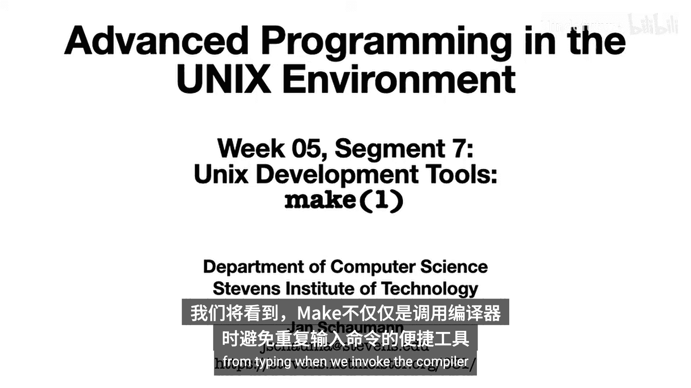
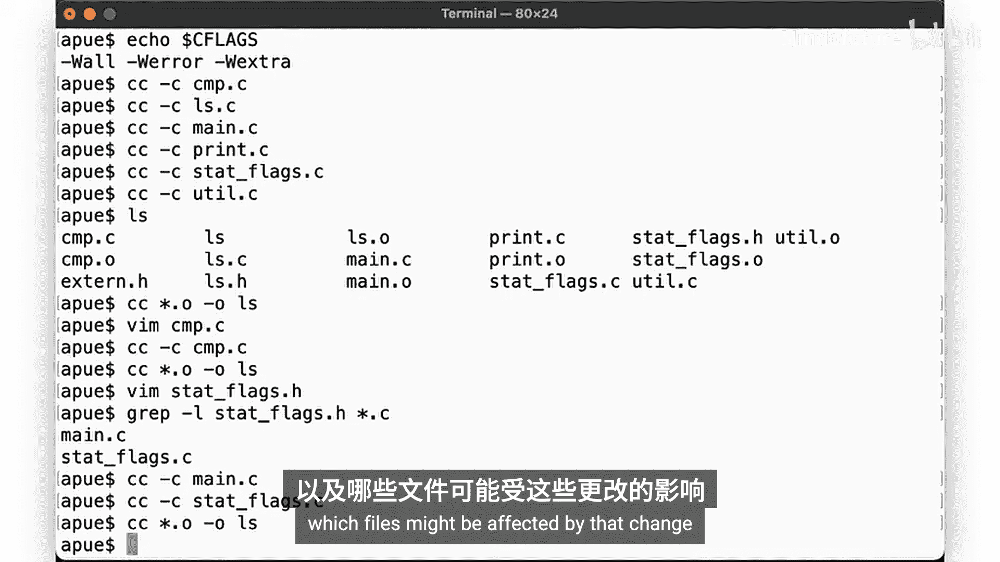
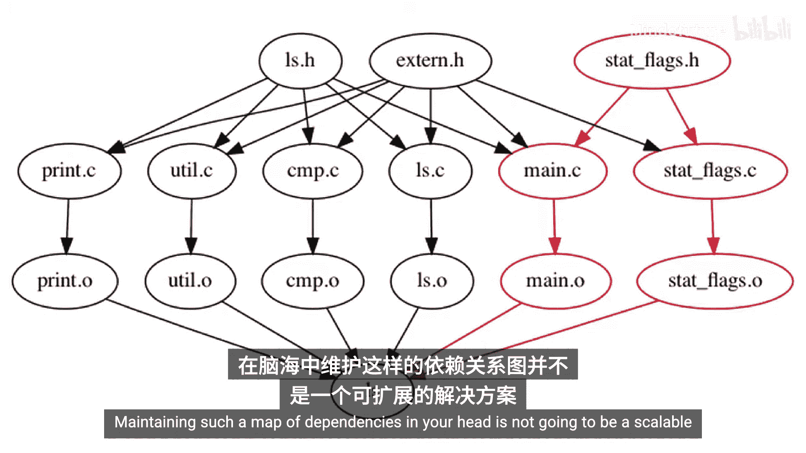
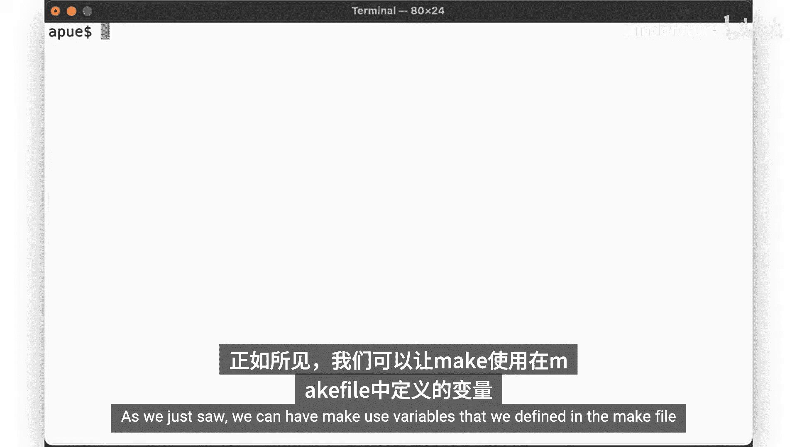
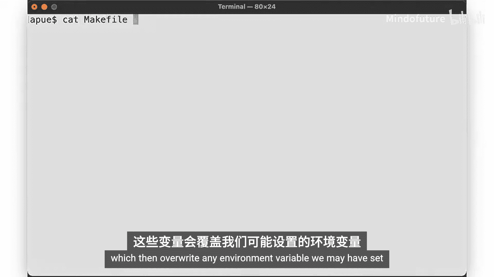
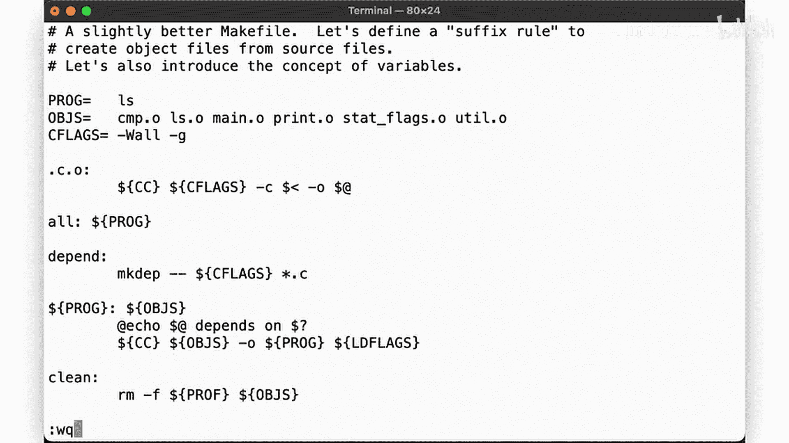
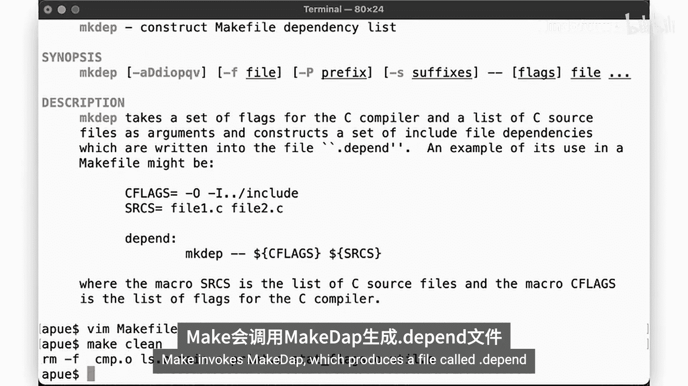
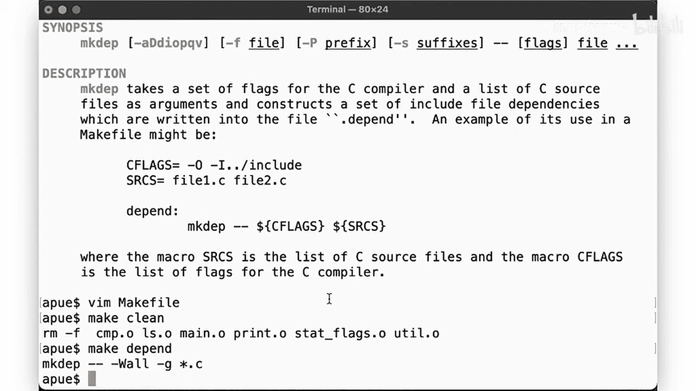
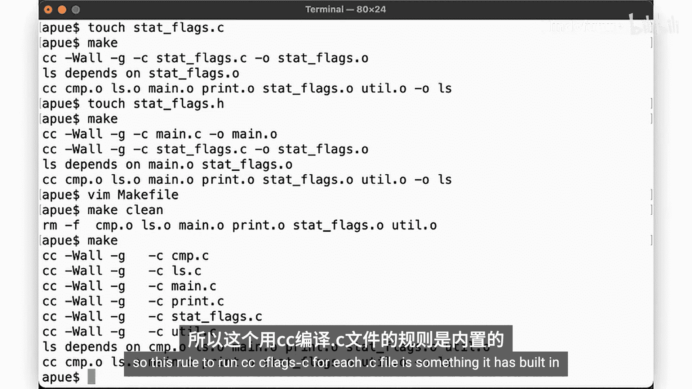
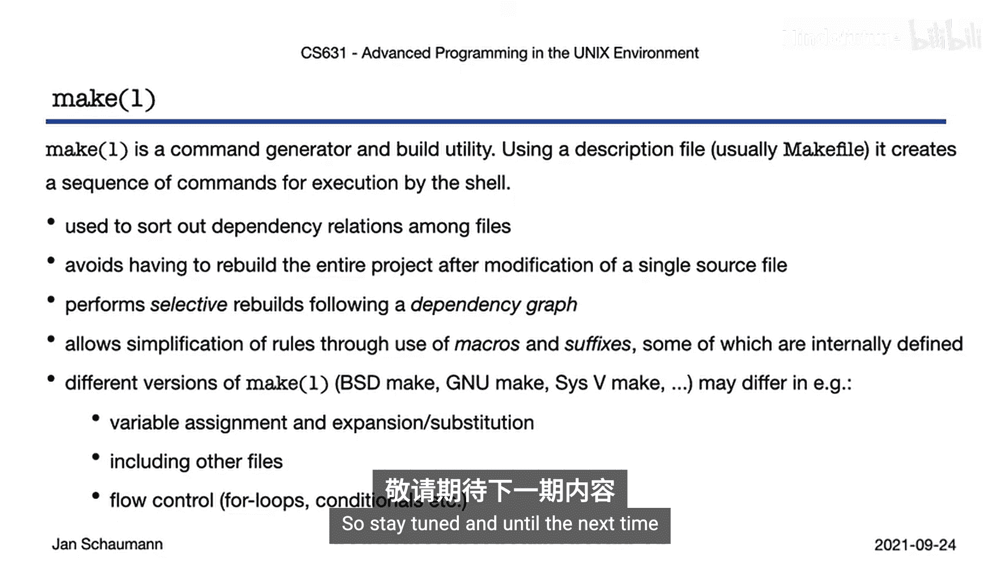

# UNIX高级编程-p30-P30-Week-05,-Segment-7---make(1)--BV1hPuVz8EWS_p30-

Hello and welcome back to C S 631， Advance programming in the Unix environmentment。

 This is week 5 segment 7。 And yes， we are still talking about the different Unix tools that make up the integrated development environment we take for granted。

😊，This time， we'll take a look at the M utility。 A tool you to selectively build a code project based on an understanding of the dependency relationship between different source and object files。

As we will see， make is thus more than just a convenient way of saving ourselves some typing when we invoke the compiler。

Here， let's start by illustrating why we might even want a tool like this to begin with。Okay。

 so here's our software project consisting of several source files， as well as a few header files。

We might compile our program like this。Okay， that worked just fine。But now。

 let's say we want to edit the file。Compare dot C。We make a simple change here， enabling silly sort。

Now， when we recompile the project， we are， again， running the same command。

But note that in this case， we again compiled all the source files。

 even though we only made one change in the file， CP dot C。Now。

 let's consider a more efficient way of building our project。

Instead of always compiling all source files， we run CC C against each individual file。

Remember from our previous videos in this series that if we pass dash C to the compiler。

 we will create object files only。And then use a separate stage to link the files together。So， now。

We have these various dotdo files here。And we can link them into an executable like this。Okay。

 so far， so good。Now， let's again edit the file。 CP， did' see。Comment out， silly sword。But now。

 instead of compiling all files， well just compile the files CMP。c。Then， link the object files。Okay。

 so this is a bit more efficient。The overall difference， as shown here， is relatively small。

 But imagine you have a complex software project with hundreds or thousands of source files。

 Not having to recompile all of them is going to really save you some time here。

Now let's consider what happens when we make it change to a different file。

Let's say that we added state flags dot H。And change the default mode down here。Now。

 what files do we have to recompile？Well， let's see which files include this headerophil。There。

 main dot C and statfls dot C。Each file that includes this header file might now have changed。

 so we need to recompile both main dot C and Stad flags dot C。And then again， link the doo files。

In other words， I need to keep track of which files have changed and which files might be affected by that change。

Our software project can then be represented as a dependency graph， like this。

Here we see an illustration of these dependencies。 We can tell that the change to C MPPot C requires us to rebuild C MP Pi O and then L S。

And the change to statfls do age。Means that now the files main dot C and Stafl dot C must be considered outdated。

 which means that we need to rebuild them and create the main dot O and Stafl or O object files。

And then recreate the executable by linking the updated dot O files on the right。

 together with the dot0 files on the left， which have not changed since our code change。

Maintaining such a map of dependencies in your head is not going to be a scalable solution。

So， enter make。Makeake is used to maintain these dependencies。

It reads a definition from a make file and determines so called targets as being derived or built from certain sources。

The way make then built these targets is by executing specified shell commands。

So make allows us to specify the commands we want to execute。

 to build a given executable from the specified source files。So let's create one of these make files。

By convention， we use a target called all and then provide the command we want to execute。 C， C。

 C flags。Startlet C， D O， L S。Now， I can type make。And there we go。 and both are executable。

And if I were to make a change to say CP dot C。Then all I need to do is type make again。

 and it'll build a less。But while this saved us some typing。

 this didn't really solve the dependency problem， nor did it。We are still recompiling all code files。

In fact， even if nothing has changed and I type make again。It will， again， recompile all files。

So let's see if we can improve on this。For starters， we can change the target name。 After all。

 we want to build the Ls executable。 So let's call our target Ls。This is the effect that now。

 if we run make， it tells us that， hey， this executable already exists。 It must be up to date。

 No need to recompile all the code。 So that's an improvement。

But if we make a change to one of the source files。 and here we just fake this by touching the file。

 thereby updating the last modified timest of the file。 So it looks like it has been changed。

So if we update this file， it run make again。M， no good。So we need to improve our make file。Here。

 let's do this。We grabbed the source files。And now edit our make file。We tell make that L S depends。

On these do files。If these dot o filess exist， then we link them in this first step。Next。

 we further tell make how to create the CP。 file。CmpP dot O depends on c dot C。

 meaning whenever the M time of CmpP dot C is newer than the M time of cmpP dot O。

 we run this command here。Now， we repeat the same instruction for the other dot O files。

And change the names。And now make notes that to build L S， it needs to build C dot O。

 which depends on C do C， and for which it runs C C， C Fl dash C， CP dot C。

 and so on for the other object files too。So let's see what that looks like。Okay。

 we run make and compiles each object file and then links them。If we now touch CP， dot C。

Make a smart enough to only recompile that one file。And if we run make again。

 it knows it's got nothing to do， neat。But I will make for still feels rather clumsy。Here。

 look at all this repetition that we have here。Let's be smarter。Let's create a better make file。

To do that， we will use a so called suffix rule， as well as some variables to show you what may can do。

Like in the shell， we can assign values to variables， which， like in the shell。

 are written in upper case by convention。So， here， we define。A program variable。To be alas。

We can then define the list of object files we need as the variable， O B Js。

And we can define our preferred sea flags here。Now， with these variables in place。

 let's get rid of all this stuff here and create a suffix rule。

A suffix rule is a rule that tells make how to build a file ending in one suffix from a file ending in a different suffix。

So here we create a rule that tells make how to build a dot O file from a dot C file。

We do that by running C， C， C， Fl， dash C。Because we now have a generic suffix rule。

 We can't just put the file name here， but make notes about a few special variables。

So here dollar less means that the initial suffix name dot C in our case and dollar at means the target suffix name dot O in our case。

So this block then covers all the individual definitions we had here before。Now。

 we get our all target。Which we simply said to Prague。When you run make。

 the command will automatically look for the first target definition。

 So using all really is just a convention。But we still want to use the program name。

 so we could also run Mig L S， for example。Here we define the rules for proc。

Prorague depends on the object files we had to find in above。

 and which will then be created automatically via the suffix rule。Now， as we read in the manual page。

 make simply execute shell commands。So that we can put anything in here。

 including diagnostic messages。By default， make will print out the commanded executes by prefixing this statement with an ad。

 we suppressed this。So this statement here simply let's make。

 tell us the dependencies that it considers。The actual building of the executable then is done as before。

 by a C， C。Another thing that we are used to is the clean target that allows us to easily remove any intermediate object files so that we can then recreate the executable from scratch。

 So let's add that target here too。O。Now， let's see what happens when we run make。Here we go。

We see that make builds each object file using the suffix rule we had specified。

Note also that while our environment variable C flags is set to dash wall， D W error， D W extra。

Make use the definition we had provided in the make file itself。If we run make again。

 nothing happens because our target is up to date。If we change CP dot C。

 then make will selectively rebuild only that fire， then recreate the executable。Likewise。

 if we update main dot O。Then Meg will only run through the linking stage。Make clean。

 remove our object files。And make rebuilds our executable。As we just saw。

 we can have make use variables that we defined in the make file。

 which then override any environment variable we may have set。

But。What if we want to use a different value from the one set in the make file。

We could edit the file。But there's another possibility。

By specifying the variable declaration on the command line， we can overwrite that value2。No。

Make used dash W error in favor of both our initial environment variable。

 as well as the hard coded value。Next， note that up here， we used the LD flex variable。

 but that variable wasn't set at all。Likewise， we used the C C variable， but that two wasn't set。

We don't have set C in the environment either and still make call the compiler correctly。

That is make has a few built in variables that it defaults to for the C variable。

 That is the C command。L D Fls， however， is not defined at all。

 so remains empty unless we explicitly set it。Alright。

 So we've seen how make sorts are the dependencies that we manually specified in the make file。

 which is really quite useful。So when the do C file changes。

It will selectively rebuild the corresponding dotdo file and rebuild the executable。

But what happens when we change one of the header files。嗯。Nothing。Well， that's not surprising。

 We didn't tell make about the defensivey relationship between this headophile and the dot seaphi that included。

We know that if this header changes。Then these two dot C files need to be rebuilt。

So we can add that to the make file。Here， main not O now depends on sta flag dot H。

And state flags dot O also depends onstead flags dot H。Cool， now make again does the right thing。

But that means that we have to tell， make again， everything manually ourselves。

For the C files to get the dot O files， the suffix rule is obvious。 Just change the suffix。

But for dot H file， there is no one to one relationship。

So wouldn't it be neat if we could automatically generate the dependencies。Enter makestep。

 a tool to do just that。It goes through the given C files and generates dependency rules that make understands。

So let's grab the example given here。And add it to a make file。So now we have a new target。Depend。

When we run， make depend。

Make invokes。 Make de。

Which produces a file called dot depend。

Here， this is what it looks like。Aow， look at that。

 It determined exactly which header files each dot C file needs。

 including those pulled in by the other headerophiles。So if any one of these files were to change。

 we'd have to rebuilt this file。Now， make still knows all the rules from before。

 our As suffolk rules tells it how to build the dot O from the dot C file。But now。

 if we change the dot H file。Makeake will know that it has to rebuild these two files here， Ne。Oh。

 and one last trick。See our dot C dot o suffix rule here。Let's delete it。And look at that。

 Make still does the right thing。That's because just like make has internal definitions for some variables such as C C and also knows about a few suffix rules。

Building C project is something that make was developed for。 So this rule to run C， C， C flags。

 D C for each dot C file is something it has built in。

Okay， let's take a break and recap All of these examples given here should be enough to give you an idea of what they can do。

And， of course， they are example make files included in the code samples on the coursese website。

 So make sure to play around with those on your own。As we've seen。

 make is really just the command generator。 Well， not just， but at its core。

 it really only runs the commands。 you tell it to run by writing a description into make file。

But it's a bit more than that。 It is able to sort out， which commences to execute in which order。

 based on the relationship of the files。Which then allows you to avoid having to rebuild the entire project to recompile every single source file。

 when you only made a change to one or two files。That is。

 make performs selective reboils based on the internal dependency graph it determines based on your description。

 as well as the last modified time stamp of the files in question。

We've seen that we can simplify general logic using a number of rules and variables or macros。

 and that make has some of these built in。And while the examples we covered here are relatively simple。

 I hope that you can see that there is significant power in this tool。 In fact。

 make is really quite complex and has not surprisingly been implemented multiple times by the different Unix versions。

 And each version has extended the tool a bit and changed a few things here and there。

 so that now we have at least two primary flavours of make B， S D make andnew make。

These two differ quite a bit in how they assign and expend variables。

How they allow for the inclusion of other files。And how you can build flow control into the makefi language itself。

All of that should hopefully wet your appetite to not only use make for your assignments in this class。

 but to learn a bit more and maybe seek a good online tutorial。

 Having a powerful build tool like make at your finger tips is just one of the many great things about Unix as an integrated development environment。

😊，And， yes， we still have a few more tools to cover in our next videos。

 So stay tuned and until the next time。 Thanks for watching， cheer。

