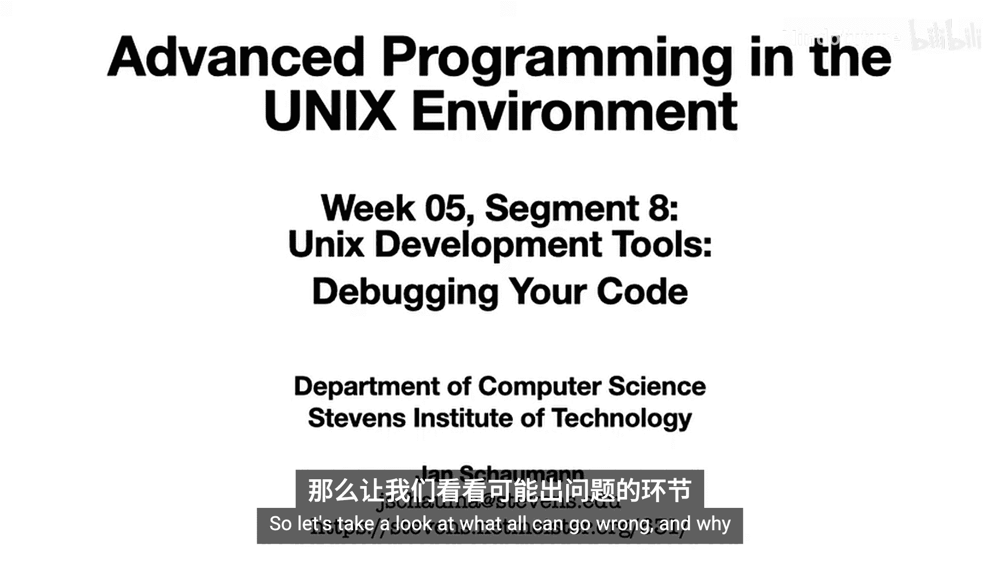
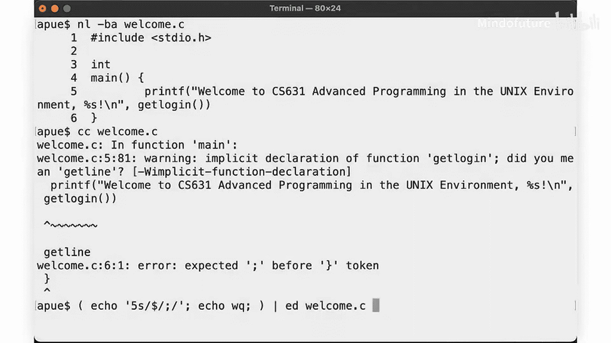
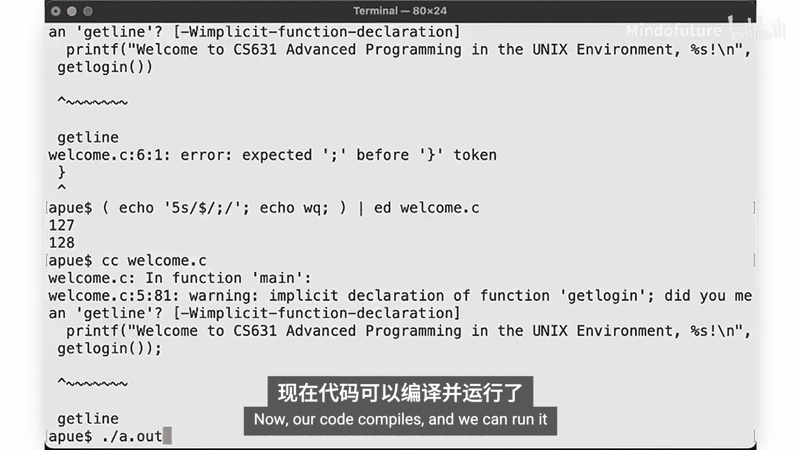
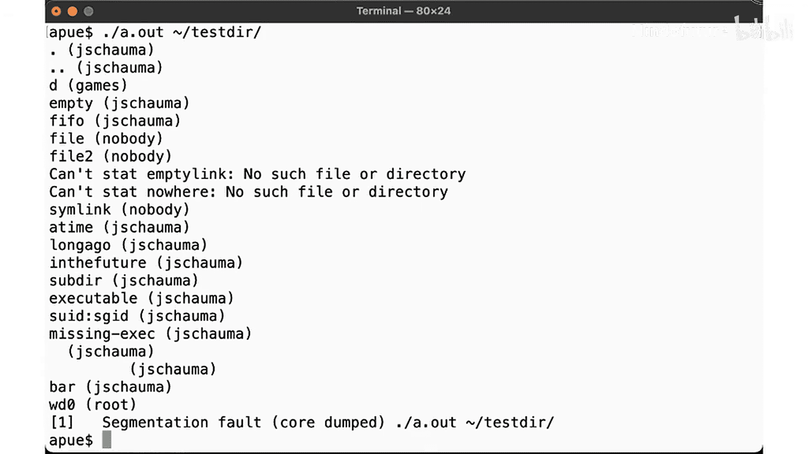
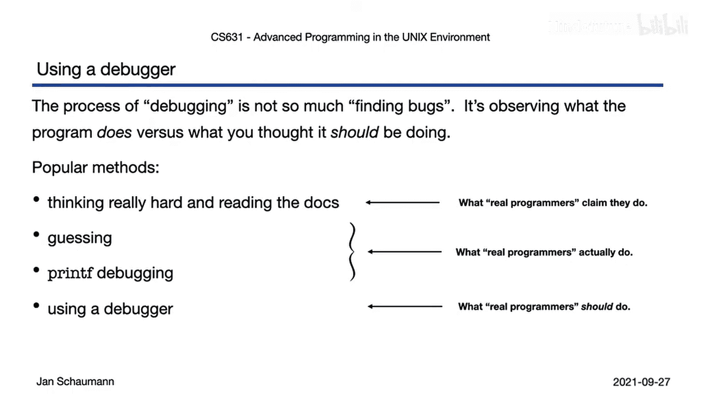

# UNIX高级编程-p31-P31-Week-05,-Segment-08---Debugging-your-code--BV1hPuVz8EWS_p31-

Hello and welcome back to C S 631 Advance programming in the Unix environmentvi。

 This is week 5 segment 8。 And after we looked at how to use the error efficiently to write code。

 how the compiler produces an executable and how to use the make utility to build it executable using the compiler from multiple files。

😊，It's now time to take a look at the stage of the software development process that probably takes up the majority of your time debugging。

That is， when we write code， we only spend so much time on actually riding code and a lot more time cursing and banging our head against the wall because the coat doesn't do what we want。

So let's take a look at what all can go wrong and why we may want to consider using a tool like a debugger to improve our development process。

Remember our welcome dot C program from the very first video。When we compiled it。

 we immediately got an error。The error we encountered was a syntax error where our compiler tells us that the characters we jam into this file are not actually valid code。

Specifically， we're missing a semicolon。But that's easy enough to fix here。's user a good friend， Ed。

 and E semico。

There。Now， our code compiles and we can run it。

And yep， sfold。So at this point， were not a stage of actual debugging the code compiled。

 but it doesn't do what we wanted to do。 and we have to figure out what went wrong。

We saw in a very first video how to fix this particular era。 But let's take a look。

And another example。Here we have a programme that attempts to implement a Fibonacci sequence。

 You know， a canonical code example to explain recursion。

 I'm sure you've seen it at some point in your CS S career。Here's our implementation。

 We requestquiively call Fip I minus-2 plus FipP I minus-1 and so on。So let's give it a try。Hen。

This doesn't seem to terminate。 So let's interrupt it。 Now， how do we fix this。

To see what's going on when we run this program， let's add a printf statement here。

 because that's how literally every programmer in the world troubleler shoulds take up。

Write to cook file， recompile。Run again。And。Right。That doesn't look right。

Let's go back into the code。Maybe we should have initialized in here。 Can't hardly to do that。

 So let's give that a try。Again， write the file， recompile。Execute。

H that's not much better Back into the goats。Oh， be probably meant to look at I not end here。

 Let's try that。Great， now it's one all the time。But at least， we may now notice。That wait a second。

 our loop condition never changes。Let's fix that。Recompile。And。Okay。Better。

But's certainly still wrong。0 is the wrong output。Let's try a different approach。

All recursive functions really require a base case。 and for Fibonacci。

 this is the core definition of fib0 equals 0。So instead of a while loop。😊，We try this over here。

There， that looks a lot more like a Fibonnaci function。Compile again。And。S fault。 What the hell。

You know what。 Let's forget it for the time being。 Let's go to another example。

Remember a simple L example from earlier。Here we extended it to also print the file owner in addition to the file name。

This is a simple function。 All we have to do is call get Pw UI and print the username。There。

 that looks good。Let's try it out on slash tempmp。No， okay。And now on the test directory。

 we have created for your metaterm assignment。Oh， look at that。 Yet another sack fault。 man。

 these seemed to happen a lot。 How annoying。So every program we try to troubleshoot here view it as sec fault。

 So clearly something is wrong here。 Our our programs have bugs。

But how do we fix these bugs。No surprise we have to debug the programs and doesn't debugging a program mean that we get rid of the bugs。

Well， not entirely。The process of debugging really is a bit more philosophical， if you will。

 and is determining what is and what isn't so。 We know what we told the computer to do。

 but it's not doing that。Or rather， we think we know what we taught the computer to do。

 But computers have this pesky habit of doing exactly what we told them to do。

 not what we had meant to tell them to do。And therein lies the core aspect of debugging。

 We have to identify where our assumptions and our understanding is wrong。

 which is why it can be so difficult。So how do we go about this？In this video。

 we've already seen a few of the most popular methods of debugging。 For one。

 we try to look at the code and think real hard。Or we may read the manual pages of the compiler error messages or any other documentation。

Then we come up with changes that might work， which really often isn't much better than guessing。

It is we jump to conclusions and try this and that， and then we try the other thing。

 and we have to constantly recompile our code and rerun it to see what the program actually does as we just saw a minute ago。

And to better inspect what the programme is currently doing。

 what the value of certain variables are or where in the code block we find ourselves。 What do we do。

 That's right。 We sprinkle copious amounts of print statements。

Printf here and printf X is now and so on。But as I try to illustrate。

 this really is a bit of a painful method of debugging code。 There going to be a better way。Well。

 guess what there is。 We could use a debugger。The debugger is a tool that lets us inspect a running programme to look into the exact state of the programme while it executes or what it was doing when it crashed。

 Now， that's a useful approach。Sure， real programmers may claim that they fix problems simply putting their thinking cap on by staring at the coat harder than others。

But in reality， just about everybody uses rapid iteration of guessing possible changes mixed with printer statements。

 when really we all should be using a proper debugger。

 that's what this series of videos will be about using a debugger in the next few videos。

 I'll show you a few simple examples of how to use the good debugger G D B to fix the programs that we fail to correct earlier。

 as well as how to trivially pinpoint exactly where and why a program failed。

Once you've gotten the hang of this， you'll become a lot more efficient。Sure。

 you'll still use printf men guessing， and， of course。

 nothing replaces thinking and reading the docs。 But there are a few circumstances where using the debugger will let you find and fix bugs a lot faster。

So get your broken code examples ready and click right over to the next video。

 I'll see you in a minute。

