# UNIX高级编程-p32-P32-Week-05,-Segment-09---Using-gdb(1)--BV1hPuVz8EWS_p32-

Hello and welcome back to C 631 Adv programming in the Unix environment。 This is week 5 segment 9。

 And in this video， we'll take a look at how we can use the G debugger G to inspect a running program and observe what's going on while it is executing。

😊。

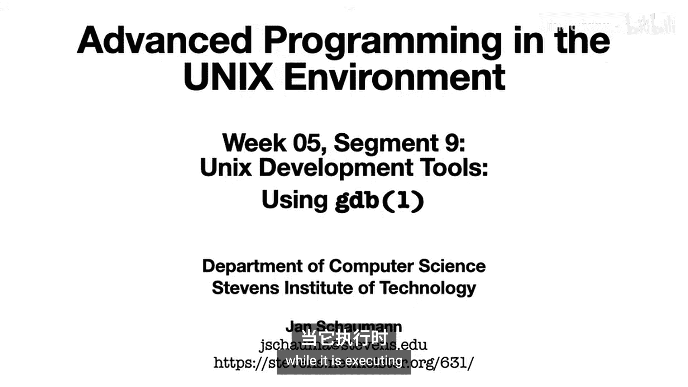

Let's dive right it。Here， let's pick up right where we left off。

 We use the simpler S program from our last video and try to resolve the segmentation fault we encountered in our test directory。

Running the command in this directory works just fine， but it fails in the other directory。

So how do we go about identifying the cause of the sfold。Let's compile the code with a dash G flag。

Which enables debugging symbols。Once we've done that， we can now run GDPB。8 or out。

To start the debugger。The debugger gives us an interactive prompt from where we can run commands。

Use help to get more information and dig into the different capabilities such as break points。

 examining the stack or variables， et cetera。To run the program， we type run。

 followed by any comment on arguments to the program。Now， the program executes within the debugger。

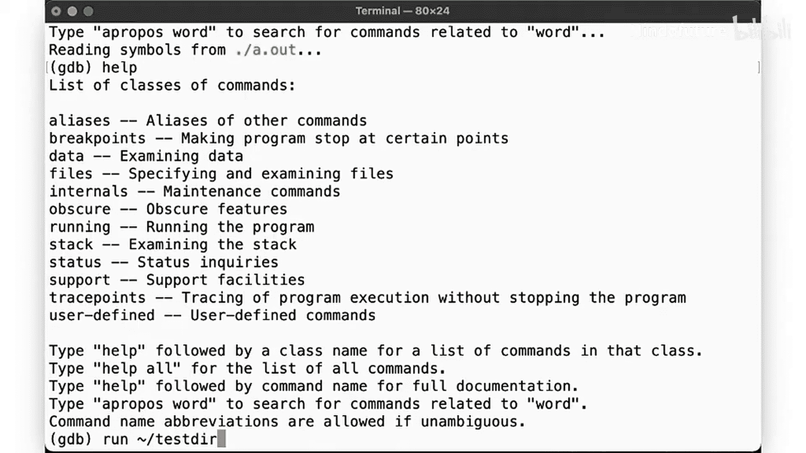

And when it sack falls over here， we notice immediately that the debugger tells us exactly where the error occurred。

In the function， print owner in the file simple dot C on line 22。

Then alone is perhaps the killer feature of a debugger。

 rather than trying to run through the coat and adding printf still alive here and there。

 We now know the exact location where the problem is。

We also see the arguments with which this function was called when the probleming crashed。

 and we can look at the code in question by using the list command。List shows us the code。

At and around the line， where the error occurred。And we see that what happened here in this printf statement。

But now we can use GDPB to give us even more information。

We can inspect the value of a variable name at the time of the crash， which was no owner。By the way。

 GDPB lets you be lazy and type abbreviations for any command so we can use P name instead of print name。

Now， let's print a second argument to printf。H， that didn't work。What's PwD。Okay。

 so it's a struck password pointer， but it's 0 x0 or no。Now， that's exactly why we setfolded here。

 Get P W U I D return null， and we try to de referenceence and then print something from null。

 That's not going to fly。HW would get P W U I D return no。Let's look at the menu page。

It returns a v struck password on success。

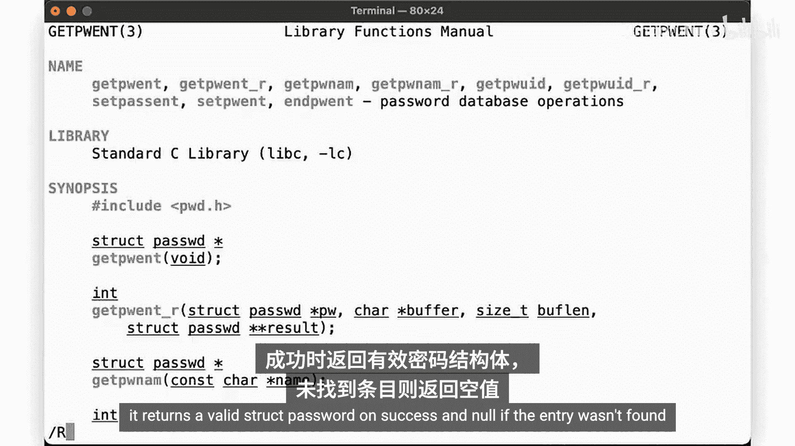

And null if the entry wasn't found。Let's go back into the debugger。Where were we。Here。

 let's get the back traces of the stack by running B， T。Main called print owner。

 and we failed on line 22。So let's look at that again。

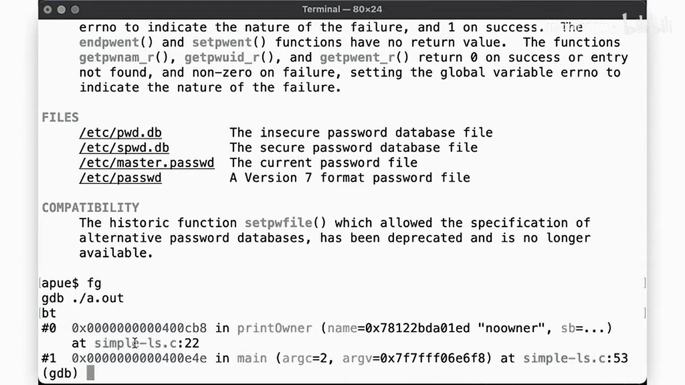

So get P W U D return null。I wonder why。One of the cool things about G D B is that we can now actually call functions and see what they would return。

😊，Let's see what get PW UID says。Oh， okay， we have to specify the return type。

 that's pointer tostruct password。And if we pass in 0 as the argument。We get back。

A pointer to a struck password at that memory address here。

We can try to print a value the college returned。And then reference any of the members of thestruct。

And get back。Root。That makes sense。 We hold called get P W U I D with an argument of 0 and U I D 0 maps to the user route。

But in the programme， we had passed an S T U I D from the strucktt for the firing question。

 What was that value。

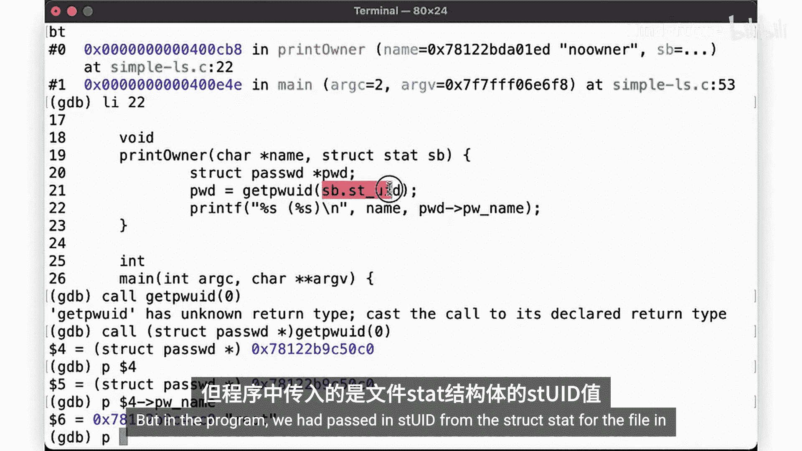

Let's inspect it。There， that U I D is 1，2，3，4。So if we now call get PW U I D。1，2，3，4。We get back now。

 there is no user with this U I D。So we can' just make the call to get P W U I D and then move on to use the resulting struck password as I keep stressing the return value of any function that could fail needs to be checked。

So let's do that。

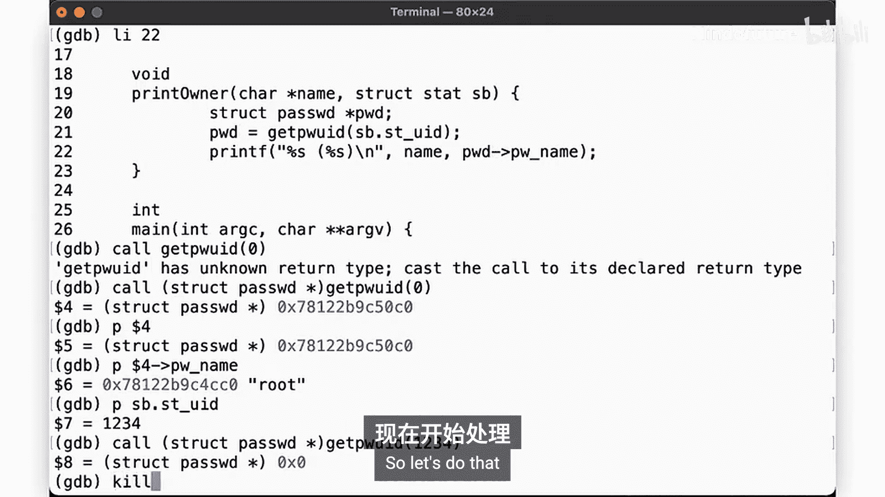

Since we know that this call might fail， we'll change our code to the common pattern of if function fails。

 then else， and have the program print a numeric U I if it can't look up the user name。

 which is incidentally exactly what the L S command desk when it encounters a file with an S U I that doesn't map to a username and Ey password。

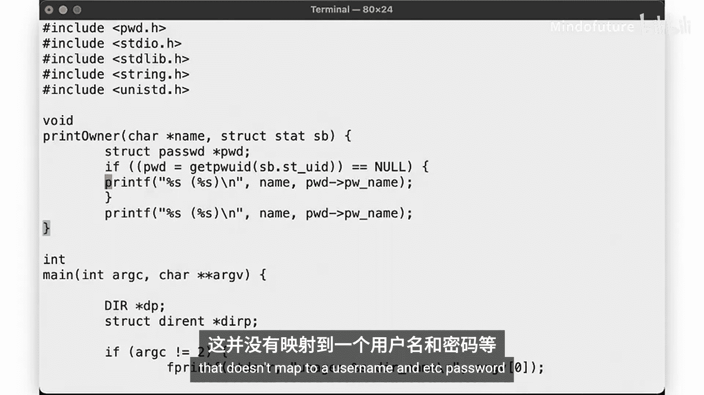

Otherwise， we print the name。O。Let's see if that did the trick。

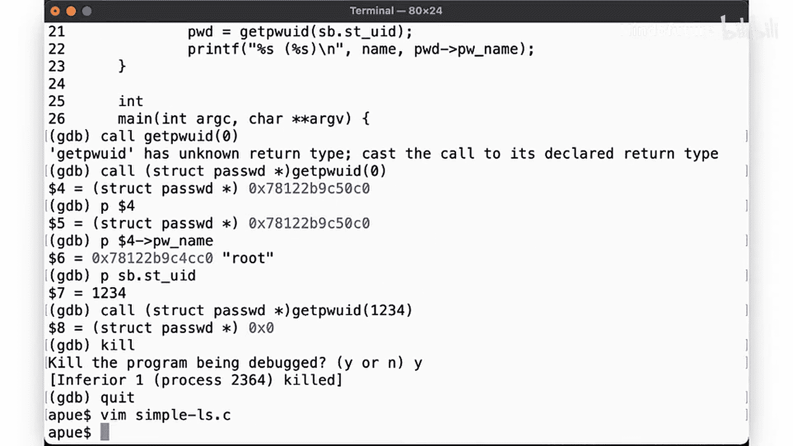

Compile。And run。

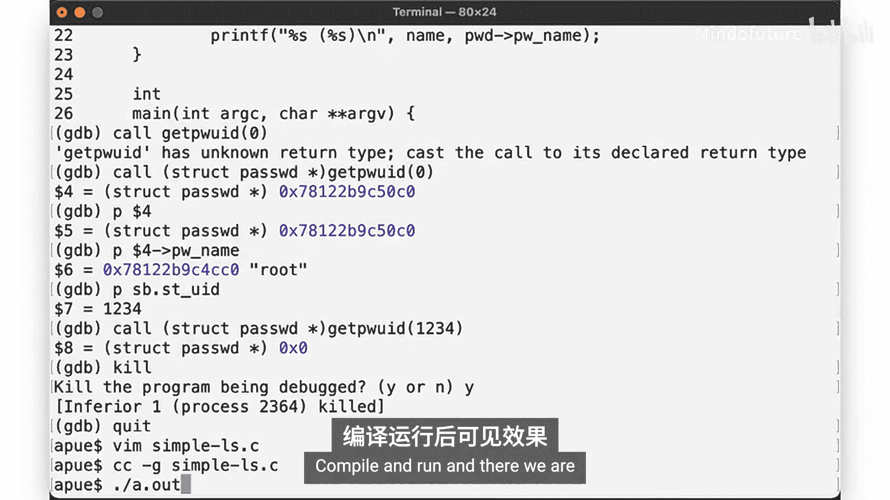

And。There we are。The file， no owner， is now displayed as having the SD U I D instead of an owner name。

 we have successfully debugged our first program。

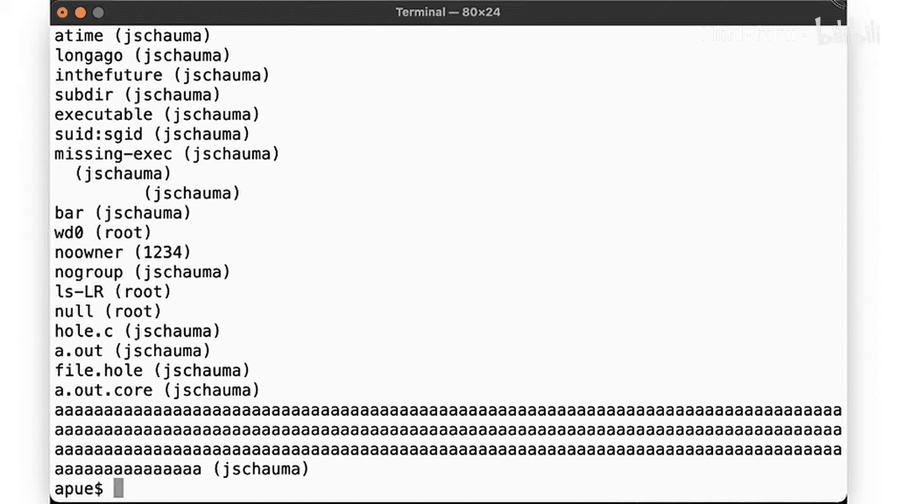

Before we go on to debug our next program， let's quickly summarize what we've learned in this example alone。

In order to see what is going on inside a program while it executes what it was doing at that moment。

 crashed， we can use thebugger like GB。To do that， we need to enable debugging symbols via the dash G flag to the compiler。

One of the killer features of a debugger is its ability to point you to the exact location in the code where it crashed。

 This includes the function name and its arguments， the file name and the line number。

You no longer have to guess or add printf statements to see where your code failed。

 Your debugger will point you right to the place you messed up。

If you take away nothing else from these videos， I hope that you remember this。

 If your programme sackfolds， run it in the debugger， and it'll tell you where the problem is。

But the debugger can do quite a bit more。 For example。

 we saw that we can inspect the value of variables inside the running program and even call functions and inspect their return values。

 that can be quite useful。In our next video， we'll build on top of this basic functionality and discuss how we can step through a running program。

 and we will fix our flawed fibonnaary program from the last video。 So make sure to tune in again。

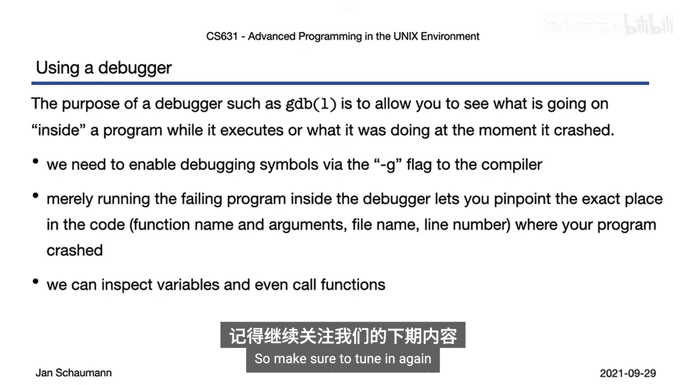

Until then， thanks for watching， cheerith。