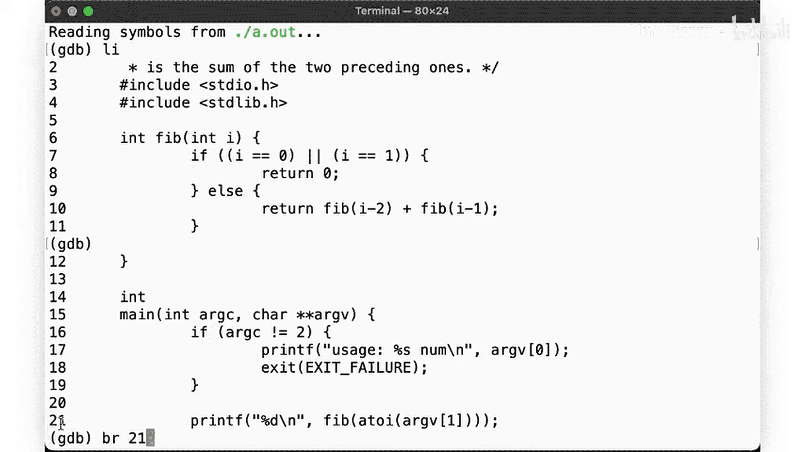
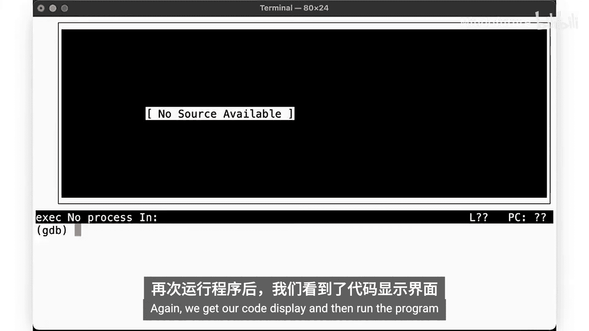
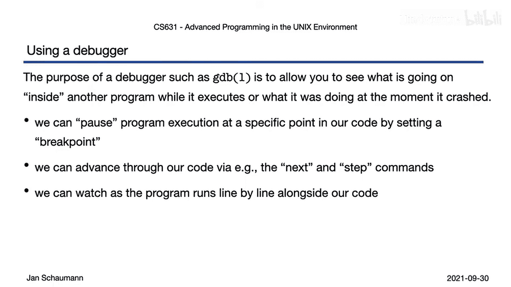

# UNIX高级编程-p33-P33-Week-05,-Segment-10---Using-gdb(1),-part-II--BV1hPuVz8EWS_p33-

Hello and welcome back to C S 63，1 Adv programming in the Unix environment。 This is week 5。

 segment 10， and well continue to try to fix our broken coat。

 I know a story of every programme is life。😊，But that's just the point we want to get better at debugging code。

 And so we will practice using a debugger。In our last video。

 we fixed the sec fault in our simple Ls program that resulted from us foolishly not checking the return value of a function that might return all and error。

Now， let's see if we can also fix our flawed Fibunaci sequence program。

Remember when we last left the program and looked like this。And when we ran it。Its ex faulted。

So now let's run this program in the debugger。We know GDPDB will immediately tell us where the error occurred。

 right。So let's run it。There sackfold in Fb on line 6。But this time。

 the error is not quite so obvious at all。So rather than letting the program run and fail。

 well this time observe the program while it is running。Here's the program again。

So let's start by setting a break point right at program startup in the main function。

A break point means that the debugger will stop the program from executing when it reaches this particular point。

 but the program is not terminated。 It's really just paused。

 and we can inspect the program at that point。Okay， so we run it again。And。Here we go。

 the program starts， and when it enters Ma， we are given control。

If we want to see the code as it's being executed， we can switch to this display by hitting control X O。

And we'll be able to see exactly which line we're on。As we are stepping through the program。

Right now， we're over here in line 16， checking Ay。If we type n for next。

Then we move on to the next statement， which is the printer from line to a new1。Now。

 if we let the problem continue uninterrupted。We'll again hit our sgfold in Phip。

So just letting it run didn't really help us。Let's try again。We'll add another break point。

 and the function fib。Meaning， we'll pause now every time we enter the function。

Let's see what our current break points are。Info breakpoint。2 break points。

 one in mainine and one in fit。Okay。Here we are Yuan main。Next。Now we are on line 21。Next again。

 And we are our first invocation of Fiip with I equals 7。We hit next， and then again。

And we now begin our recursion。We are calling Fiip with I equals 5。I go three。I equals 1。

 I equals negative1。 I equals negative 3。And so on， and so on and so on。lookss like this doesn't end。

Info break points now shows us that we have hit break point 215 times。

 meaning we've called Fib 15 times already。So that doesn't seem right。Look at our condition up here。

 we never hit the base condition of I equals 0。Because we started with an odd number and recursively called fib I-2。

 But the femenacci base condition is not only fib 0 equals 0。But also includes Fb 1。

So let's add that case here。There now we've added a check for I equals1。Let's try again。

H so now that's not right either。 We get back 0。Back into the debugger。Let's look at the code， again。

We can set break points， not just by function names， but also by line numbers。

 So let's break here on line 21。

Again， we get our code display。And then， run the program。

Here we are。Now， instead of calling next， which would try to move on to the next statement in this function。

 we called step 2。 Well， step into the next function we're calling。O。Beg in fib， I equal 7。

Hitting return repeats the last command。 So another step。And so again and again。

 we see we enter Fihib with I equals 5，3， and then  one， then returning。

Then calling F from the second part of the return and so on and so on。But as we step through this。

 we see that no matter what we do， we will now always return 0 eventually。

 which is why our final result， adding 0 and 0。Is， of course， also 0。

So we need to fix our base condition once more。For the base case of 0， we need to return 0。

But for the base case of one， we need to return one。So we can change this over here to return I。Now。

 let's compile。Then， here we go。Fhiip 7， yield's 13， yea。

Let's see if it returns the right numbers for 0 through 10。Yep， that looks about right。 Hoay。

 we fixed our programme。Okay， time for another break。In this video。

 we saw that even though the debugger can pinpoint the location where， for example， a sfold occurred。

 sometimes we need a bit more information。 So to observe a program as it executes。

 we can cause it to pass execution at any point in our code by setting so called break points。

We can have multiple such breakpoints in different places in the program。

 and we can set them by function name or line number， for example。

When the program reaches the given location it will be suspended and we get dropped into the debugger's command prompt。

 allowing us to then inspect variables within the current execution scope。

Once we are at a given break point， we then use the next command to move to the next instruction in the current function。

 or we can use the step command， which may step into a function that is being called。All the while。

 we can use the visual display to show our code as we are moving through it。

 thereby allowing us to better visualize the execution。Altogether。

 this let us identify and fix issues in our code that otherwise might be harder to track down。But。

 of course， there's still plenty more that we could do with our debugger。 And in our next video。

 we'll look at yet another failing programme in desperate need of being debuked。Stay tuned。

 And thanks for watching， cheers。

