# UNIX高级编程-p34-P34-Week-05,-Segment-11---Using-gdb(1),-part-III--BV1hPuVz8EWS_p34-

Hello and welcome back to CS S631 advanced programming in the Unix Enron。 This is week 5 segment 11。

 and we'll try to use the skills we picked up in the previous videos about how to use the debugger to fix another very silly program。

😊，This example is， of course， once again a bit contrived。

 but will hopefully serve to illustrate the iterative process of debugging a program while at the same time driving home some of the coding practices I keep insisting on。

Here， let's take a look。

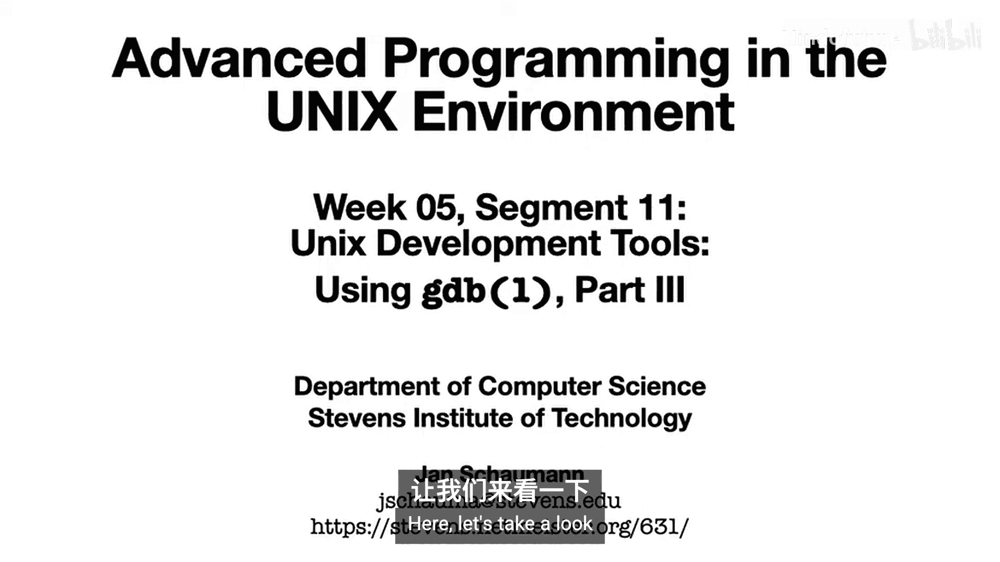

Here theres a very simple main function that calls out to a function， print bs。Which looks like this。

The function takes a numeric argument， allocate some memory for a few buffers。

 copy some data into the buffers， read some data input from the user and print the result。

Easy enough， right。Okay， so comparinging the program already gives us a warning here about the use of the inherently unsafe gets function。

 But we'll ignore this because， of course， we do。We are real normal programmers and who has time to pay attention to compiler warnings。

And so when we run it， of course， Sefold。 But you knew that was coming， didn't you。Alright。

 so what do we do， Maybe we run into this sort of problem。 We run the program in the debugger。

Here's Me。And here's the print buffs function。

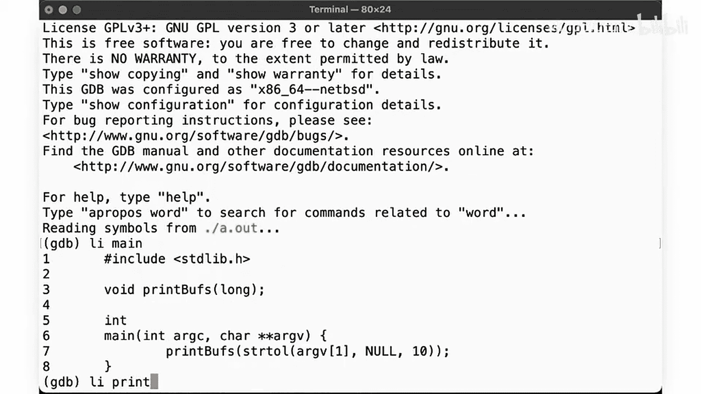

Note that we were able to list the code from multiple different source files without having to specify the file name。

 which is really quite convenient。We run the program。And Sfoldd。But this time。

 we noticed something interesting。 The s fault occurred not in any of our functions， but in， well。

 somewhere in Lipsy。

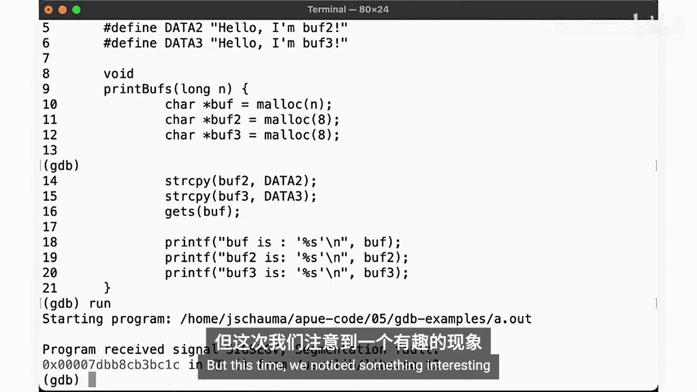

We only get question marks here because our extended C library does not have debugging symbols so the debugger can look into it quite like it can into our code。

So let's take a look at our back。The error still happened in Maine。

Let's select the frame in question。There， the error happened right here。

Note that the sack fault occurred in Lipsy， not in print buffs。

 So it must have happened in the call to S T R2 L。We pass ArgV 1 to SR2， so let's inspect ArgV。

Arkney is a cha star star， as per the main function prototype。What is the first element of Argv。

To get the first element of an arrayray， we can look at the memory location。

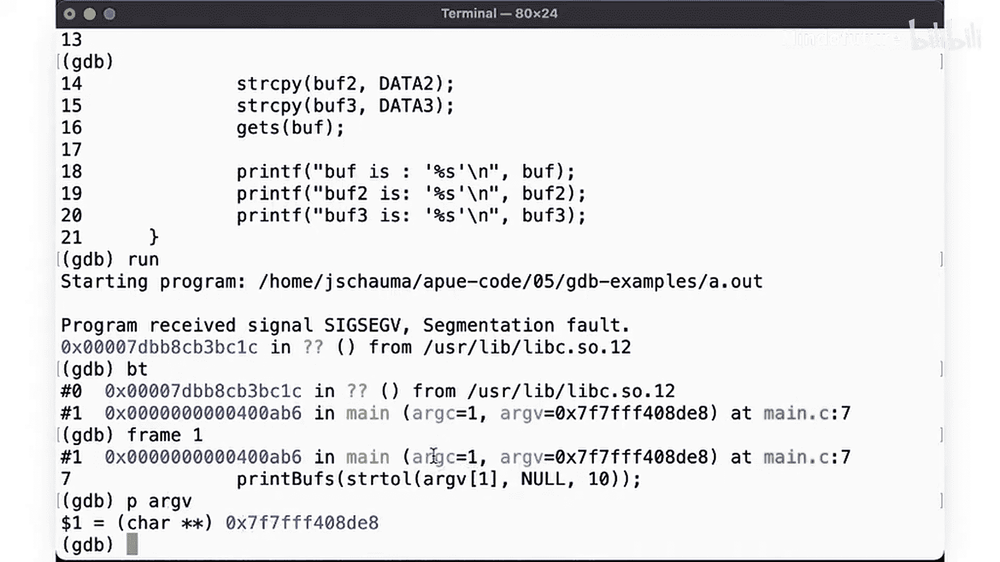

And we'll find the path to the executable here， as we'd expect。That is star A v。

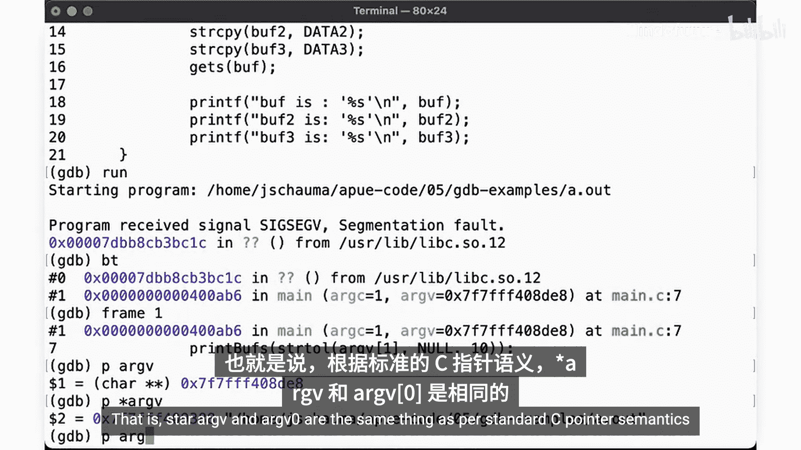

And Arc V0 are the same thing as per standard C point of semantics。Now， what's A V1？

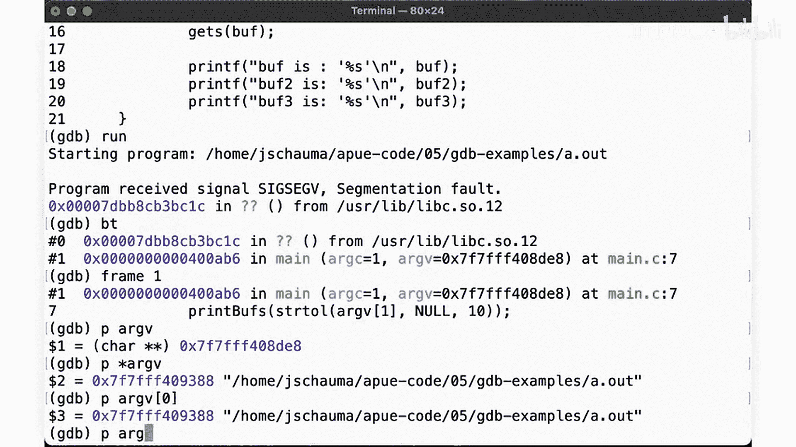

Well， that's no。As we didn't provide any comment on arguments。

 And so passing no as the argument to Estl is likely what cost our sec fault here。

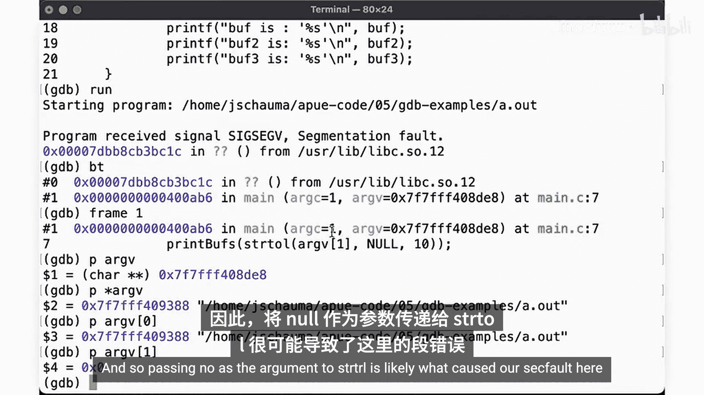

Let's fix that。We added a check to our main function to ensure proper usage of the program。

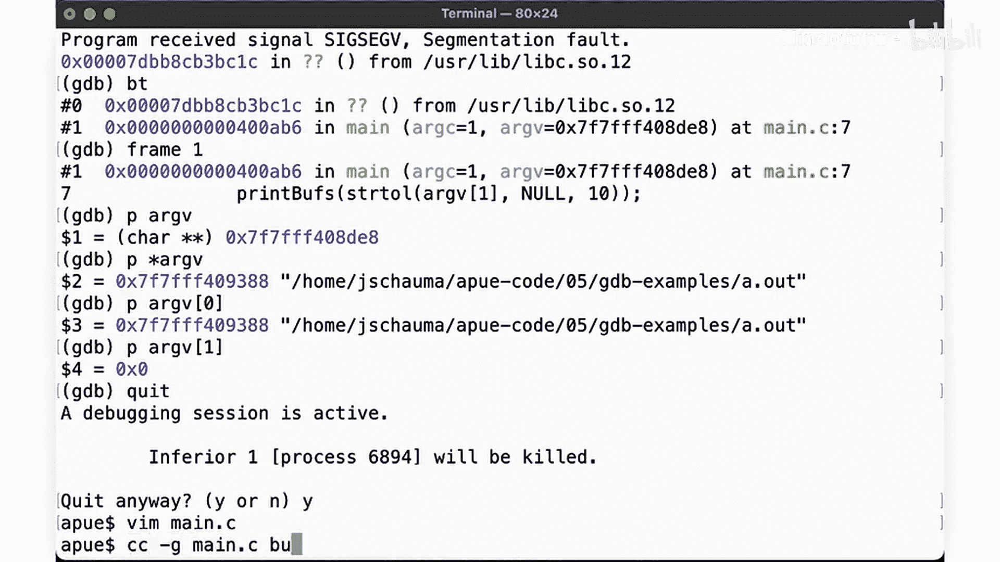

Oh， right。 We need the standard I O header for F printf。There。Now。

 when we run the programme without arguments。

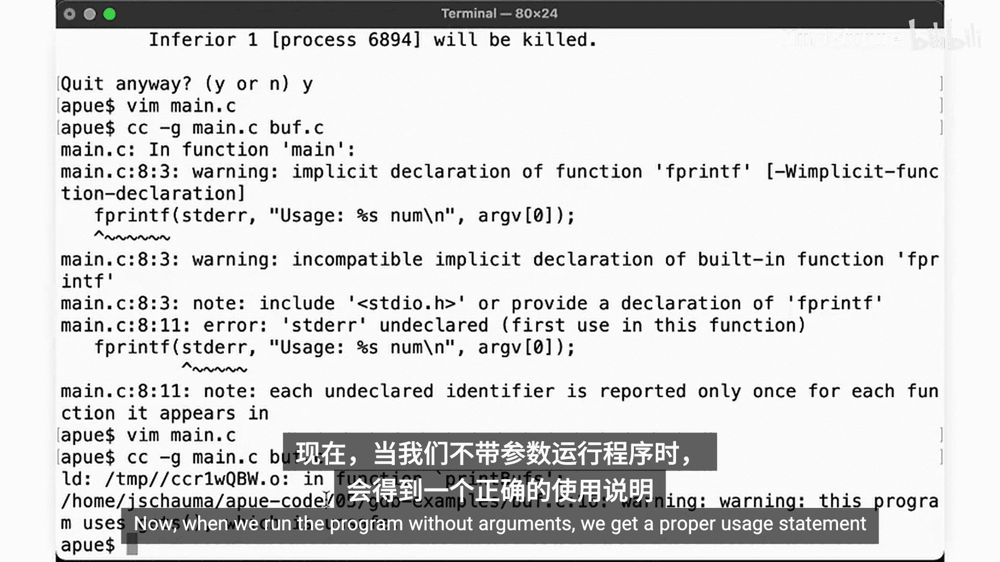

Ma get a proper usage statement。 so far， so good。So now we need to provide a number。

 Let's give it a number。How about-1。There， the program now prompts us for input。 Let's say。

 hey there。And yep， of course， we get another sfold。So again， here we go。

 This should be routine by now。Geds reads the data of the buffer that we allocated up here。And yep。

Skefold in Gs。 or backs shows the call stack。Main called print puffs， print puffs called getss。

 and get Sefolded。Let's look at frame1。What's in here。negative个ative what。What's buff。

The buffer into which gets tries to read data。 Why it's no once more。Buthich really isn't surprising。

We told Malo to allocate negative 1 by。 So， of course， that failed。

 But since we didn't error check or a function， we then try to access null to put data from the user in Errgo Sfold。

But rather than fix things right of a。

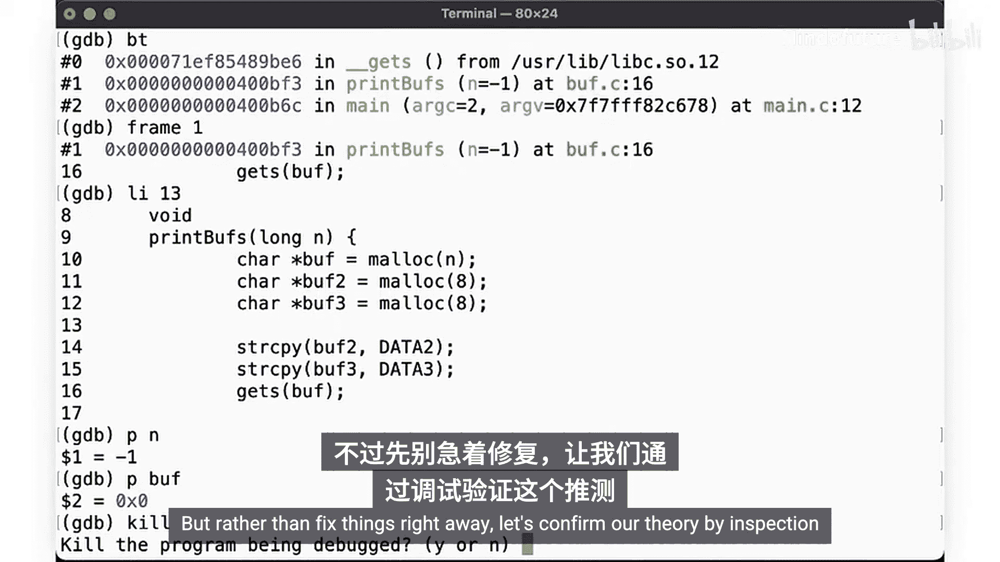

Let's confirm our theory， by inspection。We break in print buffs。

And run again with negative oneness the argument。All right。N is negative 1。What did type us And。

 it's a long。 Suppose we hadn't used a negative one with a different value。 What would have happened。

Let's give it a try in G B， we can manipulate variables at run time。

 So even though we passed a negative1， we can change that to a different value now。

Negative one is obviously bogus。 and we don't know how much data the user might want to type。

 So let's make sure we get a large enough buffer by setting in to。A really long number。

Check and confirm N is now 1024， with many zeros。So now if we're continuing。

 then Maoc will not try to allocate negative one by。But that many， instead。We can enter data again。

 and。Again， Sefold。In the same location。Because Buff is， again， no。Which， also， again。

 is not surprising。We tried to allocate an insane amount of memory for Buff， almost a petabyite。

Of course， a melo will fail to do that。But we once again didn't check the return value。 So there。

Let's update our program and fix it so that it verifies whether meoc succeeded。

 regardless of what value the user entered on the command line。Here， we change our code。

 And once again， this is how all your code should look。 If malllog fails， error。

Always check the return value of any function that might fail and handle the error appropriately。

Here。Repeat for the other buffers， too。Now let's compile it。And。Hay。

 no longer can the user enter bogus numbers。Here。But what happens when we enter a reasonable number on the command line。

Well， we'll take a look at that in our next video。

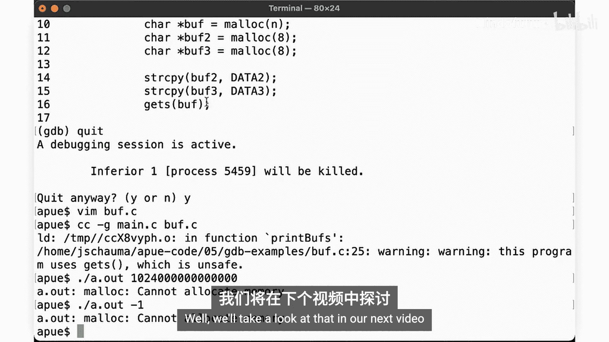

For now， let's just note that we were able to see that our debugger has no problem tracing the execution of our program and correlated to the lines of code。

 even across multiple source files。😊，However， if the error occurs at the location of the code for which we do not have debugging symbols present。

 such as when the failure takes place in a function that is provided as part of the standard C library。

 then the debugger can only tell us that the error took place or provide other minimal information。

Finally， we saw in this example that not only are we able to passively observe the execution of the program。

We also can change the program as it is running。 For example。

 we can assign a variable a different value to see how a program might behave。Now。

 our program looks like behaves， but we have just one more video to go through so I can show you how we can use a debugger to inspect specific locations and memory。

 as well as to help you understand how a arrays and pointers work and see。 Stay tuned。

 And thanks for watching。😊。

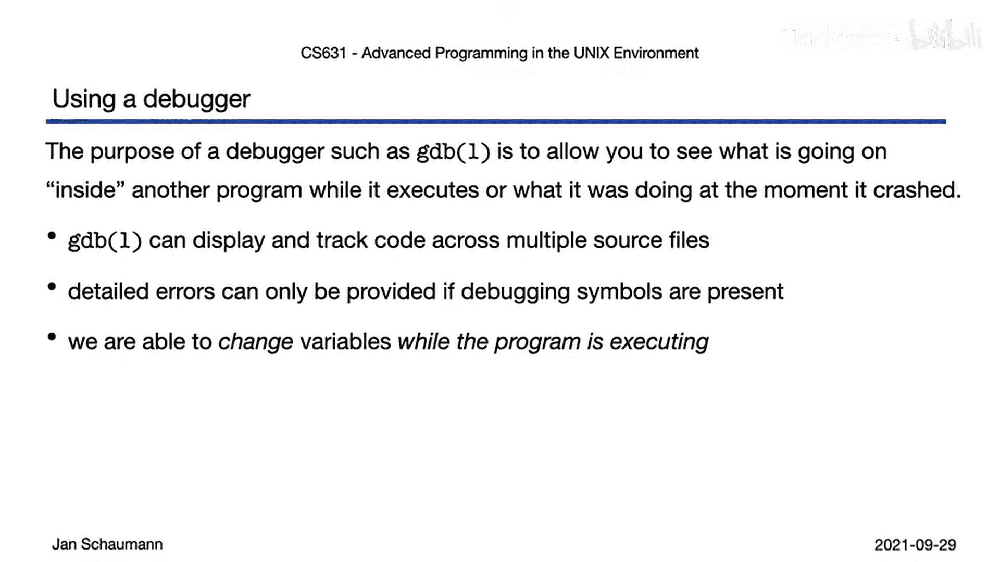