# UNIX高级编程-p36-P36-Tool-Tip---sizeof-!=-strlen--BV1hPuVz8EWS_p36-

Hello and welcome back to CS631 Advance programming in the UniX Environ。In this video。

 we'll take a look at the size of operator because I've noticed that a lot of students tend to erroneously consider it to be the same as SGRRN。

That is， I see a lot of code where size of is used to determine the size of a buffer， which。

 you know， sounds kind of like what something called size of might do。

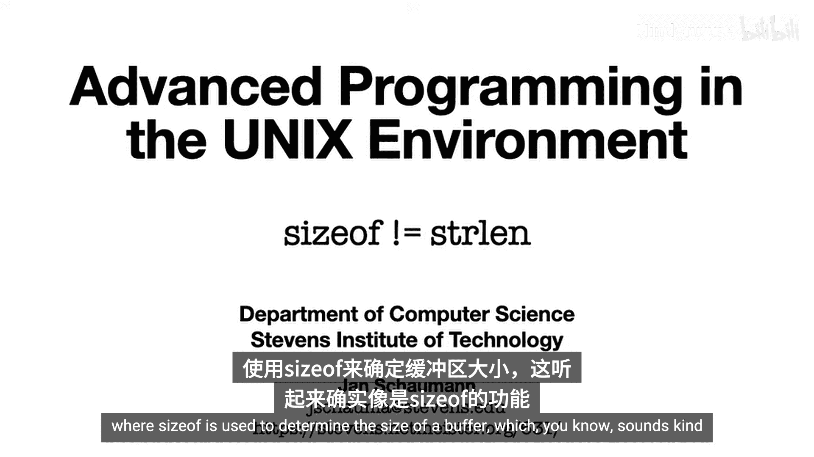

And in fact， even the Sn copy manualual page provides example code using exactly size of as shown here。

Whereby it explains that precisely because SN copy does not write a nullbte。

 one should use code like this， where we ask it to not write more than sides of buff minus1 bytes。

 and then we set the null bitete in the buffer ourselves。

But note that here we are using a fixed size buffer。

 a buffer with a size that is known at compile time。And very frequently， we have coat。

 It looks perhaps more like this。Where we use a simple pointer to some area memory that we have allocated via。

 say malloc。If we now use size of here， we're going to have a problem。We may not notice it at first。

 but this code is inherently flawed and risky。But why？In order to understand that。

 let's take a look at what size of really does。

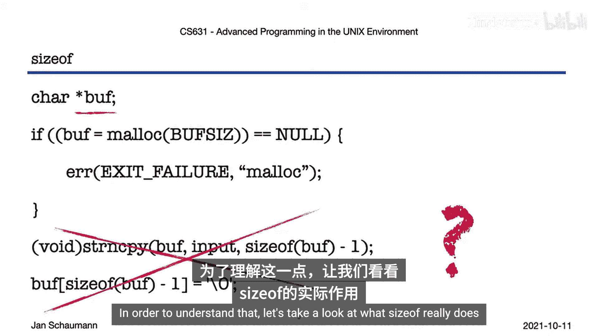

Now， spoiler alert size of is an operator， not a library function， so there is no manual page。

So how do we find out about our size of behaves？Let's simply observe it using the lessons we learned in week  five using the debugger。

That is， we can use an empty program and run that in the debugger。

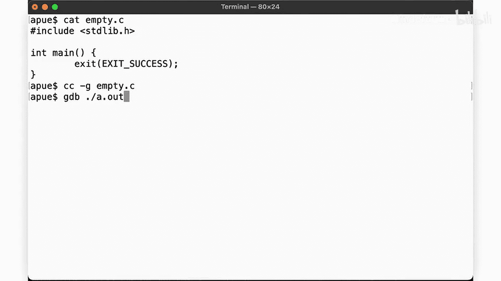

Break and Maine。

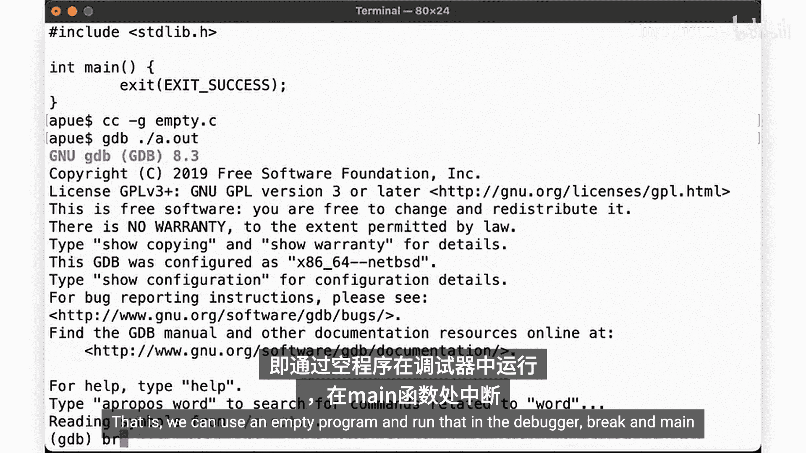

And we kind of get a rapple for sea。Need her。Anyway， so here we go。Let's start out with the basics。

What is size of char？

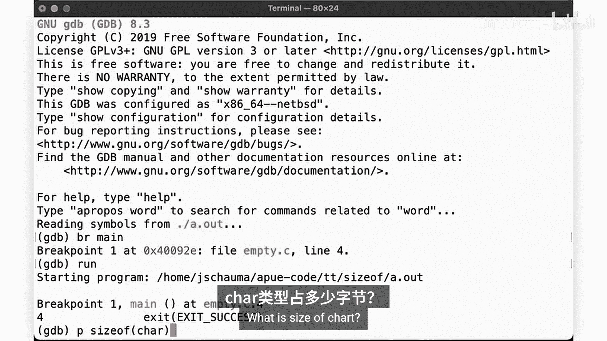

Size of char is one that is size of gives us the storage size of the data type。

 we pass it in char sized units。Logically， then that size of cha is exactly one cha size unit。

How about an int。Now on this platform， an end is four bytes。A float is four bytes。😔。

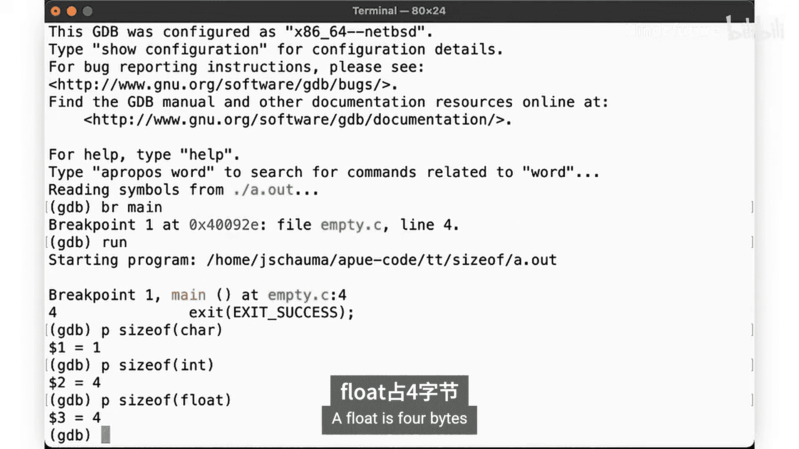

Aong is 8 bys。And the double is also8 bytes。So far， so good。 These are basic data types in C。

What else do we have？Well， we have pointers。What's the size of a pointer？8 bys。

And there really isn't a difference between a cha star and the void star。Both are pointers。

Which are memory addresses， which are 8 bytes on this platform。Okay。

 so let's write a simple program that will tell us all the sizes of the data types we have。

Here we go。 float， double chare and pointers。Those are easy。But in C。

 we can also create our own data types， right， that is we can define a struct。

What is the size of a given struct。Here you have a program that defines a fewstructs。

 one comprising a pointer。One with a pointer and an in。One with two ends。

 and finally astruct ofstructs。

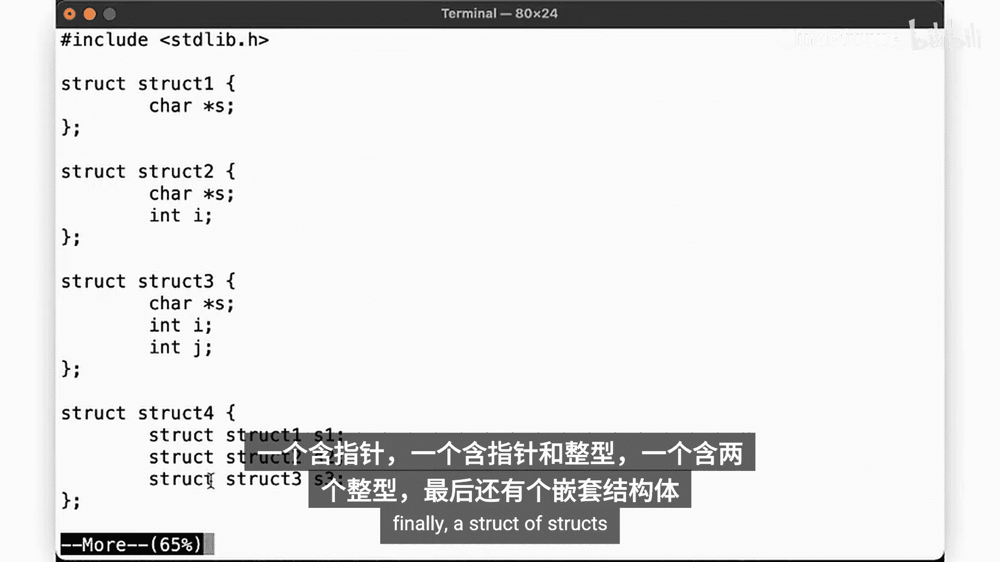

Let's inspect this program。

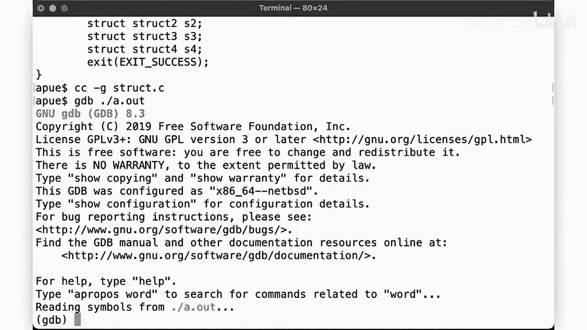

We break in Maine。And run it。

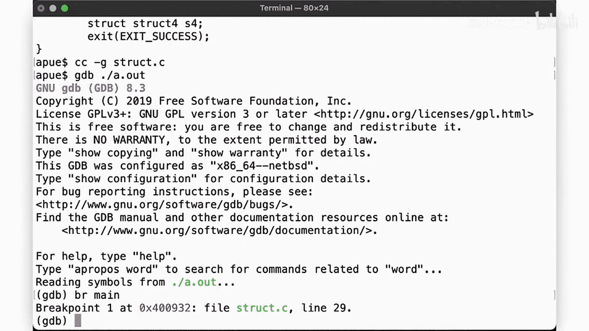

What's the size of ourstruct one？

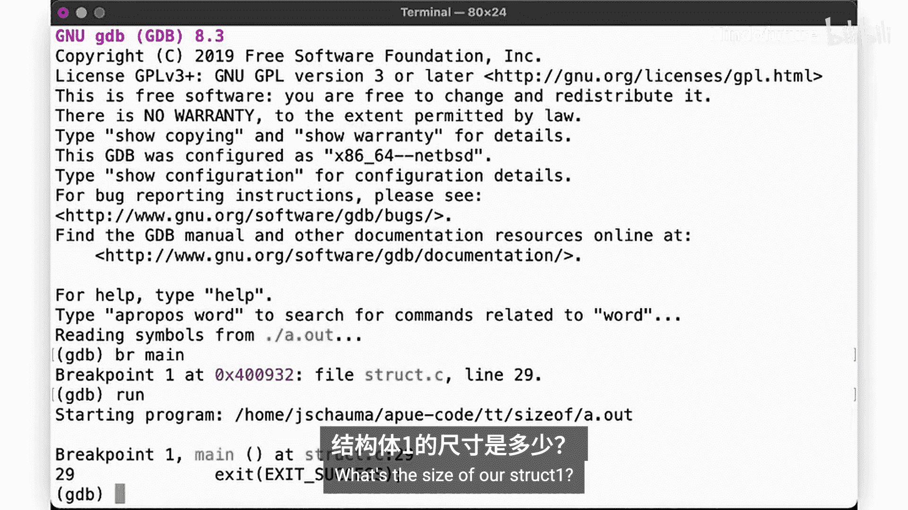

Well， ourstruct one only contains a point room， so not surprisingly， the size ofstructstruct one。

There's going to be8。Now， Sov does not require the data type as an argument。

 but can also be given an expression。So if we have a variable of typesstruct 1。

 then we can just say size of as one and get the same size。How about Str 2。

Astruct2 contains a pointer，8 bytes。And an int。Four bytes。So we might expect it to return 12 bys。

 butstructs may be padded， So it looks like we'll get 16 bys here to include padding to improve alignment and memory。

Okay。So struck three。Contains two ins and a pointer。

So it fits in with the alignment just likestruct 2， 16 bytes。And what aboutstruct4。

 a struct containing other structs？Well， that contains a struck1，8 bytes。The struck two， 16 bytes。

 and the struck 3， 16 bytes。Adding up to 40 by。Let's add all this to our program。Here we go。

Basic data types as well asstructs。But now we're going to get a bit funky。In C99。

 we got support for flexible array members ins。That is。

 we could have a member in ourstruct that as an array of an unspecified size。

So what would be the size of this flexstruct？Let's take a look。

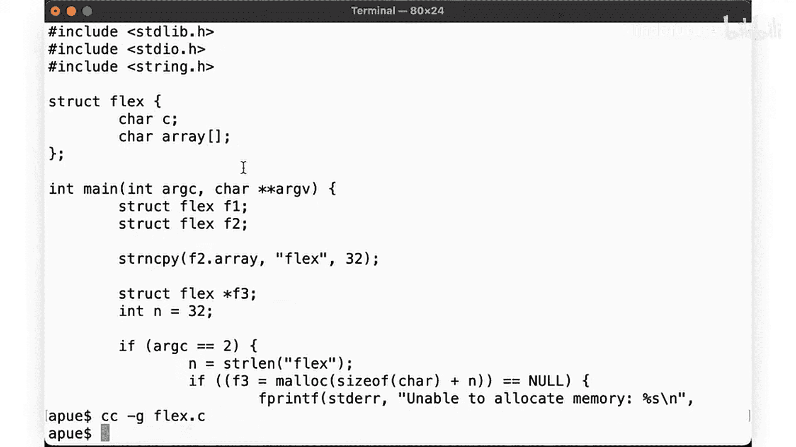

Size ofstruct flexs。

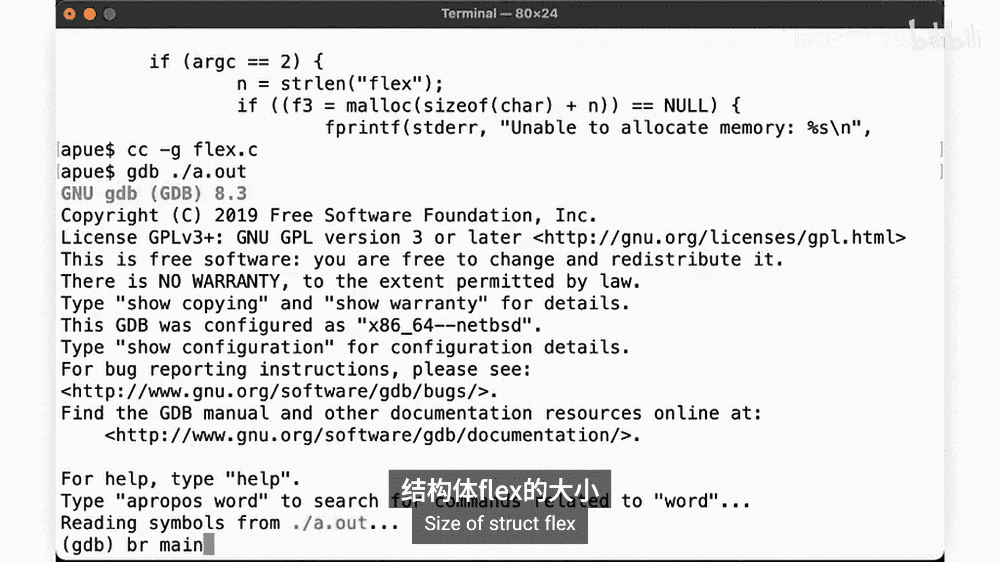

Returns one， which is the size of the char C。To this。

 the array member appears to have a zero size in thisstruct。So if we instantiate two of thesestructs。

We get structures with a cha C and an empty array。Now we start using STRN copy to write to F2。 array。

And we can confirm that we successfully wrote the data。But now if we look at F1 again。

We noticed that we apparently overwrote that data structure。Since we this stack。

 F1 has a higher address than F2， and since the size of the struct is 1。

 F2 begins right below F1 and our riding flex ended up riding F into the char element of F1 and Le into its array。

Now this is clearly the wrong approach。How should we initialize such a flex array。F3 is a pointer。

So maybe we can just write data to that。What's the size of F3。

Well it being a pointer size of R's8 and is initialized as null。So of course。

 if we then try to write data to F3。 array well。Get us sec thought because we attempted to de reference nu。

Let's try this again。This time using a different approach。

Here we continue until we're back at writing to F3。

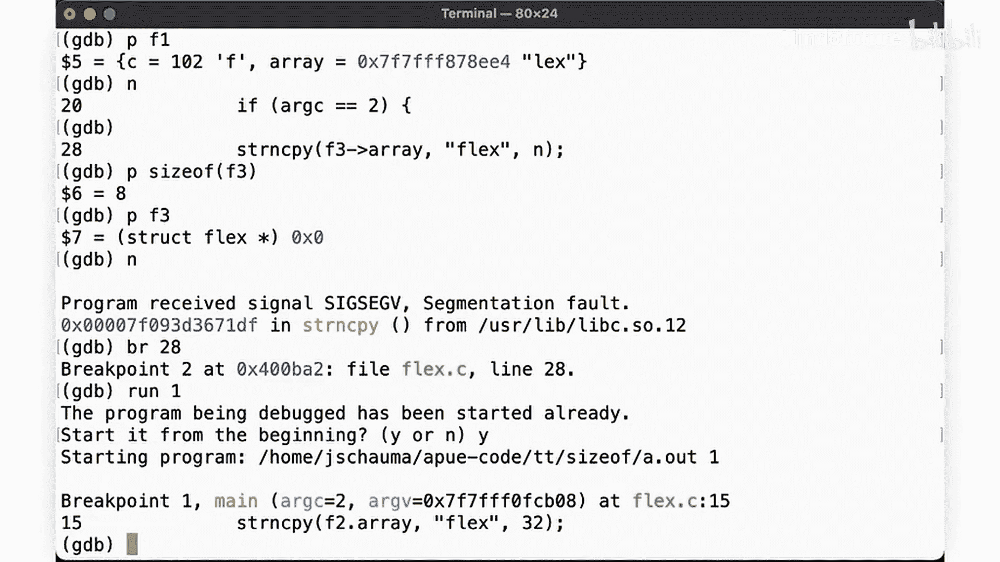

But this time we had initialized F3 using Maoc， so now F3 is a valid pointer with astruct found at this memory address。

So now we are successful in writing our data into the flexstruct。But the size of F3 remains 8。

Because F3 is still just a pointer。But now things are getting really weird。

 F3 has a field named array， which contains the string flex。But F3 array is size of。0。Remember。

 we had to find thestruct。As containing a zero sized flex array。

 so size of dutifully reports that size。But the data found in that array has a string length。

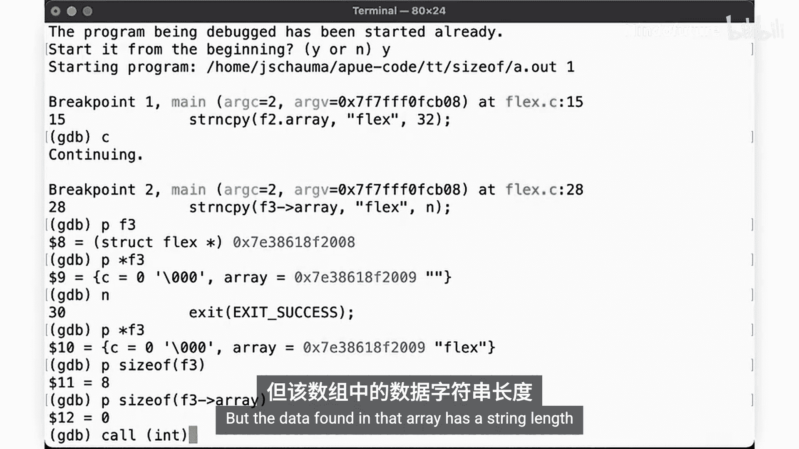

A four for flex。So clearly， there's a difference between size of an STR N， right？

Let's investigate this difference。Here's a new program that we start right away in the debugger。

The program looks like this。We initialize a few buffers and pointers， allocate some memory。

 write some data， and well let's see。So。What is Buff1？Oh， it's ABC。What is the size of Buff1？

It's four， three letters， plus a terminating null character makes four。What is its string length。

SGR length returns the length of the string up until the terminating null。So that's three。Okay。

 so we want to inspect the other buffers too， so let's save ourselves some typing。

And define an alias in GDP to call these two。Let's say Z for size off。And SDR for EtuolN。There。Okay。

 so now what's Buff2。

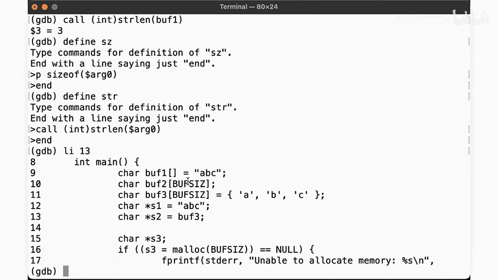

Buff 2 is a cha array of sizeius1024。And size of degrees， tened before bys。But what's S then。

 that report says6。Why is that？Well， we didn't initialize the buffer。 So its contents are undefined。

 And just so happens that the first few bites are not null。

 So S G Harland will count them up until the first null biteite it finds Ergo 6。

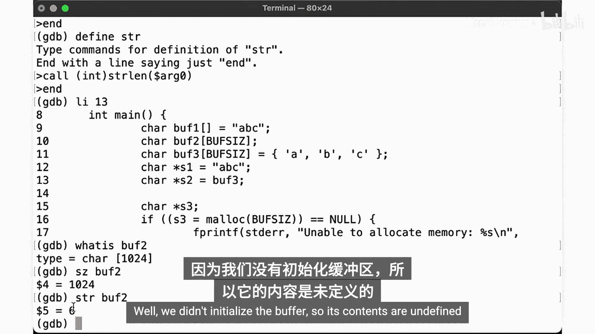

Now B3 is different， we had initialized B 3。

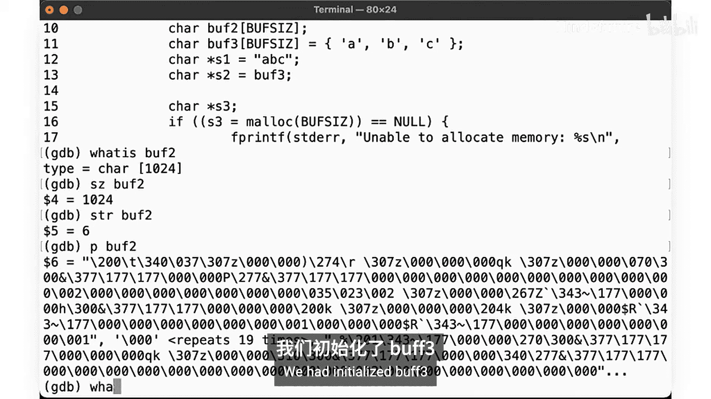

But three is also a char array of size 1024。And yes， size off agrees that is 1 to4 bys。

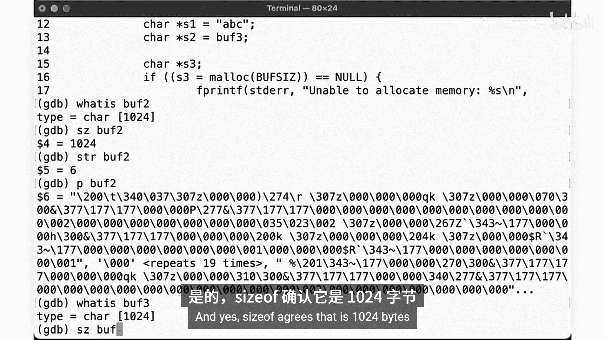

But SGara will tell us that it is three bytes in length， because that is how we initialized it。

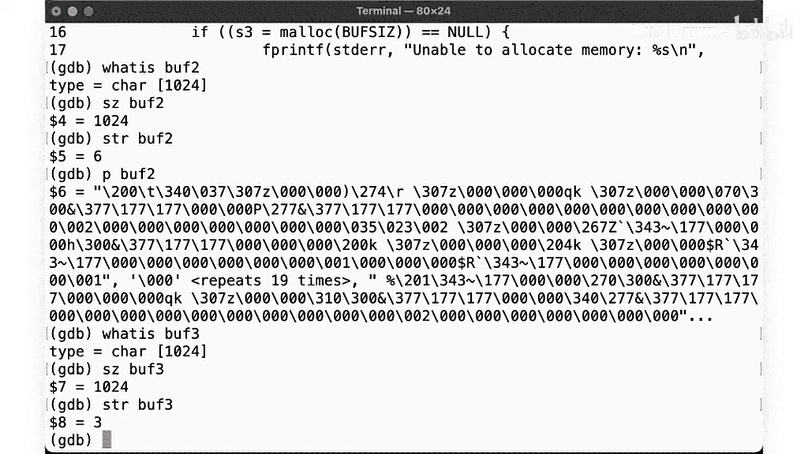

ABC and an implicit 1020 remaining nullbittes。They okay。

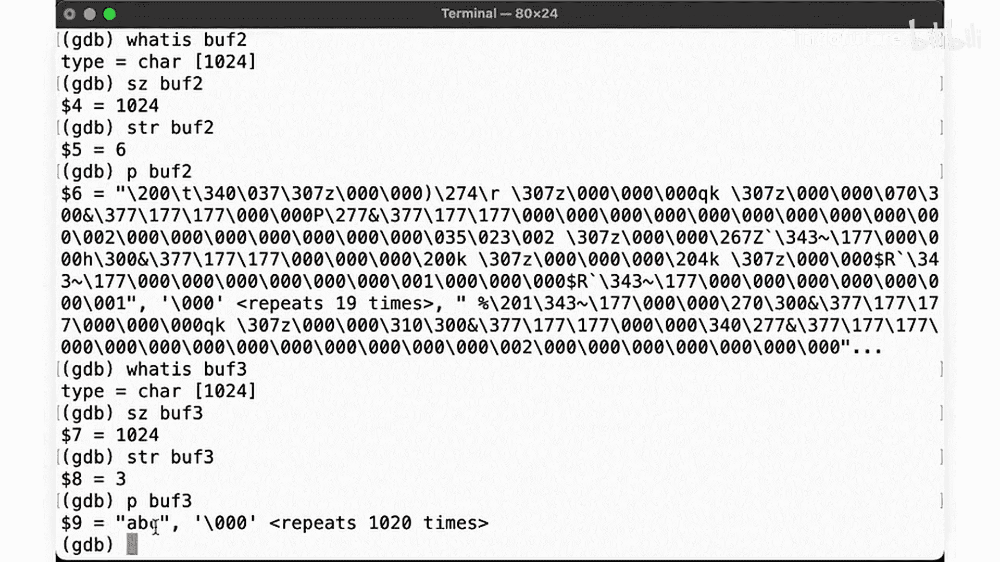

No。What is S1？

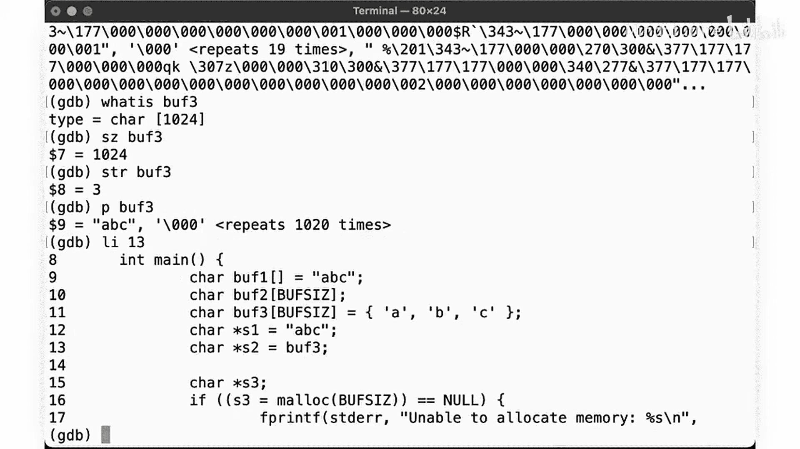

As1 is a char star， and we know the size of a char star is 8。

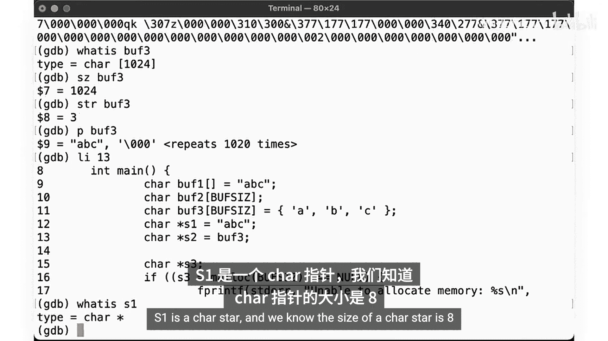

But we had initialized cha Star to point to the string ABC， so its SR length is now again3。

And P as1 shows that the di string here。S2 is another chare star， Ie another pointer of size 8。

It's SGRN。There's also 3 because S2 points2 above 3。Which。Is a cha star of 1024 bytes。

At this memory location over here。Next， S3。Another cha star。Size 8。And SGR then。Also8。

 but by coincidence， because again， we had not initialized S3 or whatever happens to be at that memory location will be reported as it E all and up until we encounter an nubite。

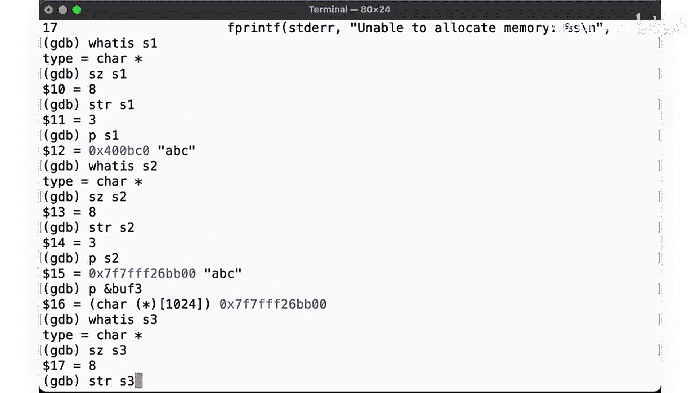

No， where worried it。Yes， we're going to allocate some memory。So now after the meoc call。

 but before the STRN copy。S3 well now。Point to a different location。It's little pointer。

 so still 8 bys in size。But its SGLN is now zero because Mello appear to kindly have initialized the memory as all zero。

If we now write data to S3。The contents of S3 are updated。Its size remains unchanged。

 since of course it's still just a pointer。But its estualin is no 10。

 as that is the number of bytes we wrote。So we see that size of and STR length are really quite different。

And if we put all this together into one program。Then we can observe the differences from the basic data types to thestructs and flex array elements。

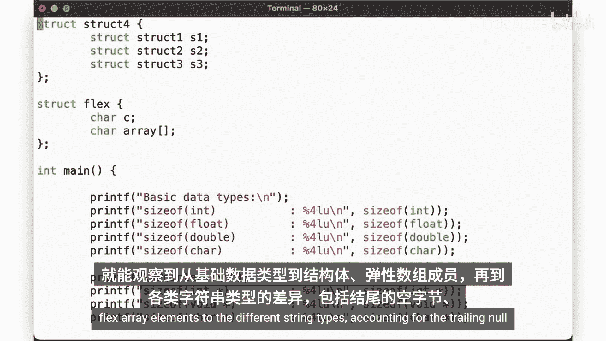

To the different string types， accounting for the trailing nullbins。

 the initialized data and the final allocated and written data。

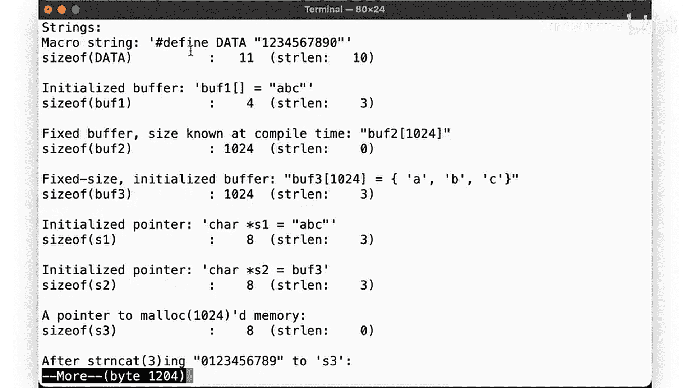

And so。

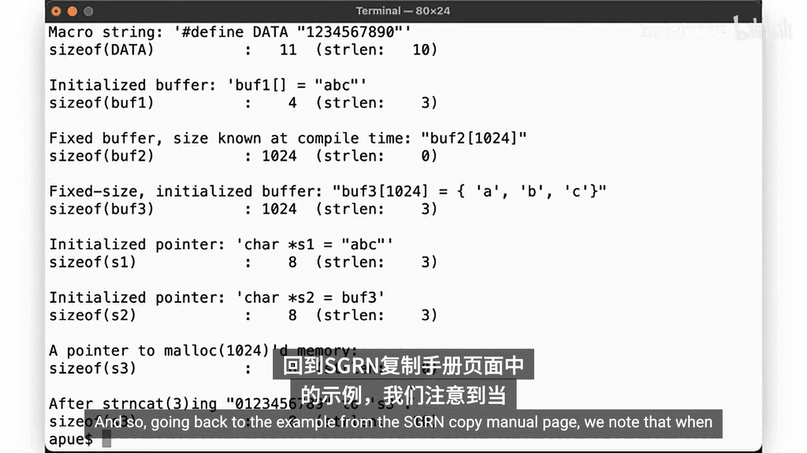

Going back to the example from the SJn copy Man page。

 we note that when we have a fixed size buffer with a size being known at compile time。

Then we can use size of to determine the correct size。But if we have a dynamically allocated buffer。

 then we can't use size of because that will always return the size of the pointer on this platform。

 A in our case， which is not the size of the buffer at all。Rather。

 we need to specify the actual maximum size of the buffer that allocated to pass to STRN copy。Okay。

 all of this， just about one little operator。But that is indeed what size of is an operator。

 not a library function。And it doesn't return the length of a string。

 but rather the storage size of the data type or expression that we pass it。Now。

 Sov is commonly used during dynamic memory allocation， especially forstructs。

 but it not must not be confused with S Rlan， which simply counts the characters up until the first nullbite。

So if you are writing data to a buffer， that was dynamically allocated。

You must know the max size of the buffer and cannot use size of。

 as that will simply return to you the storage size of the data structure。

To ensure you understand the difference between Ca and STR then。

 please look at the sample code posted on the Q website and play around with it on your own。

Until the next time， thanks for watching， cheer。

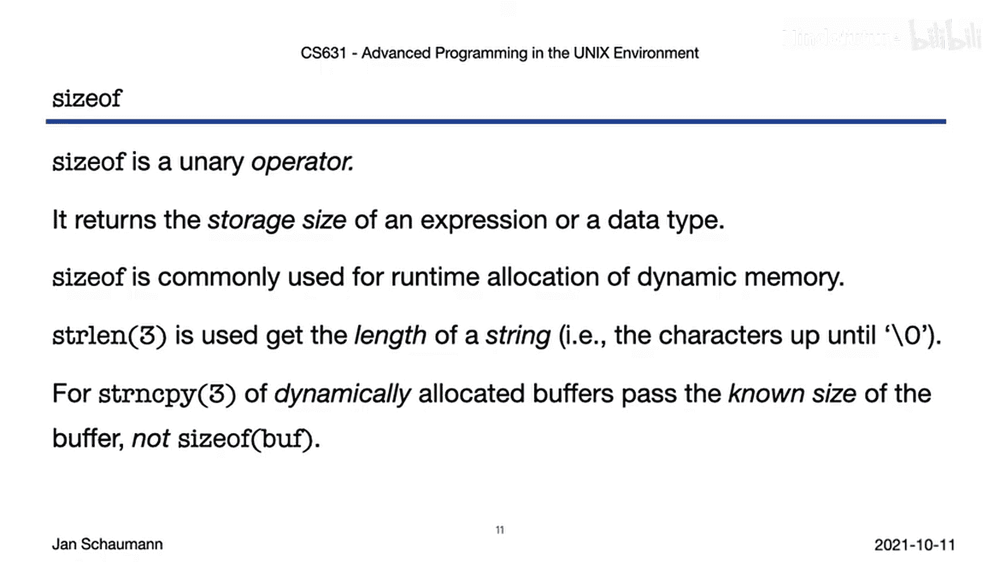