# UNIX高级编程-p37-P37-Tool-Tip---ed(1)-is-the-standard-text-editor--BV1hPuVz8EWS_p37-

Hello and welcome back to CS631 Advanced programming in the Unix Envi。In now a week。

 five series of videos on the Uni development environment。

 we talked briefly about using a suitable code editor。

 and many of the examples I've gave there were based on V I or Vim。

But it is a common joke amongst Unix users that there is only one standard Uniix editor， E D。

So I figured it might be useful to do a quick video on ED。

I promise this is actually going to be useful beyond just trying to gain eunuchs O G credentials and trying to impress fe onnerds。

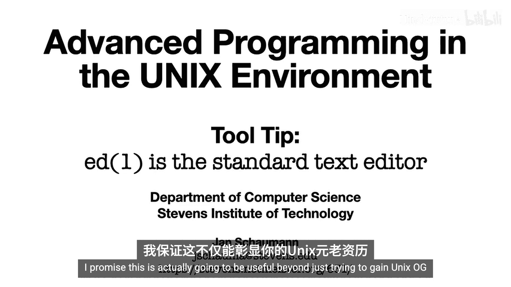

Now， for years， I've pronounced E D as Ed。 but it turns out that the proper pronunciation is。

 in fact， E D， as noted by Brian Carnegan in this linked video here。

 So I guess I'll have to get used to that。I may slip into calling my good friend Ed， at times。

 though。Anyway， so E D was written by Ken Thompson way back in 1969。

 the original first version of Eunuchx as one of the three major components together with the shell in the asmbler。

After that， it inspired the X editor written by Billjoy， which then， of course， LED to the eye。

But enough of that， why don't we start and dive right in。

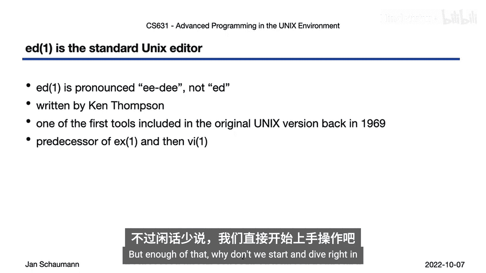

Let's give our girl friend Ed， I mean， E D a try。Here we go。你理。Okay， now what。Question mark。Returned。

Question mark。Help。嗯。Okay， I give up。 let's quit。Er， how do I quit this thing。Conl C should work。

 right。我的。Okay， let me just feed it end of file via control D。Yea， that worked。OK。

So it was interesting。That's about how a typical user's first E D session goes。 Not very helpful。

But maybe let's take a look at the manual page。Okay， so E D is a line oriented text editor。That is。

 it won't give you a full window with all the contents of the filing question。

 but rather will be upload on a line by line basis。Next， E D operates in two distinct modes。

 command and input。Which explains why at first， we couldn't do anything。 We were in command mode。

So now let's take a second look at how we might use E D to actually do some editing。

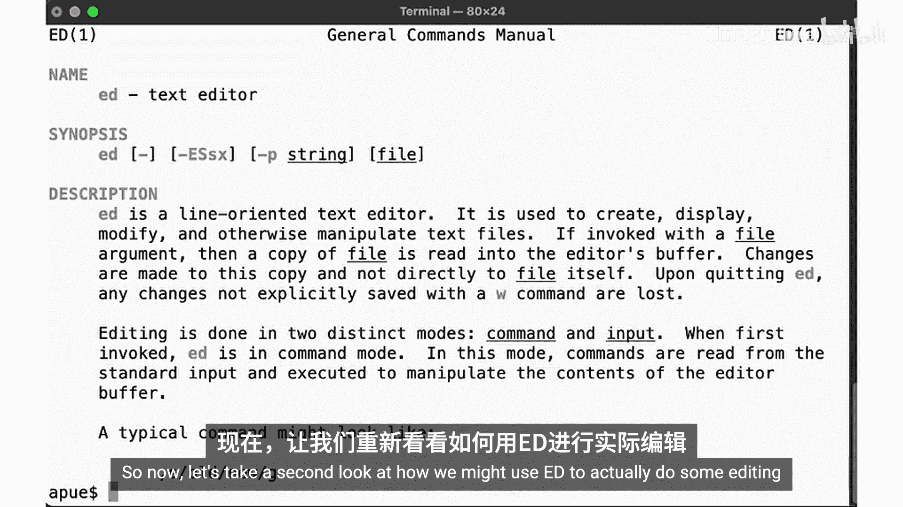

We start E D and begin in command mode， as before。We type a for a pent。

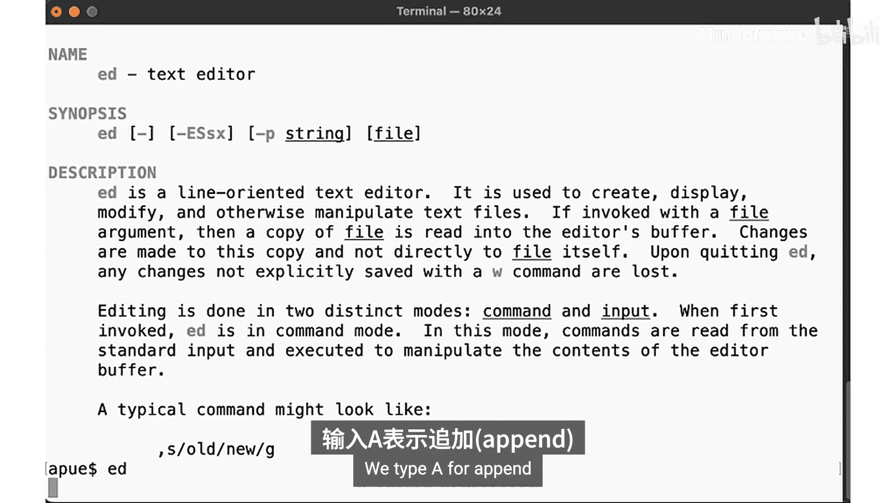

This puts us into insert mode， and we can insert text。Here we个。

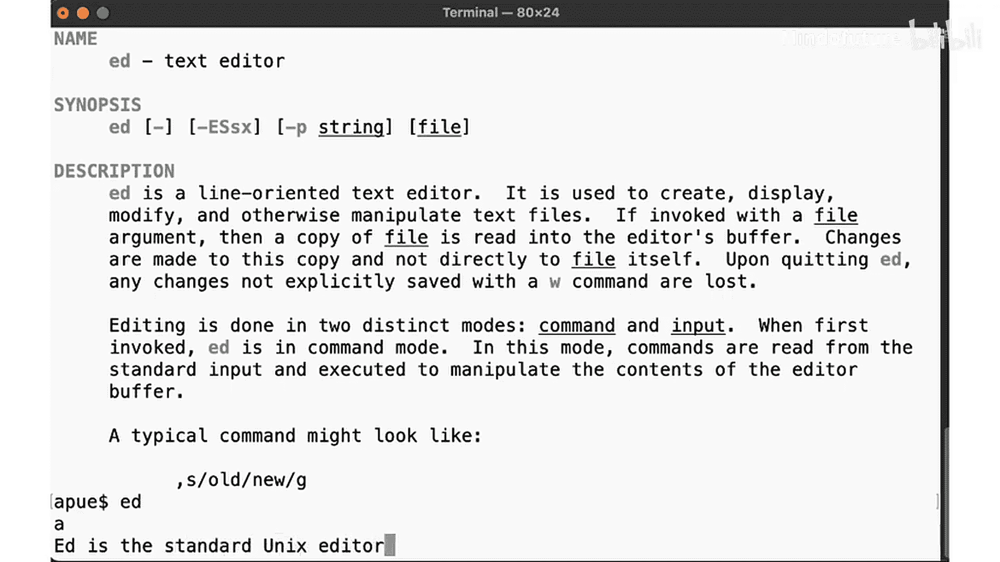

Okay， good。Now， we switch into command mode by entering a period on a line by itself。

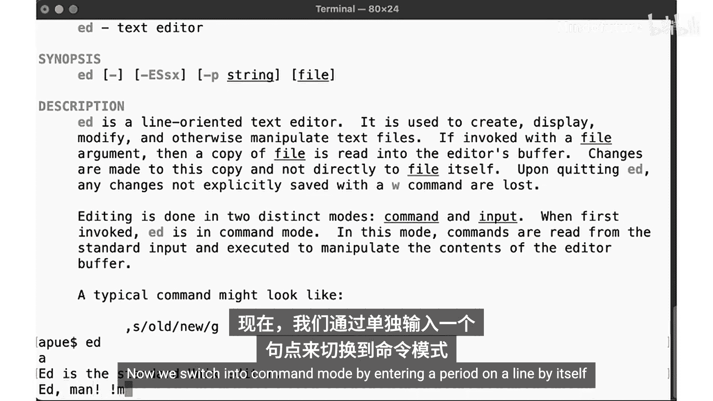

Next， we want to save our data by writing it to a file。

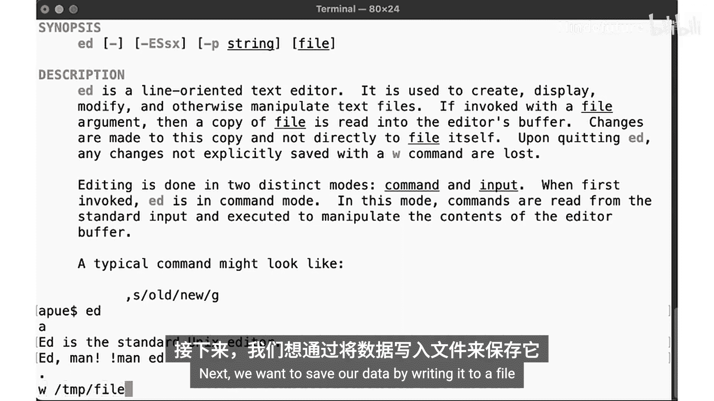

E D helpfully tells us how many bytes it has written here。We then quit E simply by typing Q。

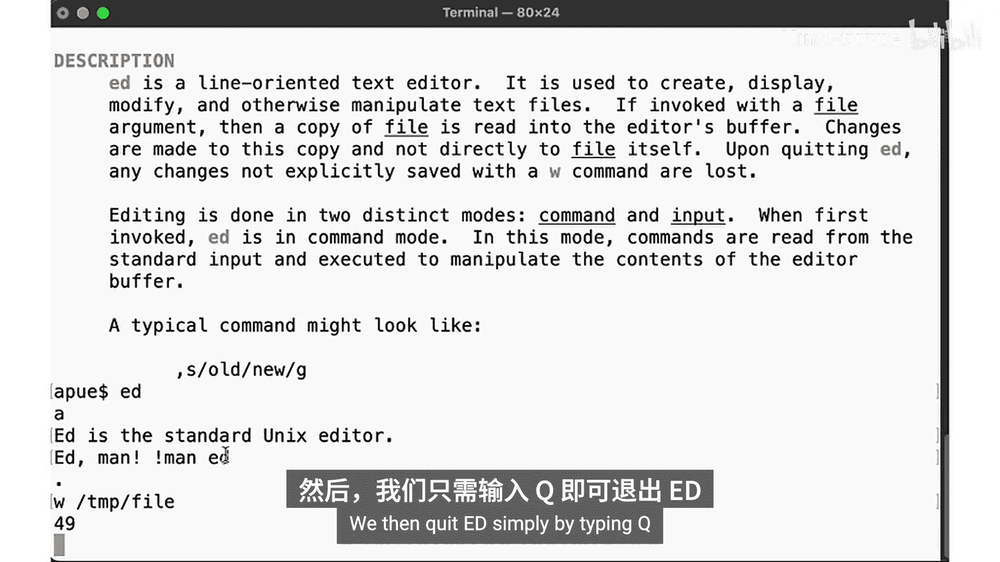

And our resulting file looks just， as we would expect there。 Was that so hard。

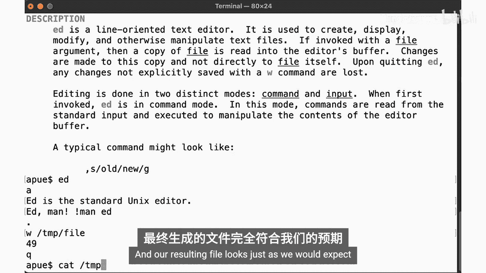

All right， we created a new file， but now let's actually edit it and make some changes。

When we start indeed with a file name。

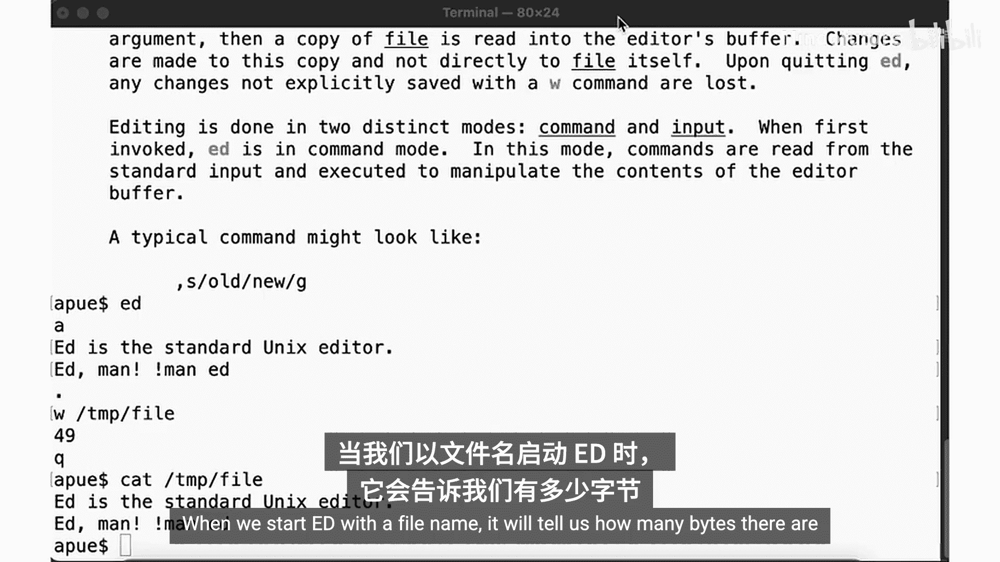

It will tell us how many bytes there are and places at the end of the file in command mode。

We can instruct ED to perform operations on line ranges。 So， for example。

 to print the data in the file starting at line 1 and until the end， we'd use this command here。

1 come a dollar P。

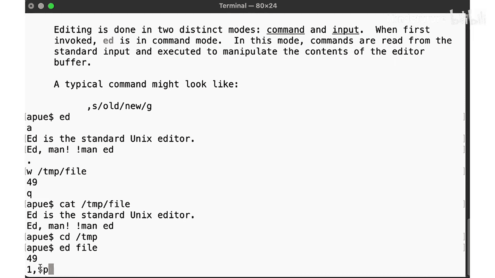

As a shortcut， we can leave at the starting and end address and simply type comma P。Now。

 let's turn this file into a C program。First， we want to insert data in line 1。

Where we can now start writing our code。Then we go back into command mode。

And app pen data to the end， using dollar a。Okay， let's have a look。

HWe'll need some printf statements here。We can do this by using the substitute command。

That's a start。We can also jump to the first occurrence of a pattern， by searching for it。

Let's appent the closing quotes and pars。Oh， dang， we are still in insert mode。

And we don't want the closing print on a separate line， anyway。Let's delete those two lines。First。

 the line beginning with a quote。Then the following line， too。Okay， we're back where we started。

 Let's try this again。We don't want to append as that puts us on the next line。 Remember。

 E D is a line based editor。 So we use the substitute commit， which， without address range。

 operates on the current line only。Hitting return moves us to the next line。

 where we can run the same command again。

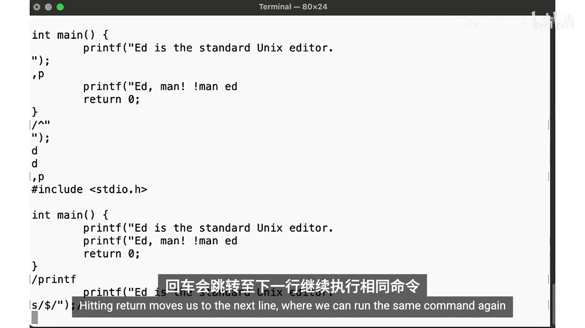

If we want to see the current line， we can hit L。Plus， he works just like hitting return。

But you can add a number to go to the end line， if you want to。O。

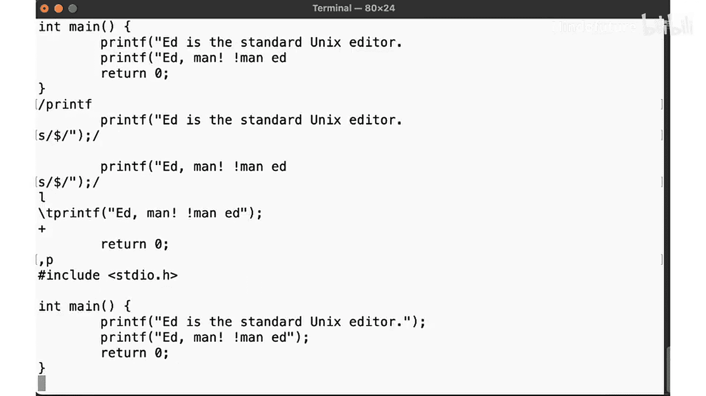

Let's write our file to a new location。Quit。

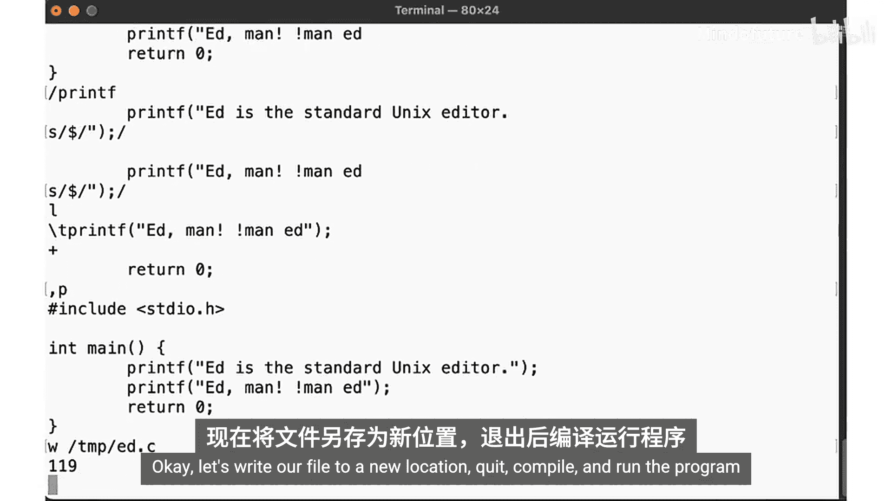

Compile and run the program。Now， this is all nice and well， but we clearly forgot the backlash ends。

Let's fix that。First。Let's only view the lines that contain printeth。We do that， using this command。

That might look familiar to you。 We globally search for a regular expression and then print the matching lines。

In other words， the command has the form G， slash R E， slash P， or Gr。

Which is exactly where the Gr command comes from。Here， R E actually match return。 But anyway。

 we wanted to fix our printf lines。Since E D is line based。

 it makes sense to operate on line numbers。Let's say D show us what lines are and what line numbers there。

So now we can say on lines 4 through 5， substitute the closing quotes with the backs slash N followed by the closing quotes and pars。

Okay， let's write our changes and quit。Yea， much better。So now， since E D is line based， as we noted。

 since that it has a command mode separate from insert mode。

 we should be able to feed its specific commands simply on standard then。Here， let's give that a try。

Hey， cool。 That works。We simply provide the command and send it in， and the de processes it。Now。

 let's give it a command to make actual changes。Here， we tell E D。To move line 4 to line 5。

And then to write the changes it made。E D tells us the number of bys at start up and the number of bys when en wrote the changes under a file。

 nor looks like this。Here， we're passing the dash S flag to suppress the diagnostic messages。

 and we see that we are able to change the file by simply describing what changes to make and commands that E D understands。

As noted above， this command mode is so useful that we've actually derived complete other tools from it。

Most notably， of course。The Gr utility。Now， hopefully。

 we've seen that E D is actually quite interesting。 but how does understanding E D help us。

One way is that mastering E D will also make you become more proficient in using V I， for example。

Here， let's take a look。V I also has two modes， command mode and insert mode。

We have to enter insert mode before we can insert data， just like an E D。We switched to command mode。

And can operate on line numbers， search for patterns or perform transformations based on line numbers。

 just like in E D。Note the similarities between the commands we run in E D as well as in V I。

We write the data and quit the editor almost exactly， like an E D。

The only difference here is that while E D is line based， V I is， well visual。

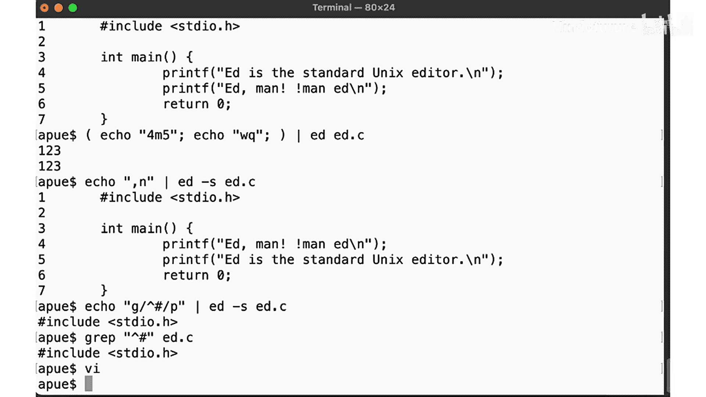

Anyway， that's it for today。 I hope you enjoyed this little detour into the standard Unix editor。

 And don't worry， this was not entirely frivolous。 A from helping you better understand V I or the set command。

 we will return to the idea of describing code changes via line based commands in our week  five series on Unix development tools when we cover the diff and patch utilities。

😊，In the meantime， maybe try to do a little editing every once in a while using a good old friend Ed。

 I mean， E D。更本。I mean， quit。

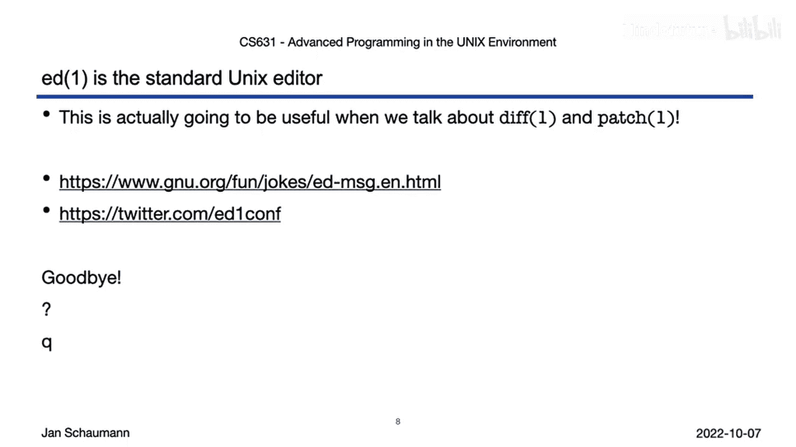