# UNIX高级编程-p38-P38-Week-06,-Segment-1---Memory-Layout-of-a-Process--BV1hPuVz8EWS_p38-

Hello and welcome back to CS631 Advanced programminging in the UniX environmentvironment。So far。

 we've talked a lot about individual programs such as the common units utilities font on a s bin。

 but we really haven't talked much about processes。Well。

 we did mention in our introductory lecture that a process has certain properties such as a process ID。

 we've seen that a process has an effective UI and group ID。

 and we've noted that properties of a process cannot be changed by a child process。

 such as the current working directory。But we really have not looked at all at what the process really is。

 what it looks like or how processes are brought to life and how they die。

In these coming videos covering the materials for week number six， we will do all that。But first。

 let us get a visual understanding of what the process looks like in memory。

 This can be quite useful to understand many aspects of process execution later on。

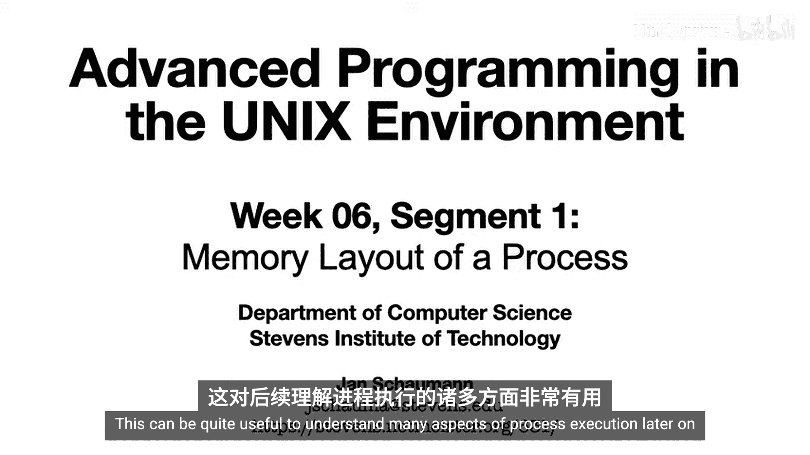

I'm sure you've seen an illustration of a processing in memory like this before。

 though you show a high address， a low address， the stack， the heap， etc。

But we generally like to really see what things look like by writing some code and inspecting the outcome。

How can we do this？

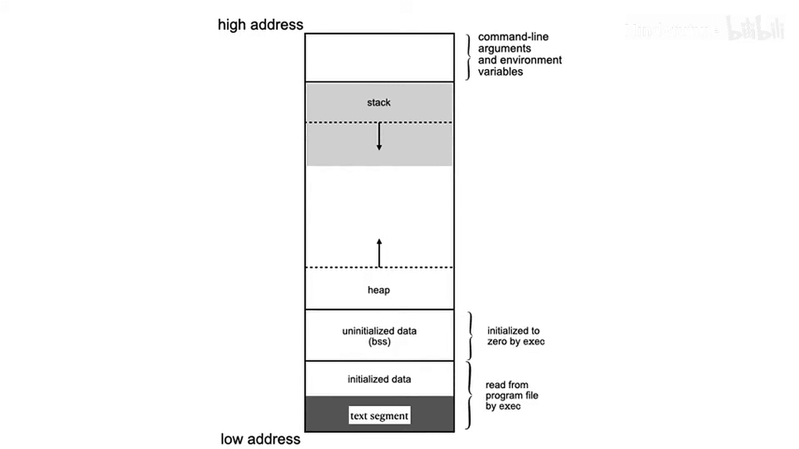

Well， let's take a look。For starters， let's note that in C we are sufficiently low level that we can inspect the address of any program element even without using a debugger。

Every variable really is just whatever is stored at a given memory location。

With the amount of memory used being defined by the type of the variable。

A pointer in turn is nothing but a variable whose value is an address in memory。

By using the M percent operator， we can dereence the variable。That is。

 instead of a value start at the given address， we get appointed to the address of the variable。

We can then take this memory address， cast it to a number， and print that value in hex。Here we go。

So apparently the variable of R inside of main can be found at this hex address。

So now that we've seen how to do that， let's try to use this to explore a little more about our program。

Here。We see two arguments being passed to a main function， axy andrV。

We declare a private variable visible only within main。

But we also have a global variable accessible to any function in our program。

 even if we only have one function here， named Mainine。But since this is C。

 we are not bound to dereencing variables， we can order de referenceence function names。

 they were obtaining a function pointer and print that address。So when we run this program。

The output looks like so。And this is now getting a bit closer to what we imagined or process to look like with some things being found at a high address。

 Axy， ArcV and the private variable in this case， and some things found at a notably lower memory address or a global variable of the function main itself。

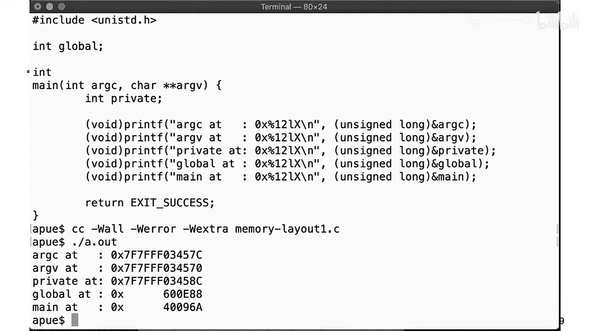

That's not enough， we want to further see if we can identify the location of the stack and heap and some of the other segments of the program and memory。

So here we have a more comprehensive program that declares a number of different things and prints their respective memory addresses。

Here， we have a few variables declared。 note that some of them are initialized。

 meaning they have been assigned in explicit value， and some of them are uninitialized。

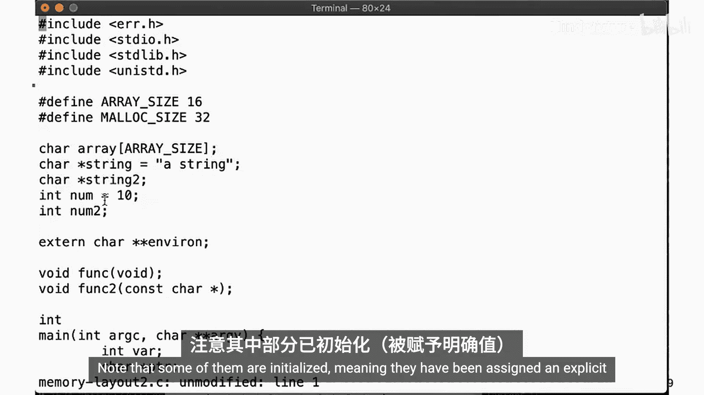

Our main function has some variables visible only to main。

 and we then begin printing out the various addresses。From within main。

 we then call two other functions。

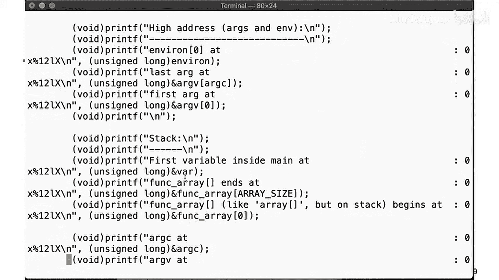

Then we dynamically allocate a bit of memory。My am Maloc。

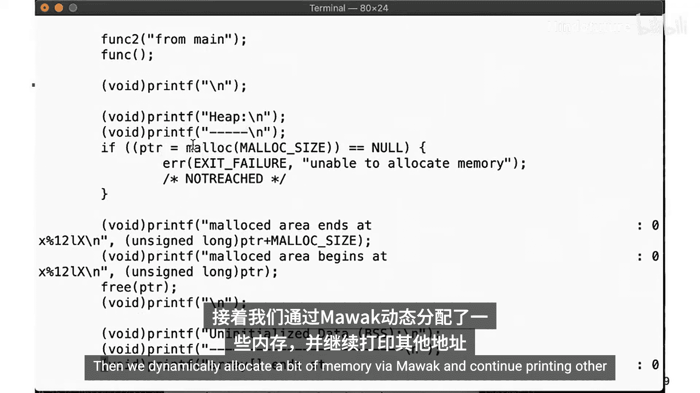

And continue printing other addresses。Don't worry too much about reading the code here。

 you can download it from the Qse website to play around with yourself。Let's run it。

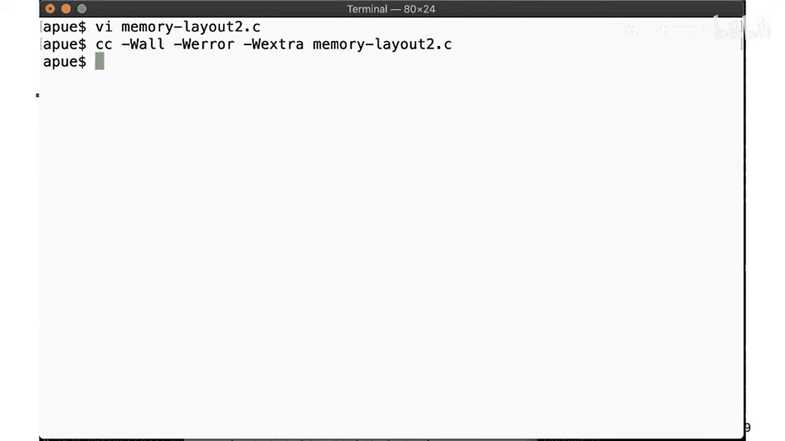

Here's the output this program produces， nicely formated to help us better understand where the different memory addresses are。

This looks a little bit more like what we had previously visualized。

Notice how the output is mostly sorted by memory address。

 starting with the highest address at the environment。

And down to the lowest address of the main function itself。

Since we invoke the command without any additional command and parameters。

 AQV will contain two elements， ArcV0， the program name and null。Each member of Aby is a cha， star。

 pointer， and thus takes eight bys， which we can see here。So our findings match our illustration。

 command and arguments and environment variables are found at the high address of the process in memory。

At the bottom， the low addresses may find the text segment。

This is the part of the virtual address space that contains executable instructions。

This is usually markedwidonni。This， by the way， is where the original use of the sticky bit comes in and if that bid is set and the ST mode。

 then the OS can keep the text segment and swap space after the process terminates。

Upon a subsequent execution of the same command， the colonel can then simply move the segment from swap into real memory。

 which is much faster than fetching it from disk。That is， the text segment remains sticky in memory。

 and this is why the sticky bit is also known as the safe text bit。

This used to be set on certain large frequently invoked binaries， the compiler， say or Eex。

Most modern Unix versions do not use a sticky with any on file any longer。Next， going bottom up。

 we have our initialized data， that is variables that we have defined find and declared in global scope or that are static variables even if defined within a function。

 meaning they retain their address across function in vocations。

 this is the initialized data or simply data segment。

Both the text segment and the data segment are read from the program file by Ex and program startup time。

After that， we see the part where we store uninitialized data here we can see our globally declared but uninitialized array of size array size。

 which is what we declare to be 16 bytes， which is nicely reflected in the hex address showing the start of the array at 601a A0 and ending 16 bytes higher at 601a B0。

All of the unitialized global variables end up in this segment， the uninitialized data segment。

 also known as the B S S segment as it is placed after the block starting symbol。

This also includes static variables that have been initialized to zero。

 or other uninitialized variables are initialized to all0 by exactec。

Next on top of the BSS segments it's the heap， This is where memory is dynamically allocated from at one time on demand by a meoc or similar functions。

This area is shared by all threads， shared libraries， or the Nene link modules in the given program。

We allocated 32 bytes， which we can again see as the starting address ending in 00 increased to 20 x。

As additional memory is allocated， the heap goess upwards towards the higher addresses。Now。

 back up towards the higher addresses， right below where we found our command and arguments。

 the stack begins。The stackers are liful， a last in first out。

 Well stack on which the function frames are pushed as they are executed。

The stack pointer points to the top of the stack， which somewhat confusingly is the low interest of this visualization。

Sometimes you may encounter this illustration flipped upside down。

So so as to allow the stack pointeder to actually point to the visual at top of this stack。

 but for this architecture that then places the high address at the bottom。

 I find it even more confusing and prefer this image here instead。

You get used to staying top of the stack when pointing at something that grows downward stonebury。

Anyway， so the stack starts at the higher address and so all the addresses in the stack decrease in order。

We find our first variable in this stack， the int var at A8254 as an in， it only requires4 bytes。

 So the next variable， the array we declared inside of main， begins at a82，50。

 which at 16 bytes ends at A 82，40。Not also that axian and Arly。

 the arguments to main are also found here， and everything belonging to this function goes into this frame on the stack over here。

Now from within Maine， we call funqu， which gets pushed on the stack。

And our stack pointer is updated。After F2 completes。

 we pop the frame of the stack and return back to main with the stack pointer back here。No， we fuck。

Which is pushed onto this stack。Funk calls Fk 2， which gets pushed onto the stack as well。

So we saw how while the heap grows up from a low address。

 the stack grows down from a high address as function frames are pushed onto the stack。

But notice that we have one outlier here on the left。With the NoA function fund。

 we declared a static end n equals1。As a static variable that was initialized。

 we should find this address。In the data segment down here。

If you were to flip the initialization of this variable to0 in the code。

 you should see that this flips the address to end up in the BsZ segment， give it a try。All right。

 so now let's take a look at our process imaging memory， as we said。

 the he grows up and the stack grows down。But that means that the two are growing towards one another。

 So what happens if you keep pushing more and more frames onto the stack？

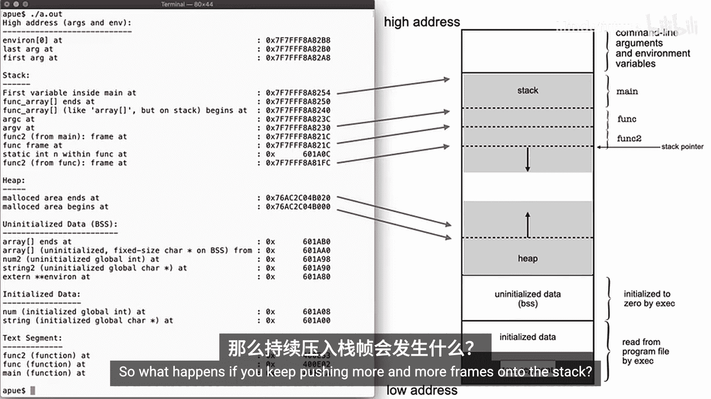

Let's give it a try。If modified of a program to allow a compiler flag to have funk2， call funk。

 thereby causing infinite recursion。If we compile it normally， everything behaves as before。

But if we define stagorra flow。Then。

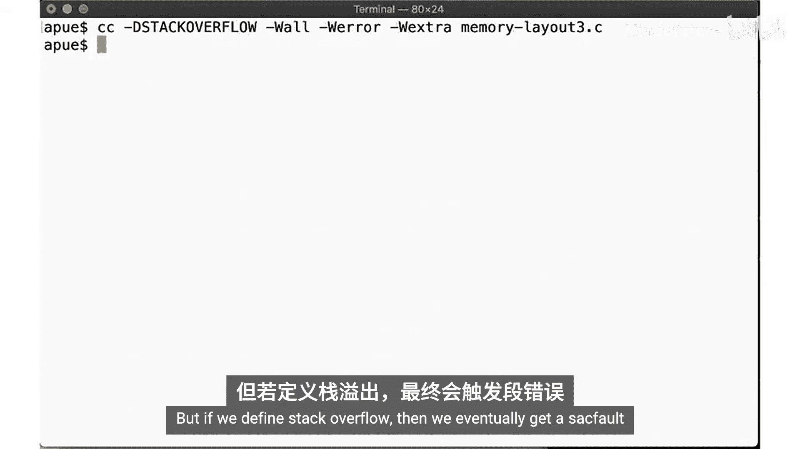

We eventually get a sec fault。That's right， a segmentation violation。

 because we are accessing a segment we have no business accessing。

Let's take a quick look how this happened。We start out and call funk。Which calls for too。Which then。

 calls funk。Which calls Fkji。And so on and so on and so on and so on and so on and so on。

 over 43000 times。Until eventually， we overflow this stack into an area that it has no longer any business reaching into。

Wecycl fault due to a stack overflow。

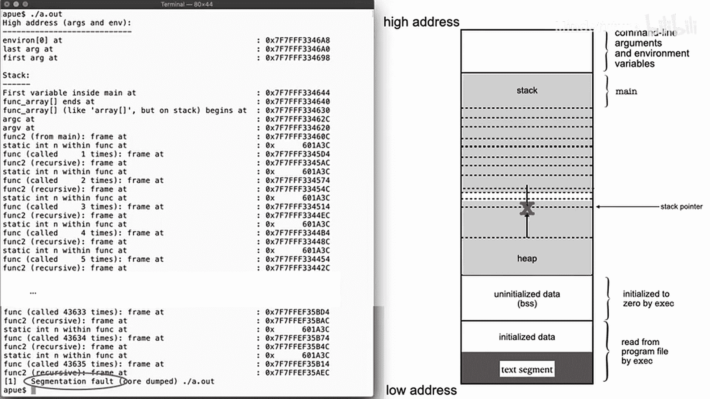

And now but you know whether the website from which you copy all your code examples has that name。

 I think we can take a break。I hope that the illustration of the process layout and memory was useful to you we get back to this every so often throughout the remainder of the semester。

Make sure to download the source file for the program and play around with the results and read through the related links shown here。

Next time we' talk a bit more about how the process starts and how we enter the main function。

Until then， thanks for watching，ith。

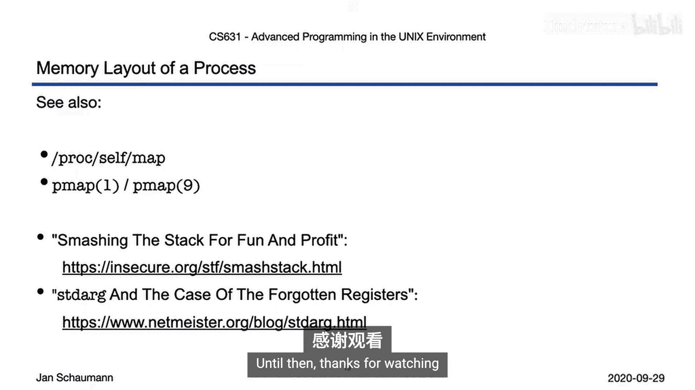