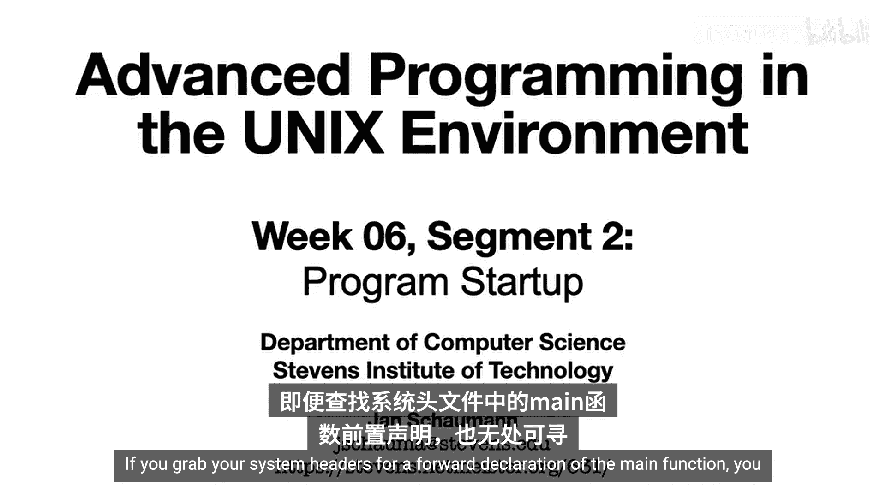
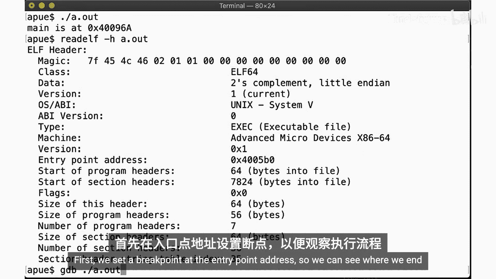
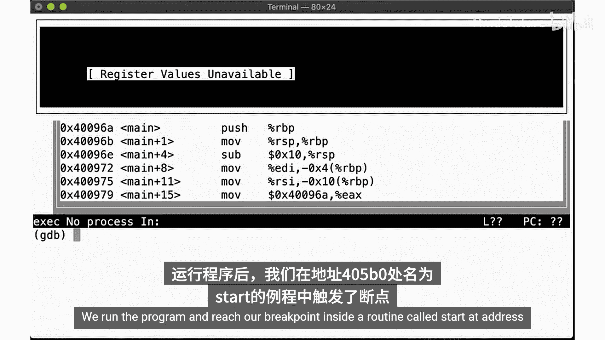
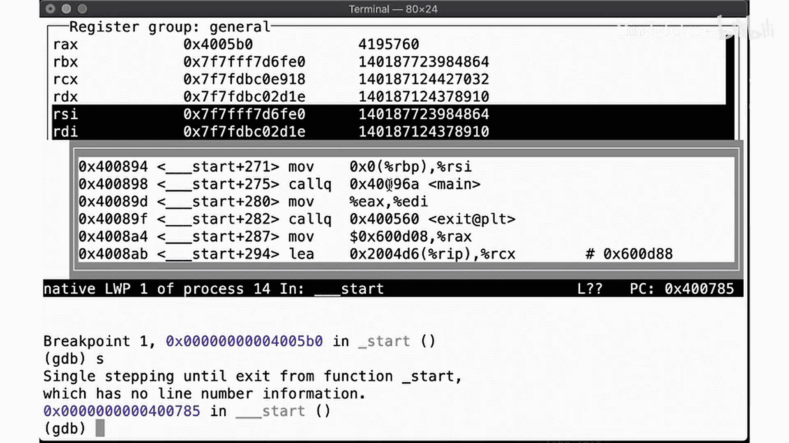
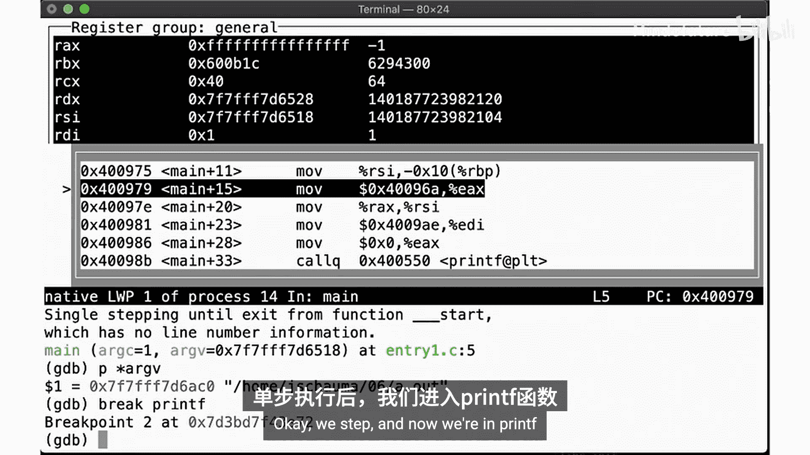
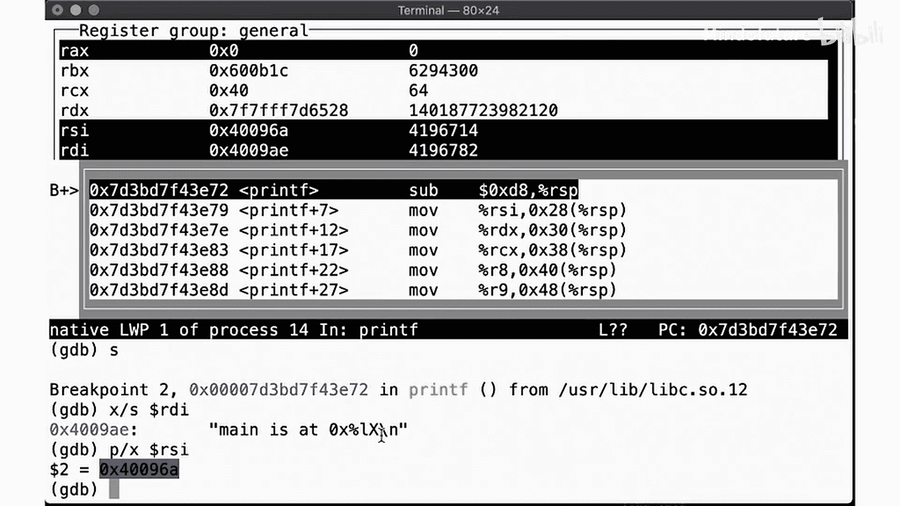
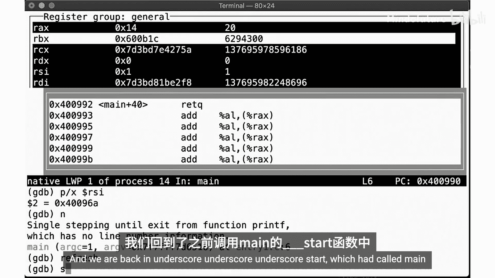
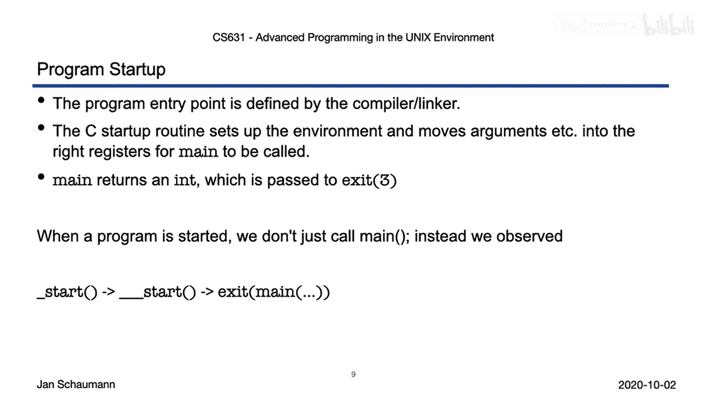

# UNIX高级编程-p39-P39-Week-06,-Segment-2---Program-Startup--BV1hPuVz8EWS_p39-

Hello and welcome back to CS631 Advanced programming in the UniX environmentviron。

After we spend some time looking at what a process looks like in memory in our last video。

 it's now time to consider the whole lifetime of a process from startup time until it exits。

We know that a process is broaden into memory via one of the exact family of functions。

 and having written a fair share of C programs， we know that we begin in Maine， right？

But we also already saw that main is a bit special。 if you type man main the terminal。

 you won't get a manual page。If you grab your system headers for a forward declaration of the main function。

 you won't find it， so where is main defined？

This is where we go to the standards， and this time it's not Posss。

 but we're looking at the C programming language standard。

The name main and whatever prototype it may have， after all。

 is a programming language specific thing。 and the C standard is this to say。

The function called a programme startup is named Main。

 The implementation declares no prototype for this function。

 It shall be defined with a return type of int and with no parameters。Specifically。

 it says that there are multiple prototypes possible。

Here's one with two parameters referred to as Axy and AV。Which we are used to。

But then it goes on to say， or in some other implementation defined manner。

Which is wonderful because that means we can have other ways of calling Ma， right？😊。

But let's go with a broad guidance given to us by the standard。 We know at programme startup。

 this main function is to be called。So when one of the exact function is called。

 the kernel needs to start the program somehow。For that， it calls a special startup routine。

 which sets up the process base， puts the command and argument and the environment into the right place。

 etc， etc。We know that Oxy is passed to main as the number of command on arguments。

And that AV is an array of pointers to the arguments， including AV0， the name of the program。

We also know that we are guaranteed that this array is now terminated so we can iterate over it easily。

Okay， all lot of those are nice words， but lots's of observe this in the white， shall we？

Here's a trivial program that prints out the address of main。

We're compiling it with D G to enable debugging symbols and using the C89 standard instead of the default Kuc C 11 standard。

As a result， we get a bunch of warnings。Which， unlike at any other time when we write code in this class。

 we are allowed to pass。Note in particular that we are getting a warning about our main function not returning in value。

 even though its function prototype promised it would return an integer。

All we're doing is print the address of main， which turns out to be 496 ax。

So this must be the entry point for the program。Let's check。Yeah。

We use the REed Elf utility to print the headers of the executable。

Don't worry too much about all the output， we'll revisit the L format and the reader of utility in a future lecture。

But for now， notice that it has in line noting the entry point address。Wichard notes to be 4005p0。

Not 496 a。So wait， our program doesn't start at Maine then。

Let's ask our good friend at debugger to observe what's going on when we run the program。First。

 we set a breakpoint at the entry point address so we can see where we end up。

Next， we change our layout to show us both the common reistries as well as the assembly of the executable。

We run the program and reach a breakpoint inside a routine called Start。

At address 4005 p0。That routine？Populates a few registerstrs and then calls underscore underscore underscore start。

That single step。Okay， now were an underscore underscore underscore start at 400785。

That routine does a whole bunch of things， it seems。At some point。

 it calls things likeed exit and lipsy in it。Before eventually。It calls Maine down here。

Calling address 496A， as we had observed from the program itself。

If we now step， we break again right as we enter me。Here in Reg RDI。

 we see the first argument to a function。Ax C。With the value of one。And then register RSI。

We see the second argument to our function。The AV pointer。The fifth element in this array。

 arc v0 is then a pointer to the program string。Now within Maine。We see a call to printf。

Let's break there， too。Okay， we step。

And now we're in print。This function comes from ley。So we don't get all our debugging symbols。

 but we can print the function arguments given to print by inspecting the argument registers again。

Examining the memory address and register RDI as a string gives us the first argument。

Printing the second value as hex。Will give us。0ero x 496 a， the address of main。

 which was what we were going to print。

Now， if we continue。We leave printer。And are back in mainine。

 where we now see the value 20 in the RAX register used to hold the return value of the last function call。

After returning from Prif may now returns itself。And we。A deck。

 an underscore underscore underscore start。

Which had called Ma earlier。Continuing from here， we exit the program。And as we can see。

The return value of our program becomes whatever was left in the register。20 in this case。Okay。

 so we saw that our program didn't really start at Maine， it started in something called start。

Where do we find that？Let's look in the source tree。

There you will find an architecture dependent assembly file under Li CSU。

 where CSU stands for C startup in the file CRT0 S。CRT stands for C runai。

And this file contains the initial entry point of the program。The underscore stored assembly routine。

Which， as we see here。Calls the underscore underscore underscore start function。Now that function。

There's a regular C function found in the CRt0 commandt C file。It takes two arguments。

 a function pointer， and astruct PS strings。Theystruct pure strings。

Is found at the top of this stack。 It is used to locate the arguments and environment strings。

 as we had previously observed when we looked at the process layout and memory。

So the underscore underscore underscore start function uses these strings to set up the X charge star star environment。

 as well as the underscore underscore pro name string。

 which is used by the get Procna library function。Further down， we see calls to add exit。

Which we'll see in our next video lecture and theipy unit function before eventually。Finally。

 it calls exit passing at the return value of main to which it passes the Axy。

 ArgV and environment pointers。Which of course means that main is not defined as being with no parameters。

Nor as having two parameters。But as an implementation defined function， taking three parameters。

We'll get back to this whole NP business in another video。But okay。

 so our entry point is underscorequa start， not main， and underscorequa start calls main。

Can we circumvent man？He has a program that has a function calledF， which would trans end。

 and which obviously isn't called at all。So when we compile this program。

We get the same warnings as before。And of course， the same behavior as before too。

And there's a switch to tell the compiler to use a different function as the program entry point。

Let's pass D E F thereby telling the compileant linker to create an executable that jumps straight into F instead of main。

We still get the same warnings， but when we run the program， we don't enter me。

Instead we directly call foo。Only， after that， we sack fault。That doesn't look good。

Let's compare the behavior between the two invocations。With a normal executable。

 we break at the address of the start routine。And then inspect the frame。

We see our instruction pointer。And the address of the start routine。

We step into the underscore underscore start routine as before and find the instruction pointer at that address。

Next， we step again and break again and meet。But note that here。

Our saved grip register containing the return address to which we will jump and we are done with this function is now 480D。

 a few bytes down from the starting address of the frame for underscore underscore underscore start。

So now when main completes， we grab the address from the saved rep。

And find ourselves back in underscore， underscore， underscore start。After that， we step。

And exit the program。ok。Now let's compare this to the execution of the program and we use an alternate entry point。

ow our entry point is，4009B， so let's break there。We run the program。

Break it 49 V and find ourselves immediately in full。No storage or one does does go stored this time。

Our instruction pointer。😮，As 49B as expected。Our saved red is the uninitialized0 x1。So if we step。

 we get to the print death。After which， we reach our return statement。Where do we return to？

Let's look at the saved rib register，0 x1。And so。At the end of the function。

 we are now trying to jump to memory location 00001。Which is not a valid address in or a process。

 and so we get a segmentation violation。So our program with an alternate entry point Se faults because it tries to return to an invalid address。

Unlike a program set up with underscore Start， which has everything properly aligned to return from the main program。

Can we figure out a way to jump to an alternateton entry point without sec faulting afterwards？

Recall that underscore underscore score underscore start doesn't just call main。

 it calls exit with a return value from main。Let's try to exit ourselves。

So here's a new function bar， unlike fo， it doesn't return， it causes exit。Let's give that a try。Hey。

 they worked and we got the correct X value too。Let's take a look how that worked。

Here we grab our entrypoint address。We break at 409 B。What also break exit。

We run it and inspect the frame。And find our saved rep register to be 0 x1。

 just as with4 being our entry point。But this time， after printing our message， we don't return。

 we call exit。Exit frame looks like so。It has its own instruction pointer somewhere in Lipsy and a saved rep pointing to where we were called from inside of bar。

So if we now step。We exit。Which is exactly what the exit function is supposed to do。

That is we don't return at all， so the contents of the saved rib register don't matter。

 and which is why we didn't sfold， even though we didn't use the start routine as the entry point。

All right， time for a break here， you spend enough time talking about how a program starts。

We learned that the entry point is defined by the compiler linker， meaning we can change it。

We saw that theres a C startup routine that sets up the environment and moves the command and arguments into place。

 etc。And we saw why Ma always returns an endt， it passes this value onto exit。So all in all。

 our program doesn't simply start with Maine。But instead。

 we notice the default entry point underscore start。

 which calls underscore underscore underscore start。

 which calls exit with its argument being the return value of main。That is。

 we also saw how the program exits and returns， but we'll spend a bit more time on that in our next video segment。

Until that， G。

