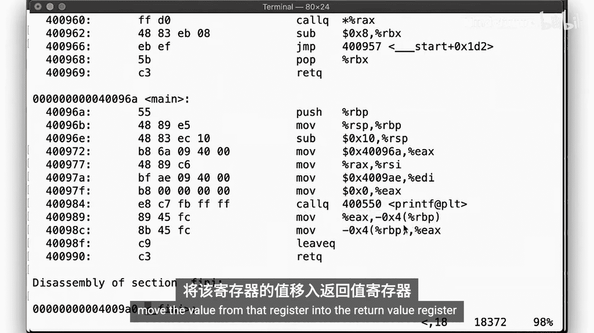
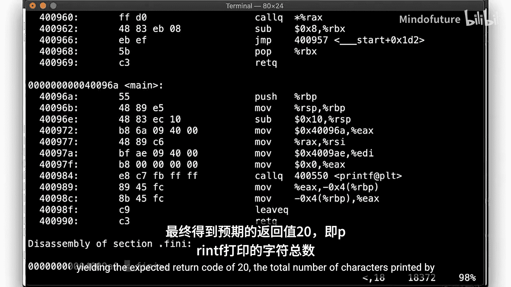
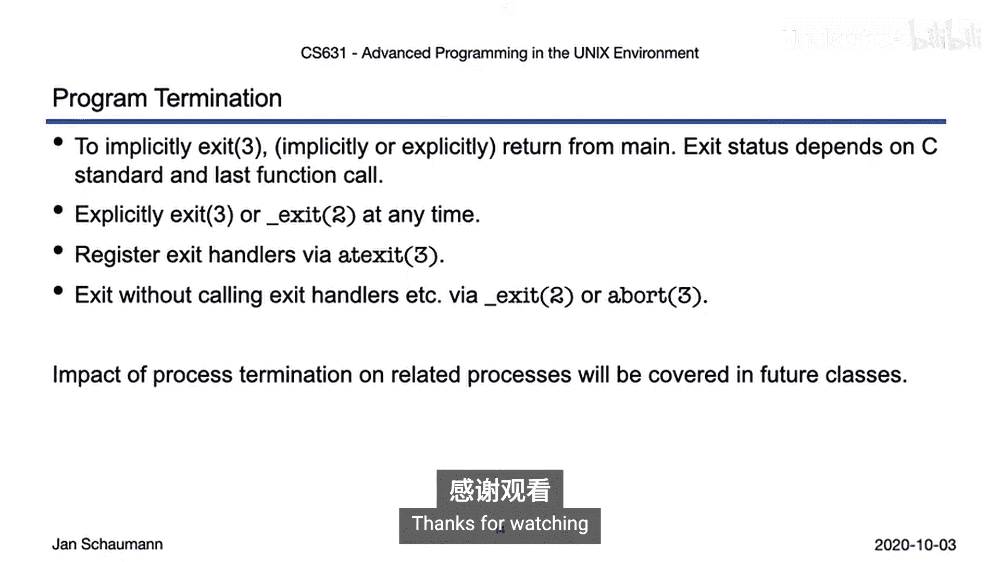

# UNIX高级编程-p40-P40-Week-06,-Segment-3---Program-Termination--BV1hPuVz8EWS_p40-

Hello and welcome back to CS631 Advanced programming in the UniX environmentronment。

Last time we talked about program startup， now we enter the startup routine before calling Ma。

At this time， we'll look at program termination， even though we touched on that a little bit in the last segment。

Remember how we started out last time？We just printed the address of main。

And then fell off Ma without returning an explicit value。With our default compiler options。

The return value was 0。But if we compile the program with Standard C89。

 we got a warning about the missing return value。And observed our program to return a mysterious value of 20。

Which just so happens to be the length of the message printed by printf。

So let's compare what the difference is between the instructions generated when using C89 and when using C11。

For that， we use the OB JW utility to disassemble the executable。Let's look for the main function。

Over here。We see the call to print death。Follow bes returning from the function without any further action。

Now let's compare it using the default Gy 11 standard。Dassembble that。And compare。

The difference between the code generated is minimal。The line starting with a plus another C89 code。

 the one starting with a minus or C level。They're almost identical。But at the C11 code。

 we see an explicit statement to move the value0 into the return value register EAX before returning。

ok。So it seems that the C program language was changed to default to a return value of 0 if no value was explicitly specified。

After all， we didn't really do anything with the return value of a printer F call。

So let's change that。What happens if we assign the return value to a variable？Let's see。

When we compile the code， we now get a warning about the integer N being set。

 but not being used smart little compiler。Our return value， though， remains unchanged。So let's again。

 disassembble the code。And then。Compare to C89 code。There too， we get the same warning。

 but we also again see the letter warning about an explicit return value missing。

So let's look at the C89 assembly。Here。Inside of mainine。

We see that we are using the return value of printf。And move it to a general purpose register。

A step representing the assignment of the value to our integer N。Before we return from the function。

In comparison in the C 11 code。You see the exact same step taking place。By this time。

 it is followed again by the explicit assignment of 0 to the return value register。Okay。

 so assigning the value to a variable by itself doesn't change much。

 The compiler appears to be smart enough to realize that n isn't really used。

 hence the warning we get when compiling， and then still explicitly assign 0 as the return value as the C 11 standard mandates。

Now let's compare the code if we do use the return value。Here， let's edit return。

Note that now we no longer get a warning。This now we are using the variable。

 same behavior for a standard C11 compilation。And let me disassembble both。

We should find that the resulting code is now identical。And it looks like so。We call printf。

Move the return value into the Reg。Then pay the return statement。

 move the value from that register into the return value register。

Uing the expected return code of 20， a total number of characters printed by print death。

Okay， so with this in our previous video， we've already seen multiple ways of how a process contaminat terme。

On the one hand， there's normal， I expect a termination。We've seen。Implicit return for main。

 which may yield a different return value depending on the C standard in question。

Explite return from Maine。A call to the exit library function。

 which can happen from within main or from any other function。

But there's also the underscoreco exit Cis score， as well as oddly an uppercase variation thereof。

We got underscore upper K exit as a gift of discrepancies between the C language standard。

 which requires upper letter exit and Posss， which requires underscore lower E exit ya standards。

Then there are two ways that only apply to multi further programs， which will skip over here。

Aside from that， we also have a ways to terminate a process。We can call a board。

We may be terminated by a signal such as6 av or kill。And again， if we're multi threadreaded。

 we might terminate upon a cancellation request。So let's take a look at the exit function。

Exit is a library function， so you can already speculate that it wraps the underscore exit Ci code and provides additional features。

As we know， exit takes as argument， an integer value that then becomes the exit status of the program。

Note that， of course， X does not return itself at can it leads to the termination of the process。

 as we just saw in our code exploration。Before exiting， it performs these steps。

It called any functions previously registered as exit handlers via at exitit。

 which we'll see in a minute。It flushes all open output streams and then closes them。

It unlinks any files that were created by the process by the temp function。And finally。

 it calls underscoresco exit。Under the exit， a ci score can be called directly。

 and we will then terminate the process immediately without doing any of those things。

There are still few things that happen when you exit the process via this call。

 but we will revisit those considerations in future lectures when we talk about interprocess communications and signals。

So as noted， the exit library function may call any exit handleers that were previously registered via the Add exit function。

 so let's take a look at that。At exitit takes an argument a function pointer for a simple function that takes no arguments and has no return type。

Upon success。At Exit pushes the function pointer on a stack that exit in turn will pop function pointers off。

 meaning the order in which they are executed at process termination time is the reverse order in which they're registered。

There's no reason why we can't have the same function get caught multiple times。

 we just have to register it multiple times。All of this is useful to ensure you perform certain tasks。

 not only when you return from Ma， but at any time you exit。Let's look at an example。

Here we have a few trir functions that simply print a message。The function fun， prints a message。

 and then depending on the number of arguments given， may either exit， underscore exit。

 or avoid the program。In Maine， we register these functions above at exitit handles via at exit。

Remember that the functions will be popped off the stack in reverse order than the one we are registering them。

 so we expect the order at exit time to be my exit 1， exit 2。In that order。Let's run it。Okay。

 the order looks as it expected， we called fun。Then return back into main。

 then return from main and our exit handlelerrs are called in the order that we saw。

If we pass an argument， then we have fun call exit itself。

 so we observe that we do not return to Maine， but our registered exitenters are executed nevertheless。

 as promised。If we pass a second argument， then Fk will call underscorecor exit。

 which will terminate the process immediately without triggering the calls to the exit handlelerrs。

And finally， with a third argument passed， Funk were called abort。

And we exit through calling the exit handler， but this time with a cord up。Inspecting the cordm。

 we can see the back traces and then find the exact location in the code where the program was terminated by the SI aboard signal。

Appears to have happened on line 36 in Exentra C。This the code？And we can， of course。

 inspect the variables。At the time of execution。All right。

 so let's look at the lifetime of a UniX process in this illustration。

The new process comes alive via exactec from the kernelval。

And then enters the C star protein and uses space， which ends up calling main。

Main may call any number of functions which ultimately return to mean。After main returns。

 we're backing the C starter routine， which calls exit from where we leave user space and terminate the process via underscore exit。

However， we can also call exit ourselves from within main or any function really。

Exit may call any exitit handles that were previously registered via a exit and then perform on cleanable fileo streams or temporary files before calling a Necor exit。

But we also have the option of calling underscorecor ourselves from within main or any other function。

Okay， time for a recut。We've seen a number of ways of exit from a program。

Returning from Ma either explicitly or implicitly will lead to a call to exit via the C startup routine。

 The return value depends on whether or not you passed one in。

 as well as on the C standard version you're following。

We can exit or underscore exit ourselves at any time。If we perform certain tasks that we'd like to。

If we have certain tags that we'd like to be performed whenever our program terminates。

 we can register exitit handles via add exit。These exitenters are circumvented by calling uncor exit or a boardort。

What happens to other processes when our program terms finally is something we'll discuss in a future lecture。

And with that， it's time to exit this video segment。Thanks for watching， G。

