# UNIX高级编程-p41-P41-Week-06,-Segment-4---The-Environment--BV1hPuVz8EWS_p41-

Hello and welcome back to CS631 Advanced programminging in the UniX Enviment。In this video segment。

 we're going to take a look at the process environment。

We use what we learned about the process layout in memory to understand how the environment variables are stored and if necessary moved around。

In doing so， we've also get a quick look at what Maoc does。

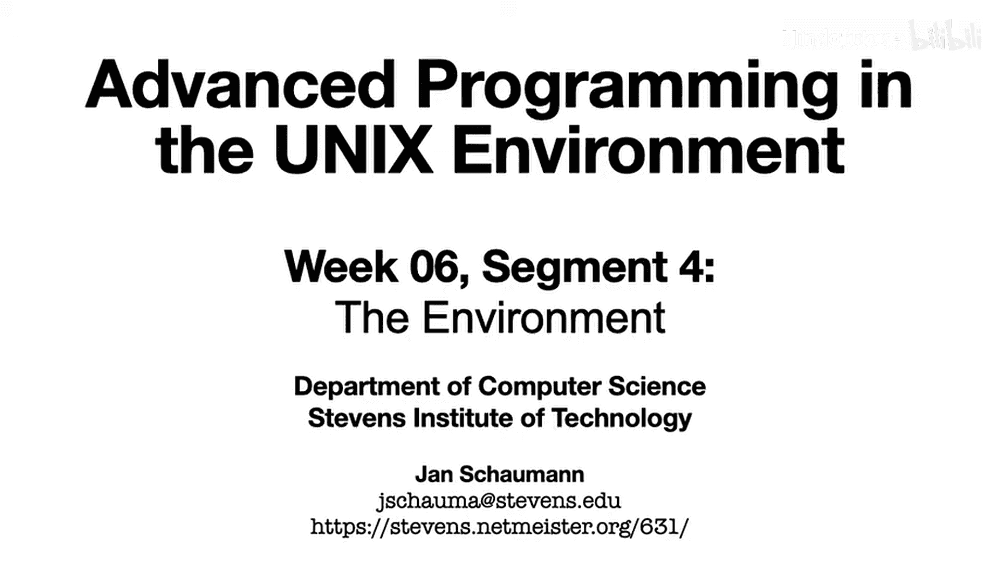

But first， let's quickly remind ourselves what the environment looks like。In the shell。

 we can print the current environment by running ends。What we see then is a list of key value pairs。

 many of which we are very familiar with from day to day usage of the Uni systems。

Setting things in the environment is then an easy way for a process to provide information to the user。

 as well as for the user to provide information to any program written to look for a specific environment variable。

 and so by convention， many Uni tools do honor and use certain commonly set variables。

See the Environ Man page for examples。From experimentation and common usage。

 you may have noticed that setting variables in one process does not have any effect on another process。

 and so we can conclude that the environment is process specific。

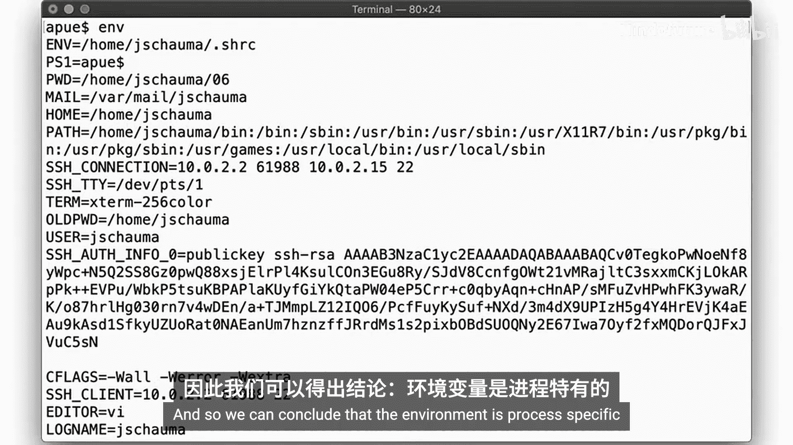

But how does a process gain access to the environment？From our previous videos。

 we remember that the layout of a processing in memory can be visualized like this。

Here we already noted that environment variables can be found near the high address above this stack。

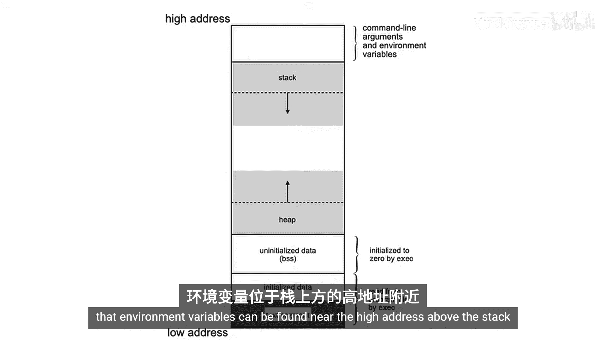

So let's take a closer look。Our externalt Share StarSt is found in the BSS segment as it was declared without being defined in our code。

Once exec has transferred control to the startup protein， the environment is then initialized。

And our environment variables themselves would be found near the high address， as promised。

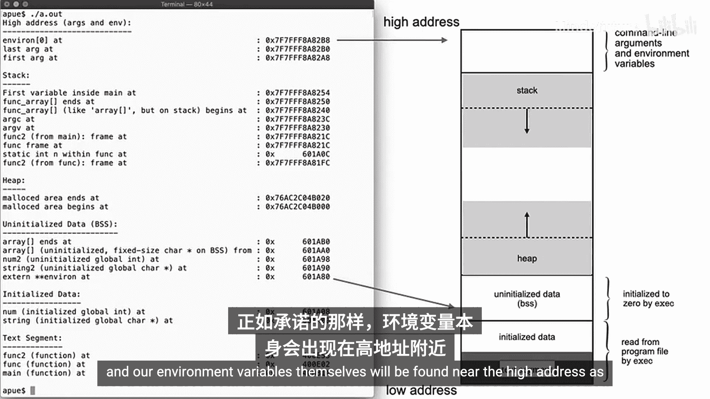

How did they get there？Reca from a previous segment what the underscore underscore underscore start routine looks like。

嗯。In here， we set the environment。And then we also pass it into Ma as well。

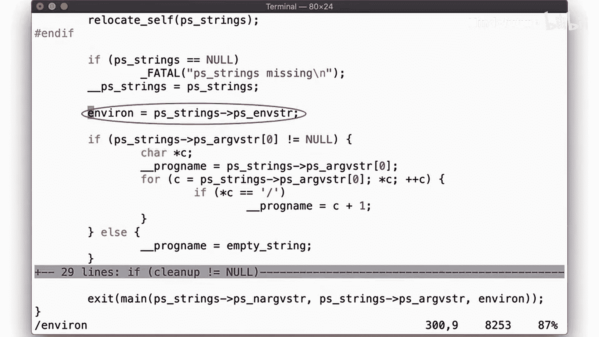

That is， we have an effect two versions of the environment。And next to draw Star star。

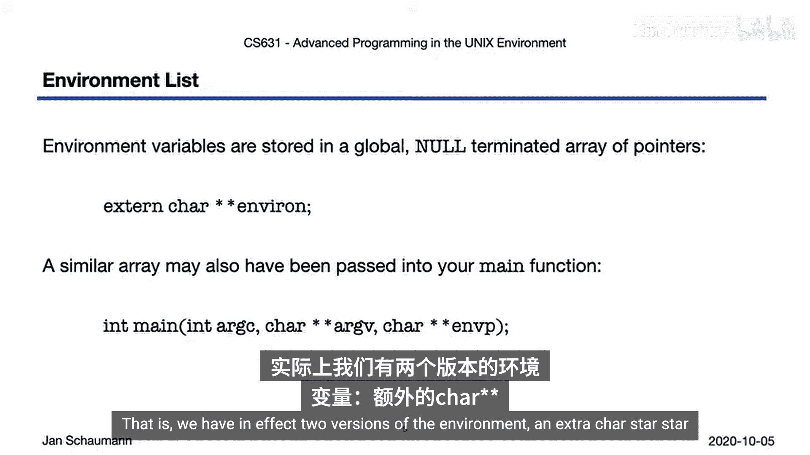

And the Charles stars are empty。So let's update our code to compare the extra charge star star environment to the Charlesstar star Npy passed as an argument。

We'll count how many environment variables there are and put out the beginning and end of the array。

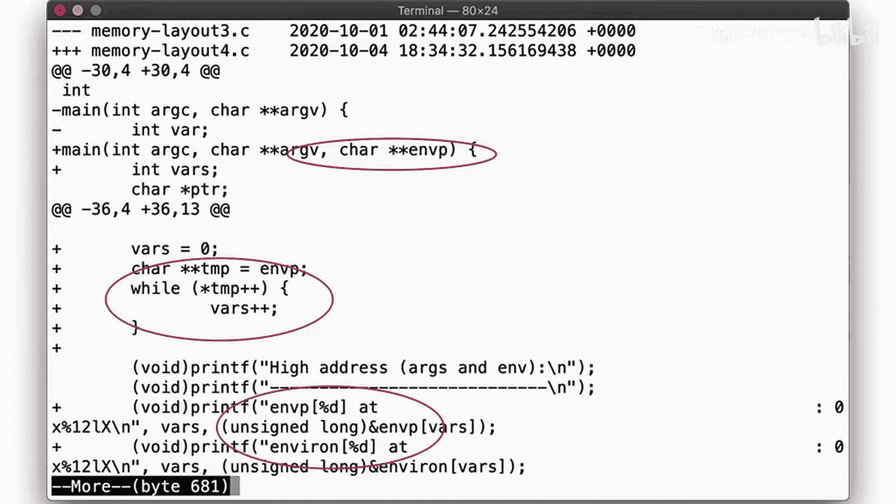

Okay， here we go。The environment contains 18 elements。

 The last element index 17 is the highest address。Our external Cho Star Str and Byron is found in the BSS segment。

 as just mentioned。But the cha star star enpy， since it is passed as an argument to Maine。

 is found on the stack， just like Arksy and Argy。Note that NP and Environ both look the same。

 both start at the same address and end at the same address。

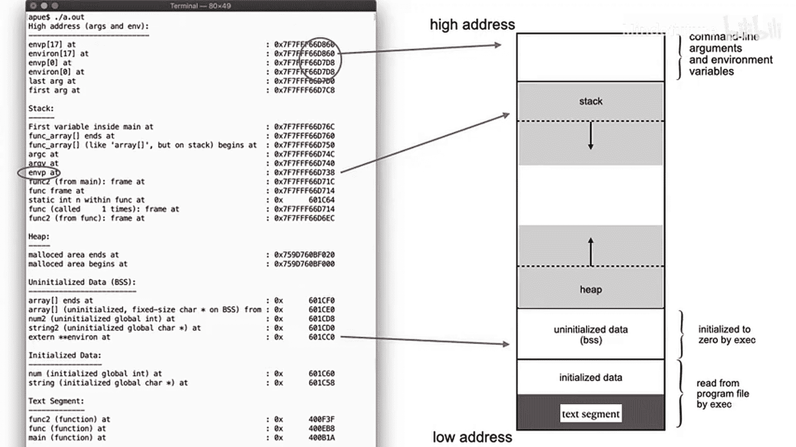

Okay， so far so good， how do we access the environment or manipulate it though？For that。

 we have the getEn， set end， put end and unset end library functions。Get n retrieves the value。

 put n adds a new value。 Sa n can be used to change a given value and unset n removes the value from the environment。

Note that there is a difference between setting a variable to the empty string and removing it from the environment completely。

Some tools may only test for the existence of a variable， not for any specific value。

 and a variable with no value still counts as being set。

But now let's think a bit more about how these functions work。

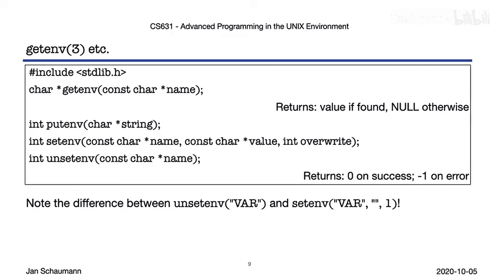

Remember， the environment is initially placed near the high address。

 so there is necessarily limited space yet we are allowed to update。

 add or remove values from this array。What does that look like？As we said。

 enP as an argument to Maine must be on the stack。The first element。

Offf this array NP0 points to an address above this stack， CB18 in this case。In this location。

 we find the cha star， another pointer。Which points to the actual array of characters containing F equals bar。

 and which is found at CC080。How does it compare to our extra insure storeer environment。

 that variable is found in the BSS segment。But the first element here also points at CBB 18 just by n for P0。

Similarly， the last element in the array is found at the same address。

 both NVP and environment near the high address。Now let's see what happens when we use set ends to change the value of a variable already in our environment。

Let's change4 to a longer value。And after we call set N N p0， still points that B8198。

Aszdo and Viron zero。But the cha star at that location now points to a different place。In particular。

 it looks like settEn dynamically allocated some memory for the new string a longer value。

 and so updated the pointer at B81982 point that。

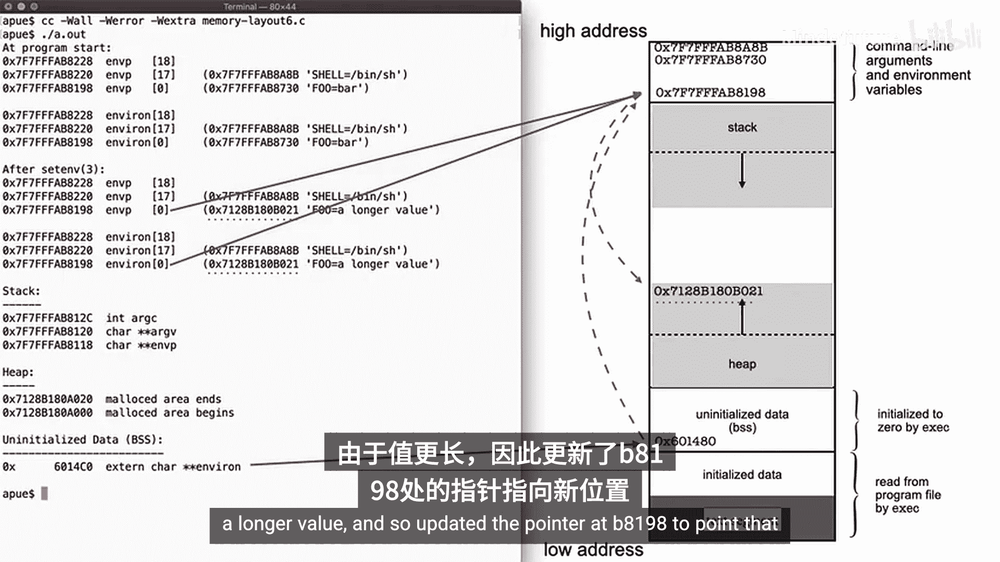

How did it do that？Well， to dynamically allocate the buffer， we use the Melog function。

This library function will try to allocate the given amount of memory and return a pointer to the beginning of the region it reserved。

This memory is uninitialized， if you want to have it to be initialized to all zeros， use C Aloc。

If you need to change the amount of memory you need。

 you can use relog to grow or shrink the region in memory。

If it can make the change without having to shuffle data around。

 you may get back the same point that you handled it。

 but it will still have updated how many bytes are reserved。And of course， as for all resources。

 once you're done using it， you should free the pointer。

This is similar to how we always close a file descriptor in the same scope in which we opened it。

 just like that， you should always free any pointers if allocated within the same scope。

 as otherwise youre run the risk of a memory leak。

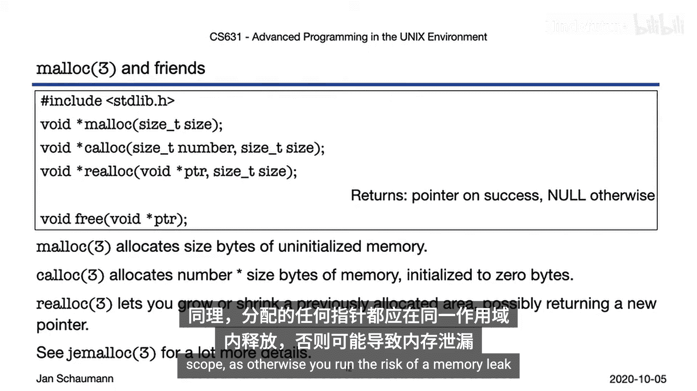

Okay， before we get back to set End， let's take a brief detour and observe how Melocan friends play out in the wild。

Here on the left is a small program that first allocates a memory then reallocs it to larger and smaller areas in the middle。

 you see the output from the program。The first call to Melog。Reserve some data。Here on the heap。

The next call to relog ends up preserving a smaller region below the one we initially reserved。

Likewise， the reallocation of the larger region。Happens here。

And the final reallocation to a smaller region again reserves yet another region of memory on the heap。

In this case， each of the real locations used a new pointer。

 even when we shrink the amount of memory we reserved。

 meaning that you cannot make any assumptions about the pointer you get back。

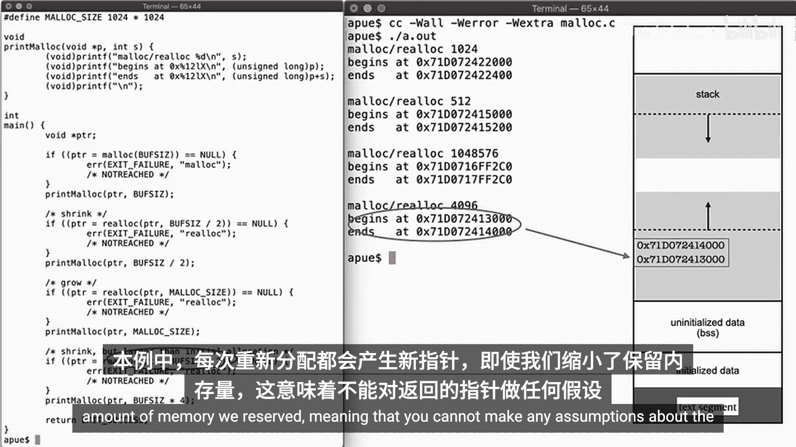

Okay， back to our environment。We saw that set N reserved some space for the new value via malloc。

Now let's see what happens when we add a new variable to the environment。

After our call to put in P0 still points to the same address as before。

But the first variable in Environ now is in a different place， it's on the heap now。

The pointer at this new address， however， still points to the same address that we had previously gotten back after we called Se。

So why did Environ  Ze move？Our environment， atop the stack is only so big。

 adding a new variable to the environment might not have fit at the top of the stack。

 and so in order to add a new variable， put n had to first copy the entire end to a new place。

That is， putin allocated new memory for the whole infree on the heap。

Then copied all the elements of the environment， all the pointers to the values over。

 and only then could append the new value。Which of course explains why our new value in Viron 18 points to this address at the heap。

And that address here points to the location of another variable， which is found in the data segment。

This string is founded the data segment of the program as it was included in the program as a fixed string。

So let's note that here NFP and Environ diverged。After put Nf， environ was updated， but EnVP was not。

Which makes some sense since NVP is really just a variable local to Ma。

 while Viron is a global variable。Okay， so now it's left answered N。

 let's see what happens when we call that function。We callunset and full。

 so the array shrinks by one element and what used to be index 18。Is now in next 17。

But it is still found at the same address as before we call unsettance。However。

 unsai N removed the first element of the array in this case in Viron 0 so that all elements shifted down by one。

What used to be invi1 is now inviron 0。 The address of Environ 0 itself doesn't change。

But while it contains， the pointer to n equals home J Xma S HRRC is updated。

And that value still remains all the way at the top in the original environment。

 so Environ zero can no point there。NP， meanwhile， remains unchanged。

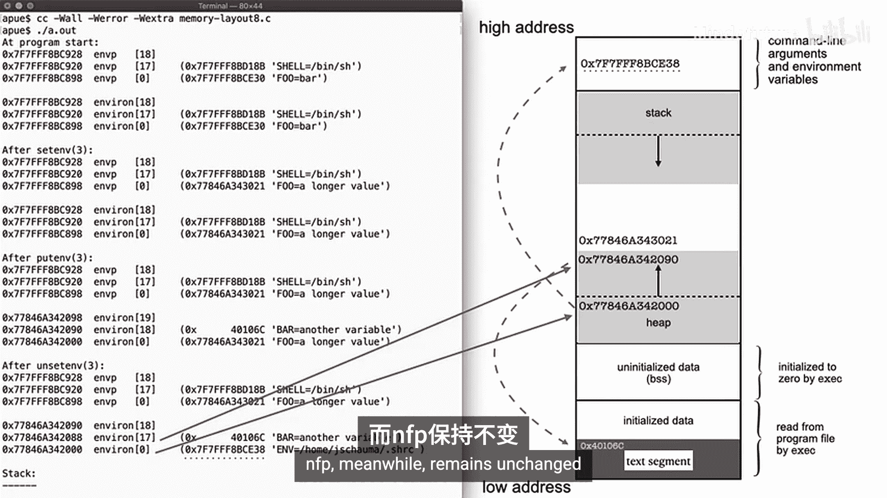

Okay， let's recap。The process environment consists of an array of strings as key equals var pairs。

This is by convention， although you can of course put anything there。

The initial environment is set up at the top of the process space by the startup routine and pointed to by the external chare star star environment。

The startup routine may further pass the current environment as a third argument into Ma。

We saw that the elements of the array may be removed， moved around as we add new variables。

 update or remove existing ones。We saw how the elements of the array may be moved around as we add new variables。

 update or remove existing ones。Sometimes this involves moving them into malled areas。

 but it is important to note that manipulation of the environment should only happen via the library functions and the external starster environment。

 not the endpy passed into the function。Finally， while a lot of tools rely on the environment or use it in conventional ways as a defensive programmer。

 you must always verify the sanity of the contents of any variables you plan on using。

The user may be able to change them if you're not careful。

 you can easily end up in undefined or at least unexpected behavior。Okay。

 neither abo wraps things up。But before we go， here's a link for another exercise for you。

Think about how the environment is updated and what might happen if a user were to add hundreds。

 thousands or tens of thousands of new environment variables。

Or what might happen if the user adds a single variable that is thousands of characters long？

Cllayear around with this and see if you can identify the limitations and side effects of this。😊。

Good luck and have fun。😊，J。

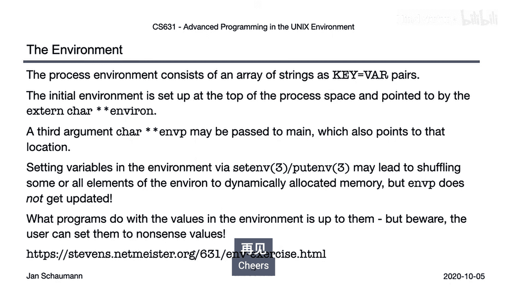