# UNIX高级编程-p42-P42-Week-06,-Segment-5---Process-Limits-and-Identifiers--BV1hPuVz8EWS_p42-

Hello and welcome back to CS631 Advance programming in the UniX environmentviron。

In the last few videos， we've looked at the details of the process layered to memory and how our process starts and is terminated。

Before we move on to process control and process relationships。

 you will spend a few short minutes on two additional aspects of every process， its resource limits。

 which we've frequent contented in an earlier lecture and its process ID。

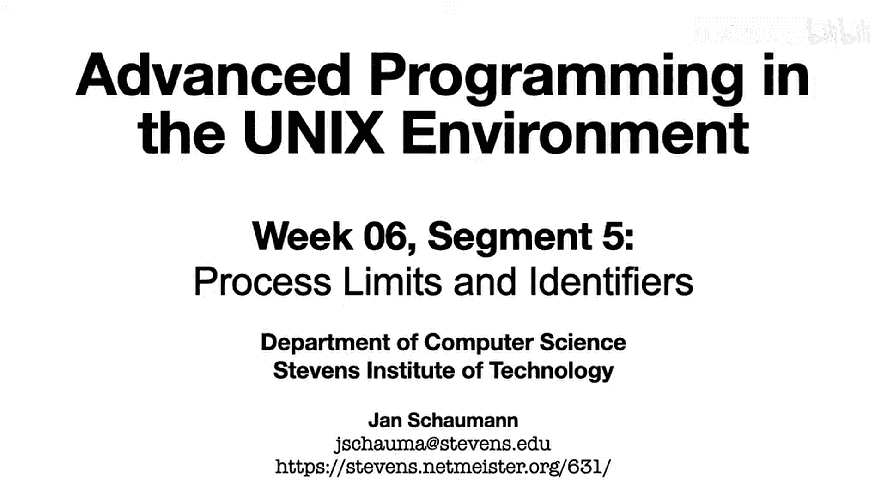

We can inspect the processor's resource limits via the U limit command， as shown here。

These limits describe， for example， how long a process is allowed to hawk the CPU。

 how much memory it may allocate， how many child process it may create。

 or you may remember this from our little experiment earlier in the semester。

 how many file script as of process may have opened。Let's see。 How does the U command work？

Sut up the menu page。2。That gives us section 3 of the manual pages， library functions。

Let's try again and ask explicitly for Section 1 to define the command。 no manual。Wait。

 where's the command？It's a shell built in。All right。

 let's take a look at the implementation of the function in the C library。😊，Here in Liy， we find it。

And we see？It's not really all that complicated。Its called get our limit and set our limit。

 but only appears to operate on the file size limit。

But our shell is clearly capable of setting other limits。

So perhaps it's best if we look at the implementation of the built in in the shell。

Here in user source， spin S age， missBuildton，s see。

We see the different supported limits listed as options in the command。

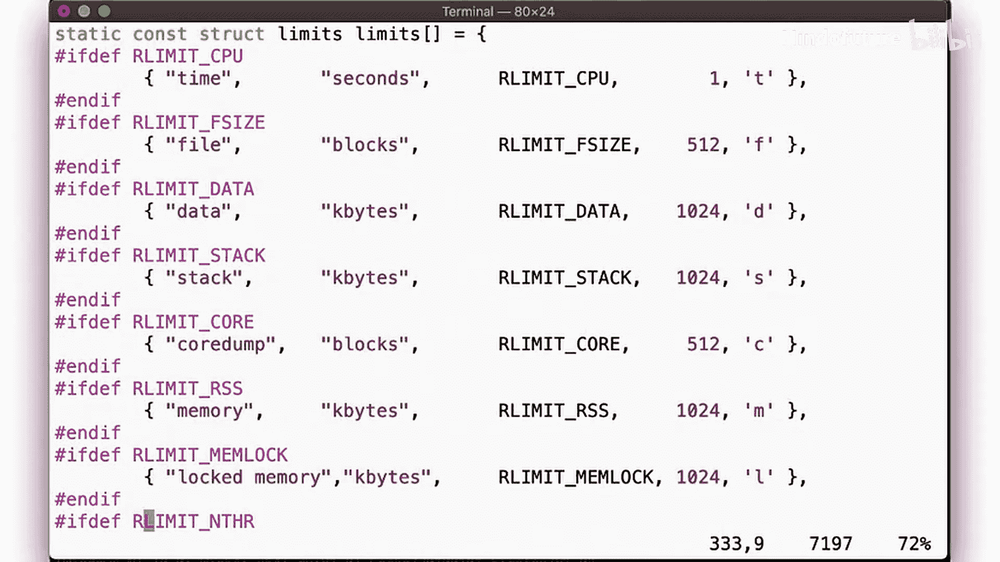

Mature then。To finded in user include cisresource。h。Let's jump there。

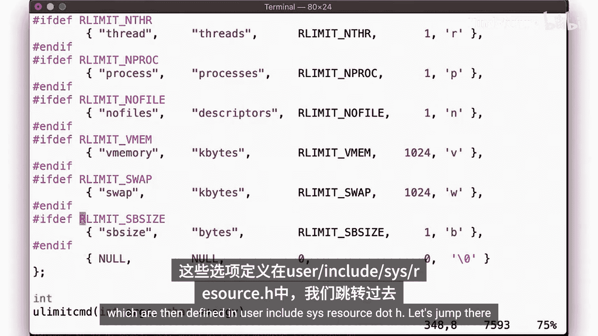

Here we go。

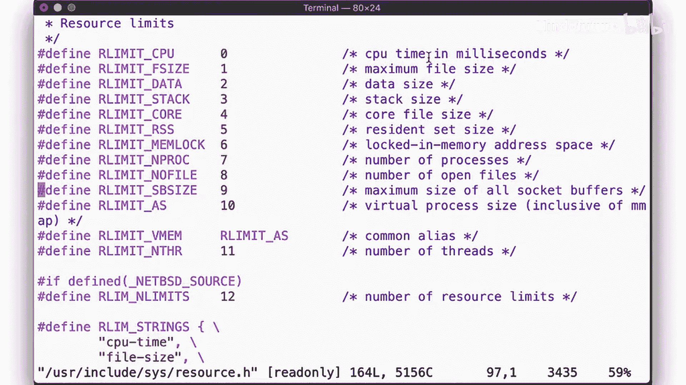

So now going back to our menu page for the Ulimit library function。

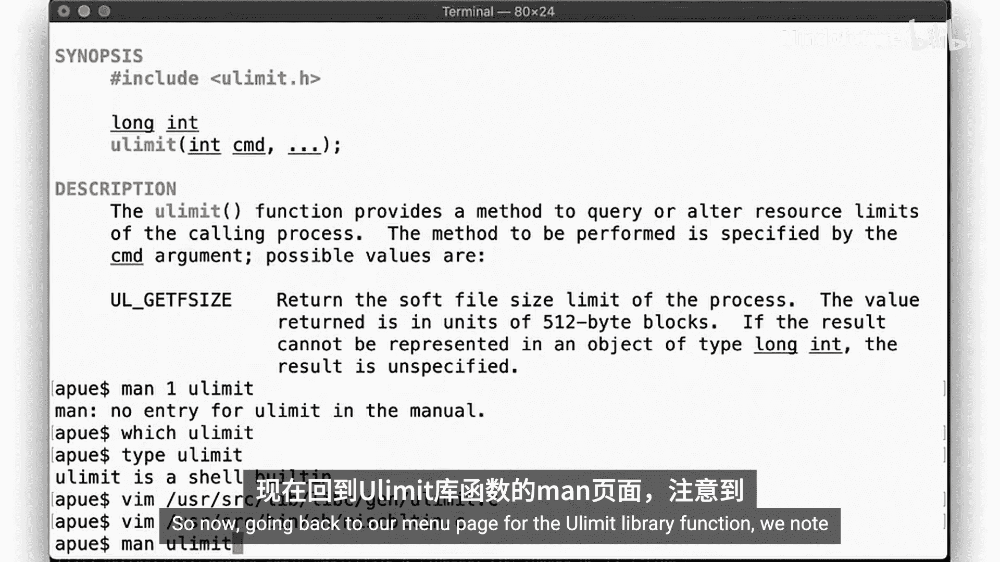

We know that this function is obsolete。And instead。

 we are directed to use the get or limit set our limit as。

Which you've just seen is indeed what is being used by the shell built in U limit command。

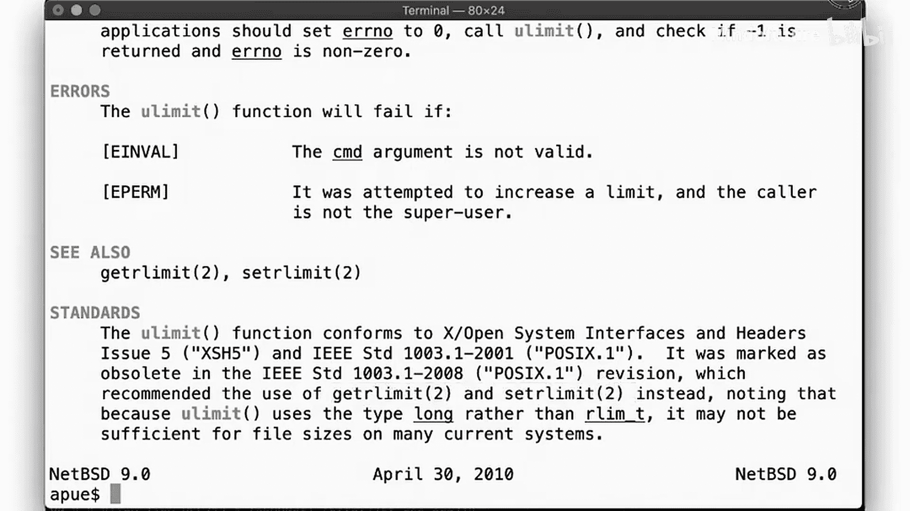

So let's take a look at those。As we saw in the code。

 a resource limit is specified as a soft limit and a hard limit。When a soft limit is exceeded。

 the calling question may simply fail， or the process may receive a signal。

 but is allowed to continue if it catches the signal。When the hard limit is reached。

 the given resource cannot be increased。Using a set limit to change the limit follows these rules。

A soft limit may be lowered by a process or raised to a value lower than or equal to the hard limit。

However， changing your soft limit also always changes your heart limit。

 meaning if you lower your soft limit， then you are also setting a new hard limit and you can cross that again later。

Only the super user can raise a heart limit。Any changes are made will only affect the current process or any of its children。

Which of course explains why your limit must be a shell built in and can' be a standalone command。

 just like we've seen for the C command before。

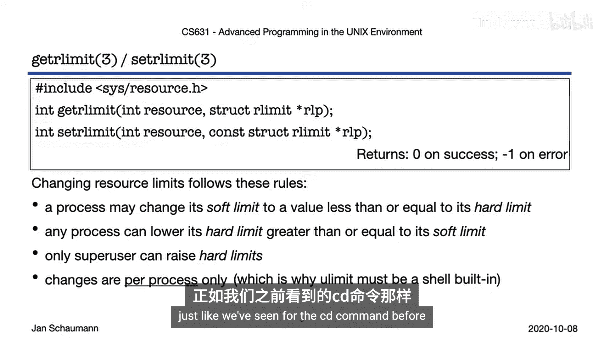

Okay， let's see this's in action。We revisit our Openmax example from week 2。 Remember。

 we try to open as many files as possible to see what the limit of the number of open file deors was。

Here we observe it to be 1024， and Eullimit seems to agree。

But U limit gives us the soft limit by default。 What's the heart limit。A， 3404。

So we should be able to bump up the soft limit to any value lower than that。Let's try 2048。

That works， and our program is now able to open 2048 files。Of course。

 we can also lower the limit to say 512。With the expected result。But once we've done that。

 we now can't go back to 1024， even though that was our initial soft limit。

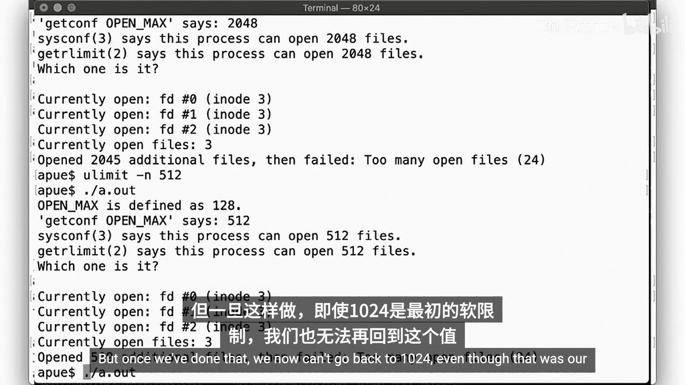

This is because changing the limit also set the new heart limit。

This is so as to ensure that a profit can restrict itself and any of its children without then later being able to remove this restriction。

 and this approach is similar to how we can change our effective view I need to drop privileges permanently。

But let's take another example， Let's look at the CPU time。

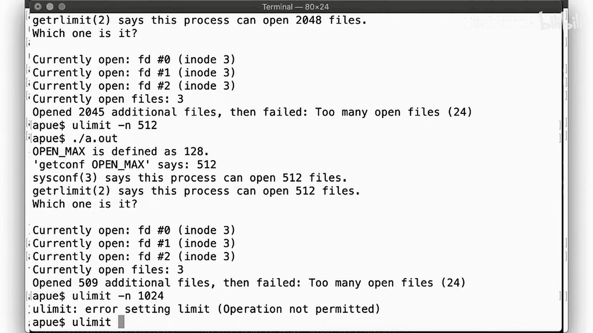

Right now， it's unlimited， meaning a process can ha the CPU for however long at once。

If we restrict this time to three seconds， then any program we invoke afterwards should be terminated after three seconds of CPU time。

So if we then。Sleep for5 seconds。What's going to happen？H，We do sleep for five seconds。

 Why did our e knock again？Well， sleep doesn't really do anything。Specifically。

 it intentionally suspds the execution for the given time and seconds。So to trigger are you limit。

 we need a program that actually does something。

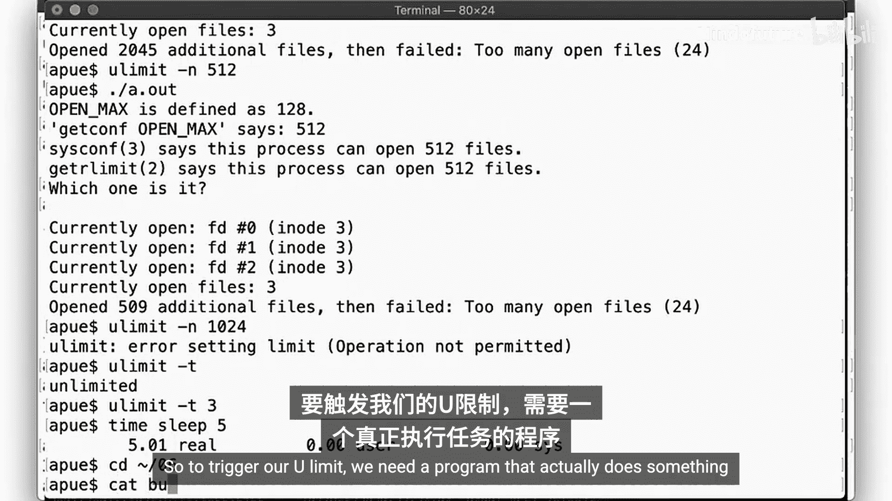

Here， let's create a brain that point this busy program。 All we wanted to do is something。Now。

 when we run this program。It will get terminated。After three seconds。

Plus some overhead where the program was not using the CPE。

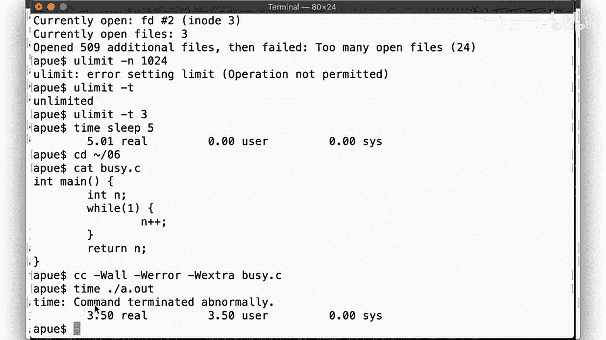

Okay， on to process identifiers。As you all know， every process has a process ID。

And every process has a parallel process， which also has a process ID。

You can inspect these process IDs using the gettP and getPP as called。

A process ID identifies a single process running on this instance in time。

But note that while the system guarantees that the pit is unique and maps to a single process。

 it does not guarantee that a subsequent look at the process table finding that process I D is through the same process。

Processed ideas are reused by the system。So when the process terminates and another process starts。

 it might get that process pit。The process Is are assigned in an opaque manner。 That is。

 you cannot predict what the process I will be of a new process。

 It may increment or decrement or pick aend number。However， there are some exceptions， of course。

 when the system bootss up， the kernelel has to explicitly create certain processes。

Process I D0 used to be referred to as the swapper process。

 sometimes known as SCt or system 5 derived Uni versions。

It was responsible to swap entire processes out to disk and back in when ready。On Linux systems。

 Proor0 was the idle process。Doing nothing but ensuring that oh there's always a process ready to be scheduled。

Nowadays， most Uni systems use Pid0 as the system process that handles a bunch of related scheduling things best left to your operating system class to discuss。

Process I D 1 is traditionally known as init It bootstraps。

 the Uni system creates all other processes and reaps orphan processes。

 which we'll talk about in more detail in our next segment。Nowadays。

 there are alternatives to init that perform this function and that may be a assign process ID1。

 most notably system D， which you will find on several Linux systems。Lastly， processs ID2。

 notably on VSD systems was the page De as Undermanned paging was a feature introduced by VSD。

On some solar systems， you may also find this process identified as page out。

Ass responsible for some virtual memory operations and may simply sleep until physical memory becomes scarcece。

 upon which it scans memory and pages out whatever memory hasn't been used recently。

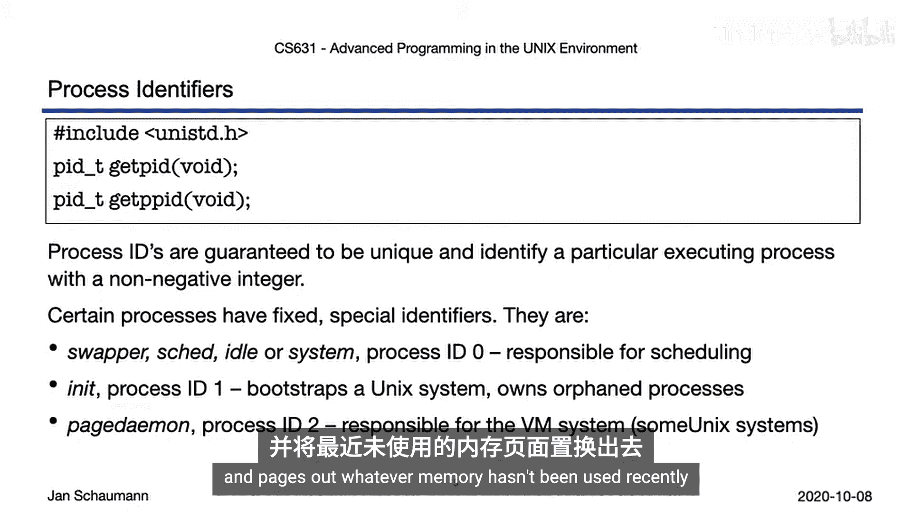

But let's look at getbit and getP pit in action。Here's our trivial example。

 printing the current pit and P pit。When we run the program。

 the shell forks a new process and executes this program。

The new process was assigned processces ID 980， with its parent process ID。

 the process ID of the shell is 396。If we inspect all processes on the system。

 we can see their relationships。The PS command with processces I 1011 has a parent process I of 396。

 or shell， which has a parent process I of 423， which is SSHD。

 that process has the SSHD privileged separation process at its parent。

 which has the SSH demon at its parent， which finally is the chart of init processces I1。

You can then also illustrate the same relationships as a tree as we've done before。

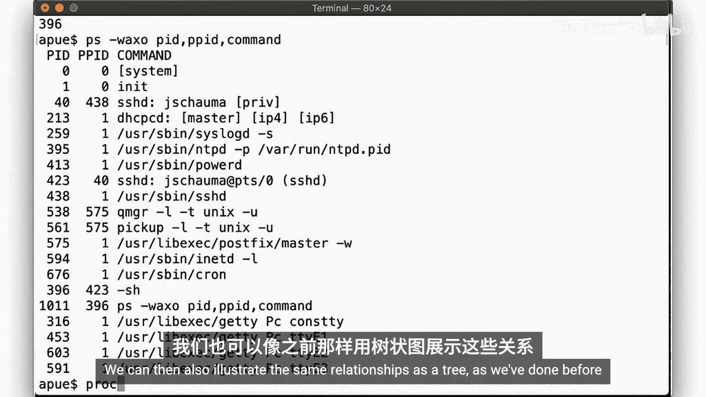

And observe again， how child and parent。Derive from one another。

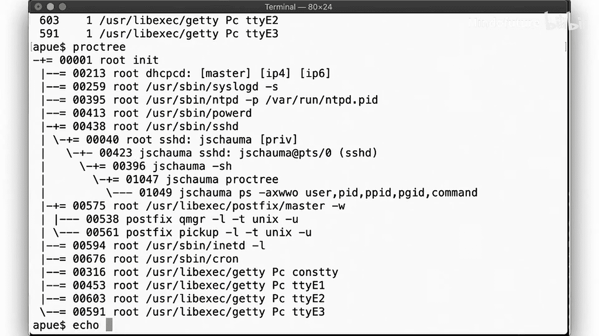

Okay， time for a break。Let's recap。We've seen that processes are limited in certain ways。

These limits are specified as soft and hard limits。The process may lower both。

But raise the soft limit only up to the heart limit。 Only root can raise a heart limit。

We saw that process limits are as the name suggests， process specific。

 which explains why the Ulim command must be a shell build。

We also started to look at process relationships， but we'll cover those in much more detail in the coming videos。

And that's it for today。 Thanks for watching。 And until next time， cheer。

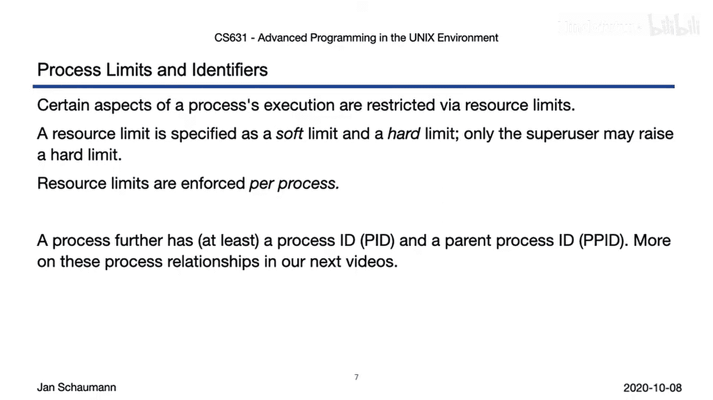