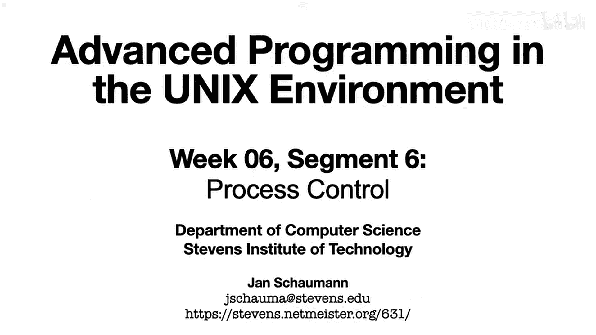
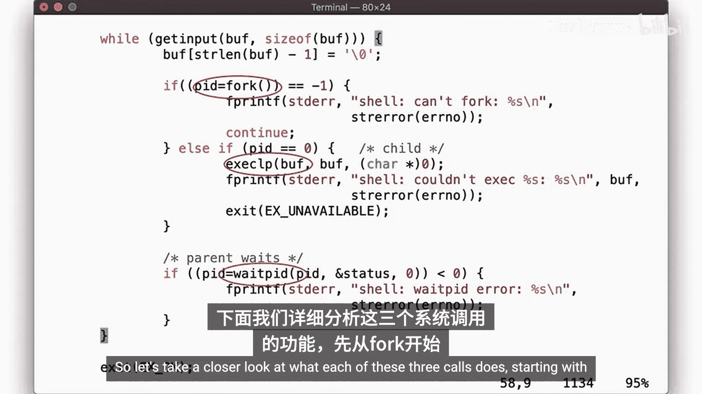
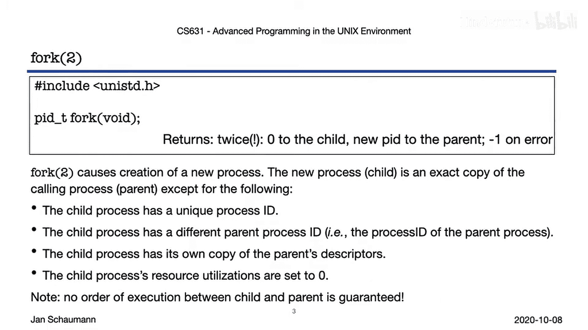
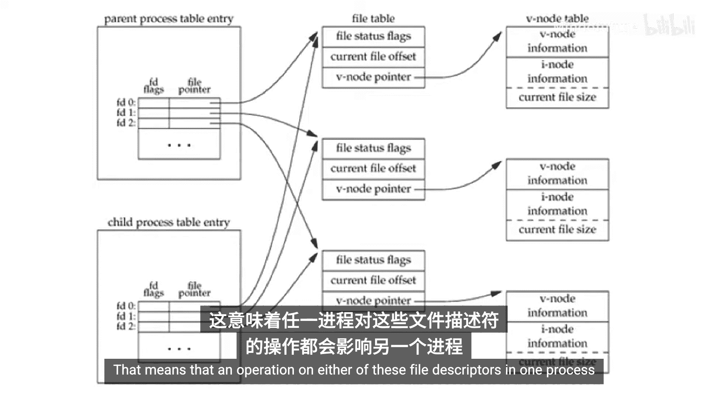
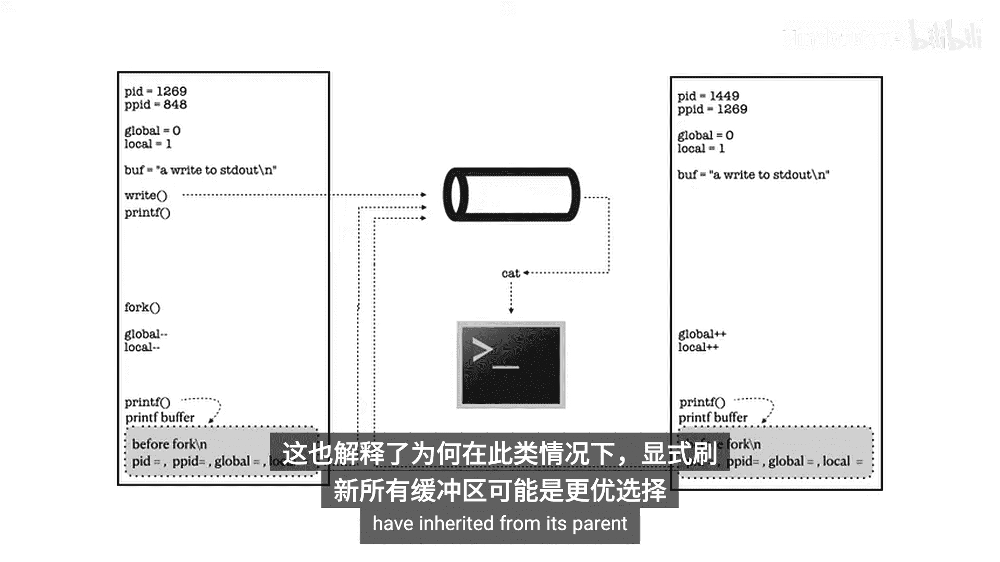
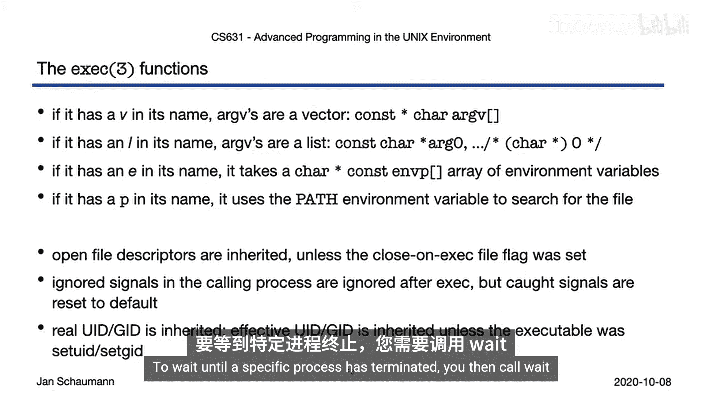
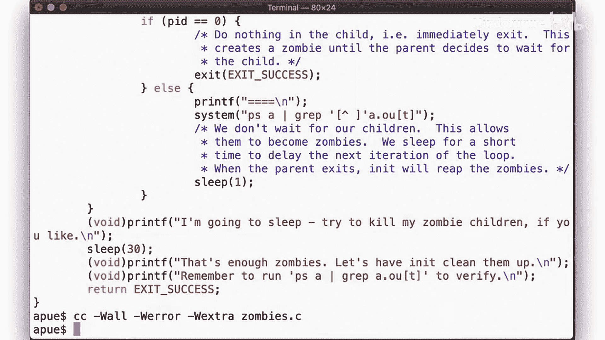
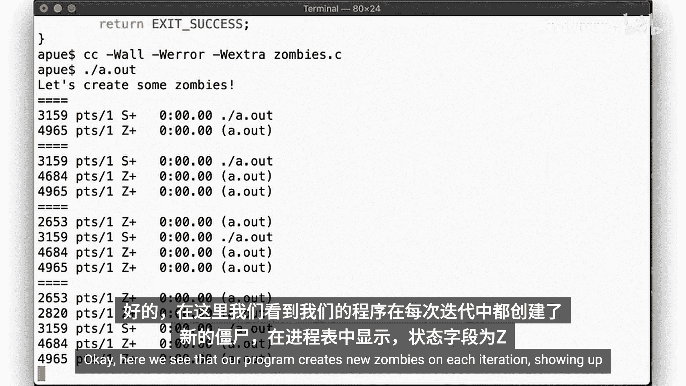
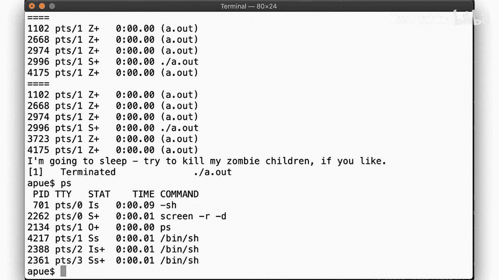
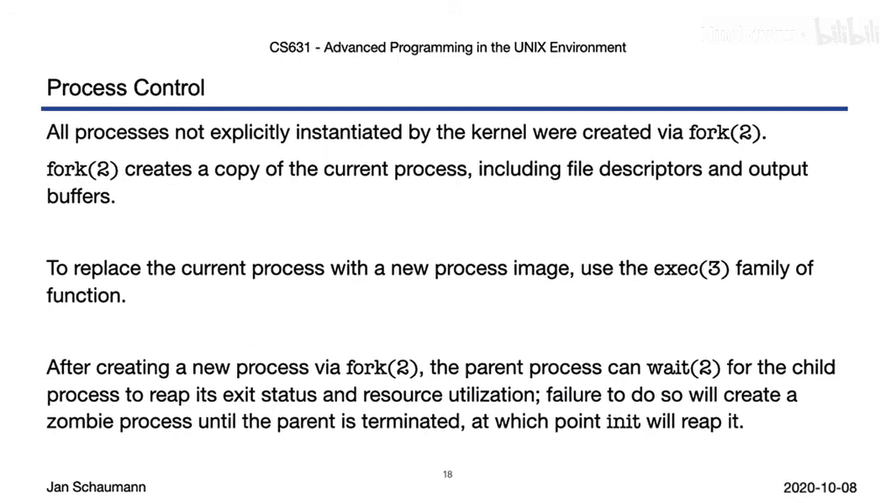

# UNIX高级编程-p43-P43-Week-06,-Segment-6---Process-Control--BV1hPuVz8EWS_p43-

Hello and welcome back to CS631 Advanced programminging in the UniX Environ。

In this last segment for week six， we will look at process control。

 how new processes are started from an executable， and what happens when they terminate。

This is a prerequisite for the materials we'll cover in the coming videos where we discuss process relationships in much more detail。

Also， there will be zombies， so， you know， limb up。

But then let's go back to our first lecture and we wrote the world Ss Shell。

 that program looked like this。For every input line we receive。We fork a new process。

Exactly given program。And then wait for it to terminate。

So let's take a closer look at what each of these three callss does， starting with fork。

The fork system con is a bit peculiar because it returns twice。That is。

 it creates a new process resulting in two copies of the current process。

 meaning it will then returned twice， once in the original process and once in the newly created process。

We call these two processes， the parent of the child process respectively。

The new process is nearly identical to the parent process with the following differences。

The trial process has a unique ID， This should be reasonably obvious。

 as we established in our last video that a process ID identifies a single process uniquely and thus cannot be shared。

Likewise， and equally logical， the child process has its parent process ID。

 the pit of the process at called Fork。Makes sense。

The I process gets a copy of the file descriptors open in the parent。

 pointing to the same data structures。This is interesting， as it means that， for example。

 a read in the child would change the opposite on the same file descriptor in the parent。

Would illustrate this in a second。The child's resource utilizations are set to zero。

 that seems only fair too， the process was just born， so having for example。

 a limit on the CPU time get applied would seem confusing at best。Finally。

 it's important to note that while we talk about a chart and parent process。

 it may seem intuitive to assume a specific order of execution after Fok returned。There is none。

You may observe the child to always appear to run first after fork。

 but that is an implementation to find behaviour that you cannot rely on。

The order of execution after Fork returns is unspecified。

To illustrate in a bit more detail the differences between the parent and the child processes。

 that us revisit the visualization of the data structures relating to open files。Here。

 this process has three files open， each with their own fire table entries。

When the process calls fork。We get a second copy of this process。

 inheriting the file descriptors of the parent。Note that the child processes's fire pointers do point to the same fire table entries as the parent processes pointers。

That means that an operation on either of these fire descriptors in one process affects the other。

Let's show this in action。Here we have a small program that opens a fire， print its pit。

 read some data。And then forks。After it forked， both processes now have an open file deor with a current offset at the end of the data chunked red。

32 in this case。The try process， then L seeks 32 bys forward and goes to sleep to let the pound read。

And then reads data itself。The parent goes to sleep immediately to give the child a chance to seek。

And then the parent reads data。In the read data function。We determine the current offset。Priinted。

And then read some data。Here we go。Now， when we run this program。Let's see what happens。

The process ID is 361。The program then calls the reateta function and reports its current offset0。

 which makes sense we just opened the file and thus find ourselves at the beginning。

This function then reads 32 bytes， so at the end of the function call。

 and before we fork our current offset is thus 32。After we fork the trial process with Pi 999 then seeks forward 32 bytes。

 leaving the offset at 64。The child then goes to sleep， and the parent calls reta again。

 where it reports a current offset of 64， showing that the child's LI changed the parent's offset。

The parent completes its read， advancing the offset by another 32 bytes。

 which is then reflected when the child process calls read data and finds itself at offset 96。Okay。

 so file descriptors are duplicated and the offsets are shared。But let's look at another example。

Here you have a program with a few variables。Which makes a call to write。

Then called printf before it forks。Parent and child both operate on the global and local variables in different ways。

Then both were print art， the current pit， P pit， and the values of these variables。

There shouldn't be any surprises here， so let's run it。Okay。

 so the current shell has a process ID of 848 with a parent process， process ID 1726 reports its pt。

The child Process ID 2154 reports 1726 as its parent。

Each incremented or decremented the global and local variables。

 showing that they each got a copy of these variables， not references to the same variable。Okay。

 but now let's try this。We run the program again， and this time we pipe the algorithm into kit。

 that really shouldn't change anything， should it。But hey， what's that？

Why do we suddenly get a second before a fork statement。

Our code clearly included only a single printer of call before we forked。

So how come we now seem to have gotten the child process to also print out this message。

 even though that print took place before the child process even existed？To explain this。

 let's look at how the two flows differ。😊，We start out with a process that has its variables declared。

And then， called right。Right is unbuffed I O and immediately writes the data to a send it out fire no。

 which is connected to the terminal。Next， we call Pref。Printf is buffered I O。

 so it doesn't write directly to the terminal， but instead writes to a buffer。

If the netout is connected to the terminal， the narrow output is line buffer。

 meaning when we encounter a carriage return， we flush the buffer and the message is printed to the terminal。

And that the buffer is drained。Next， we call fork。And so。

We get a copy of the current process nearly identical to the first with only the pit and Pit being different here。

After that， both child and parent perform their respective operations on the variables before they each called print。

This called to printf again write to the buffer， which then upon encountering the carriage return。

A flush to the terminal。Okay， so far so good， perhaps you already have an idea what happened when we redirected output into a pipe。

 but let let's take a look here。Again， we start out with our process before。

We call right as before and again， right being unbffered， immediately rights to send it out fire no。

Which is now connected to a pipe。We then called printdef， which， again， as before。

 fills the output buffer。But since net out is now connected to a pipe， it no longer is line buffered。

 That is， we keep the data in the buffer without flashing the buffer and then called fork。

Fork does its thing and creates a copy of the current process， including the output buffer。

 That is now our child process has an eyeleed output buffer that contains data。

Both processes continue with their operations。And then called printdef。😊。

To write their information to the output buffer， appending to whatever data is already there。

Upon program termination， the buffer of each process is flushed and written to the pipe。

Which then dutifully writes a duque， which copies it to its standard out our terminal。In this way。

 we've seen how fork can lead to a child process retaining data from the parent。

 and this explains why in such cases， it may be preferable to explicitly flush any buffers before calling fork。

 just like it might be useful for a child process to call underscoreco exit instead of regular exit to avoid flushing of any buffers it may have inherited from its parent。

Okay。Using fork， we can create a new process， but the parent and chart are identical。

 and any differences must have been coded into the if P equals0 else logic。More often， though。

 we want to execute a different program altogether after we've forked。To do that。

 we use the exact family of functions。As you can see here， there are several variations。

 each differing only in the way it accepts the arguments。

Each of these functions is merely a front end for the Ex V E system call。

 and from our discussion of the process start in previous videos。

 we already know that we will provide the avy and the environment to the new process。

Note that the exact functions do not return。They replaced the current process with a new image from the executable specified。

If Exec ever returns， then you encounter an error。The various exact functions differ in the arguments they accept。

 and you can easily remember which function uses what type of argument by looking at the name。

If it has a venus name， AVs are a vector。If it has't Ellenent's name， Ars are a list。

If it has an E in its name， it takes a trust or constant NPPR of environment variables。

If it has a P in its name， it uses the path environment variable to search for the file for other functions。

 you have to specify a complete path to the executable。

Note also that you can control the entire A v vector or list， including A v 0。 That is。

 you can invoke a command4 and pass an Arc v0 of bar to exec。

 and the process table will then show the command as bar。But it tried to confirm。When you call Zec。

 there are a few side effects that are was noting。Open file descriptors are inherited unless the close and exact file flagake was set by a F control or file open time。

Ignore signals in the calling process are ignored after exactec， but CA signals are reset to default。

We discuss signals in more detail in a future lecture。Our process inherits the real UID and group ID。

 the effective UID and group ID is also inherited unless the executable was set UIDs at group ID at we've seen in previous lectures。

After we create a new process and possibly execute a different program。

We have to have some sort of process control as both child and parent are now executing simultaneously。

To wait until a specific process is terminated， you then call。

Wait。Wade suspends the execution of the current process until status information is available for any child process。

If you want to wait for a specific process or a process group。

 you can use weightP or the weight4 function。What does waiting for a process mean？On the one hand。

 yes， it thes waiting until the process is terminated。On the other and more specifically。

 it means we are inspecting certain information about a process that is no longer alive。

Remember that our programs have a return code somewherewhere something has with something with this return code。

You may also be interested in the resource usage of a terminated process， how much CPU term is used。

 how much memory etc。Which the weight 3 and weight four functions can retrieve for you。

So once we get back the status information about the process。

 we can then use a number of defined macros。WF exited and W exit status can tell you whether the process terminated normally and what the exit status was。

We can learn whether a process terminated as a result of a signal， and if so which signal。

 as well as whether it left a cordamp or not。That the process may also be suspended， not terminated。

 and we can find out about that using WF stopped。Finally。

 weight will block until any process changes status。

 but you can also use weight pit or weight4 to check on the status of a given pit in a non blocking manner。

Okay， but why should you bother to wait for your child processes？When the process dies。

 the Excel status information must remain available for inspection。

So if nothing ever clears up this exit status information， then we have a process that's dead。

 but still running。In other words， we have zombies。That is what a omni process is。

 a process it has died， but it has not been waited for。

 meaning it continues to use up certain resources such as the process I and the research utilization。

 exit status， etc。Here， let's look at an example。Here we have a program that intentionally creates a few zombies。

We loop and fork each time having the child process exit immediately。

But without having the parent calling wait， thereby becoming a zombie。So let's run the zombie maker。

Okay， here we see that our program creates new zombies on each iteration。

Showing up at the process table with the Z in the status fielde。

If we switch to another terminal and try to kill one of the zombie processes。

We'll find that doesn't work。The can't kill a zombie， they're already dead。

Let's try to kill it harder。Still no luck。ok。Back to the initial window。

The program finally terminates。Know that the program did not wait for any children that we had five zombies while we were running。

But after the process terminates， we note that all the zombies are a gun。

This is because in it will automatically wait for any orphan processes。

 An orphan process is a process that's still running， but where the parent has terminated。

When that happens， the kernelel repars the process to init， and when that process terminates。

 Init gets a signal and then explicitly calls weight on that process to clear the exit status and formation。

This process is known as reaping because， hey， sure。

 we're talking about zombies and other dead things。Knowing this。

 we now know how we can get rid of all the zombies。If we kill the parent process。

 all of the zombies will be reparented and the knit will reap them for us。Let's give it a try。Okay。

 zombies are being created。Let's switch over to the other screen。We still can't kill the zombies。

But if we pick the parent process。Then all the zombies disappear。

Just like in any standard horror movie where if you kill the first zombie。

 all the others die as well。Nice。

Okay， enough about zombies， time for a recap。We looked at how processes are created using fork。

And we saw how four creates an almost identical copy of the process。

 including fileless scriptors and buffers。We saw the different ways to call exec to replace the current process with a new process image。

And we saw how to get back the status information and resource usage from a terminated process and why we need to co wait to avoid zombies taking over our system。

 although in it will hopefully reap any orpha processes for us。And with that。

 we terminate the current video series for week6。In the next videos。

 well look more closely at process relationships before we move on to signal handling。

Until next time， thanks for watching。

