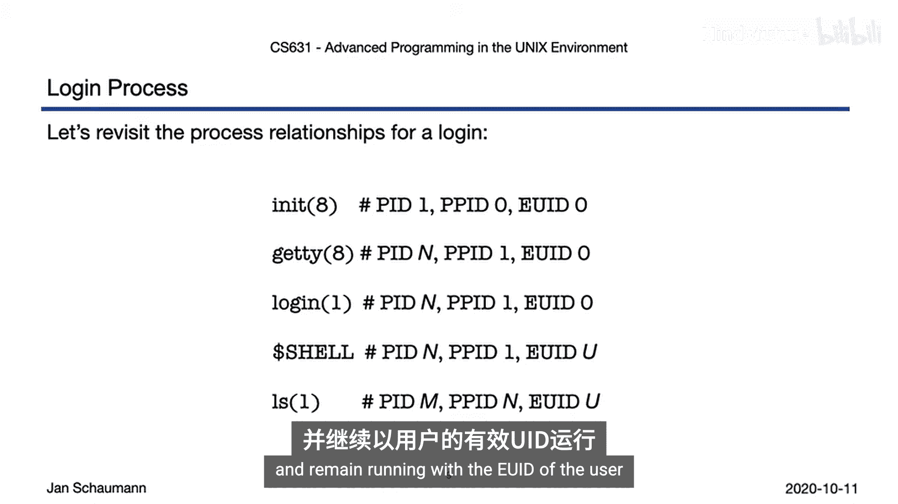
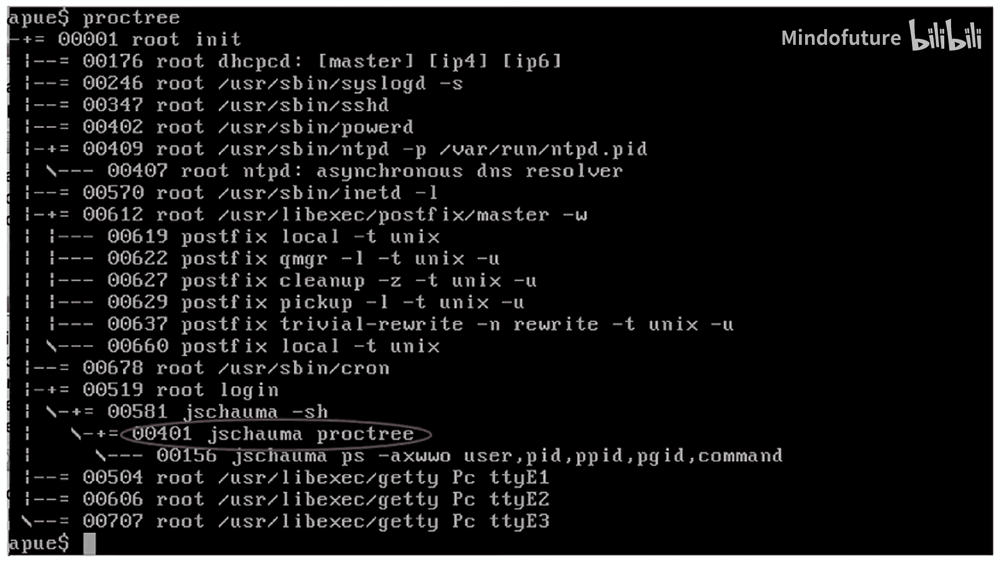
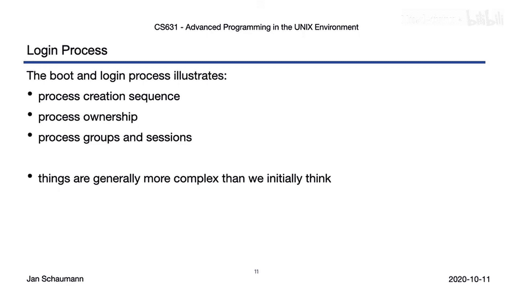

# UNIX高级编程-p44-P44-Week-07,-Segment-1---The-Login-Process--BV1hPuVz8EWS_p44-

Hello and welcome to week 7 of CS631 Advanced programminging in the UniX Environment。

As promised for this week's materials， we'll begin our discussion on process relationships。

 including process groups， sessions and our first asynchronous type of interprocess communication in the form of signals。

But before we get there， let's first see how processes created during the normal UniX boot process relate to one another。

When the system boots up， it will produce a large number of messages on the serial console。

Some of those messages are also available on the running system via the D messagesage program or may be saved under Varran Dssage boot。

What we see here are the kernel messages as it is initializing the hardware it discovers。

But once the colonel has boots up the system， it will hand of control to init and any subsequent messages sent to the serial Council are not preserved in this fire。

To view those， you have to actually look at the zero console。

This is done either via a physical connection to the Ser serial port or if the system has been configured as such。

 it may also relay such messages over the network。Virtual hosting providers may offer a way to get the system console messages accessed remotely。

But you see then are the messages from the various demons as they start up before the system will finally print the login prompt ready to accept connections。

If you are connected to the serial console， then you can provide your username and hit return upon which you will be prompted for the password。

After you provide the correct password， the system will log you in and start your shell。

The sequence of process creations will be somewhat along these lines。

And it is created explicitly by the kernelel， as we discussed in the previous video。

The system may be configured to allow connected in multiple terminals by the file etcTTYs。

 So for each entry there。And it will fork a new process。And then exactlyti。

To program responsible for configuring the TTY， read the login name and then invoke the login command。

When the user enters the username on the terminal。Kedddy will exact the login program。

Upon successful login， the login program then。Exact the users shell。And as we've seen before。

 for every command ended in the shell， the shell then forks a new process and exactecs the given command。

When the shell exits。Then in will reap the process， fork again。

 and exec Getty on the now available terminal once more。

The first few steps of the login process all run with super user privileges， but then login comes in。

8ight。Well turn off E on the terminal so your password is not shown when you type it。

 then it reads your password， hashes it and compares the hash towards founded Ey master password。

If successful， it then enters the login information into the system database。

 which can be queed by tools like the W or who commands。

There are a number of files in the system that may be read in display to the user at Lointime。

 Esy MOTD is one of those， allowing the administrator to display important messages to all users at Logen time。

We know that the user may be a member of multiple supplementary groups。

 so Loin must initialize all group memberships。It will then change the current working directory to the directory listed Ney Pass for this user。

Change ownership of a terminal device to the user so that they can read and write the device。

And finally， the program has to change the UID from UID 0 to the user's UID before it invokes the shell。

So we just saw how processes are created。The kernel creates it explicitly。In it， for exs Getty。

Ganddi execs， but does not fork a new process for login。Login execs。

 but does not for a new process for the user's login shell。And the shell of for exec commands。

But what about U ideas and the process ideas of these processes？

In it as process ID 1 with parent process ID 0 and EUu I0。Gddy。

 For exact of knit has an unspecified process ID with its parent being in knit and still being UID0。

Login merely exact by Getty， keeps Getty's pit and Pep it as well as EUuID。

And the shell retains the same pit and Piep it as login， but now has a different UI that of the user。

And finally， whatever commands we execute， we get a new pit， have the shelf pit as the P pit。

 and remain running with the EUuI of the user。

If you use virtual box to start your VM with a graphical console。

 you can log in on this virtual serial console and display the process tree to replay what we've just discussed here。

Here， we see。In it？Ass process I D1。Gedty listening on multiple serial consoles。

 has process ideas 504，606 and 707。The login program we ran from is Pit 519。And our shell is 581。

 and proc tree itself， in this case， is 401。

All right， let's break here。We've seen in this example how the boot and login process creates processes。

 output pits， pes and process ownership change。But we've also seen how certain processes are grouped together。

 hinting at the larger topic of process groups and login sessions which we'll discuss in our next video segment。

We have also seen that the login process is perhaps a bit more complex than we initially thought。

It's not quite as easy as printing password and then executing the shelf for the user。

To get a better idea of everything that's involved here。

 take a look at the sources for the login program and the user source user bin login。

And review the section in your's manual page， which talks about Shell startup and the various files it may look at。

Hopefully that will keep you busy until I post the next video。Until then， thanks for watching。Yes。

