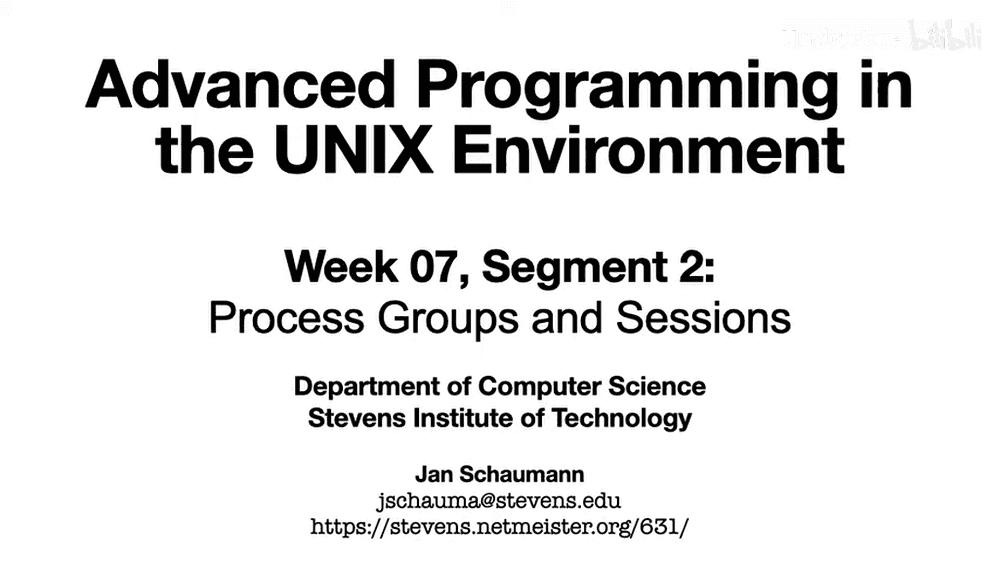
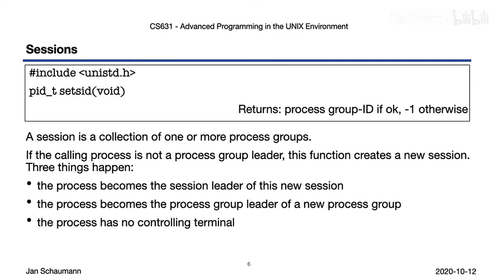
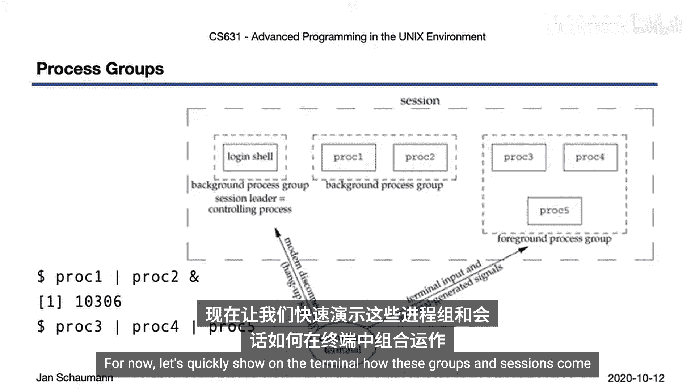
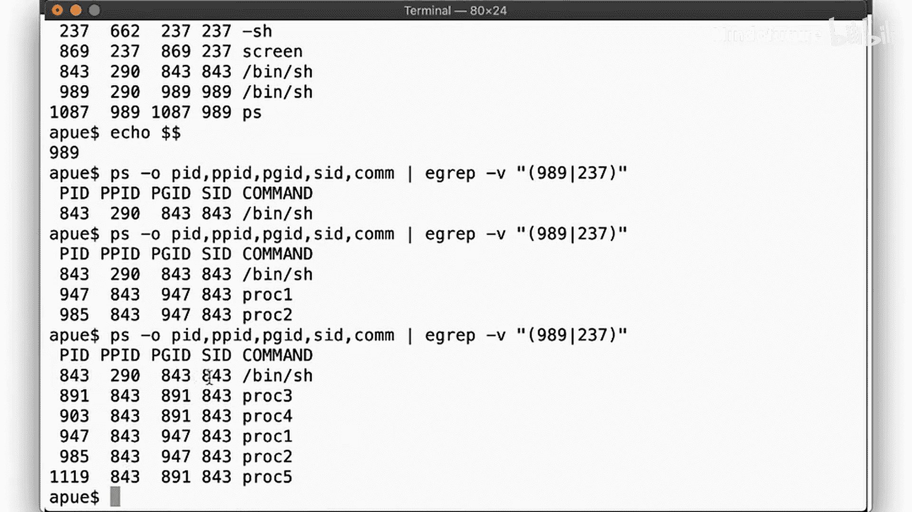
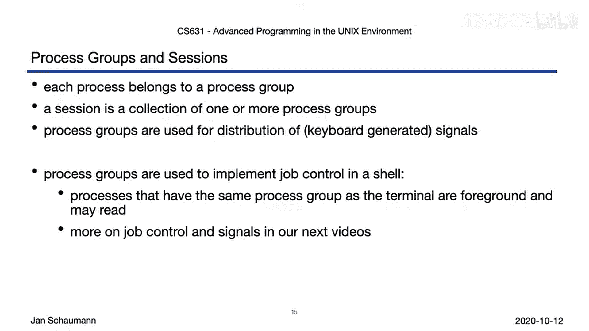

# UNIX高级编程-p45-P45-Week-07,-Segment-2---Process-Groups-and-Sessions--BV1hPuVz8EWS_p45-

Hello and welcome back to CS631 Advance programminging in the UniX Environ。

Having seen how processes are created as part of the boot sequence and how a user logs in。

 let us continue where we picked off and take a look at process groups and sessions。

We intuitively understand that certain processes are related in some way and should form a group such as when we pipe output from one command into another。

 so let's see how that works in detail。

First， every process， whether it is run as part of a command pipeline or not。

 belongs to a process group。How do you define the process group？

A process group is generally speaking a collection of processes within the same job or terminal。

Process groups are identified just like process IDs via a process group ID。

These process group Is are just like process IDs， small non negative integers uniquely identifying a process group and can in fact be stored in a PT data type。

You can get your current process group ID by according the GetP group system call。

Or try to determine any process process group ID when I get piged。

Each process group may have a process group leader。

This leader is identified by having the same process ID as the process group ID。

And this leader can then create a new process group and create processes within this group。

To set the process group of any processes explicitly， you can call it set Pot。

 but of course that only works for the current process or any of your children。

Unless you're the super user。Let's see what this looks like。When we log in。

 we find ourselves in a login shell， ready to execute command on our behalf。

This logganshire will be in its own process group。When we invoke a new command from this shell。

 such as this background pipeline shown here， then all the commands in the pipeline will be placed into their own process group。

Since we placed the Pro 1 pipe Pro 2 pipeline into the background。

 we can now execute a new command pipeline， Pro 3， Pi Pro 4， pipe Pro 5。

This set of processes will then also be placed into their own unique process group。

 meaning in this case， we have at least three process groups， one for the shell。

 one for the processes running in the background， and one for the pipeline running in the foreground。

Ging processes together in this way makes sense as we are interacting with the different processes in different ways。

But still， all of these processes still somehow belong together， right？

They were all started as children from the login shell。

 and if you were to disconnect from the terminal， you would not be surprised to find that they all would be terminated because our login session was interrupted。

And that is precisely what this collection of process groups is， a session。

You can create such a session， such a collection of process groups by calling Se sit When you do this。

 the following happens。You become the session leader for a new session。

And then you also become the process group leader of a newly created process group。

That is you begin with a clean slate， the calling process will be the only process in either the session or the process group。

There will also be no controlling terminal for this new session。

So if you wish to allocate a controlling terminal。You'll either have to open one and system 5 derived Uni variance or call Iocal to request a controlling terminal。

The device defTTY then represents the controlling terminal。

So this is what we understand the session to look like。

 it comprises all three process groups we previously saw。

And the different process groups in assertion may interact with a controlling terminal in different ways。

The foreegground Pars group may receive keyboard input as well as keyboard generated signals。

 and to hang up of the terminal will send a signal to the session leader。

We will see more examples of this in action in our next video segment。For now。

 let's quickly show on the terminal how these groups and sessions come together。

Here， our login shell。Process ID D 843。When we switch to another screen。

 we can inspect the process information to list the process ID， parent processces ID。

 process group ID and session ID。Now， of course we're going to see all the processes。

 so let's work on eliminating those processes we do not care about right now。

All I shell here is process ID 989， so we can ignore all processes that have this ID or parent pit。

We can also ignore the initial login shell under which we created our screen session。

 be anything having to do with process ID 237。There we go。

Now we only have the information about the process in the other screen window， process ID 843。

So now let's run our background pipeline， Proc 1， pipe Proc 2。

Switching back to the other screen window， we can now see Pro 1 and Progue 2 as children of Rochelle pit 843 in their own process group 947。

While those are running in the background， let's run our next pipeline， Pro 3， pipe Pro 4。

 pipe Pro 5。With those running in the foreground， now looking at the output of P。

 we see the background processes， Proc1 and Pro2 still running。But we now also have Pro 3。

 Proc 4 and Proc 5 in a separate process group 891， but still as children of process 843。

And all of these processes being grouped together in the same session。

 with session ID 843 with our shell as the session leader。

Let's review once more how the individual processes in the pipeline map to process groups。

Here we have two copies of the cat command created to more easily distinguish them in the process table。

 or so we hope anyway。As before we start out with our login shell process ID 265 in this case。

When we enter the command line， the shell parts the entire thing then。Forks a new process， pitch 296。

Which then exactecs the PS command。So we keep Pi 296。

The shell then forks again to spawn pit 689 in which it exacts the cat command。

This process is connected to the PS command and pit 296 by arrow pipe。Thanks。

 the She again fork creating process at in 981。And exactecs K2。

Which again is connected to get one viral pipe。The con of this process。The parent process。

 our initial shell is notified。Now note that our PS output， we do not see Catt1 or CAt2 show up。

This is because the PS command is invoked。And the cat and Katu programs have not yet been exact。

Instead the shadows forked the three processes for the three components of the pipeline。

 then PS read， look at the process table， sees the processes listed as SH。

 and then the two children shelves exact the cat command。

All three commands are in the same process group， group 296。

 with the PS command being the process group leader。

 but all of them together with the initial shell being in the same session。

Session 265 was the initial shell as the session leader。All right。

Before we move on to how the controlling terminal interacts with the background and foreground processes。

 let's recap。In addition to having a unique process ID。

 every process belongs to exactly one process group。

Multiple process groups can be grouped together into a session。

These process groups and sessions are used to distribute signals， and in that way。

 allow for the implementation of job control in the shell。

 introducing the concept of foreground and background groups of processes。

Process groups in the fore may interact with a controlling terminal。

 but what happens when a process group in the background wants to talk to the controlling terminal either to read data or to write data？

Well， we'll see what happens then in our next video， so stay in tuned。Thanks for watching。Jes。

