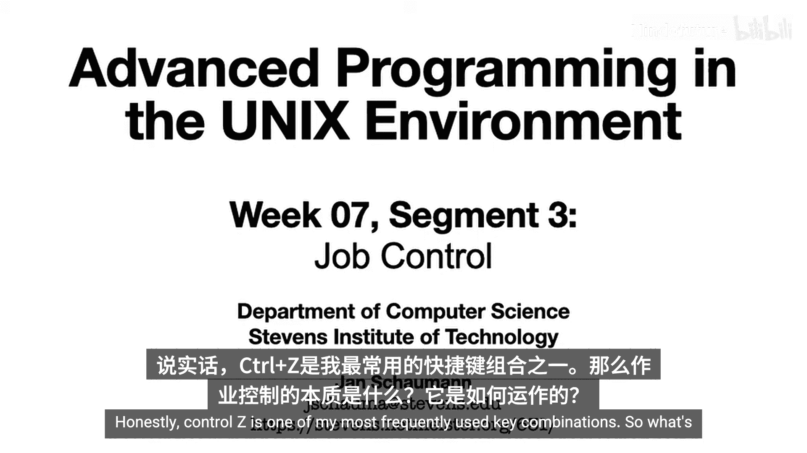
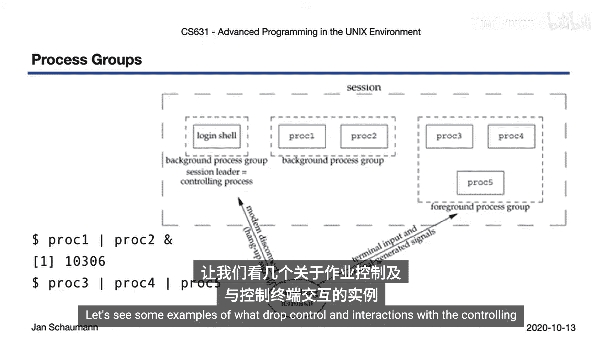
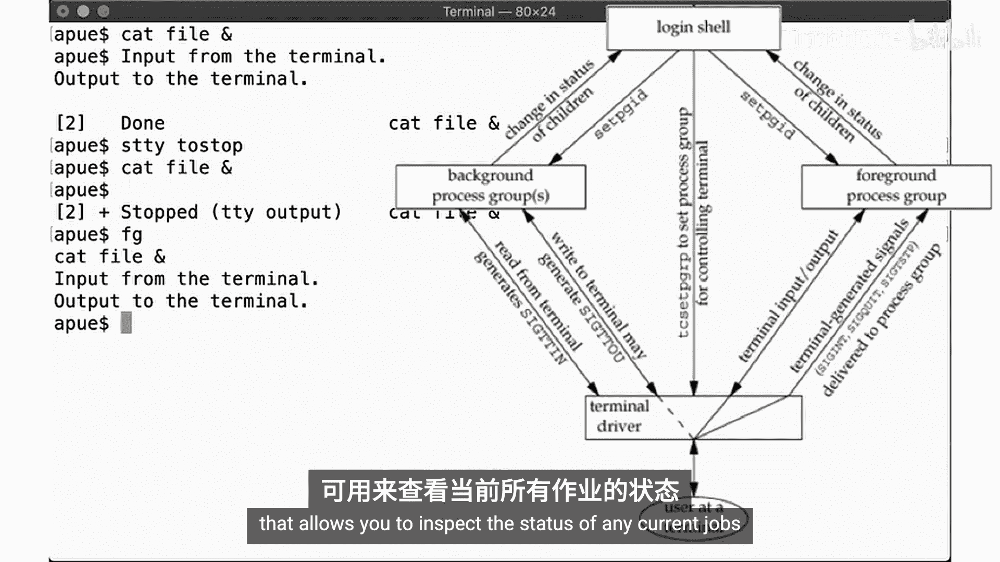
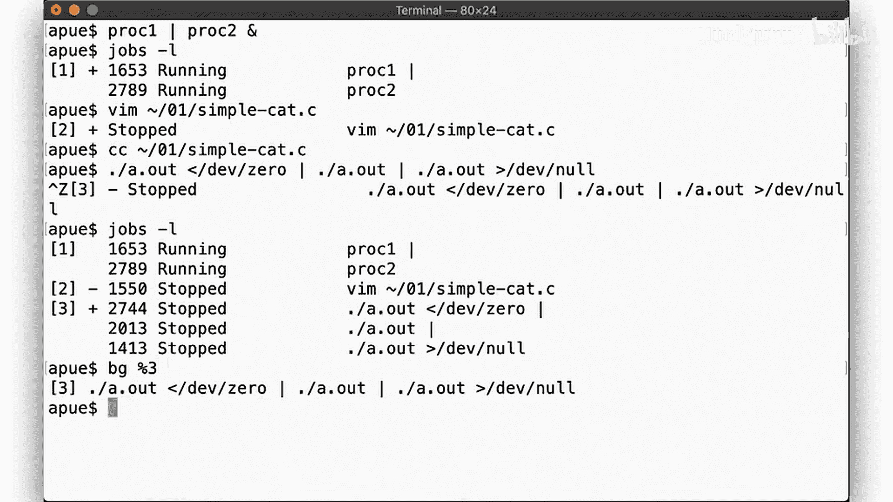
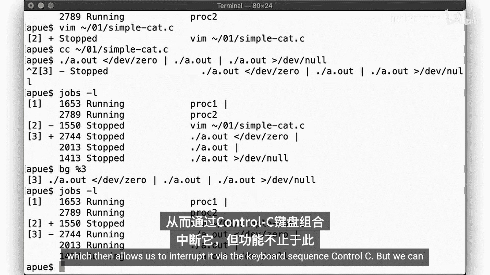
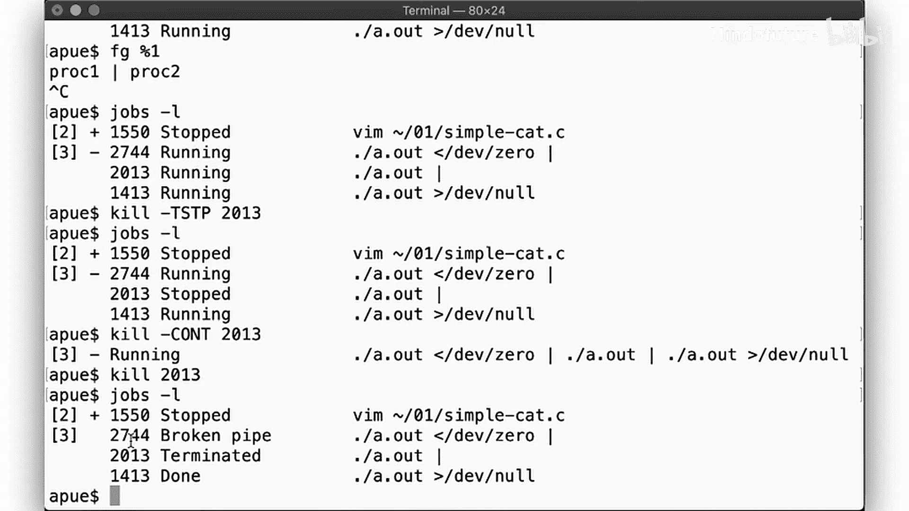
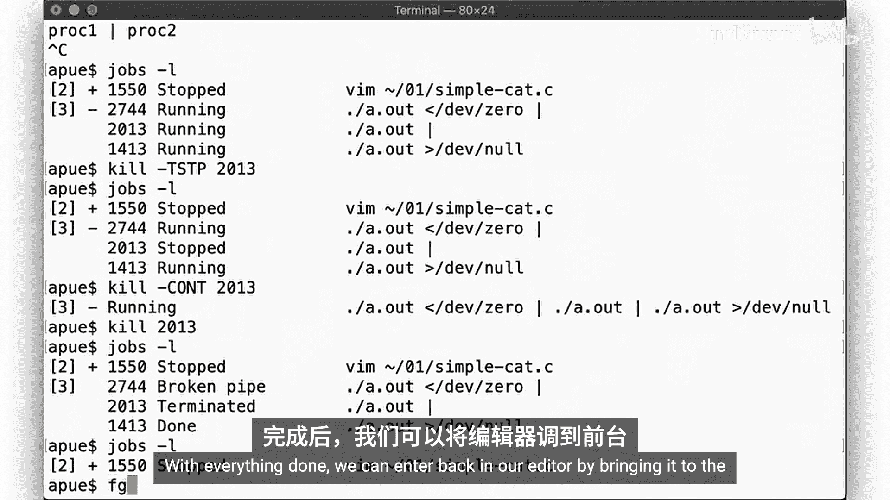
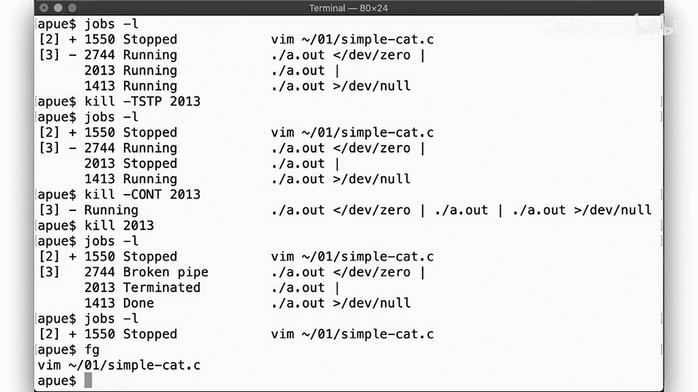
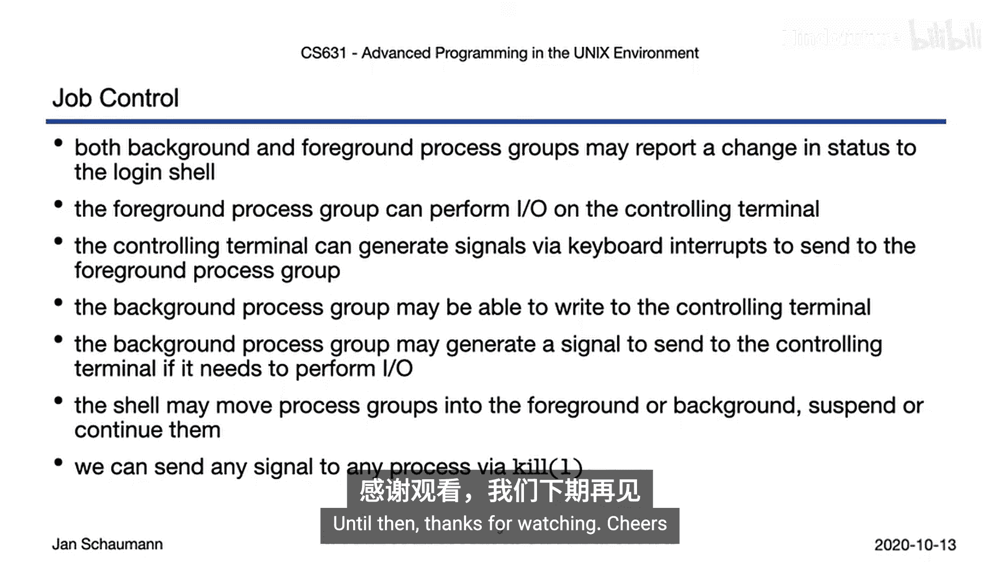

# UNIX高级编程-p46-P46-Week-07,-Segment-3---Job-Control--BV1hPuVz8EWS_p46-

Hello and welcome back to CS631 Advanced programming in the UniX environmentviron。

As you should remember， we ended our last segment looking at process groups and sessions and how these interact with a controlling terminal。

In this video， we'll pick up where we left off and illustrate the concept of job control in the shell。

 first introduced in the seahell， then adopted by the corn shell and eventually incorporated into the standard B shell。

The idea here was based on the very limiting circumstance of syn terminal interactions in the 80s。

 A user only had a single terminal and could thus not run multiple tasks at the same time。

 The sea shellll developed at Berkeley by Bill Joy。

 who would later go on to co on some microcrosystems。

 introduce the way for the shelter to supend the current process and switch another process to the foreground。

To this day， this remains one of my all time favorite productivity hacks。

You avoid interrupting whatever it is you are doing， suspend the process or process group execution。

 do whatever you are going to do， then continue your left off。Honestly。

 control Z is one of my most frequently used key combinations。

So what's job control really and how does it work This is where we left off last time a login session comprising several process groups with a foreground process group interacting with a controlling terminal and a session leader being informed of changes from the controlling terminal hangangout。

 for example。Let's see some examples of what drop control and interactions with the controlling terminal look like。

If we want to comment in the shell， we know that this command will be placed into its own process group as shown here。

The share with process I 41， a process leader for the process group 41 and session leader for the session I 41。

 fork Ex the PS command。And then。It called said Piot to place the newly created process into its own process group。

 Pi 75，3 process group by D 7，5，3。After PS completes， it exits。As we know。

 its exit status will linger until its powering process the shell waits for it。Now。

 the shell may simply sit there and wait blocking any other input so that when the child process terminates。

 it will immediately reap it。Having done so， the shell then is able to report the exit status。

 providing for one illustration of how a completed foreground process group can report a change in status to its parent。

But let's see what happens when we started processing the background using the common shell syntax of 1% after the command。

Not surprisingly。You see the background command being placed in its own process group within this session。

Now， if this command completes， nothing much happens。

 it appears since the programme is in the background。

 the shell did not wait for it and block instead it returned immediately and allowed us to enter other commands。

But if we had returned。Then the shell will report that the background process has completed。That is。

 it must have caught weight on the background process to get the status information。

 but clearly it didn't block waiting on the process。

So how did the shell know to call weight on its start process？

The answer is that when the background process terminated and generated a signal to notify its parent sick child。

The parent our shell is set up to Kuwait whenever it receives the signal。

So we see that just as with the foreground process group。

 the login shell has the process group of the background process and then can be notified of a change in status。

But so we've been talking about the controlling terminal。

 which allows us to control the foreground process group。

 so at some point the login share must have allocated such a terminal。

There is it called TC setP Group for the controlling terminal。

 allowing the user to interact with the login share and the drops the shell creates。

How does the interactioning with the controlling terminal work？Well。

 input from the terminal goes to the foreground process， cat in this case。

Output from the commands goes to the terminal2 unless were redirect it to a fire。

But when we call CA file， the output cut of the tre is expected。

When we provide input via the controlling terminal， Catt will call Re。

 which now happily blocks until we provide more data。

We can stop by using the control D keyboard sequence in our controlling terminal。

 which by convention sends a literal EOF character， or we can somehow try to interrupt the command。

As I'm sure you know， hitting control C on your keyboard causes the program to be interrupted。

This is done by and again， the terminal driver sending a signal， S in in this case。

 to the foreground process group。So IO with a controlling terminal interacts with a foreground process group。

 but certain keyboard sequences may also trigger the generation of certain signals to be delivered to this foreground group。

All right， so foreground processes interacting with the controlling terminal aren't very surprising。

But what if you have a background process group that wants to perform IO？

If you want CA file in the background。Then the shell will happily put the command into the background。

 and that process with then white data to stand out。

 which is still connected to the controlling terminal， even though it's in the background。

The shell will not wait for the command to terminate before it print next command prompt。

 So we get the result we saw here。 The prompt is printed first。

 and the output kindeg gars the terminal screen。If we then hit return。

 we get the status confirmation that the command completed。But that's a bit annoying， isn't it。

 If we were doing something here in the foreground。

 we wouldn't want some background process to randomly bar whatever it wants to write to the terminal that we're using right now。

Fortunately， we can in our terminal to not allow that。By using the STTY command。

 we can ask the terminal driver to suspend the background process whenever it wants to generate output and instead send a signal。

 S TTOU to let us know。Note that now when we run Cat fire， nothing happens。

 Our background process group has been suspended， and then we hit return the next time the shell report this change in status to us。

We can then ask the shell to bring this process to the foreground so it can complete the IO。

The interactions of the background process group with a caling terminal then may also trigger notification via signal。

6TTOU in the case of output to the terminal and STTN in the case of background process trying to read data from the terminal。

But being able to handle these signals and move process groups from the background to the foreground is what is known as job control in the shell。

Most shell implement jobs built in command that allows you to inspect the status of any current jobs。

For example， if we run our pipeline from the previous video in the background。

 then we can run jobs to have it show this process group as two processes， both currently running。

With those jobs running in the background， we can now do something else in the foreground。

 such as edit source file。If we wish to do something else now。

 we all have to close the editor and lose our place in the code。

You can instead suspend the current foreground process， them in this case by hitting control Z。

Thereby sending the sick T stop signal to the editor。

 which supends the process as shown by the shell here。Now we can run other commands and for example。

 create a whole new pipeline running in the foreground。

If we then decide that we'd like to switch to do something else。

We can again control Z and suspend this entire foreground process group。

And Jobs L will show us the status of all of our current processes。

Pro 1 by Pro 2 is still running in the background。They was suspended， and so is this pipeline。

We can now place the 80 out pipeline into the back by running BG and specifying job number three。

And Jobs L shows them to no longer be suspended。

We can also bring any of the currently background and process groups to the foreground。

Which then allows us to interrupt it via the keyboard sequence control C。

But we can do more。We can suspend any process， including one running in the background by sending it the T stop signal using the kill command。

And Jobs L shows that that this had the expected effect。

We can then ask the job to continue as well via the sitcon signal。Or we can kill it completely。

Since we just killed one command that was part of the three command pipeline。

The other two processes are also affected， although each one differently。

The first it out was terminated because the re end of the pipe was writing to disappeared。

It received a sick pipe signal， an accident。The last illout command， on the other hand。

 simply encountered EOF when the second it out was killed， so there's command ended that normally。

All three commands reported their changed status to the parent process。

 allowing the Jo command to display their status accurately。

With everything done， we can enter back in our editor by bringing it to the foreground and exiting as normal。

Now okay， let's summarize。

Both background and foreground process groups may report the change in status to the login shellll。

The foreground process group can perform Io in the controlling terminal。

The controlling terminal can generate signals by our keyboard interacts to send to the foreground process group。

We saw at least EOF via control D， S int via control C and S T stop via control Z。

 but there are others that we may revisit in our next video。

The background process group may be able to write to the controlling terminal if the terminal permits this。

 if not， then the background process group is suspended and the foreground process notified。That is。

 the background process group may generate a signal to send to the controlling terminal if it needs to perform IO。

The shell may move process groups into the forground or background， suspend or continue them。

 as we've seen by several examples， this is what is called job control。Finally。

 we can send any signal to any process via the kill command。

We'll take a closer look at this command and how signals are delivered as well as what you can do when you receive a signal and our next video。

Until then， thanks for watching。Yeses。

