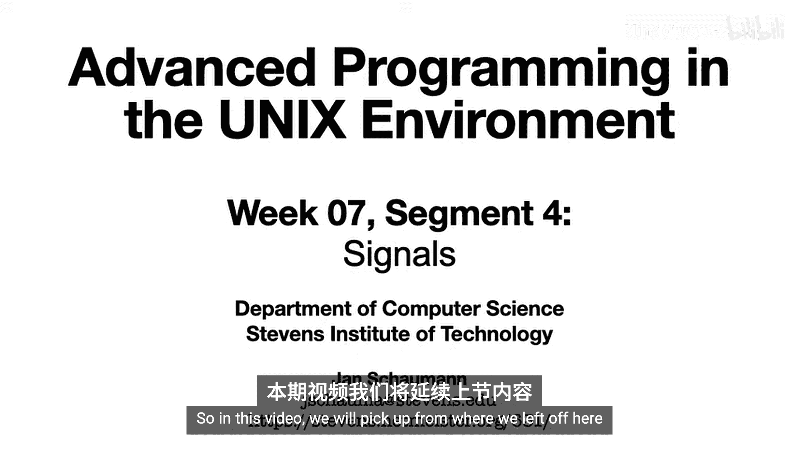
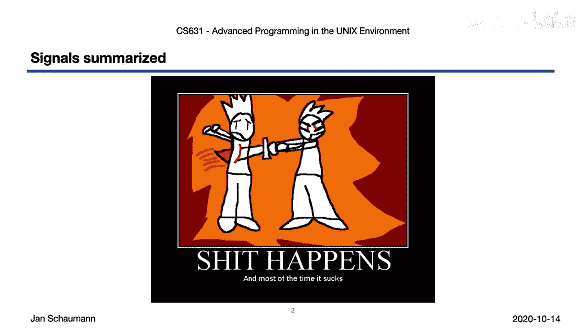
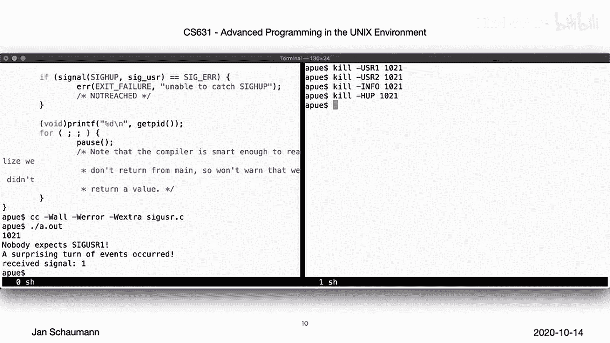
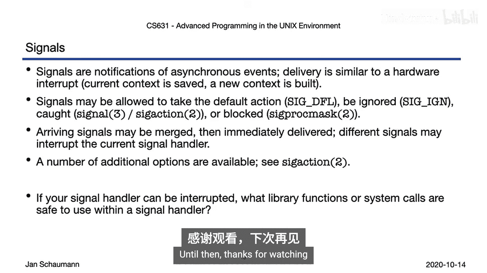

# UNIX高级编程-p47-P47-Week-07,-Segment-4---Signals--BV1hPuVz8EWS_p47-

Hello and welcome back to CS631 Advance programming in the UniX environmentvi。

When we spent some time talking about drop control in our last video。

 we saw several ways that the shell can communicate with the background and foreground process groups。

 by way of the controlling terminal。We also saw several examples of processes being able to send a signal to each other。

 a very simple way of asynchronous inter processcess communications。

 where by one process sense the other， a very small message， something along the lines of。

 please suspend yourself or please continue running。So in this video。

 we will pick up from where we left off there and talk in much more detail about unique signals。

Here's the video segment in a single slide。 Basically。

 signals are a way for the computer to tell you a process that something happened。

 And most of the time， that's not good news。In fact， more often than not。

 your process will be terminated as a result of receiving a signal。

But not always。 So let's perhaps take a closer look。

Signals are a way for a process to be notified of an event。

 The single most important aspect of signals is that they are asynchronous and thus unpredictable。

 You don't know when they will occur， nor even that they will occur。

 They can occur at any time or not at all。You've seen a number of examples。 and at the very least。

 you I've been using。The sick ins signal countless times yourels。This signal。

 like several others we've already seen are generated by the terminal driver when a certain keyboard combination is pressed。

Among those， we count， for example，6T stop， which we talked about in our last video。

We also saw some signals being generated by processes， without our help。

Such as when the background process wanted to perform Io in the terminal。

Other things that may lead to a signal being generated are the timer goes off。

The user disconnects from the controlling leader causing SHub to be delivered to the session leader。

Or a user resizing a window and requiring the visual editor to redraw the screen。And， of course。

 many others。You can find a complete list of signals in the Sign manual page。

 depending on your version of Unix， the details may be described in different sections， however。

So other than keyboard combinations， there are also certain hardware exceptions。

 such as the ever popular segmentation fault 6 sec V， or a divide by 0， say。

Or some software conditions， such as when you try to write into a pipe where the reading consumer process has been terminated。

We can deliver any signal to any of our processes via the kill commit。

 which you will not be surprised to find out as implemented using the kill system call， which。

Looks like so。The usage of the system call is trivial if you are passing in a valid pit。

But you may also wish to send a signal to multiple processes。

 such as to all processes in your current process group。To do that， pass in a pit of 0。Now。

 what happens if you're passing a process ID of negative one？Psex doesn't define this。

 but both BSD derived systems and Linux at least implement this such that if you're the super user。

 then the signal is delivered to all processes except for certain system processes in its who or page demon。

And the current process that is， this allows you to bring the system into a state where you can debug or reboottrap the system without being logged out or terminating the process。

If you're not rude， then the signal is delivered to all of your processes except for the calling process。

Now， Linux also supports another special behavior。If you pass in a negative number。

 less than negative one， then the signal is delivered to all processes in the process group of that positive pit。

Note that this is obviously not portable。Finally， it' is also worth noting that you can pass0 as the signal number。

 in which case the kill ci call will simply return 0 if the process exists and negative one otherwise。

 that is you can easily check whether a given process exists in this way without actually delivering a signal to the process。

So when such a signal is delivered to your process， what can you do？Well， here's the lazy way out。

 Don't do anything in your code， and you'll get whatever the default behavior is for the given signal。

Now， in most cases， the default action is to terminate the current process。

 though that may not always be what you want。Remember， for example。

 our simple shell from our first lecture。Because we didn't do anything about signal handling。

 if the user hit C C and delivered Sig into the shell， it would be terminated。

So a better solution may be explicitly instruct your code to ignore the signal altogether。 That is。

 ignoring a signal requires an explicit action。But you may also decide that you'd rather do something else whenever the signal occurs。

To do that， you specify a function to call that is known as installing a signal handler。Finally。

 you also have the option to say not now by blocking the signal from being delivered。

This is different from ignoring the signal in that you can then unblock the signal at a later point and then see whether any such signal did get delivered and then have it take either of the above three actionss when you're ready。

😊，We'll see some examples of this in a little bit。So how do we tell our process what we want to do about a given signal？

Well， we can call the appropriately named signal function。

 which has this function prototype shown here。By the way， if you ever write， I know C on your resume。

 you can bet that somebody is going to ask you to explain this function prototype in an interview。

 It's a very popular question。Can you tell what this function returns and what its arguments are？

If not， and even if you just want to simplify things a bit， you can use this variation。This。

 we type F a6 T to be a pointer to a function that takes an indescent argument and that returns void。

With that type de， you can then write the Sign function prototype as shown here。That is。

 the signal function takes arguments and integer， as well as a6 T and returns a6 T。Or。

It's a function that takes as arguments， an integer。

 as well as a pointer to a function that takes an integer as its argument and returns void。

While signal itself return such a pointer to a function taking an integer and returning void。

Specifically， where it returns is the previous function handler。Here。

 let's take a look at a simple example to illustrate how you can call the signal function。

Here we see a function that will be our signal handler， S user。In main。

 we install this signal handler for the stick user 1， stick user 2 and S up signals。

 print our current pit and then pause forever waiting for signals to be sent to us。Now。

 before we run this program。Let's create a second window so we can observe the program while sending signals to it。

Okay， so now we have our program running with pit 1021。

Let's send it stick user1 using the kill command。And there we go。Now Sig user2。That works too。

What happens if we send it a signal that we didn't set up a signal handle for？Well。

 then the default action takes place。In this case， we're lucky the default action for S info is to do nothing。

If we send SHub， then our signal enterer will terminate the program。

So this was a simple example of using the signal function。

But you may have noticed that signal is a library function， not a ci score。

 which means that theres a differences ci score that can be used to implement this function。

And that's the car。

Isig action。The Sig action Ci allows for more comprehensive handling of signals。

 which is necessary since signals due to their asynchronous nature can be a bit weird。For example。

 while you're in a signal handleer， the same signal that triggered this handler is being blocked。

 but another signal might come in， which means you'd be transferred out of the current signal handleer and into the signal handleer for the new signal。

If any of the signals that are currently blocked are delivered。

 you can then inspect those and see if that was the case。

And if you're done with your signal handleer， the signal that triggered this handleer will be unblocked automatically。

If you did receive the same signal while you were in the handler。

 it is now delivered after you've returned kicking you right back into the handler。

If multiples of the same signal are triggered why the signal is blocked。

 then you won't receive each one of them at a time after you returning。

 Instead they are merged into a single signal， which is then delivered。

Seeing how we can change how our process handles signals is。

 we also need to think about what happens when we fork a new process or exact a new program。

Since Fork creates a full copy of the current process。

 all established signal handlers or other dispositions are of course inherited by the child。

But if we exact a new program， then the established tens are reset to the default action。

 While signals that are explicitly being ignored continue to be ignored as well。

All of these considerations may be a bit confusing when you first hear about them。

 so let's take a look at some examples， which I hope you will recreate yourself as well。

Our first program， signals 1。 C has two signal handlers。Sick quit and sick int。

Sickquid will print a message， then go to sleep， then print another message each time showing the value of a global variable。

Second， simply print a message and returns。In Maine， we establish the signal handleers。

 then go to sleep， allowing the user to send us a signal of some sort。When we run this program。

 we will hit control back slash to generate thequi。And see us enter the Squid signal handler。Here。

After that signal handleer returns， we hit control back slash again， again。

 entering the signal handler and then try to hit control back slash again right away。This time。

 though， nothing happens because Sd is currently being blocked。But when our Sd function returns。

 it will immediately have another Sd signal delivered and as reents the signal enterer right away。

If multiple such signals are generated， we still only reenter the handto once。Now。

 let's run it again。Again， we enter the S handler。But this time。

 while we were executing the S handler， we hit control C， calling sicken to be delivered。

 which interrupts our s handler。After S in returns， Siquit print its message and returns。

If we re enter the S handleler and then deliver another s signal， we know that will be blocked。

 and they delivered。But if we then had controlled C。

 we again immediately jumped into the sickened handler。 return。

 but now immediately re enter the sickt handler as the block signal was now delivered。After all that。

 we exit。So this illustrated that we can be interrupted within a signal handler。

 as well as that multiple locked signals are merged into one and delivered when unblocked。

Now let's look at signals 2。c。This program is almost identical only here we emulate the old behavior of a signal handleer always resetting the disposition to the default upon each trigger。

Everything else remains the same。Running it， we again enter Squit。

 and then after return from that signal enterer， we again deliver the same signal。

But since our signal handleer had changed the handleer to the default。

The second sd leads to the default action for sd， which is to abort with a cordump groovy。Okay。

 let's try again。Enter St once more。Now， interrupt that handler with control C And again。

 the next secret will abort the program。Now a third try。Enter Se as before。

Now generate a few more liquids that are being blocked。But once the signal hender returns。

 the merged signal get delivered。 But at this time。

 our signal hennder had already reset the disposition to the default。

 So the single merged signal being delivered again triggers the default action。

This shows that this behavior is quite inconvenient。 Fortunately， nowadays。

 the signal handlender remains installed after the signal was delivered。Finally。

 let's take a look at code example using SG action。Our signal handleers themselves remain the same。

 but now we initialize a new signal mask and add s to it。

Then we explicitly block the signal using S proc mask。We allow for an alternate behavior。

 based on axy。To ignore si quit。And then check whether anyqui signals were delivered。And finally。

 unblock the signal again。Let's run this program。Now， if we hit control back slash。Nothing happens。

The quid signal generated by the terminal driver is being blocked。After our call to sleep。

 we then saw that the signal in question was delivered。 So upon unblocking。

 we entered the signal handler， which now again behaves just as before。

Note though that we entered the signal handler immediately after we unblock the signal and before we print it that we unblock the signal。

 What happens if a signal is delivered while being blocked。

 but then after we check for pending signal we change the disposition to ignore the signal。As before。

Entering control backslash does nothing as the signal is being blocked。After it is unlocked， however。

 we see that no signals were found to be pending。That is changing the single disposition to S een Remove the pending signals from the queue to be delivered。

Make sure to replay the code examples yourself and read the comments， but for now。

 let's recap real quick。Signals are asynchronous and unpredictable。

 They may be delivered at any time， whenever。We can allow the default action take place to ignore the signal。

 to install a signal handleer or to block the signal。

We saw that multiple arriving signals may be merged。

 but also that our signal hinder itself can be interrupted by another signal。

But what kind of stuff can we do inside the signal handleer？If we can be interrupted there。

 we probably have to be quite careful about what we can and can't do。

We will discuss that in our next video。Until then， thanks for watching。

