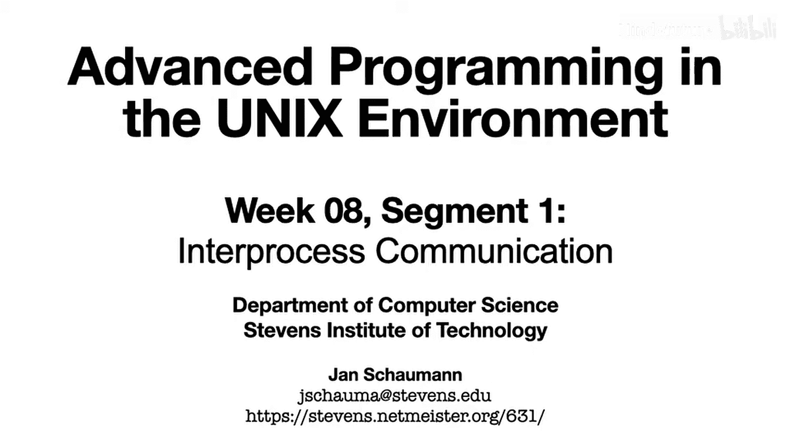
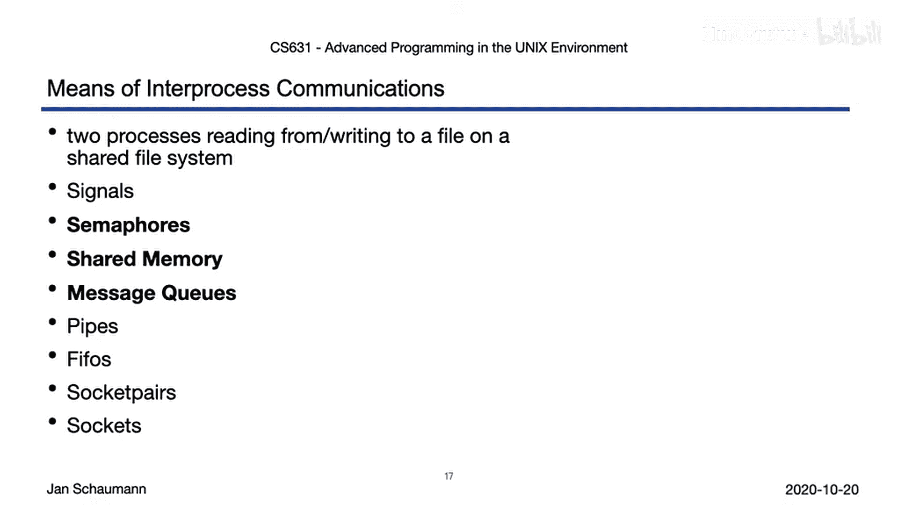

# UNIX高级编程-p49-P49-Week-08,-Segment-1---Interprocess-Communication-Intro--BV1hPuVz8EWS_p49-

Hello and welcome back to CS631 Advance programming in the UniX Environ。This is week 8 segment 1。

 and we are beginning our discussion of interprocess communication。Inter processces communication is。

 of course， something that we use all the time without ever thinking much about it。

 such as when we run a command and pipe the output into a second command。

This flow of data from one process to another is a form of inter processcess communication。

In the last two video segments， we've also talked about signals and how they can function as a different type of inter processcess communication。

 a way for one process to communicate to the other that a condition has occurred。

So these two forms of IP， pipes and signals are vastly different in exhibit or support different aspects。

Let's look at what forms of IPC we will consider。For starters。

 there's a difference between asynchronous and synchronous in process communication。

During asynchronous IPC， the communication takes place without coordination。

 as we've seen with signals， and as we discussed in our last two videos。

But asynchronous communication also allows for a process to deliver a message and for a second process to consume it at a later point。

That is a process， sends a message。Time eappsses。Then the recipient receives the message again without any coordination with the sending process。

In contrast， in synchronous I PCC， the standard recipient operating in a coordinated manner。

 and the message is received immediately。But inter process communications may also be either unidirectional。

 as shown here， only one process can deliver a message to the other with a receiving process。

 having no means to send anything back to the sender。Or the communication may be bi directional。

 allowing for either party to send a message to the other。

Communications between processes may sometimes only be possible if the processes are related。

That is the share common answer to process。A typical shell pipeline shows that all processes executing are ultimately children of the initial shell process。

 as we've seen before。The entire process communications by pipe。A only possible because of this。

 Instead in contrast to what we've seen when we looked at signals where any process may be able to deliver a signal to another process provided they have the same effective U I D。

Finally， while we talk about inter processces communication。

 we also want to consider how processes on different hosts communicate with one another。That is。

 we will look at the APIs used to perform network communications where instead of one process。

 sending a message to another process。You now have a process on one host。

 talking to a process on a different host。Communicating over a network like the Internet， which。

 as we all know， looks like a cloud。So what are our options for two processes to communicate with one another。

If you are on the same system， you can， of course have one process open the file， write some data。

 and then have the other process open the file and read the data from it。That is。

 we'd be using the file system as an inter process communications mealo。This allows for。

Asynchronous communications。There's no good way to notify the other process of new data being available。

But it's bi directional either process can read or write。

It allows for communication between related processes， as well as unrelated processes。

But it only works for the processes on the same hosts。Well。

 you can communicate over the network if you use a network file system， for example。

 but it's not quite what we mean when we say that an IP PCC mechanism facilitates network communications。

This method also allows for the exchange of variable data。

 meaning there is no real limit on what data you communicate。

Signals in comparison are rather different。They are asynchronous in nature。Unnidirectional。

Allow communications between both related and unrelated processes。But， of course。

 do not allow communications across the network。On top of that。

 you're quite limited in the amount and type of information that you can relay。As we said before。

 all you can do is say condition X occurred， and that's it。

But there are a lot of other ways to perform IBC。 and in the upcoming videos。

 we'll be covering all of the following。We look at semaphoes， which allow for asynchronous。

Unnidirectional communications between related and unrelated processes。On the same system。

But the information we can relay is， again， very limited。In fact。

 sehors are primarily used as a locking mechanism， but more on that in our next video。

The next two IC approaches are shared memory and message queuees， which both allow for asynchronous。

Bdirectional communications。Between processes on the same system。But these two approaches。

 in this case， allow for variable data to be exchanged。Like Sephoce。

 willll discuss both of these two means of IPC in our next video。After that。

 we'll talk about our very good friend， the Eunx pipepe。Types。Require synchronous communications。

Are undirectional that is a process reading from a pipe can write data back to the other process through that same pipe。

They require a common ancestor process。And don't work over the network。 in part。

 for that same reason。But do allow for variable data to be communicated。Next， there's POs。

 which are similar to pipes and that they require synchronous， unidirectional communications。

But unlike pipes， they also allow unrelated processes to communicate。Although， of course。

 they remain bound to the same host。We'll also look at something called socket pairars。

Which have the advantage of allowing bidirectal communications。Of related processes on the same host。

And finally， we'll cover the Sockets API， which。Ticks all the check boxes for synchronous IP PCC。

And which then can be used over the network to implement all the various systems on the internet。

 including layer upon layer， other communication systems like message Q services on top of T CP P I P。

 for example。But before we go there， we'll cover what is known as system 5 I PCC in our next video segment。

 Semaphores shared memory and message cues。So stay tuned and check out the next video in this series。

Jes。

