# UNIX高级编程-p50-P50-Week-08,-Segment-2---System-V-IPC--BV1hPuVz8EWS_p50-

Hello and welcome back to CS631 Advance programming in the UniX environmentronment。

After our introduction to IPC concept in our last video。

 we'll begin looking at the various methods in detail with this segment。

Here we'll talk about so called system 5， IC。

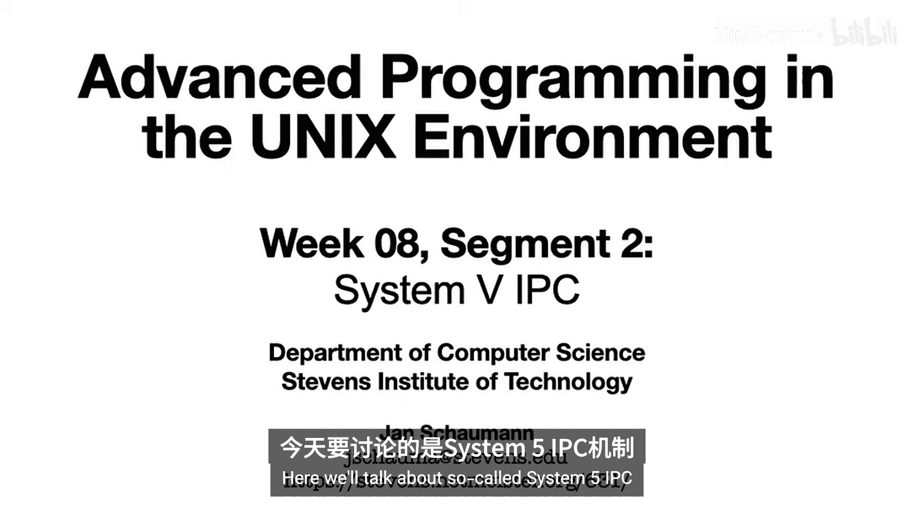

Not surprisingly， system 5， I PCC is called System 5 I PC because these three types of inter processcess communication mechanisms were first introduced in AT& T Uniix System 5 in the early 80s。

 While B SD focused on the socketsets API。The three mechanisms then introduced and which we will cover in this video。

A semaphoes？Shared memory。And message cues。All three of these mechanisms are nowadays supported by most Uni systems and will even see how at least the concept of message queuees has since been translated to cross network systems and is even offered as a service by certain giant cloud computing providers。

 Although， of course， those services are built on top of the socketss API will cover in future video。

But we're getting ahead of ourselves。System 5 IC mechanisms use specific IPC kernel structures。

Utilizing an identifier and a key to reference these internal resources。 And as a result。

 they are obviously and necessarily restricted to communications between processes on the same system。

However， and this is perhaps a bit surprising， since normally we consider IC to be primarily synchronous and ephemeral in nature。

These resources are persistent， meaning the structures will remain present even after a process had created or accessed them has terminated。

We'll see what this looks like by example， in a little bit。Finally。

 since these structures only exist in kernel space and are not usually manifested in the file system。

 we can use our usual file descriptor API to access them and instead require both special system calls。

 as well as command line tools to access and manipulate them。

So let's start our deep dive into system 5 I PC and begin with。

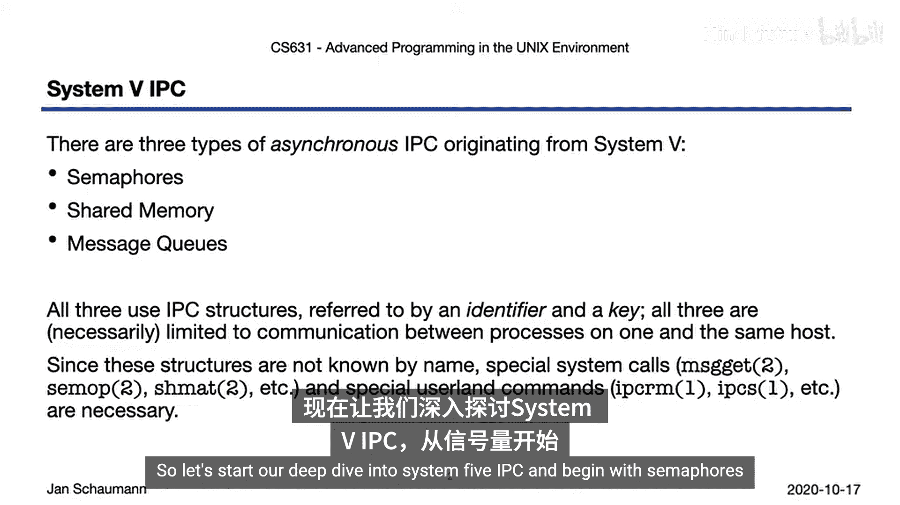

Semiphoce。Smapho is really more of a locking or coordination mechanism to access a critical region。

And you should be familiar with them from your operating systems class when you talked about concurrency and perhaps discuss the dining philosopher's problem。

In the system 5 implementation， a semaphore then is a simple counter that the kernel provides certain atomic functions and guarantees on。

In order for you to access a shared resource to pick up your second dropstick after you've been thinking for a while。

 for example。You test the sepho that controls the resource and check if the counter is greater than 0。

If so， you decrement the counter， use the resource that is you pick up the second chopstick and eat your noodles。

And then decrement the counter when you've put down the chopstick。If the value of the semapho is 0。

 then you go back to thinking or your process goes to sleep。Now， this sequence of operation， testing。

 incrementing， decrementing or blocking until it has a certain value are all odd atomically。

 which of course， is the point of the smaphore。The functions you use for this are Se get。

 S control and S up。

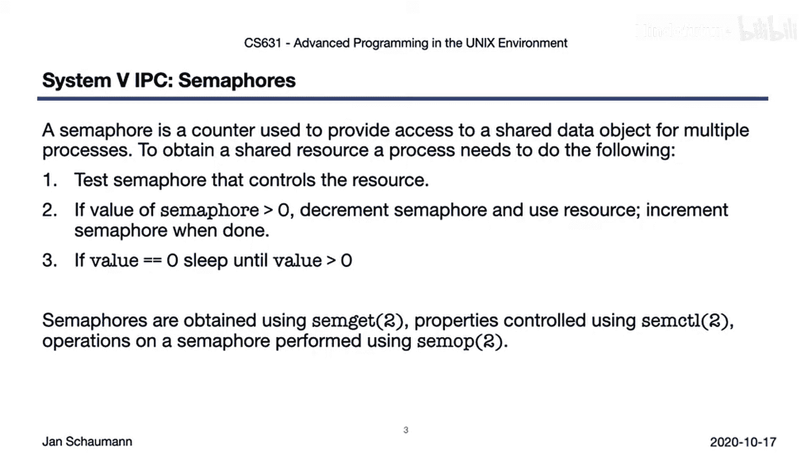

Let's look at an example。Here's our seven demo program。

We begin by creating a key to identify the sepho with。For that， we call the F talk library function。

This function uses a path name， an identifier to construct an IPC identifier suitable for use with a system 5 IPC search calls。

It does this by combining the i note and device I of the given pass name with the ID passed in。

Thereby allowing for a reproducible identifier that doesn't require you to hard code a key。Next。

We call init Se to initialize the se form using a custom function that handles a few of the edge cases around us。

The comments of the code， hopefully， are sufficient for you to follow along on your own。Next。

 we asked the user to request a lock， after which we called Samopp。

This call performs the test of the semaphore with subsequent decrement and will block until it can get a hold of the semaphore。

After that， the user can unlock again。To avoid deadlocks。

 the colonel will release a log when the process terminates。

 But just as we are good citizens enclo our file descriptors。

 we also unlock any semaphoes when we are done。So when we run this。And had return。

We will immediately get the semaphore， since no other process currently tries to grab it。Now。

 before we unlock， let's start a second process that will try to gain a hold on the lock。

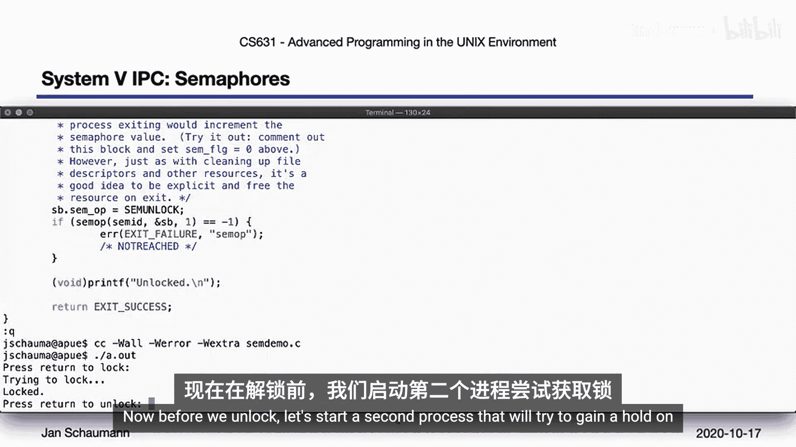

This process will now block， as the semaphore is currently held by the first process。And the second。

 we unlock that process。 Our second process gains the lock and can now enter its critical section。

Likewise， running the program again here on the left shows that this process is now blocked until the second process releases its lock。

We noted earlier that the system 5 IBC structures are persistent。

 So the kernelel has created the semapho。Based on our key。

 and we should be able to inspect it by running the IPCS command。Here。

 we note that the Sefoesait has permissions and ownerships associated with it。Just like a file。

 thereby allowing excess control to the users， if so desired。

So let's illustrate this by becoming another user。Fred。Note that Fred can run the programme。

And gain a hold in the semophore， because the permissions on the Semophore said， are。

 as shown on the left。And there in two processes， competing for the lock behave just the same as before。

The sepho sets allocated by the kernel and thus visible to all users。

But the user who is not the owner of a semophocet， cannot remove it。

Fred can see the summerforesait just as the owner can see the permissions。

But Fred cannot remove the safoesait by the identifier。The owner， however， can。

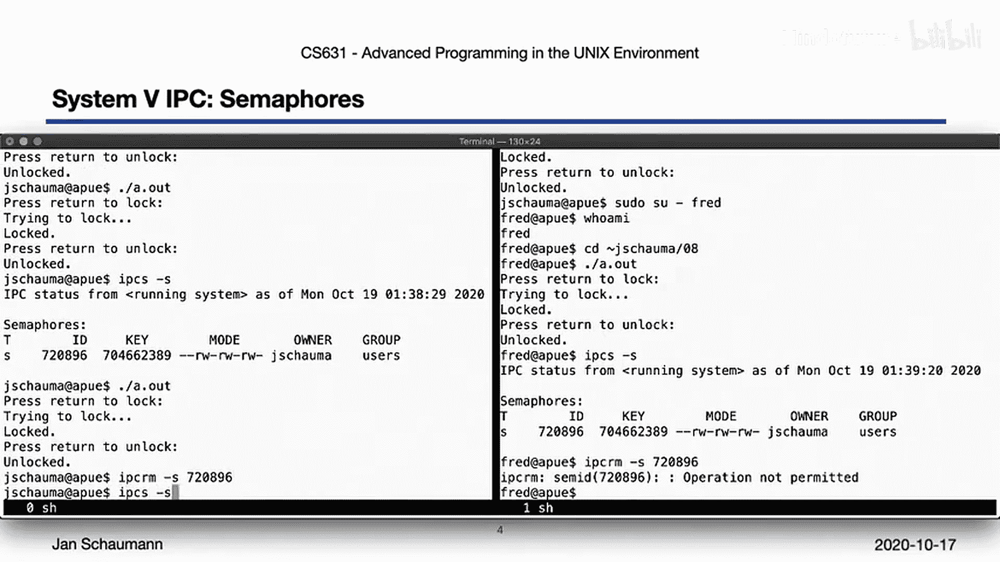

Okay。So let's consider how data flows in normal IPC。

Here we have a simple shell pipeline where one process reads data from a file。

 pipes it to another process， which then writes the data to another file。In the process。

 our data will need to cross the boundary between kernel and user space multiple times。

When we call cat input， the process has to fetch the data from the disk。

 which means crossing the userland and kernel space boundary。

But the IC itself happens in the kernel space， too。

 It is after shoveling all the data from kernel space into to user land and then need to transfer it back into kernel space。

And then back into user space on the receiving end where our second Cat command will then write the data to disk again。

 once more， crossing from user space into current space。

So we are crossing this user space kernel space boundary four times。

 and doing so is generally quite expensive。Perhaps we can come come up with a more efficient way。

Enter shared memory。In this model， we have both processes access a certain area and memory。

 which means that we can cut down in the number of times that the data has to cross from user space into kernel space。

With this improvement in mind， it shouldn't come as a surprise that shared memory then presents the fastest form of inter processces communications。

Since we are sharing a region of memory， it may make sense to protect access to this region to avoid two processeses overriding each other's data。

And what better way to do that than using a semaphore。Note， though。

 that this really is necessary if you have strictly sequential access via some other sort of agreed access。

 But for possibly concurrent rights， you do need some sort of locking mechanism。

 and some of words lendent themselves well for this。Okay， so do obtain a shared memory segment。

Your course shm get。Then use Schette to attach the segment to your process address space。

Simditi to detach again。And shim control for any of the other operations。

Let's take a look at a practical example once more。As with our semi demo example。

 we begin by determining a suitable identifier using F talk。 then get a new shared memory segment。

 creating it if it doesn't exist， much like we create a new file。 we call open with Oreat。We attach。

The memory segment and then either read or write data from or to this area and memory。

And just like always， we clean up before we exit this time by detaching the memory segment。

When we run the programme。We first write some data into the shared memory segment。

Note that now our process terminates， but， of course， the data remains stored in the memory segment。

An I S M can show us the information about this memory segment。In particular。

 we can inspect the permissions and ownership just by for Semopho us。

We know that we see information about which process I createdated the segment。

 as well as which last access it。 And we have time stamps for the last time of segment attachment。

 detachment and last change via our sh control。If we run the command again without any arguments。

 it will simply retrieve the data from the memory segment。

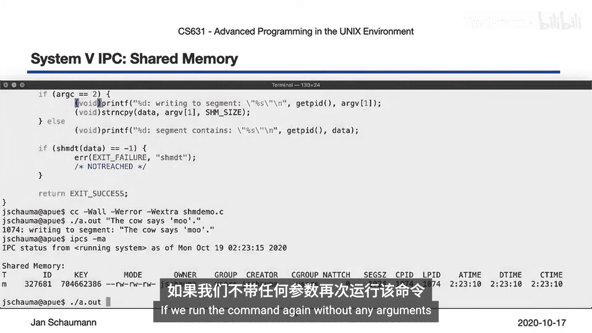

But note that the data remains persistent。 So a second invocation will again display the same results。

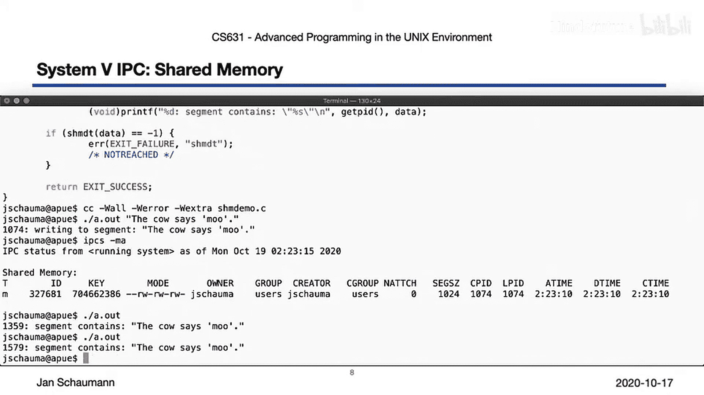

That is， the shared memory really works just like a regular file and the timests for the attach and detched time are a way to determine last access。

Also note that just as before， we can allow other users access to the data。

So Fred can certainly retrieve the information from the shared segment。

But Fred can also write data into the segment。Because we created it with what permissions granted to other users。

The output field shows the process I D of the process that lasts access to shared memory segment。

Just like with semaphoes， since the segment remains persistent。

 it is the responsibility of the user to remove any unused mappings。

And if you were to try to read data from the segment with no data。

You simply get no data back since our program created a brand new segment。

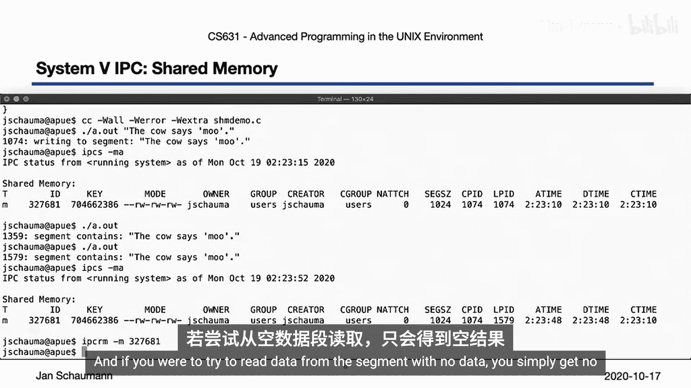

Using the same keySP before， but now yielding a new identifier。

Since we are talking about data being stored in memory。

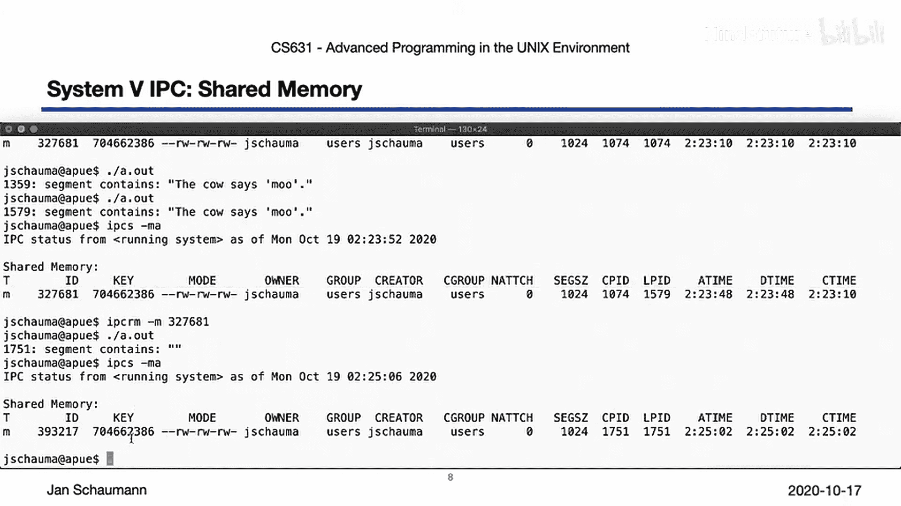

We should be able to observe the address of the memory segment。

So if we update our memory layout program from week 6。

 we can observe that the shared memory segment space。😊，Appears to be。

Somewhere below the stack and above the heap。What the size limitations are in shared memory and what happens when you try to exhaust them is an exercise Ill leave for you to complete on your own time。

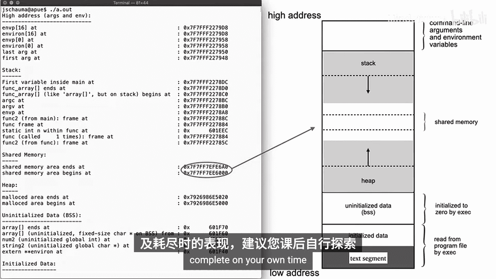

For now， let's move on to。Message cues。So what our message cues。As the name suggests。😮。

They are linked lists of messages。 more specifically。

 the list is a fi folder that is they are ordered and can be consumed only in the specified order。

As the other forms of system 5 I PC we discuss in this video。

 they also are stored in kernel space following some of the same semantics， as we'll see in a moment。

You create a new message queue by your message get。

You add new messages to the end of the queue via a message sent。

And concern them via a message received。With additional properties being controlled via a message control。

What exactly is a message， though， Well， that's really kind of up to the user。

You can define a structure for your messages yourself。

 The only stipulation is that the first element must be along defining the message type。

 which helps to find the delivery of the message。See the manual page for more details。

In our example will use a very simplestruct to only relay a few bytes of text。

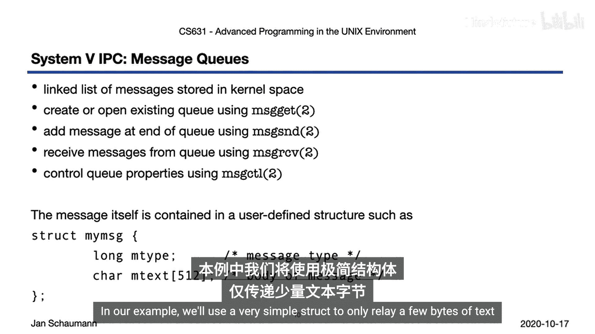

So for our example， well need two programs， one to send the message and one to receive the message。

With the final message to be a simple text message。

 then ask the user to provide the key identifier rather than to use FTlk as we did before。

This is merely to illustrate that we can use any integer as an identifier and allow the user in this way to specify different message queuees on the command line。

Creation of the message queue follows pretty much the same semantics of the other system 5 I PC examples。

 And we then craft our message to deliver and then submit it into the queue in a non blocking way。

We compile it and then take a look at the receiving program。

The receiver really doesn't look very different。And all we do here is pick up a message from the queue。

Print the text， and exit。So let's create a new queue and submit a message。Let's say， hello。

IPCS Q shows us all the details， much as we used to by now。For message queuees。

 this includes the number of bytes in the queue。The number of messages。

Which process I D last accessed it， which last read from it。 And when the queue was created。

 data submitted and data last read from。Since of this asynchronous queue。

 we can send multiple messages。Without overr previous data。

 as was the case in the shared memory example。 And we can observe the Q stas， reflect this。

When we run our receive program， it will pick off the first message in the queue。Hello， in this case。

And IPCS Q shows the updated information。Now， as before。

 we also allow multiple user access to this queue。 So let's ask Fred to do that。

Fred runs receive and gets the next message in the queue。

 which works because the queue was created with read permissions for others。

So now our queue is drained。 and when we try to run receive。

 the call will block as no messages are present。Let see if Fred can unblock us here。

But unfortunately， Fred can't save us。 Fred doesn't have permissions to write to the queue。

Only to read。So let's have Fred read。Now we have two processes reading from the queue。

Let's create another shell from where we can send the message into the queue。

Which of the two processes currently being blocked will receive this message， Fred or other process。

Well， Fred is still blocked。But the other process is now unblocked。

This shows that consumers of the queue are still waiting in order， even while blocked。

We can now unblock poor thread by sending a new message into the gear。There。Our Q is now empty again。

What happens if we try to read from a different queue。Not surprisingly， That won't clock。

 It'll simply fail since a queue with that key doesn't exist。Clean up of our IPC resources is， again。

 the same as before。So as you've seen here， message queuees look indeed quite nifty。 Remember。

 they are initially created to help overcome limitations in the only other IPC mechanisms available at the time。

 half twoplex pipes， which we will cover in our next video。😊。

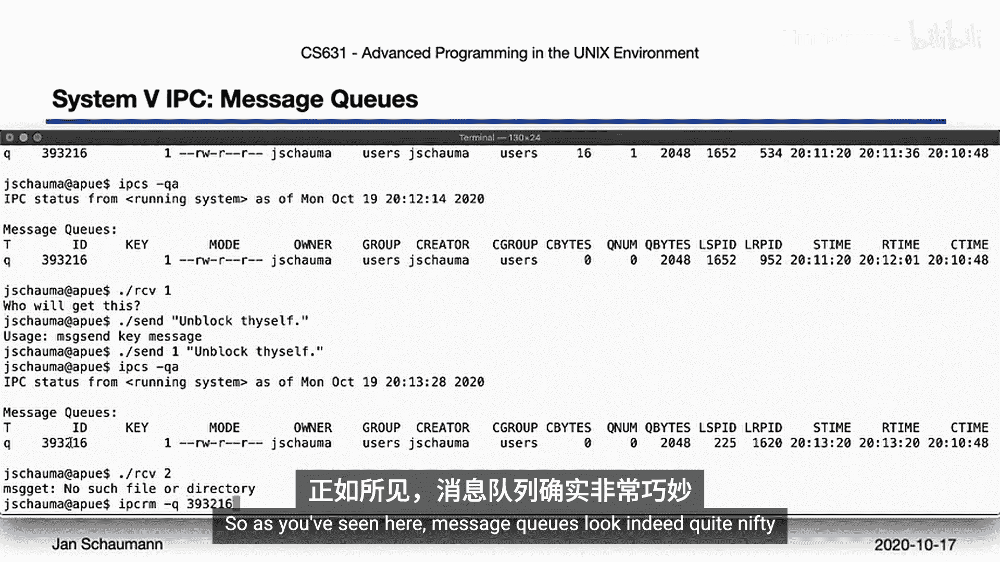

In modern systems， however， Unix pipes and the Socket API closed the performance gap。

 But if you wanted to implement real applications， you needed a few additional features。

 including a way to express priority of messages。

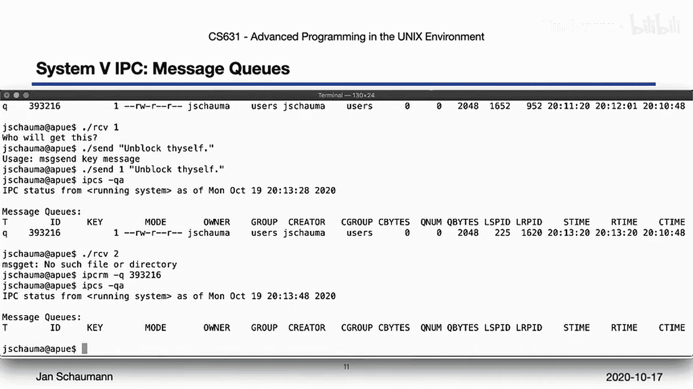

And so Poss message cues were born， similar in syntax and semantics to system 5 message queuees。

 but now standardized and providing a few additional features。For starters。

 we no longer need to use F talk or similar key as we can now identify message queuees by name。

These name message queuees may now be exposed in the file system， which can come in handy。

We allow both blocking and non blocking communications。

And we allow for a way to skip the queue and place a message to the head by assigning a higher priority。

And finally， we had way for your process to be notified of incoming messages rather than sitting there and waiting。

This is particularly useful and perhaps best illustrated by another example。

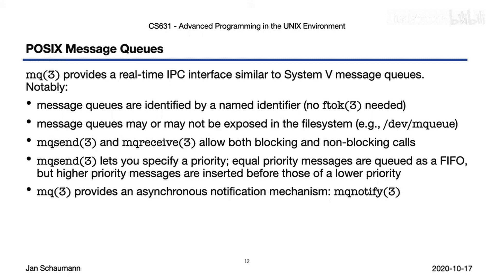

Okay， so here we have our Project messages Q sender example。Instead of a key will specify a name。

 which follows the semantics of path names， even though it may not necessarily be represented in the file system。

We open the message queue for writing。Then sent all the messages were are given with the same default priority。

After that， though， we also had a message of a higher priority。

It should be cud after the other messages， but which then may be received by the other process before the others。

Then we close the queue and exit。The receiver program looks like this。In Maine。

 we register signal handler to set a flag that new messages have arrived。

We open the message queue and then configure it to send us a signal whenever new messages arrive in an empty queue by calling M notify。

We pause， and whenever a signal is received， we empty the message queue。

 iterating over all messages in the queue and printing them。

When we compile our as sender and receiver。We have to link them against the real time library。

As this is the library that provides the Pols message queue interface。This looks like so。Dash LRT。

Okay， the receiver with no messages present and the queue will block as we are now pausing。

 waiting for messages to arrive。

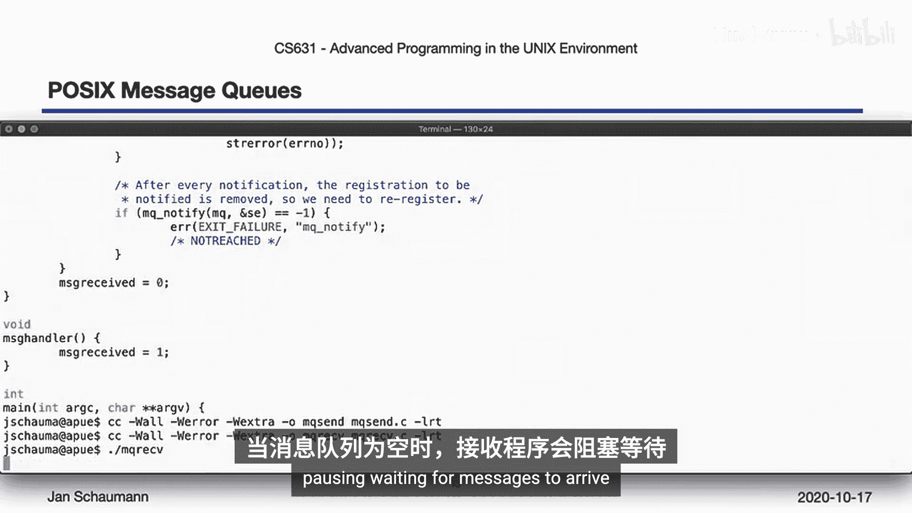

If we now send a few messages， we'll observe that our receiver wakes up after having been notified。

 But even though our messages were delivered in order。

 the receiver will see the higher priority message sent last as the first message to pick off the queue。

If we wait for a second in between message submissions。

We see a receiver picking them off one by one as they arrive。

 as it is receiving a new signal for each incoming message。If we run the command again。

 we may observe notification of the incoming messages to happen fast enough for the receiver to process them。

 such that the higher priority message only comes in last。If you run the receiver with a weight flag。

 it would allow for all messages to come in before then picking them off。 again。

 showing the higher priority message as the first message。

If the queue has not been drained beforehand。

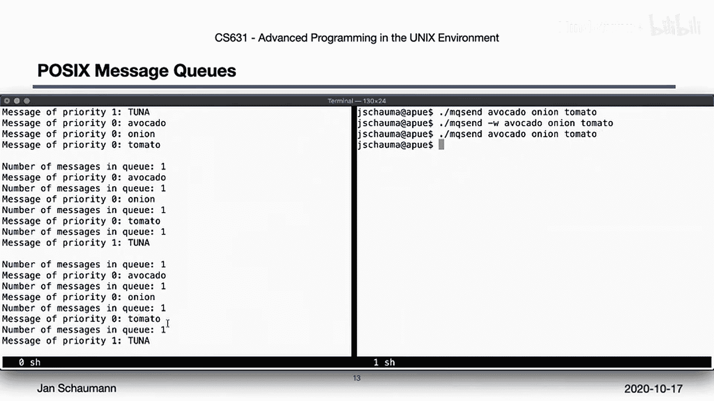

Okay， we went through system 5， IBC quite quickly。 So let's recap here。

All forms of IPC we've seen here were asynchronous and only possible for processes on the same system。

System 5 IC is amongst the oldest forms of IC， but by no means up so neat。

The use of sephoce is primarily intended for guarding critical sections and coordinating access to shared resources。

And shared memory allows for very fast IC。Message cues。

 while perhaps not all that often seen in the system 5 incarnation， Ha as a concept。

 become quite popular in the last 10 or so years。As they implement the common pop up model for producers and consumers to exchange messages。

Build on top of other forms of IPC， which well see in future videos。

 they can be found offered as services from various providers and implemented and different software stacks。

 both open source and proprietary。So are definitely a useful technology to understand。With that。

 let's break here。In our next video， we'll discuss the other oldest and still most ubiquitous form of IPC。

 the Unix pipe。Until then， thanks for watching。😊，Yes。

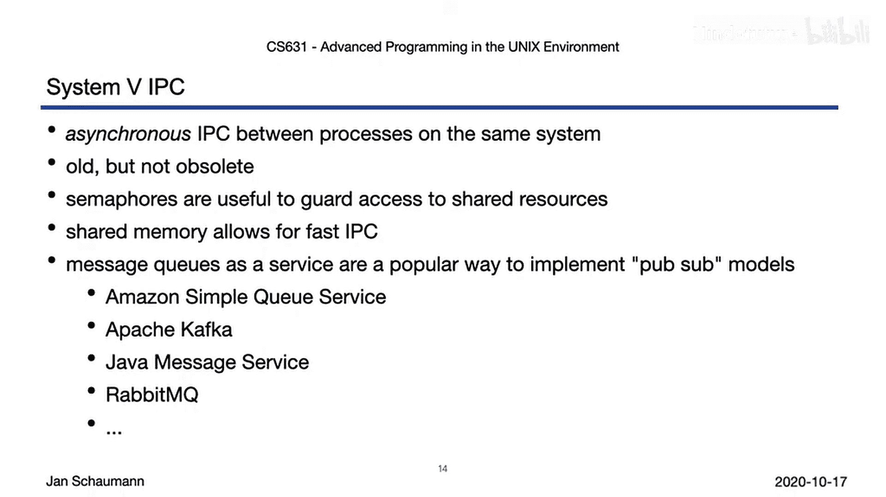