# UNIX高级编程-p51-P51-Week-08,-Segment-3---Pipes-and-FIFOs--BV1hPuVz8EWS_p51-

Hello and welcome back to CS631 Advance programming in the UniX Enron。

After we discussed traditional system 5 I PC in our last video。

 we'll now move on to the form of I that we use the most day in day out。

 and which provides the basis for so much of the Uni philosophy of building small tools that operators filters。

 handing text streams and operating on standard and instant standard out。

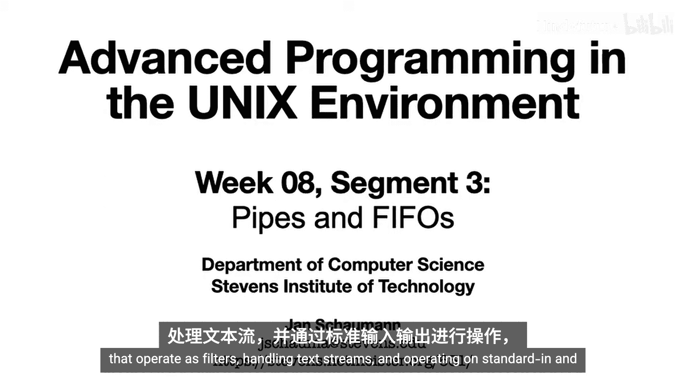

The ex pipe。With the pipes the。The pipe itself。Is one of the oldest and most common forms of IBC。

As similar to what we've seen in our system 5 IP PCC discussion， the kernel structure。

Which provides undirectional communications by offering a read end and a ride end。

The pipe Cisco takes argument， an array of file descriptors。

 which it will connect to the read and write end of this newly created pipe。Okay。

 so after calling pipe， this is what this looks like。

FT1 points to the right end of the pipe and F0 to the right end of the pipe。But this by itself is。

 of course， not useful at all in order to be able to perform inter processces communication。

 you actually need another process。How do we get another process？We fork。After we called fork。

 we know that the new process is a near identical copy of the parent process。 So， of course。

 it also gets a copy of the file descriptors of the pipe。Now each process， the parent and the child。

 have a copy and can use the file descriptors to perform myio。However， since the pipe is unidirectal。

 both processes have to agree on which process does the reading and which process does the writing。

By convention， each process then closes the file descriptor that it is not going to use。

 and we end up with our Interpro communications channel looking like this。

The parent process on the left close the read end of the pipe and can write into the pipe where the child on the right close the right end of the pipe。

 ready to read data from the parent。

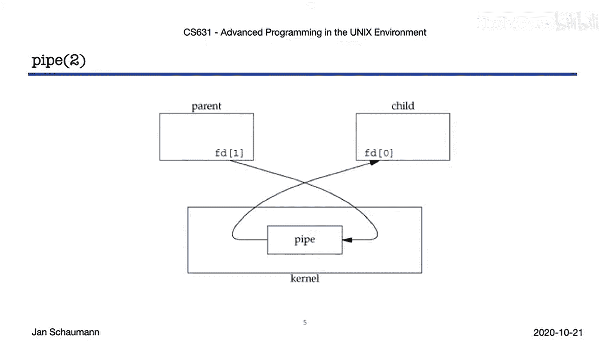

Here， let's look at an example。We're basically replicating an E pipe cat pipeline。First。

 we called pipe。And then， we fork。In the parent， we close the reent of the pipe。

 Pri of a few messages to stand it out。 That is not into the pipe。

 That use right to print a message to be delivered to the child process through the pipe。

In the child process， we close the right end of the pipe。

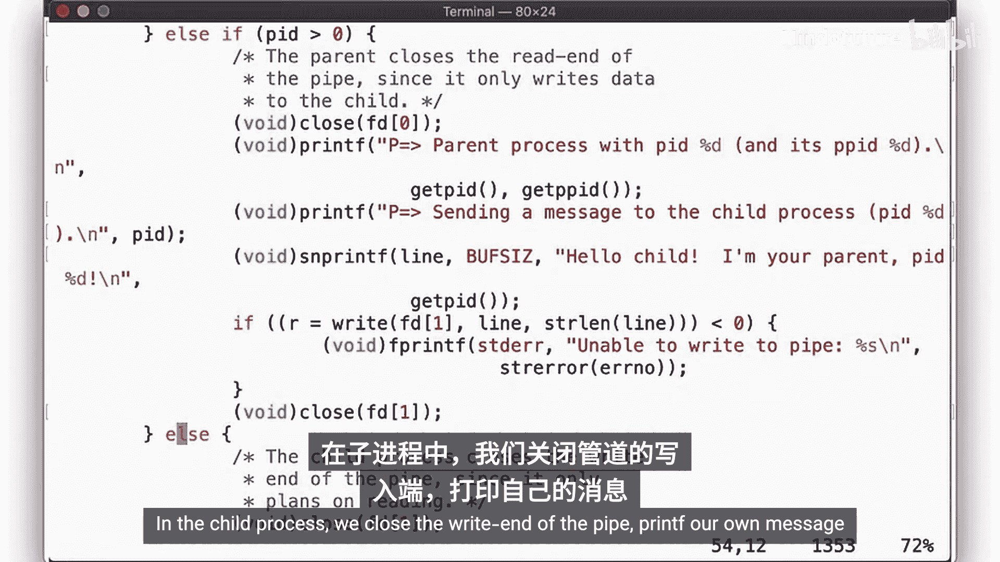

Print for our own message。 then read the message from the parent and write it to standard art。

At the end， both processes col weight and exit。

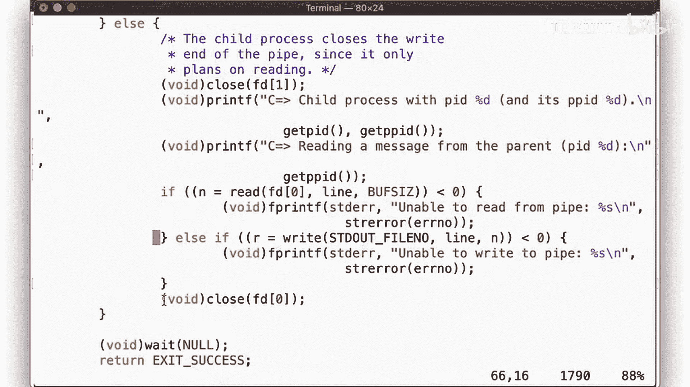

When we run the program， we now see the message from the parent。Which is reporting its parent pit。

As process I D 41。Which is the pit of our shell。The child process reports its parent pit。21，3，2。

 Then report sending a message to the child。The trial processces reports reading the message。

 then writes it to standard out。Now， let's see what happens when we write our output into our pipe ourselves。

Now， note that the message written by the child， which it received from its parent process。

 is written out first。 And we see the print of messages from the child first。

 than those of the parent， which is in contrast to what we saw right before。

Why do we have different output here。Well， remember that we are mixing printf and write calls and recall from my early discussion that printf is buffered I O while write is unbffered。

When standard net out is connected to a terminal， it is line buffer。

 So any time a carriage return is encountered， the buffer is flushed。

But when standard I is connected to a pipe， it is no longer line buffered。

 and instead the default standard out buffer size applies。

So the data written by our program will appear out of order than what we might expect from interactive views。

Recall also that we do not know whether the child or the parent will execute first after we caught fork。

 but that the dynamics of our programme necessarily enforce an order of completion。

The child necessarily will wait until the parent is done writing data。

 as it reading the data from the pilot。The parent， however。

 necessarily will wait for the child to complete after it has written the data。

 as we explicitly called W before we exit。

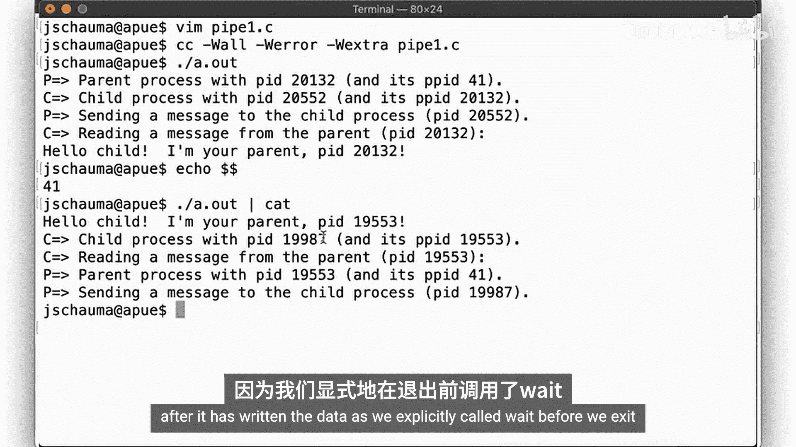

Now， what would happen if we didn't wait for the child process to complete。Let's comment this out。

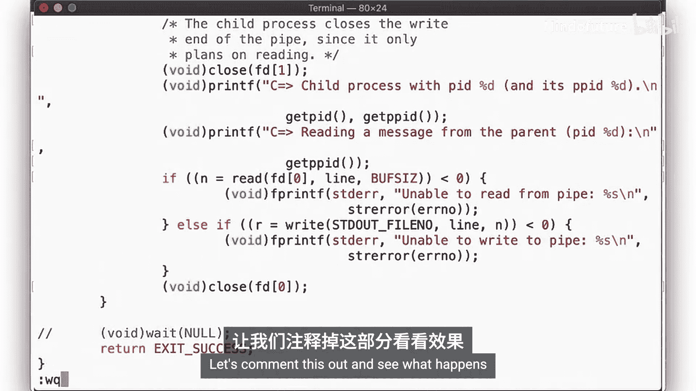

And see what happens。Now， let me run this。

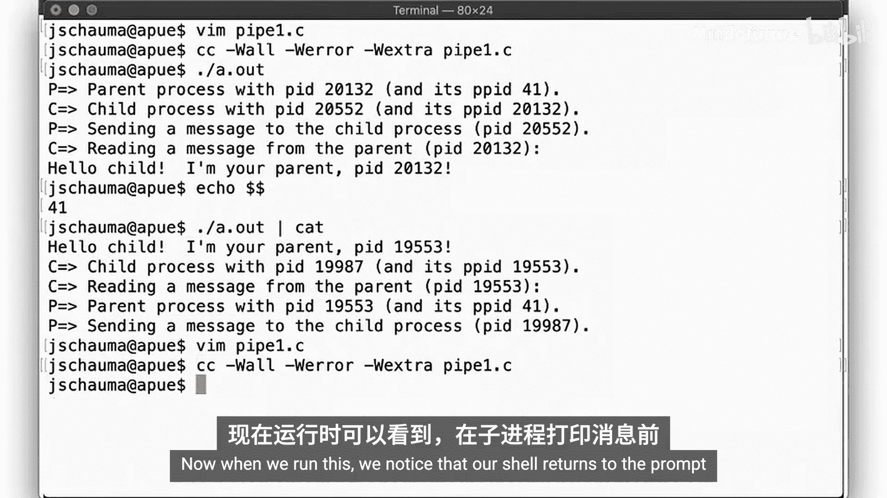

We noticed that our shell returns to the pram before the child has had a chance to print its message。

But what if we pipe the output into a pipe again？Look at that。

Now the parent completes first since it doesn't have to wait for the child。

Then the child writes its message。From the parent。 and then the child reports its pit and parent pit。

But note that when the child is writing its message into the send and out buffer。

 when it calls get peeped， that reports a parentpi of one， even though the parent process was 200，6。

1。This illustrates that we all what we also remember from week 6 when a child process is still running after a parent has exited。

 it is read by Init process I D1， which then becomes the orphan's new parent。

If you run this program often enough， you may even observe the case where the child process will report the expected parent with in one statement and then report process one as its parent in the second statement。

Okay， so we've learned how we can communicate between two processes using a pipe。But often。

 we do not want to implement all the code on both sides of the pipe。 Instead。

 we want to communicate with another program altogether。 That is。

 we want to execute another program and pipe data into it。

 allowing it to receive the data and stand that in without us having to change the program。

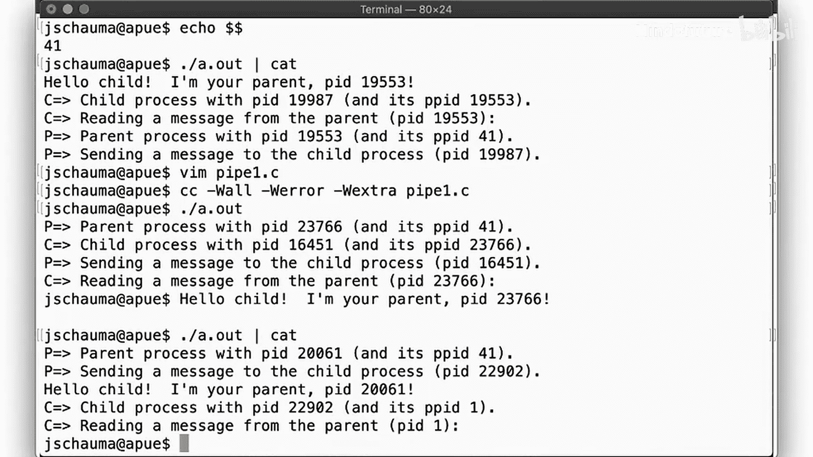

Let's simulate this into this code example。Specifically。

 we're going to emulate piping data into a pager。By convention。

 many programs are another pager environment variable， which might point to a program to invoke to。

 For example， read the manual page。If that pager is unsai。

Most commands were then default to the Mor command。So what we'll do with the program pipe2。

c is implement exactly this command right here。We cat a file into the user chosen Pager command。

 defaulting to user bin more if that variable is not set。Okay， so let's see。

We F opened the file were given。

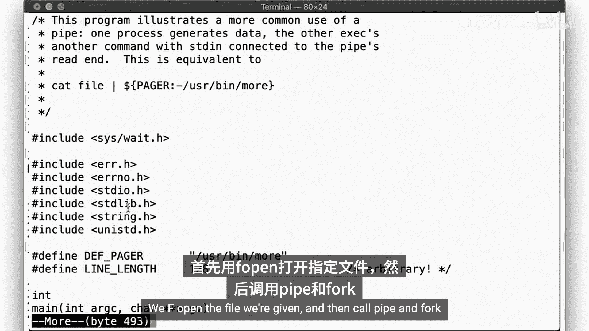

And then called pipe and fork。In the parent， we close the read end of the pipe and then continue to read input from our file handle and write it to the right end of the pipe。

In the child， we close the writing end of the pipe and then call dube 2 to duplicate the readent of the pipe onto the standard in file thescriptor。

 thereby redirecting standard in。This has the effect that now our child process or any program it may exact later will。

 when they read from Standard In， in fact， read from the pipe read handle。Next。

 we check if the user has a pager set in the environment and produce a suitable ArcV0。

 or use the default pager if not。

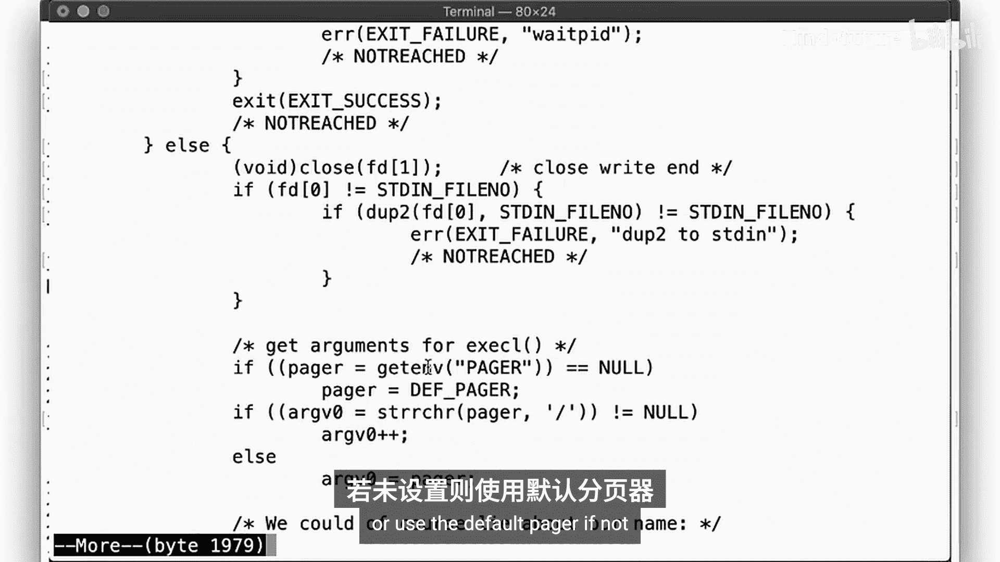

Then we call exact LP， knowing that our pager is connected to our pipe。

 allowing the bytes from the parent to become standard in of the program we're executing。

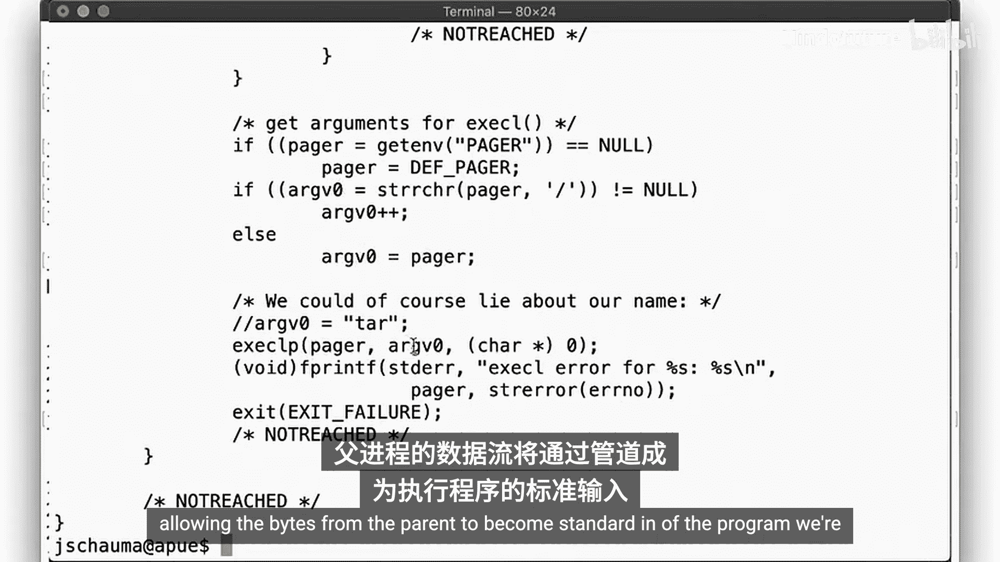

So when we execute this program and that's what we expect， it pipes the file。

 we give it into the default pager。

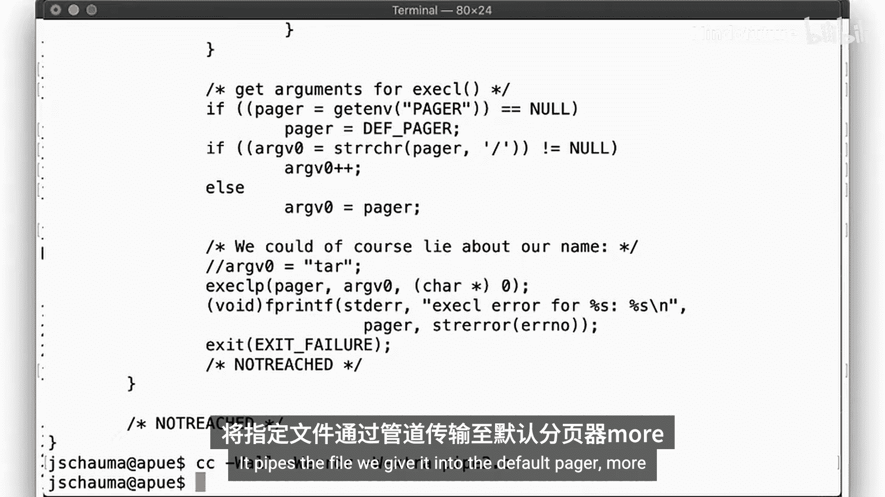

More。

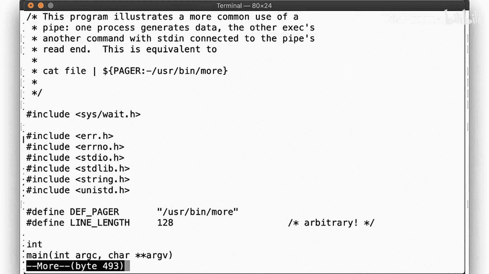

Now， if we suspend this program。We can see the processes。

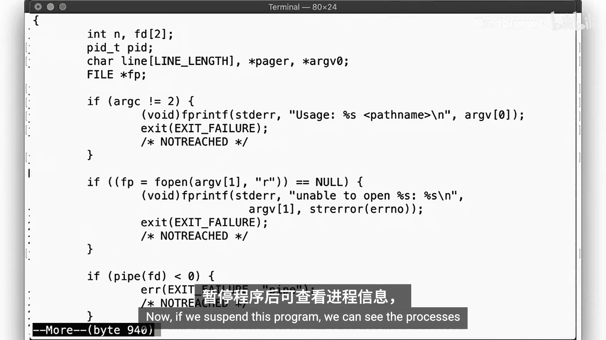

With process I D 148，5，7 being the parent process。

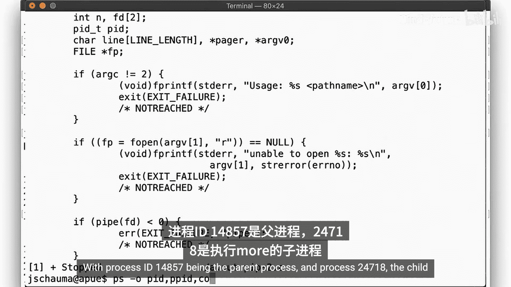

And process 2，4，7，1，8， the child process， executing more。

But this program also gives us an opportunity to explore how using settings from the environment can change how your program behaves。

We had intentionally written a program to allow the user to choose the pager。

 thereby allowing for some flexibility。Here， let's set the pager to Cat。

While our program now is perhaps not very useful， well see that we are able to execute this other program。

 and again， it will receive data and standard input from our pipe。😊，There。But we can， of course。

 use any other program capable of reading data from Standard in。Say WC。So this is useful。

 We basically illustrated just how the shell implements inter process communication for its pipelines。

And when we looked at the output of P， we saw which program was executed。

But remember that our code included a short comment and that when we talked about the exact in the previous video。

 we mentioned that we can specify Arc v0， the name of the program。Here， let's take a look。

Suppose we set av 0 to be。

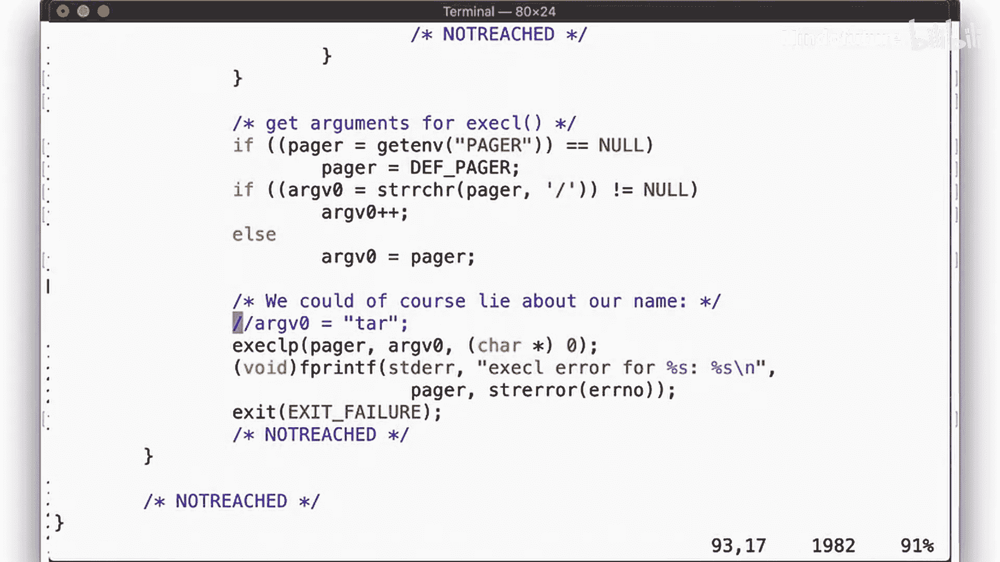

Then regardless of what program we are actually executing。

 it will show up into a process table as tar。 Let's do that。

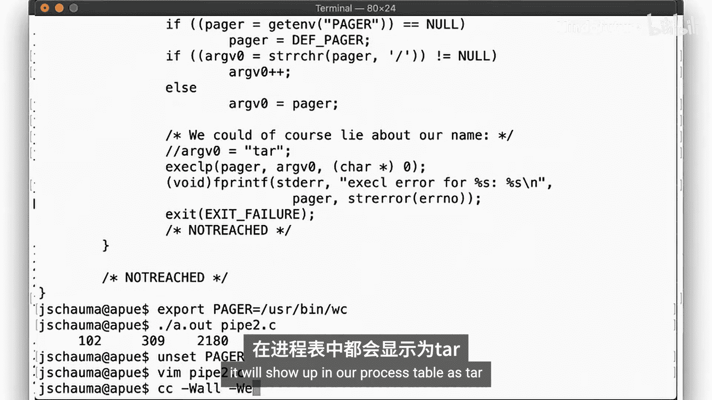

Since our pager environment variable is un， we will execute the default pager more。

 if we then suspend the process and look at the process table。

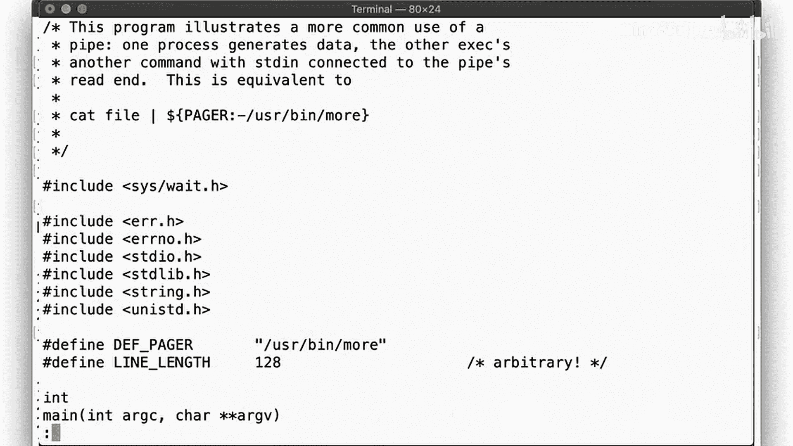

Then we see the command listed。

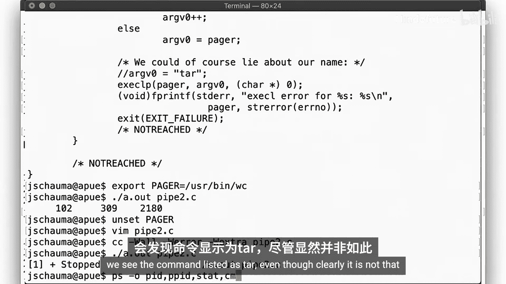

As tar， even though clearly， it is not that。In other words。

 you can trust the process table only to some degree。Now， our program here。

 where we create a pipe and then write data into a second program is something that is needed quite often。

Likewise， you could imagine the inverse， a program that executes another program and then reads the output from that program。

Both are very common use cases， and so of course， we actually have a library function available for us that does all that。

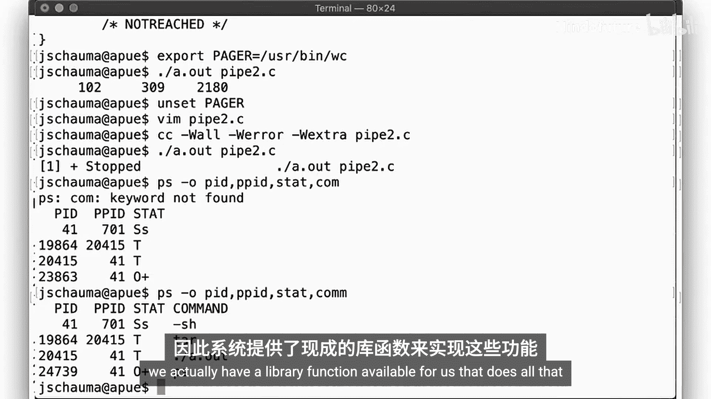

Enter P open。The Open will create a pipe connected to the command that is to be executed and return a file stream for you to consume。

So it's kind of useful to be able to read and write from another process。

 This is nowadays usually implemented， not using a pipe or a socket。

 which is what we will discuss in our next video。To tell the function whether you like the read or the write end of the pipe。

 you specify R or W。If you want both， add a plus。The command you pass to P open is executed not directly。

 however。Instead， the function executes B S H， and then hence the shell the command。

It has a few important and perhaps surprising side effects。 For one thing。

 this allows for expansion of all shell meta characters， including fire glbbing， for example。

But it also means that if youre not careful， your pro can be abused to execute additional command。

For that reason， NePSD has an additional variation of this function that combines the exact call with the redirection of the I O stream。

 P Open V E。That， however， is non standard and only mentioned here for completeness sake。

 since Nebu is our reference platform。

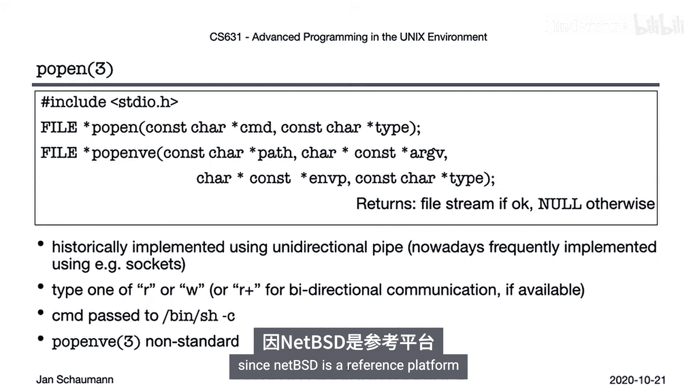

But let's look at a few examples。Our program here implements pretty much what we had before。

 piping a file into a pager。But note that this time around， we don't need to call pipe or fork。

Instead， we simply call P open。And can then easily write our data into the program。

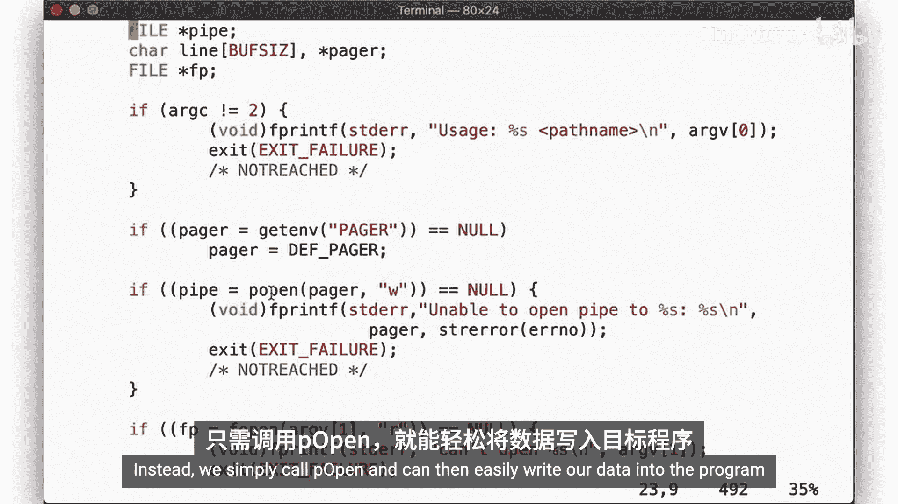

Here we go。This time， we prefix the output with some arrows。But otherwise。

 the program behaves exactly the same。And if we set the pager to catch， for example。

 we are also not surprised by the results。Same if we said it to WC。

But now let's enter our pager to a sequence of commands。When we run the program now。

 it will dutifully pipe the contents of the file into more。

But it will also execute the other command since the contents of the pager environment variable are passed to a shell to execute via a P open。

So after our program is completed。😊，We should find that it did indeed execute the ID command。

And there you have it。

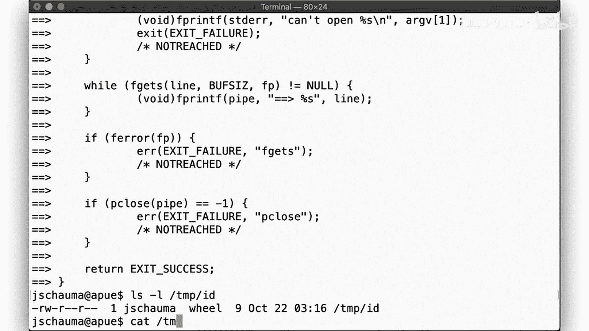

This pattern is actually a very common security of vulnerability。

 Many programming languages support a P open equivalent and all too often do not verify the command that is passed to this function。

 not remembering that it is passed on to a shell。You can find countlesss bug bounty reports of vulnerability disclosures that centre around this particular way of exploiting unvalidated user input。

 And so this should serve to you as a reminder to A。

 avoid P open and use something like P open V or other parameterized execution methods and B to always verify that what you are passing into a shell doesn't contains shell met characters or otherwise can lead to the execution of additional commands or perform file O etc。

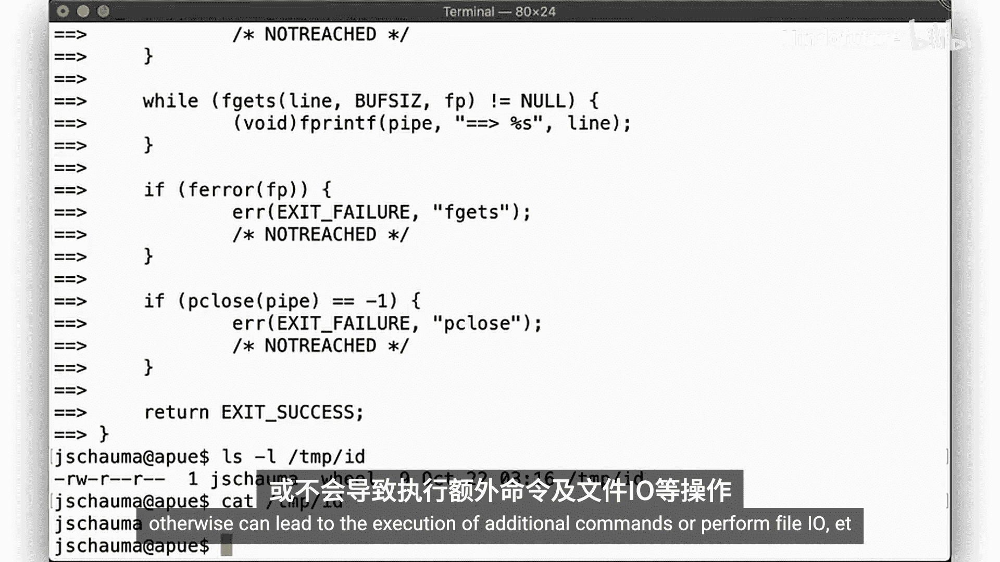

Okay， so we've seen the use of the pipe and we know that it can allow related processes to communicate。

 but what if we want to have unrelated processes to exchange information。For that， we can use a fiFO。

A firefo is also known as a named pipe。 It behaves much like a pipe。

But it allows unrelated processes to communicate。Because it is actually manifested in the file system。

 that is， it exists as a file of type 54 and thus allows processes to read from or write to it。

As such， all the usual file Io operations work almost just as on a regular file。

And you create a PIFO via the makeg PO is called shown here。But why is a file for useful。

 Couldn't we just create a normal file and let the processes read from and write to that。Well。

 the advantage of a PIF is that the data does not actually end up on disk and it is consumed in sequence as it is written to the PIFO。

😊，Its usefulness is best illustrated by an example。

Suppose you have a process that you wish to connect to not one single process， but two。That is。

 you want two commands to process the output of a program。We can do that。

 There' is no way to pipe data into two programs， so you'd have to run the command multiple times。

But if we create a file form and we have a tool that duplicates input that reads to a file as well as to standard it out。

😊，Then we can create a pipeline that allows for data to flow into two programs。

The problem we need to facilitate this is T。Tea is called tea because it looks like a tea。

 Thela goes in on one end and comes out on two ends。But what about the fiO？Well， with T。

 we can only duplicate its input to a file， but oftentimes you do not wish to create an intermediate file。

Perhaps you're processing large amounts of data and simply don't have the disk space to store the intermediate duplicate copy of the data。

So instead of asking T to write to a file， we ask it to write to a file file。

 and our second consumer can then read the data from the file file。

This may sound a bit confusing when you're just looking at these illustrations here and have never used tea。

 so let's try to make things clearer by showing an example。😊。

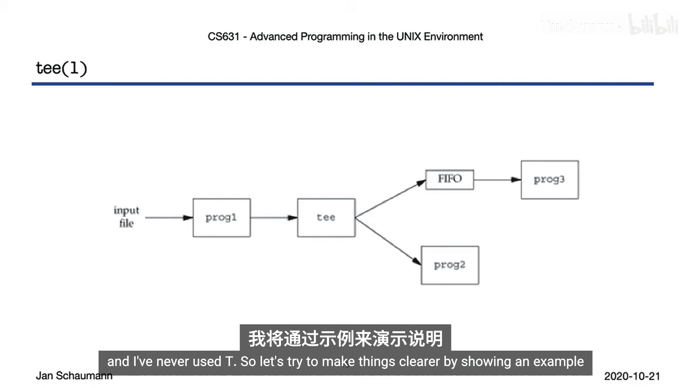

Here we have a bunch of log files from our web server。 The entries look like this。

One line per hit where the9 field shows the HtTP status code。

So if we want to separate all our logs into entries that were successful that had a 200 HTP status code and those that did not。

 then we have to decompress all of these files and grab out the lines with 200。Into one file。

And then decompress all of these files again to grab out all those not matching our pattern。

In other words， we performing rather expensive IO and CPU worked twice。

Let's see if we can improve the situation by using a Pphone。Let's create one of those。

It looks like this。Type is P for named pipe， and the size is always 0。

 as a 5 or does not store anything。 only allows it to flow between processes。

So how can we take advantage of this？Let's start our a first grab process。

But place it in the background。The invocation will now block。

As no data has been written into the Pfo。But now we can uncompress our log files and have T duplicate the data into the filefo。

Then add the inverse grab in this pipeline。After this completes。

 our background pipeline will also have completed。And our results are identical to the ones we had produced earlier。

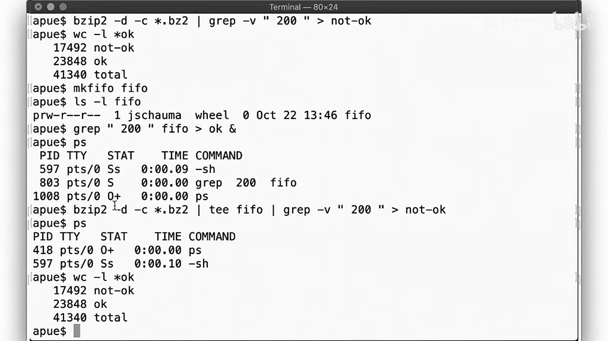

Well， okay， time to recap。Python fis are the oldest forms of IPC。

And form the basis of the Unix philosophy of building filters and operating on text streams。

As we've seen， we can only use pipes between related processes。

 as the pipe system call produces the pair of file descriptors。

 and you need to fork a new process to allow them to share the communication end points。FO。

 on the other hand， allow us to have unrelated processes communicate with one another。

We noted that pipes are not line but fully buffered。And after you've created a pipe。

 it's conceivable that you fork multiple times， yielding possibly multiple readers or writers。

This may not seem like a desirable situation， but the pipe at least guarantees you that the data from a single rider does not interleaved with the data of another rider for up to pipe off chunks。

Practically， though， it's rare that you have such a setup and instead would likely prefer having multiple pipes or some other form of IPC for this scenario。

Now， what happens when you close one end of the pipe？If you close the right end of the pipe。

 then the consumer。We'll simply get 0 bytes from it on the next read。

But if you're trying to write to a pipe where the reader has disappeared。

 then you will receive a signal， S pipe。 You can， of course， catch or ignore that signal。

 as we discussed in our earlier video。If you do that。

 then the right to such a broken pipe will yield ana with Erno said to E pipe。

This concludes our coverage of Unix pipes and Fiphos， but of course。

 we have a lot more to say about other IC。In particular， in our next videos。

 we'll discuss socket pairs and sockets， both in the local domain and then in the network context。

Until next time， thanks for watching。Js。

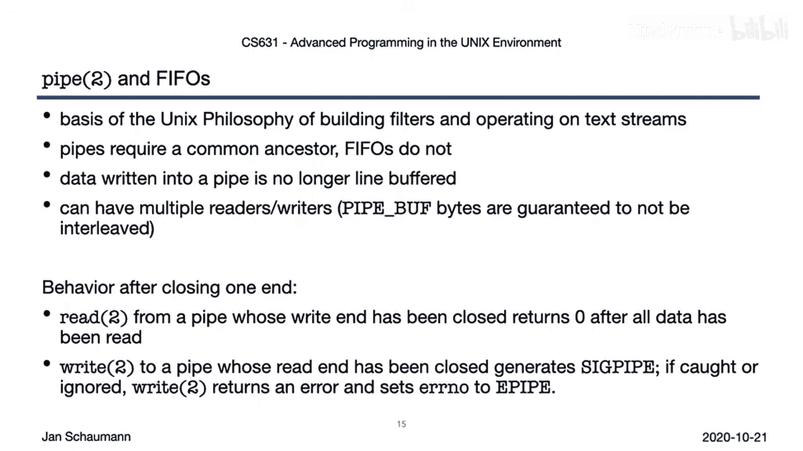