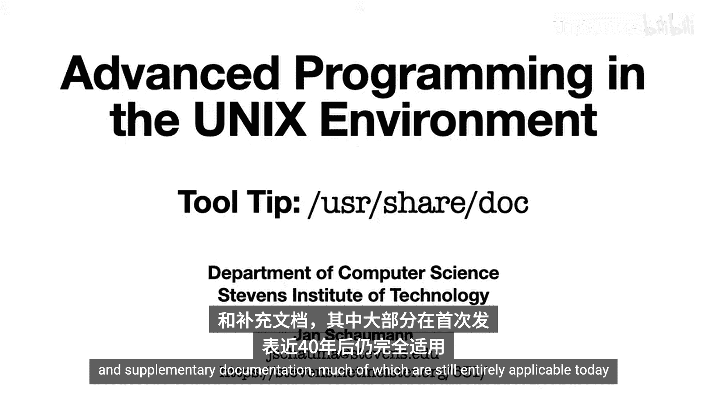
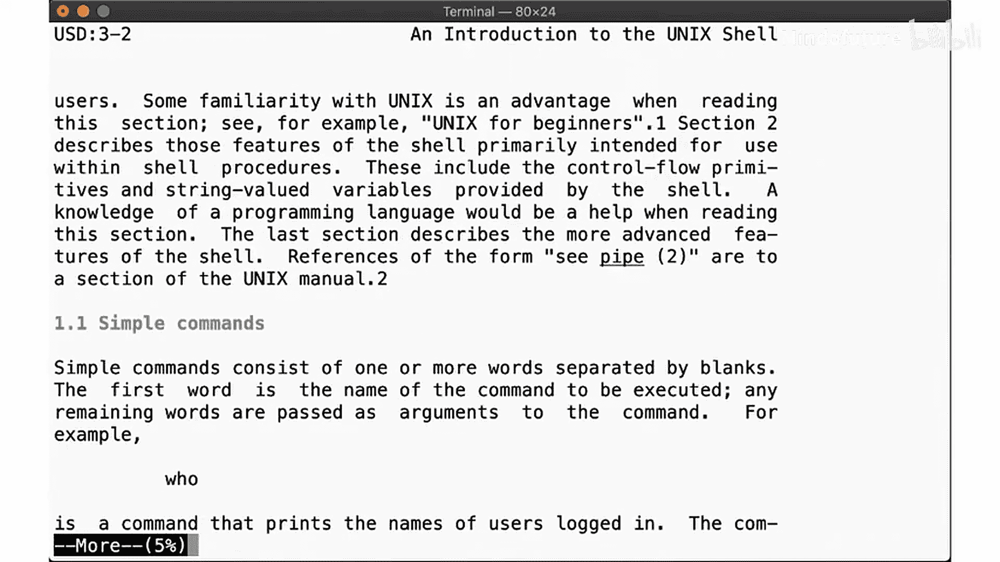
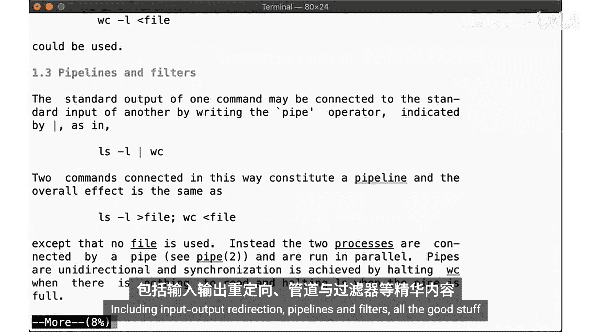
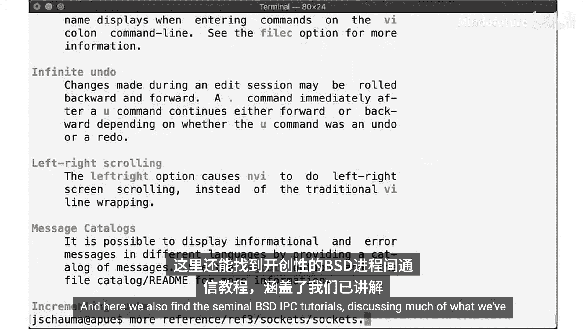
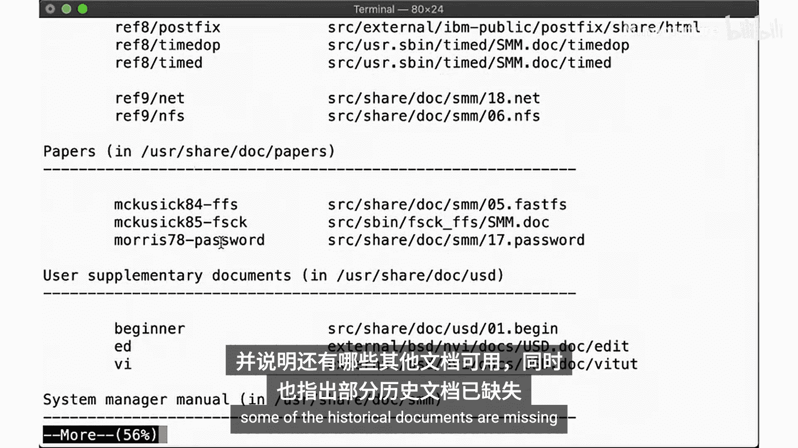
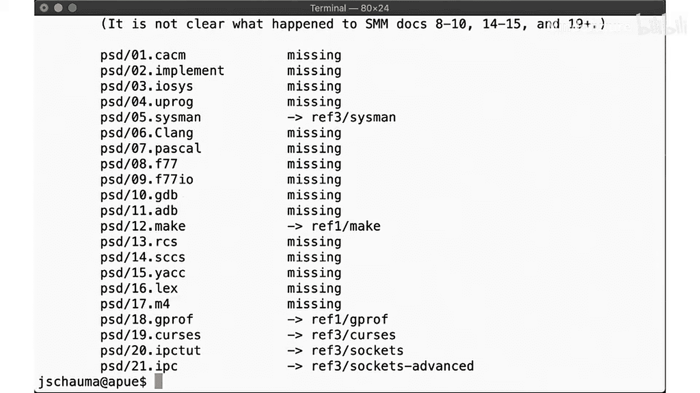
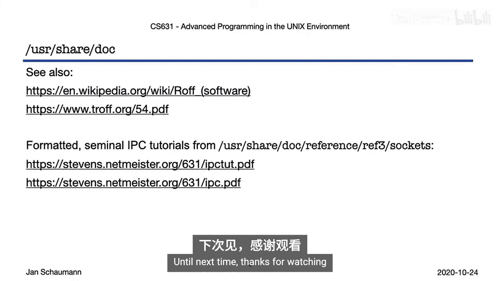

# UNIX高级编程-p52-P52-Tool-Tip----usr-share-doc--BV1hPuVz8EWS_p52-

Hello and welcome to another C S631 advanced programming in the Unix Environ toolt。😊，Well。

 this time is not so much an actual tool tip。 It it a general reminder that the NetPSSD operating system as a genetic Uniix。

 comes with a number of historical Unix research papers and supplementary documentation。

 much of which are still entirely applicable today in nearly 40 years after they were first published。

The documentation is installed into user share doc， where you can find several directories。

Theres a directory for published papers， a directory containing programmer supplementary documentation。

 PSD， a few reference documents， a directory for the system manager manuals， S M M。

 and one for user supplementary documents， USD。Let's take a look at what you find in there。

Here's a paper on the fast file system by Marshahal Kirk Mcchusick， from 1984。

But what's with a display。Well， turns out the documentation he has actually formatted using the system type setting tools。

 So let's use a pager that can properly display this。We'll use more。There， that's better。

So here's a full paper on FFS， the default file system we've been discussing。

These papers are well formatted and easy to read on the NePS SD system without the need for a window system or using Google or asking Qora。

 what a concept。You should find that many， if not most of the names on the authors are familiar。

Over here。There's a paper on password security by one Ken Thoson and Robert Morris Se。

 who later would go on to become chief scientists at the NSA and whose son， Robert Tappan Morris。

 later released the infamous Morris wormm， The first computer worm on the Internet。

There is an introduction to the Eunuch shell， by Stephen Arborne。Author off， yes， the born show。

Covering all of the useful features of the shell。

Including input， output redirection， pipelines and filters。

All the good stuff。There's a VI slash X reference manual。

And here we also find the seminal B SD IP PCC tutorials。

 discussing much of what we've covered so far and we'll cover in our next video。

These two documents are also available from our course website and P F  form， by the way。

Pipes should look familiar to you by now。In the advanced IPC tutorial。

Covers socket pairars and sockets。Topics of our next video。

Then there's the Berkeley Soft Architecture Man。Describing all the system calls and the overall architecture of the kernel。

In the user supplementary documentation directory。We find a Uniix 4 beginners guide by Brian Gnegan。

And another， the I quick reference。Answering the supposedly difficult question of how to exit V I。

 as well as how to manoeuvverre it， operate it and generally be more efficient using it。

As well as a more detailed tutorial by the guy who rode V I Bill Joy。

All of these docs are found in a users share doc， but since we have the source for the OS。

 we can also find out where they all come from。Indeed。

 the read here documents all the various locations and gives you an idea of what other documentation is available。

But also noting that some of the historical documents are missing。

So why don't you go ahead and explore this directory a bit more yourself。

 There's plenty of useful information in here that you should find especially applicable for our class。

As we discussed in our introductory class， Unix was initially primarily used exactly for type setting software manuals。

 so it shouldn't surprise us that the documentation uses all the tools present on the Uni systems。

In particular， the Rft tools， a Uni version of the original motic's runoff text formatting tools。

You can view the Markov files and then convert it into format documents using the command shown here。

Alright。 that's it for today。 I hope you take the time to browse the docs and you'll find a lot more of what we talk about in our next videos to be familiar from these IC tutorials。

Until next time， thanks for watching。

