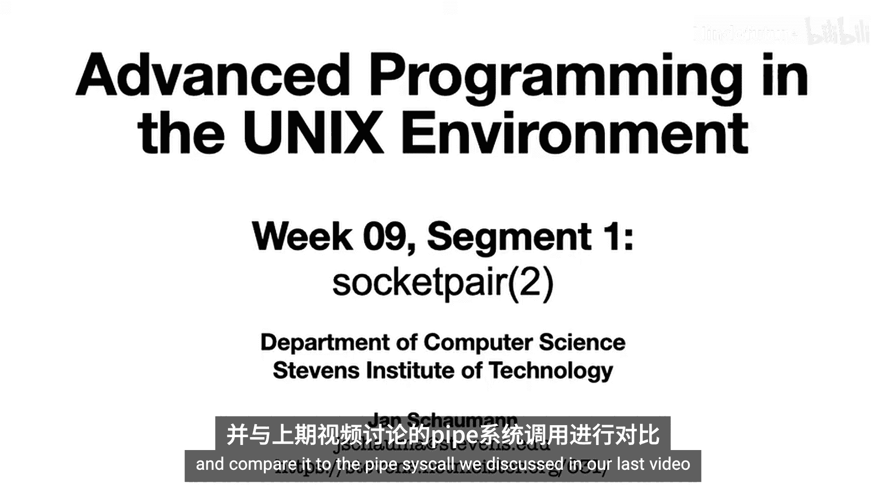
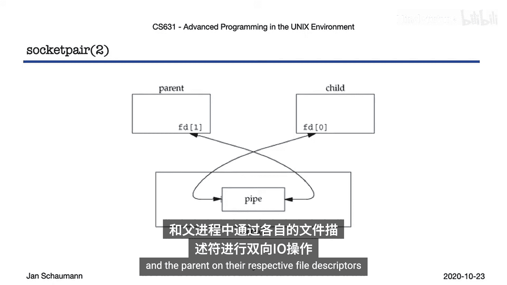
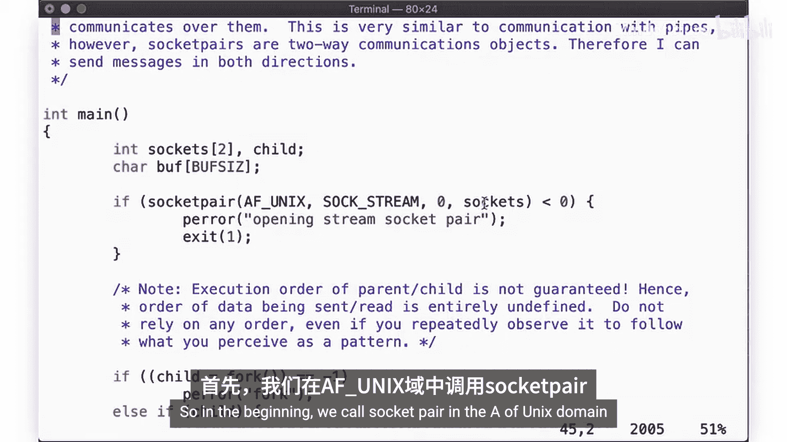
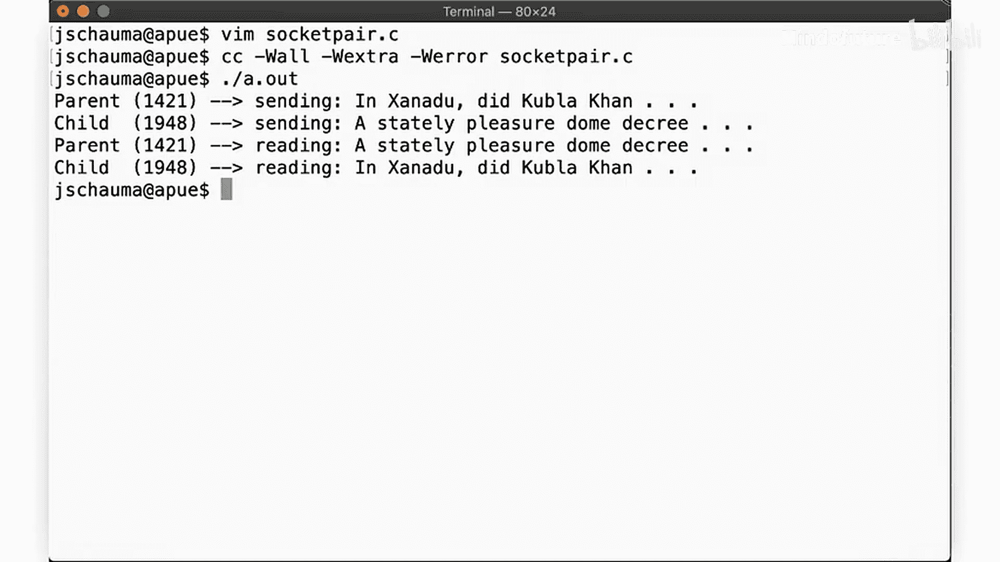
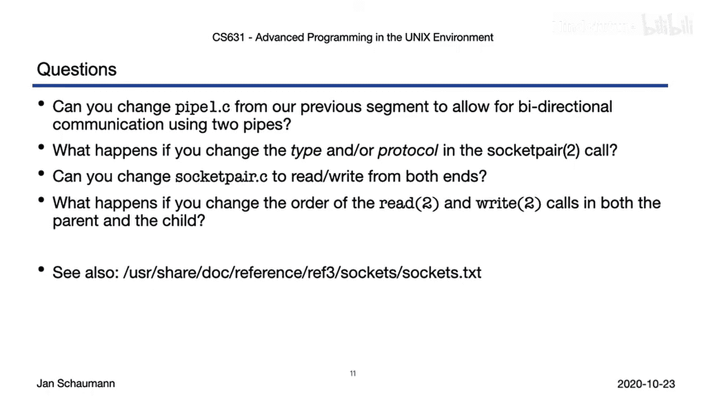

# UNIX高级编程-p53-P53-Week-09,-Segment-1---socketpair(2)--BV1hPuVz8EWS_p53-

Hello and welcome back to CS631， Advance programming in the UniX Envi。This is week 9， segment 1。

 and we're continuing our discussion of interprocess communication。In this short video segment。

 we'll cover the Socket bear system call and compare it with the Pi source call we discussed in our last video。

As a reminder， the pipes this call took as an argument。

 the two element array of integers connecting them to the newly created kernel structure。

This is what this looks like。 A pipe is a pay of connected sockets for one way stream communication。

 And so to perform IP PC， a process called pipe。Forks。

And then has both child and parent closed their respectively unused viscriptors to allow data to flow from one process to the other。

But as we noted， this communication is unidirectional。If you wanted bidirectional communications。

 you'd have to create two pipes before your fork， then use one for data flow in one direction and the other for data going in the other direction。

That's cumbersome。 So instead， we can use a socket pair。

A socket pair is just that a pair of connected sockets that allow for to way communication。

Their use closely resembles that of a pipe， which is by design。 In fact， nowadays。

 a typical unx pipe may actually be implemented using a socket pair。

These sockets are created in the specified domain of the specified type and using the specified protocol。

Well go into more details about domains and protocols， but in a nutshell。

 a domain is a specific address format that implies certain conventions。

 such as what types of communications are supported and what protocols may be spoken。

By passing0 as the protocol， you let the system pick the default for the given domain and type。Again。

 we'll discuss this in more detail than our next video。For socket pairs。

 this selection is particularly limited anyway， since socket pairs are only implemented in the Unix or local domain using the AF Unix or Pf Local identifier。

So after calling socket pair， we find ourselves in a situation similar to after having caught pipepe。

 only this time， both filescriptors can be used to read from and write to。As before， we'll call fork。

And then close the unused file descriptors。Now we can perform bidirectal I O in both the child and the parent on their respective file descriptors。

Here， let's look at an example。This program does almost the same as what we did with our pipe example in the last video。

 But this time， we are using the sample code from the BSD I PCC tutorial shipped with the O S。

See our last tweeted video for more information on these docs。So in the beginning。

 we call Socket pair in the A of UniX domain。

Then， we fork。And in the parent， we close one out of file descriptors。

 write some data into the other， then read data from the same file descriptor and print out what we found。

In the child process， we do just about the same。又一个。Both parent and child begin sending data。

 and once again， we have no guarantee for which process executes first。

Then each reads some data and print it to standard out。And that's really all there is to it。 Easy。

 peasy。

So let's take a quick break here before we continue with generic sockets。

The example was simple enough， but perhaps use it to try to answer these questions here。

Suppose you want to perform bidirectional IPC， but you only have a pipe， no socket pair。

Can you change the pipe program example from the last video to do the same thing we just did here with a socket pair。

 you'll have to create two pipes before forking。Play around with the different protocols and types in the socket pair call。

 What， if anything， changes。In our example， after creating a socket pair。

 each pair and then child closed one file ascriptor。

Update the program to instead use the second connection to also exchange data。And， finally。

What happens if you change the order of calling read and write in the two processes。All right。

 Good luck playing around with us。Next time， we'll talk about regular sockets， the local domain。

Perhaps give the BSD IPC tutorial here to prepare。Under then， thanks for watching。

Jes。