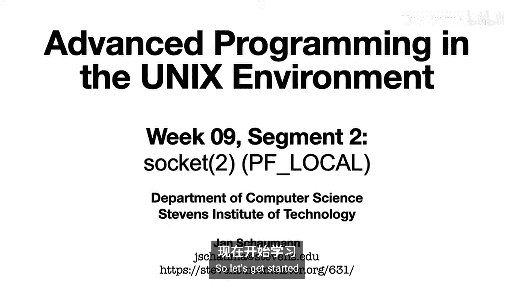
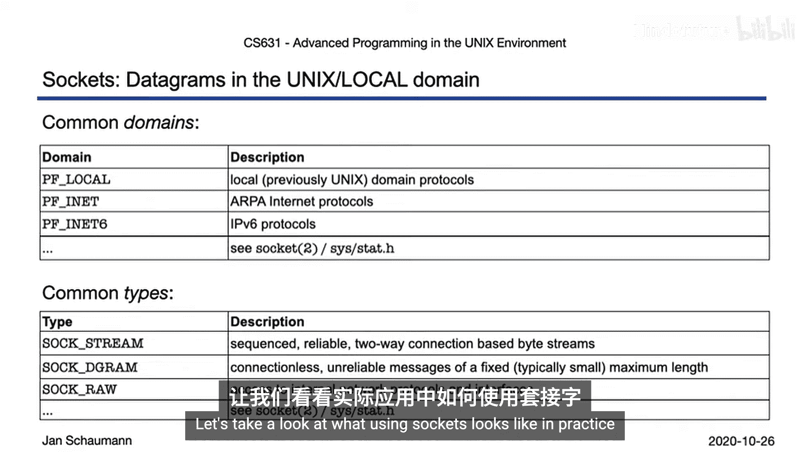
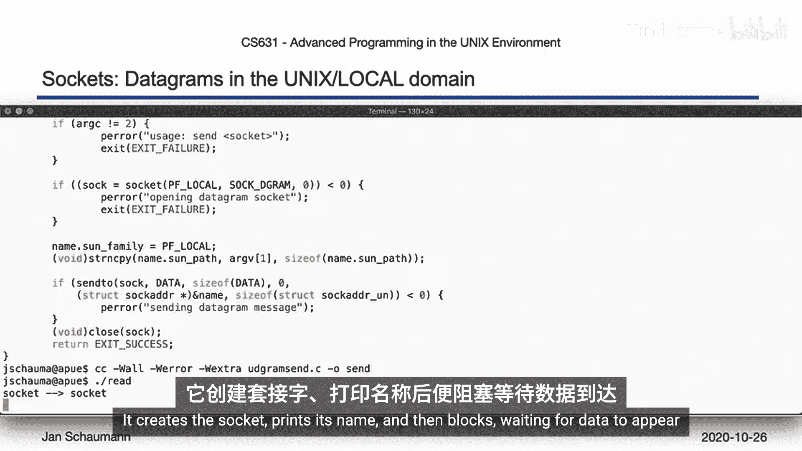
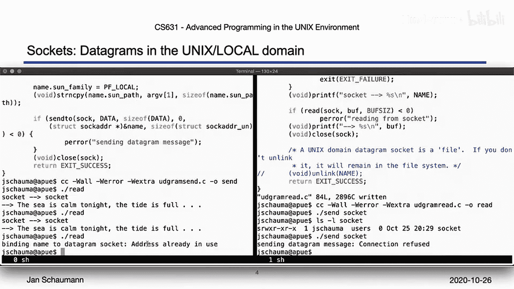
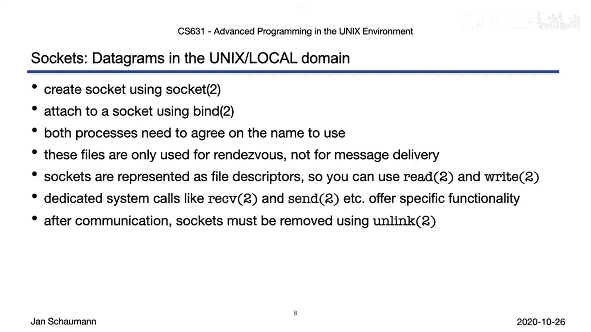
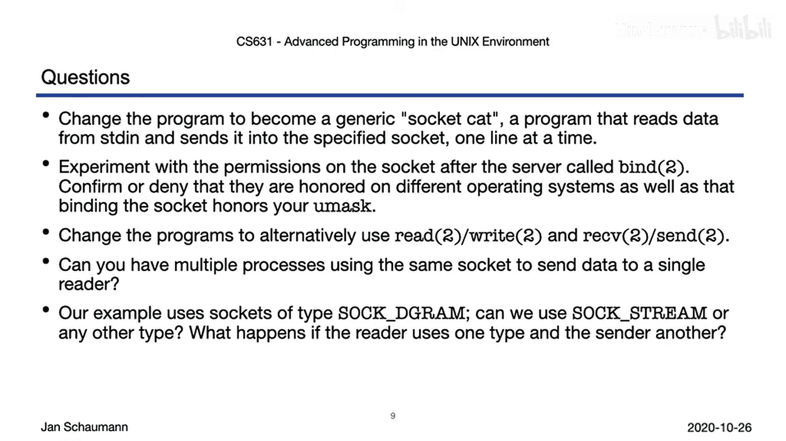

# UNIX高级编程-p54-P54-Week-09,-Segment-2---socket(2)s-in-the-LOCAL-domain--BV1hPuVz8EWS_p54-

Hello and welcome back to CS631 Advanced programming in the UniX Environ。

After we discussed socket Ps in our last video， we move on to regular sockets in the UniX or local domain。

Once more， relying on the system provided BD IPC tutorials will further deep understanding of the Socket API in this way。

So let's get started。

To create a socket， we use the empty named Socket system call this will create such a communications endpoint and return an identifier to us in the form of a file descriptor。

Soccckets can be created in different domains， an address or namespace from which a suitable socket name is drawn。

This domain define certain communication properties and present a useful layer of abstraction from the specific implementation of the communication's internal aspects。

As we will see， there are several different domains defined find one important feature of the Socketets API is so that it allows you to implement interprocessed communications logic that is largely identical for processes communicating on the same system as for those communicating across the network。

In either case， you' start by creating a soet using the system call。In addition。

Socktets are typed based on how the user process interacts with the socket in the given domain。

Finally， the user may choose a particular protocol set of rules that further govern the details of the communication。

Usually there's one protocol for each so type， and in most cases it's sufficient for the user to simply let the kernel pick the appropriate default protocol for the selected So domain type。

This is done by specifying zero for the type。The available domains to select from vary depending on the operating system and version。

 but at a minimum you should find the following to be supported。PF logo， the local domain。

This was previously referred to as the UniX domain and the different domains used to use the AF prefix for address format。

The PF prefix used today stands for Protocol family。

This domain is for communications on the same system。

 and sockets are named with a standard path name。As we'll see in a minute。

 the socket of this type does indeed appear in the file system as a file of type socket and is then used as a rendezvous point by the communicating processes。

If we wish to communicate over the network， we can create a socket in the PFINe domain。

And to communicate via IPV6， the Pf I 6 domain。There are several other domains that may be supported on your system。

Check the manual page as well as the socket header file for those。Next。

 just like there are multiple domains， so are there multiple types？😊，For starters。

 they are sockets of typey streamream， which provide sequenced reliable two way connection based by streams。

For network communicationmunations， the prime example here would be TCP。Second。

 there's datagram sockets which support bidirectional， connectionless， unreliable messages。

For network communications， the obvious example here would be UP。Next。

 there are raw Sos which allow the call process access to the underlying communication protocols。

For example， if you want to send ICMP packets， you need to utilize a raw socket。

Raw sockets are only available to the super user。Other so times may be defined a new system。

 such as one for sequence packet streams or connection oriented dataograms， for example。As before。

 check your manual page and system head for which types are supported。But enough talk。

 let's take a look at what using Socutets looks like in practice。

Here we'll again follow the system provided PSD IPC tutorials。

And similar to how we handled message queuees in week08。

 we now have separate programs for the sender and receiver。

 thereby illustrating that we can communicate between unrelated processes。Okay， so here's our reader。

We create a D socket in the local domain。Then populate the family and path into a struck sock aton before we call buy it。

It assign the name to the given socket。After that， we can use the read Ci to operate on the filescript of the socket and read any data sent to us by the client。

Afterwards， we closed the socket again， just like a file descriptor， but here before we exit。

 we also need to unlink the socket we created。We'll compile this program into executable called the read and then take a look at the standard。

The setup is rather similar to the reader。😊，We create a datagram circuitet in the local domain。

 again fill in thestruct circuiter on before we then send data to our reader using the Susis call。

When we're done， we closed the socket and exit。Let's compile this program into an executable named set。

Okay。So now we start our reader。It creates the socket， prints its name， and then blocks。

 waiting for data to appear。

We create a second show。Enlist the socket， which as expected we find to be of type S。

For circuitet and size zero。This looks similar to our5 we used previously。

 so perhaps we can just try to write data into the socket。Let's give that a try。Nope。

 not going to work。Unfortunately， Shell doesn't use STR error， so all we get is the nu code here。

Let's look up what error 45 is。Yeah哈。Operation not supported for the type of object。

So we can't just write to the socket。But let's use our Ascent program。

Here we see the data sent by our program to be immediately read by the reader on the left。

What happens if we try to send data again？We get an error that our soet no longer exists；

 remember we had unlinked the file in the reader after reading the data。

Let's try to keep the socket and see what happens。Okay， we read again。And send data again。

Now the socket remains in the file system。Still with zero byte size。Let's try to send again。

ANow we get a different error， connection refused， our reader is no longer paying attention to our socket so we can connect to it。

Let's try to read again。Oh， another error， address already in use。

This happens because a reader is trying to create a new socket， but the file already exists。There is。

 we get the same errors we'd get if we try to listen to a network socket and another application was already listening。

Which is why we need to remove the circuitcket after our program completes。

If we remove the socket and then run the reader again。

 it'll be able to create the socket and use it again。

And our sender will be able to send data again as well。Okay。

 so we've seen how communications over our socket work。

 specifically we noticed that after we created our socket， we had to bind it。

When you first call socket， the new socket will exist in the given name space。

 but it won't have a name yet。By calling bind， we are assigning a name to it。

Where a socket is in the UniX or local domain， then calling bind causes the socket to be manifested in the file system。

Since this creates a new file and as a socket is used to allow another process to communicate with us。

 we'd have to consider the permissions on the file。

Although the fact that the new file of typey socket is created with consideration of IU mask shouldn't come as a surprise。

 it should be noted that this is not portable， and we should ensure that we provide a pass name and they will properly restricted directory。

So after we've called bindd， our socket exists in the file system that's represented internally by a file descripture。

 which we can use to read from as our reader does。But we saw that our as sender。

 instead of calling right， used another system call to send the data， the send to system call。

The send and send to system calls can be used to transmit a message to another socket。

They have the advantage over the rightrs that they are designed for use with sockets and as such allows。

 for example， for additional flags to be set， some of which we'll see in a future lecture。

In addition， in order to be able to transmit data reliably， that is using the stream。

 the socket must be in a connected state。Since we're using datagrams in our example。

 we can use send you to submit our data without calling Connect。Now in our Read program。

 we did use RE， but there too， we have specific socket API calls to receive the data。

Receive and receive from and ask the equivalent calls to send and send to。

Or returning the number of bytes sender received on success， negative one and failure。

We'll see that use again in more detail in our next video segment when we perform network communications。

All right， so a short example of using datagrams in the local domain serve as a good introduction to the Socketsets API。

We've seen that we first have to create a socket by calling the Socket Cisco。

 specifying the domain type and protocol。Then we have to bind the socket to assign a name to it。

In order for communications to be possible， both parties have to agree on the name thats use the same pass name and have access permissions for the filing question。

The file of type Soet that is created when we call bind is like a FiO only used for rendezvous between the two programs。

 however。Since we get back a finalr scripture， we are able to use a standard diosis called like Read and Writeite on it。

But dedicated systems like receive and send， etc exist and offer socket API specific additional functionality。

We've also seen that after we are done with our communication， it's up to us to remove the file。😊。

In our nexted segment， we'll see how we can use sos for network communications and we'll discuss the parallels to inter processces communications on the local domain。

Before I let you go， here are a few questions and exercises for you。

Our sender program currently always sends a fixed message this is okay to illustrate our basic functionality。

 but not terribly useful。Can you change the program to write data read from sending it in into the socket instead。

 one line at a time？Play around with the permissions on the socket after the server called bind。

 what happens if you restrict them， what other processor can use it， etc？

Change the two programs to use the respective other system code to perform the IO。

 change the reader to use receiveive and the send to use writeite， what works better， what's easier。

Can you have multiple processes using the same socket to send data to a single reader？For this。

 you'll have to change the reader to loop and read repeatedly， see some of our earlier IPC examples。

 not at our code here。And finally， what happens if you change protocols or socceret types。

 can we mix and match？Okay， I think that might be enough to keep you busy until the next video。

 good luck and thanks for watching。J。

