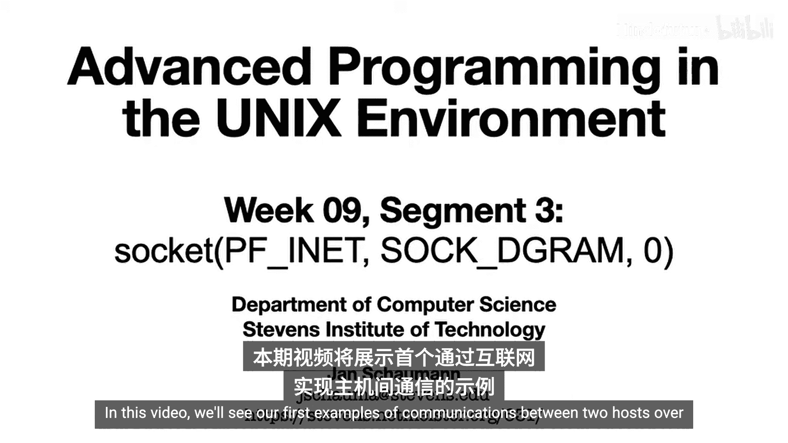
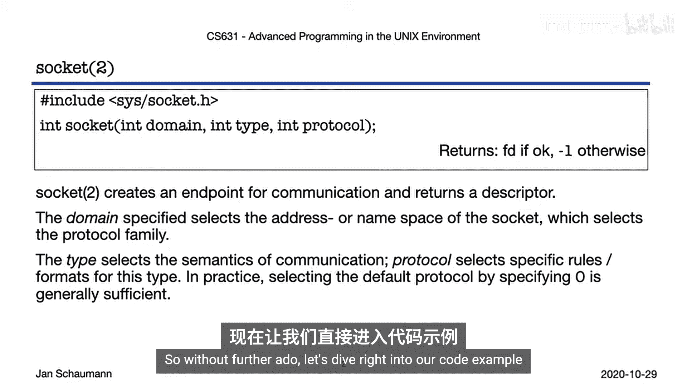
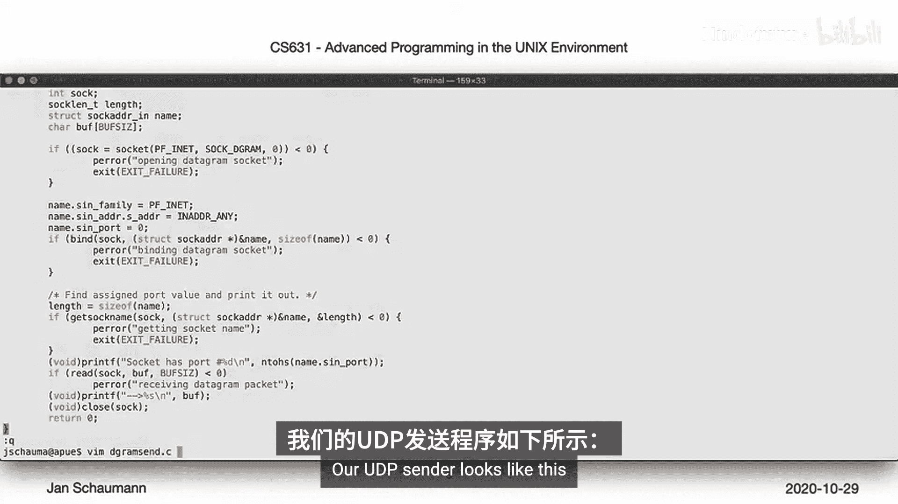
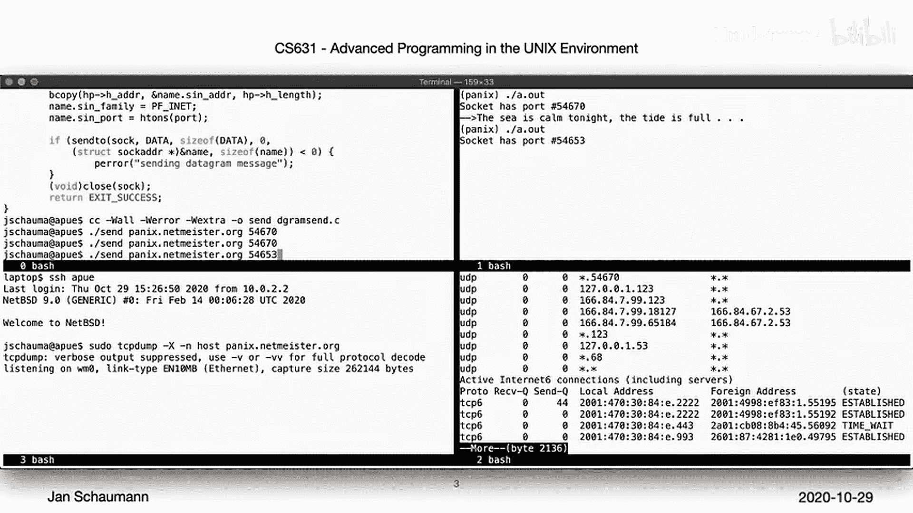
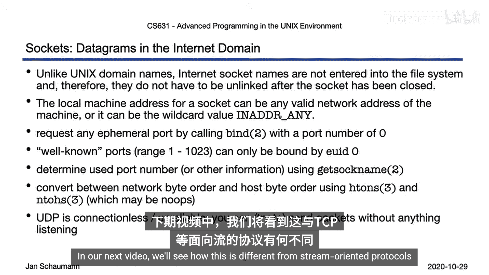
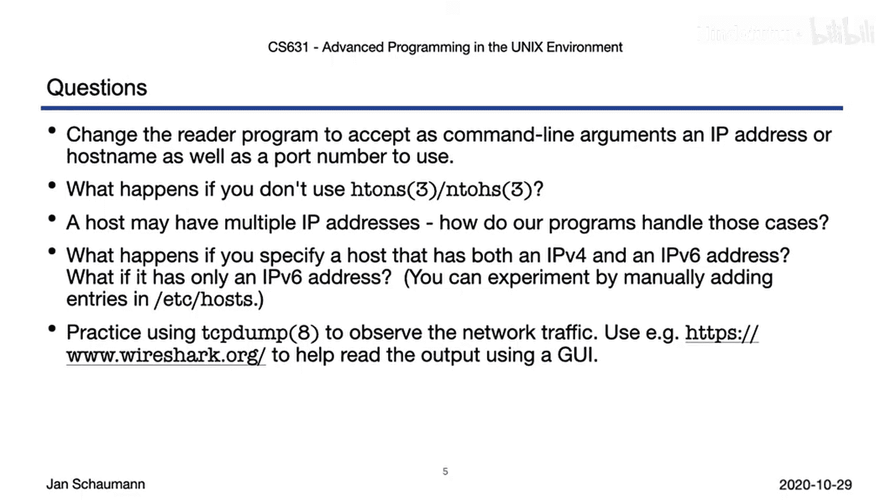

# UNIX高级编程-p55-P55-Week-09,-Segment-3---DGRAM-Sockets-in-the-INET-Domain--BV1hPuVz8EWS_p55-

Hello and welcome back to CS631 Advanced programming in the UniX Environ。In our last video。

 we started our discussion of the Socket system call and observed inter processces communications using datagrams in the UniX or local domain。

This allowed unrelated processes on the same system to communicate with one another。 In this video。

 we'll see our first examples of communications between two hosts over the Internet。

As a reminder， this is what the socket source looks like。 We specify a domain， a type and a protocol。

 which then creates a socket suitable for use with the conventions associated with those properties。

So without further ado， let's dive right into our code example。

Once again， we have based our example on the BSD IPC tutorial found on your system under the user sharere doc。

 and once again it is split into two programs， a reader and descend sender。The reader， D Grri do C。

 looks like this。Here we call Socket with a domain of PFINe and type Sock Dgram。

 meaning we will be using datagrams in the internet domain， UDP。We fill in our sock andstruct。

 but this time instead of providing a path name， we need to specify an IP address。

We can provide any IP address on our host， or as in this example。

 we can simply say allow connections to come in on any one of them。Bypassing in E any。Similarly。

 if we don't care which port we wish to listen on， we can let the kernel pick one for us by passing0。

After that， we called bind just like before。But since we let the colonel pick a port for us。

 we don't know which one it is。So to find out the port number， we call getSo name。

As explained in the manual page， the common use case for this function is to retrieve the kernel assigned port number。

Next， we want to print this port number。But we have to be careful to first convert it from network by order to host by it order。

As you may recall， different hardware architectures may use different ways to represent numbers in memory。

 least significant bitfor or little inion or most significant bitfor or big inion。

TCP IPP networks are declared to use big Indianion byte order。

 So if you're in a little Indianion system you'll need to convert。

Since it's annoying to have to know whether you need to convert or not。

 we outsource this to the H2 N S N to H S calls， which may simply be no ops if you happen to be in a big Indian system。

Oh， and by the way， the term Indianness does indeed derive from Jonathan Swift's schoolli's travels。

Liipputians who peeled their eggs from the bigger end were called big Indians。

 those who peeled from the smaller end， little Indians。So， you know， you learned something today。

Alright， so anyway， after we print the port number， we then read from the socket。

Print out was sent to us and exit。Or a UDP center looks like this。

We're asking the user to provide us with a port， which we dutifully check for validity。

 Then Mira O a soet call from the reader and then try to turn the host name provided by the user to an I P address。

We then populate the Str So Eder again， using H2NS to convert the port number and then happily send our message on the way。

So let's build our send。But now， having the reader on the same host is a bit boring。

 We wanted to illustrate communications over the Internet。

So I run the reader on the different system。For that。

 we create a new shell and SS age to the remote system。

There we built the same code that we just looked at on this system。

And then spawn a second shell on the remote system before we run it。Okay。

 so now we are running our UDP reader。It tells us that it is now listening on port 54670。

 which we can confirm by running Net in the other shell。

Nett shows us all the open ports on the system， and here you see a number of TCP connections and open ports。

 as well as several UDP ports， showing us that port 54670 is currently listed as being open。

So now back on our local Vm， we can run the sender and give it the remote host name and the port in question。

Nvoila， my message was delivered across the Internet from a local VM to the remote system。Okay。

 but what happens if we try to do this again？Our a sender quietly sends the message。

 But since there is no reader listening on the remote side， we do not receive the message。

But we also didn't get narrow。 Why is that。Well， remember， we are using UDP。

 which is connectionless and unreliable by design。Theuce you can send a packet。

 but you won't know whether it will arrive。Or maybe our program didn't send the message at all。

Let's observe our packets being sent。To do that， we open yet another shell。 this on our V M。

And now we're going to run TCP D to capture and display all packets between this VM and the remote host。

With that you see P running， we now start the reader again。Which now will listen on a new port。

 port number 5，4，65，3。So let's send a message to that port。

There we go。 We see the message having been delivered in the upper right and the TCP dump packet capture in the bottom left。

Now， we repeat sending our message， and again in the bottom left。

 we see that the message was indeed put out on the wire。Okay。

 let's quickly rearrange our windows so we can take a closer look at the network packets。Okay。

 so now we have the packet capture on the right and our sender on the left。

The first packet shown here was a successfully delivered UDP packet。Looking at the hex stump。

 we can see all the information about the packets。 The first 45 indicates an IPV4 packet of 20 Bs。

The hex40 here is our TTL64 decimal。And the Hex 11 tells us this is a UP packet。

The source and destination I addresses can be decoded by converting the hex to decimal， for example。

 using printdf。First， we print the source address。Using these four bytes over here。Next。

 the destination IP address， using the next4 bytes。

Which is the I P address of the system where we're running our reader on。Next。

 both ends of our connection have a port。 So our source port here。Is6，5，4，90。

And our destination port。5，4，6，5，3， as we had specified。We can also decode the actual message。

Which is simply turning Hex into ASi。Here are the bits。In the TCP dumpm capture。

Or we could look it up in the Askki menu page。So as you can see。

 all the information is included in the packet capture。Now， after we sent the message once。

 we repeated it。And so we do see it having been sent out over here with almost identical bits。

But then we did receive a message from the remote end。An ICMP packet。

Informing us that port 54653 on the remote system is unreachable。

Which is encoded here in the hex0303 of the ICMP packet。Likewise， if we run this again。

 we'll again observe the UDP packet being sent。And ICMP telling that that the port is unreachable on the remote side。

As the reader has terminated。So while our UD P send did not get an error when they sent the message。

 the system may receive， for example， an ICMP message letting us know。

But that happens outside of the UDP context。Okay， so let's summarize what we just observed and how it's stands in contrast to the use of sockets in the local domain。

Since sockets of type Inet exist entirely in kernel space only and are identified by the I P and port tuupple。

 we don't have to do any cleanup and react。 The kernel cleans up after we are terminated。

We can either specify a specific IP address or we can listen on all IP addresses that are available by passing in at or any。

Similarly， we can request the kernelel pick an ephemeral port for us by passing in zero。

If we want to have a specific port， we can provide that， but the so called well known ports。

 ports under 1024 can only be bound if you have an effective U I of 0。

But we may need to convert the numbers to network by order， but fortunately。

 we have the convenience functions， H to N S and to HS to do that for us。Then finally， as we saw。

We can fire off messages without any regard or knowledge of whether the remote site is currently listening or would receive them。

This is my design。In our next video， we'll see how this is different from stream oriented protocols such as TCP。

Okay， before we close。😊，Here's again a list of questions or suggestions for you to work through to get a better understanding of UDP Sockets in the INina domain。

First， try to make the reader tool more user friendly by allowing it to let the user specify the IP address and port number。

Next， play around with N2 HS H2 N S and see what happens when you do not use these functions。

Think about how you might want to handle a host， having multiple pie addresseses。

Think about what happens when your system is in a dual stack environment or is only IPV 6。

 Can you change the sample program to work there。And finally。

 get some practice capturing and analyzing network packets If you have not done this before。

 There are many other tools such as the wonderful wire Sha graphical user interface。

 which can help you drill down into the details of the packets。

 but it's a good idea to develop some comfort level analyzing packets via TCP down below。😊。

Good luck and have fun with these exercises。 Next time。

 we'll talk stream sockets in the internet domain。😊，Until then， thanks for watching， cheer。

