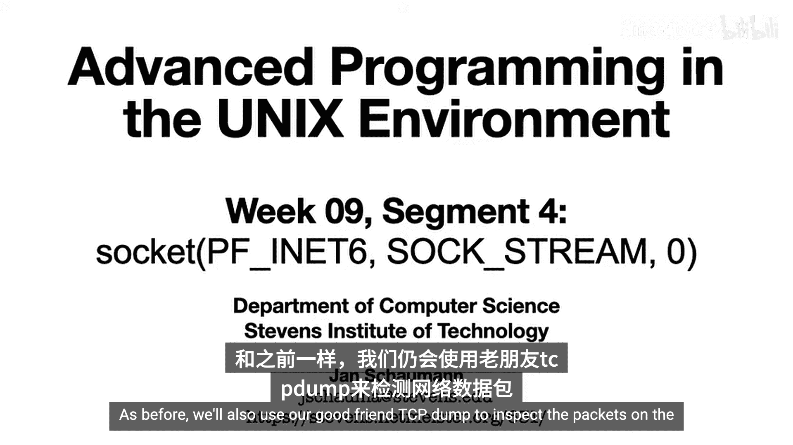
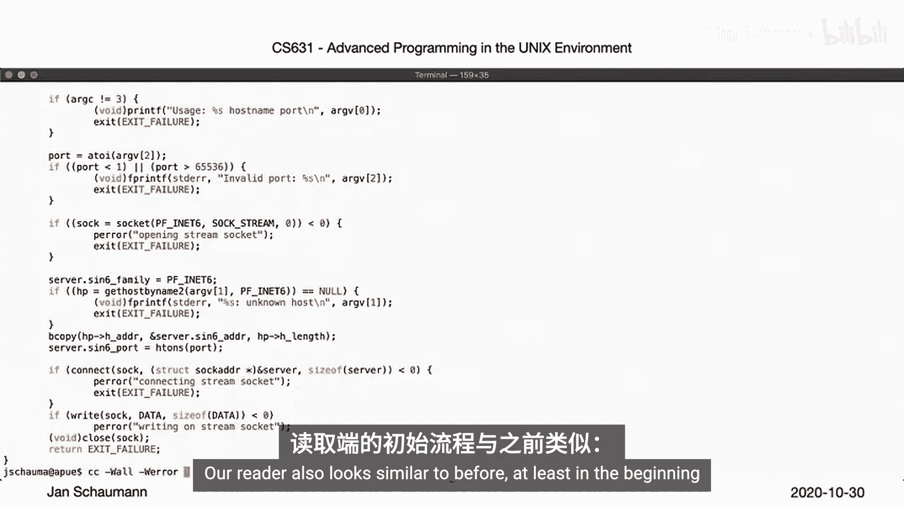
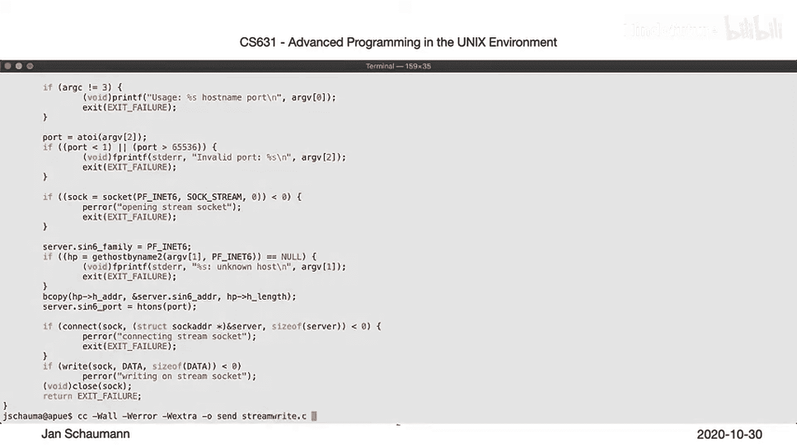
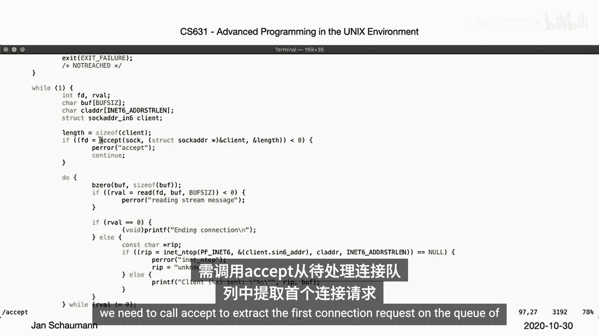
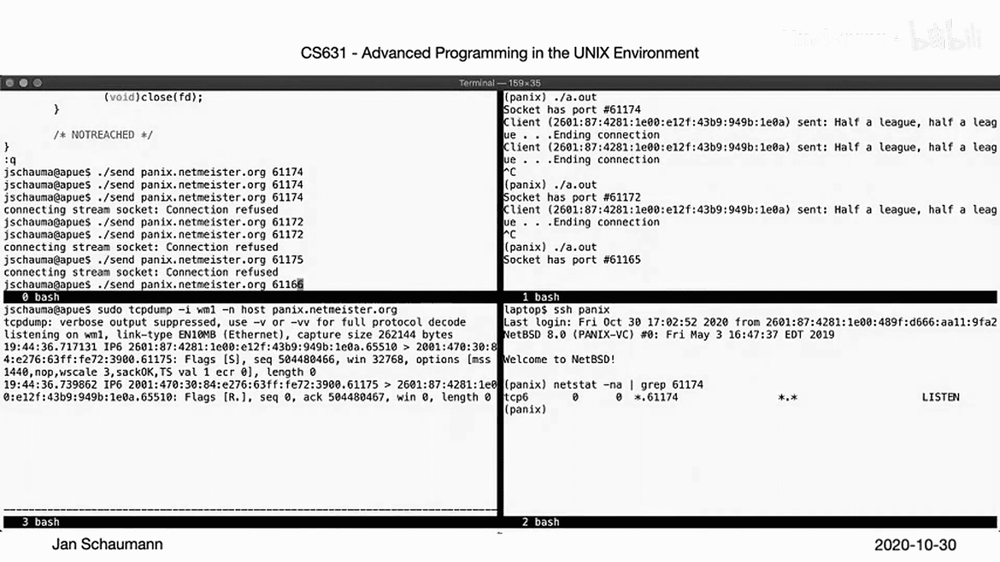
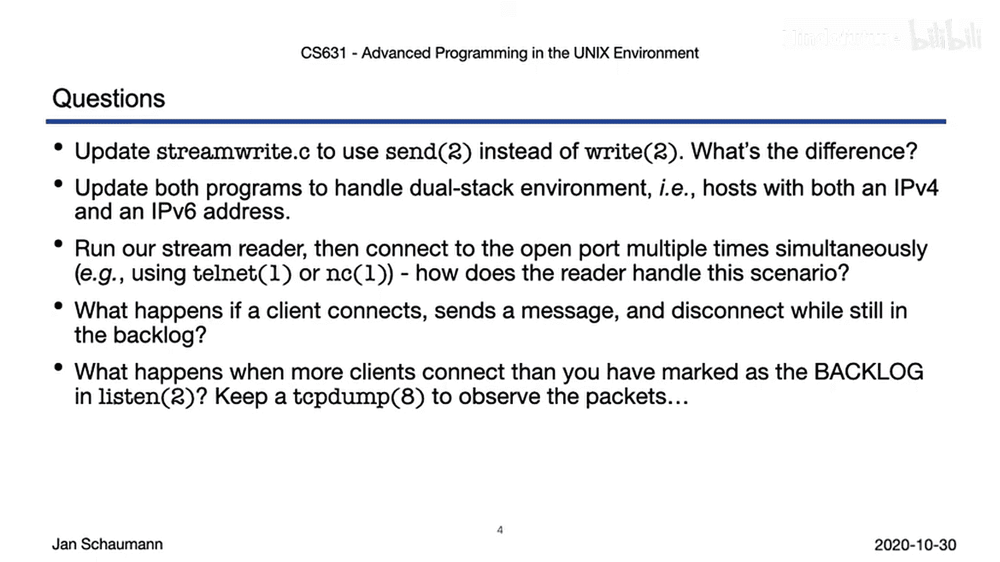

# UNIX高级编程-p56-P56-Week-9,-Segment-4---STREAM-sockets-in-the-INET6-Domain--BV1hPuVz8EWS_p56-

Hello and welcome back to CS631 Advd programming in the UniX environmentvi。Now last video。

 we saw communications across the internet using datagrams over IPV4。

We observed to our clients and UDP packet to the remote server without knowing whether the packet would be delivered or not。

In this video， we'll repeat the same setup， but this time we're going to use a stream socket。

 meaning we'll use TCP to establish a sequenced reliable two way by stream。In addition。

 we'll use IPV6 as the network protocol。But you should find that both the reader and the sender programs still look very similar to our UP version from the last video。

As before， we also use a good friend TCP dumpm to inspect the packets on the wire。

Here， let's take a look。First， the sender。As before we accept the port number， then create a socket。

This time we are passing PF net6 and So streamream to the Socket Su call。Next。

 we are looking up the IPV6 address of the given host name and use that to fill in our So Ed in 6。

 once again converting the port number from host to network by order using N2HS。Next。

 and this is where we have a slight difference to the UP center， we call connect。

This would initiate the stream connection to the remote host。If successful。

 we then simply use right to write our message to the socket descriptor， close it and exit。

Our reader also looked similar to before。

At least in the beginning。

We create our socket。😮，Fill in thestruct Sock Ed in6。

 letting the kernelel pick the IP address and port。And then bind the socket。

Just like before we determined the port number selected by the kernel via get Sock name and print after converting it from network by order to host byte order。

But now here's where our stream reader begins to differ a bit from our UDP reader。We call listen。

 which will specify a willingness to accept incoming connections as well as a Q limit。

Of how many pending connections we are willing to handle。With that backlog in place。

 we then enter a forever loop waiting for connections。With stream connections。

 we need to call accept to extract the first connection request on the queue of pending connections。

This then creates a new socket。From which we can read data。In this program。

 we do not simply read a single message， but instead we continue to read data。

 showing up on the socket until we reach EOF and print each message together with a client's IP address to standard out。

Okay。So now just as before， we will log into a remote system where we built our TCP reader and once again create a second shell to display our network connection。

When we run our reader， we see that our program is now listening on port 61174。

And Needst confirms that this socket is open only for IPV6。With the reader listening。

 we can now send our data。And there we go， our reader prints out what we send prefix with our client IP address。

But note that our reader did not terminate， it is now again waiting for a new connection so we can send the same message again。

If we interrupt the reader and then try to send the same message again。

Will this time get narrower as a connection oriented protocol or a call to connect with no fail since nothing is listening on the remote side。

 connection refused。Let's also repeat what we did for UDP and capture our packets using TCP Do。

Here we start our packet collection on the bottom left。Start a new reader in the upper right。

And send a new message to the server。Now we stop the reader。And try to send again。Okay。

 let's rearrange our windows again so we can better inspect the network packets。There we go。

Now up here in the upper right， we see the TCP threeway handshake when we first send our message。

The sender sends a syn packet， the reader replies with a synac and the sender transmitsn。After that。

 the client sent its message in this packet with a pushflake said。And then close the connection。

Sending a fin with a server replying with its F neck before a connection is completely torn down。

So all of these packets correlate to our sending message once over here。The next。

 the failed attempt to send a message shows our client trying to establish a connection with a sin packet。

But the server replying with the reset， indicating that the connection is refused。

So this connection set up and tear down is a bit expensive。

 so let's see if we can send multiple messages in the same connection。For that。

 we'll rearrange our windows again to the initial setup。Then we'll start a new reader。

Start a new TCP dump。And then send a message once more。Oops， wrong port。

 so we get another connection refused。Let's fix that。

Okay， so a message we sent us before and Net shows our open port since our client just connected。

 send data and disconnect it again。But now let's use the Tnett command to establish a TCP connection。

Now， when we run Ne Start， we see that we have one established connection as well as a still available listening soet。

 illustrating the concept of the connection backlog we established by the listeners call。

Now when we send data via Tnet， we can send multiple messages without having to establish a new connection each time。

 and only when we quit Telnet is the connection terminated。Let's look again at the network packets。

So here。We see our initial failed connection。Then our three way handshake。

So send that message and the connection tear down from our send our program。After that。

 we see the three were handshake from the turn command。Which then sends each message。

Using the same connection。Before terminating only after we quit。Okay。

 so we've seen how to establish and use a TCP connection via a stream socket at the IE 6 domain。

As before， we know the connections are now asymmetrical， but unlike with datagram sockets。

 for a stream socket， we create a separate message socket for each request。

Our initial socket must be marked as being willing to accept connections by us calling listen。

 which also establishes a backlog of connections we're willing to accept。Once we've done that。

 we can then pick off incoming connections using the acceptanceors call。

Which may block if no clients are connecting。We've also seen that each connection does require a full three way handshake。

 send， an act a， and tear on thin， a， thin a。So altogether。

 this program has helped us understand stream So is much better。

But it also leaves plenty of room for enhancements and additional exercises。

You can start by updating the program to use send or send to instead of write and see what if anything changes about your program。

We've now seen programs using IPV4 only as well as those that use IPV6 only， but more often than not。

 you'll encounter systems that have both an IPV4 and IPV6 address。

Can you update the UDP and TCP examples to handle both？

We've seen it our our stream reader allows multiple clients to connect。

 but how does it handle messages delivered to us by multiple simultaneously connected clients？

What happens if a client is still in the backlog and then disconnect connects before we've consumed the messages sent to us？

And finally， if you have multiple clients， just how many can you have？

We know that our backlog specified to listen has to do with this。

 but what happens if you have more than that number of clients。In our next video。

 we'll follow up on some of these questions， so give it a try and play around with a code。

Until next time， thanks for watching。