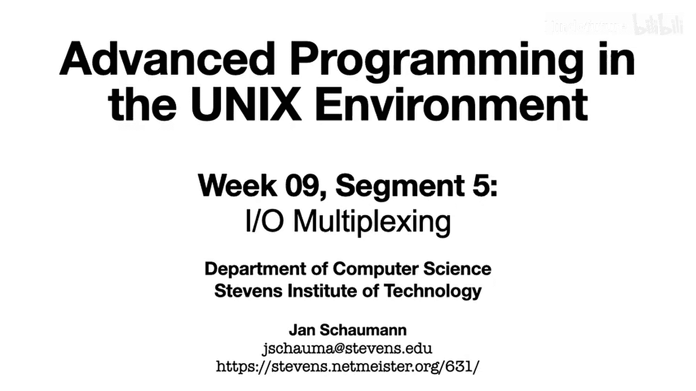
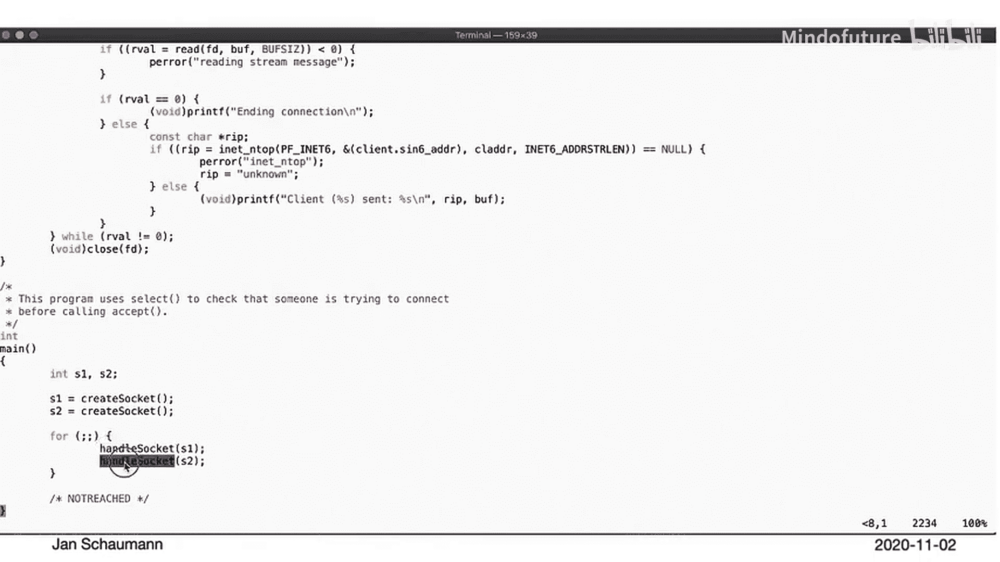
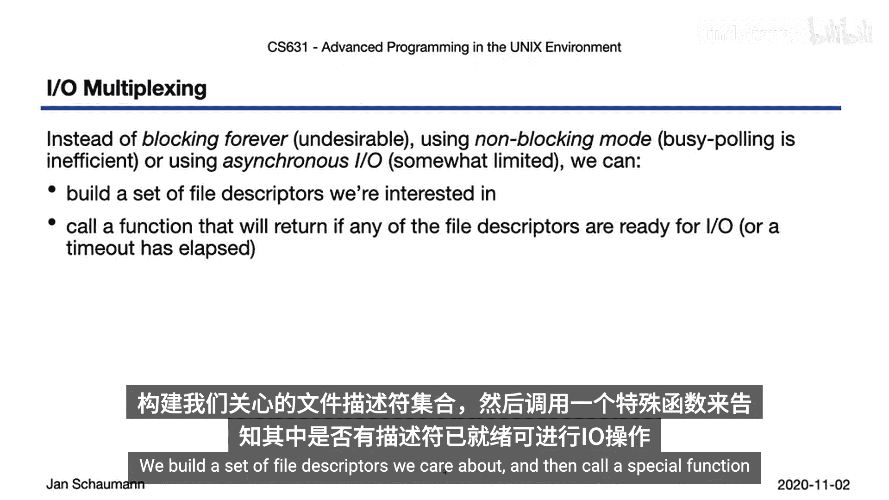
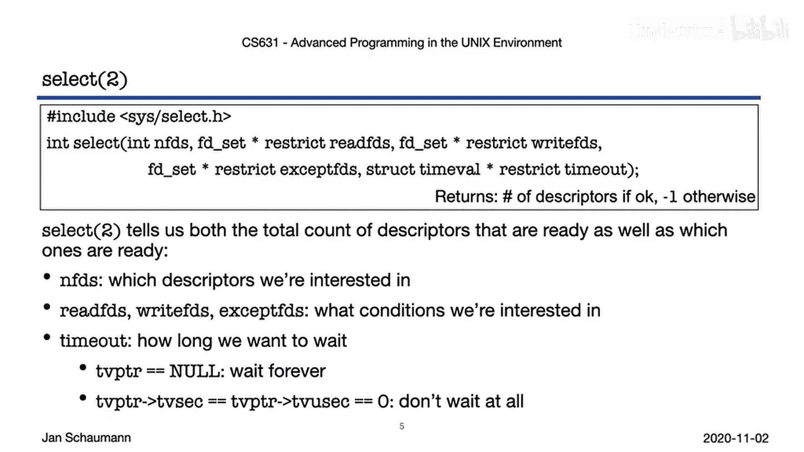
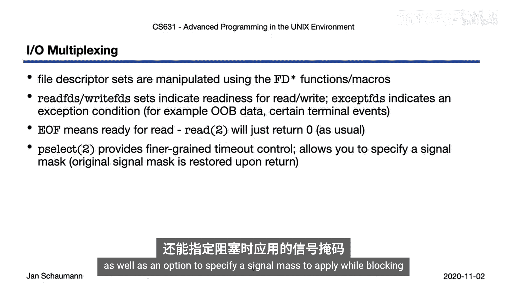
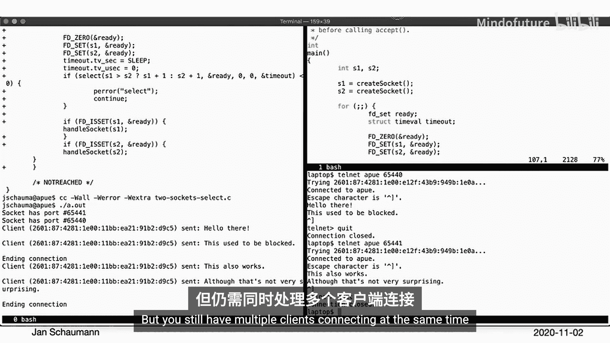
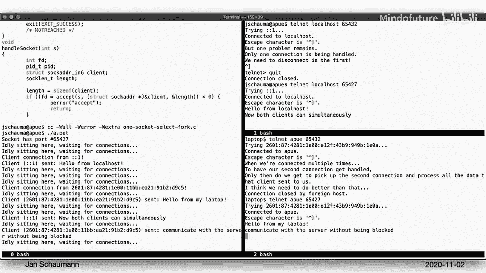
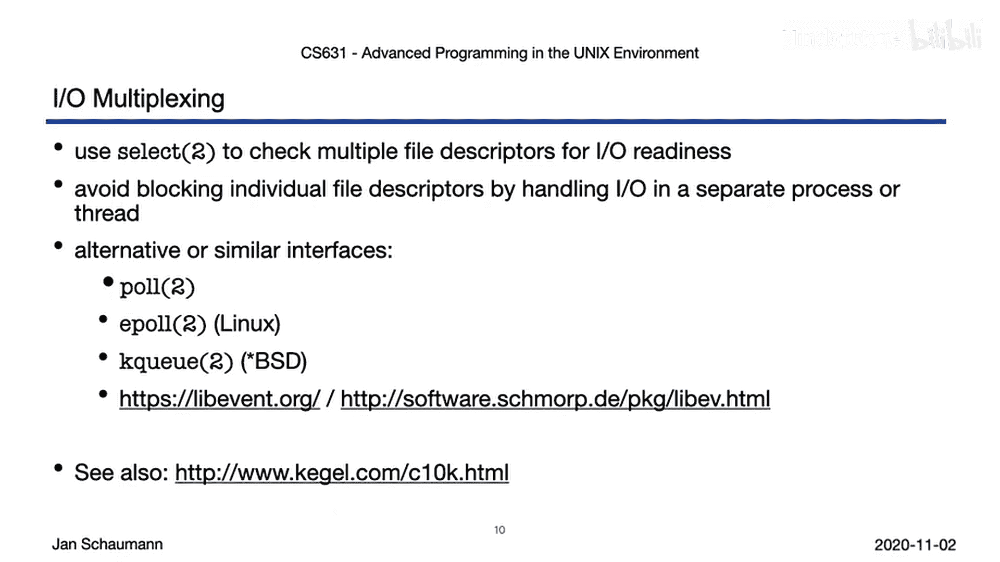

# UNIX高级编程-p57-P57-Week-09,-Segment-5---I-O-Multiplexing--BV1hPuVz8EWS_p57-

Hello and welcome back to CS631 Advanced programminging in the UniX Envi。With this video。

 we complete our discussion of inter processces communication。

 We've come a long way from when we started with signals as the most trivial asynchronous method to inform a process that some condition occurred。

To full bidirectional connection oriented communications between two systems spread out over the internet using a modern network protocol such as IPV6。

In our last two videos， we moved from simple inter processces communications to a client server communications model。

 but we still use primarily one to one communications。 That is。

 we had a single process accepting connections and another process， sending messages。

But this isn't a realistic communications model on the Internet。

 So let's see how we can build on this to move towards a more typical client server model with a server side process capable of handling multiple simultaneous clients。

So let's quickly revisit our last example and see where we might run into problems。

Here's our stream reader code where we create a socket， bind it， listen， and then accept connections。

Suppose that we want to allow multiple connections。 We might consider opening additional sockets。

 And so we might split out the functionality to create a socket and then handle a socket and accept new connections into separate teamss。

So our new main would look like so。We create two sockets， then handle both of them in succession。

 hoping to allow multiple connections to our server。If we now run this program。

 we will have two sockets open。And they are on ports 6，5，4，46 and 6，5，445。

So now we should be able to connect to either port and send messages to our server。

Let's give it a try。Here we create one client connection from our laptop。To port 6，5，4，4，5。

And send a message。But we don't see a server receiving it。 Why is that。

If we try to connect to the other port，6，5，4，4，6， and send a message。Then。

 it is immediately received。So what happened to the other connection？

It seems like we can send messages， but nothing happens because our program is still blocked inside the first court to the handle socket function。

Only， let me terminate this connection。Can our program move on。And handle the second socket。

Which it then does immediately， as shown here。So our model of creating two sockets and then trying to process them sequentially is not going to work so well。

The except in the first car to handle socket will block。

 even if there is already a connection waiting on the second socket。

So what can we do when we have multiple file descriptors that we wish to perform I own？Well。

 the first option is what we've just seen。 We simply open the file Descriptor block。

 waiting for IO and then move on to the next。But that's clearly not a very good option。

We could fork a new process for each file descriptor we want to handle。 That would seem reasonable。

 but what if you want to have information be passed between the different channels。

Then you need additional IPC， so that seems a bit cumbersome too。We could try non blocking mode。

 something we'll discuss in a bit more detail in a future lecture。But in a nutshell。

 if we mark the file descriptor as non blocking， then any call we make will return immediately and we can move on if it's not ready for IO。

Or we can use asynchronous IO， Another form of IO we'll discuss in more detail in the future as well。

This approach requires us to get notified by the colonel when the finest scriptures we interested in are ready for Io。

But each of these options has at least some drawbacks。Blocking forever is clearly undesirable。

 as we've seen。Using non blocking mode on the other hand means that if there is nothing connecting to us。

 we end up busy polling。That is we loop and test and loop and test， et cetera， et cetera。

 constantly making calls and wasting CPU cycles。Asynchronous I owe。

 while sounding promising is oftentimes very limited， as we will see in the future。

But let's instead consider another option。We build this set of filescript as we care about and then call a special function that will tell us whether or not any of them are ready for IO。

And that is precisely what the selectors called us。

We pass it the file descriptor number up to which we wanted to inspect。

There is the descriptors from0 through NFDs minus1 is examined。

 which is why you will always see the argument given being said as filehi descriptor plus1。

Then we pass in a file descriptor set for each of the fields， read Fs， write FDs， and accept FDs。

 and select will respectively check whether any file descriptors in those sets are ready for reading。

 writing， or if an exceptional condition has occurred。Exceptional conditions include， for example。

 out of band messages arriving on a socket， something we may revisit in a future election and advanced I O as well。

Finally， we can control for how long Select should block when waiting for such conditions。

We can have it block forever by passing nu。We can specify a granularity of seconds and microseconds to wait。

 or we can have it not block at all by setting both seconds and microseconds of the struck time value to 0。

When using select for this form of synchronous Io multiplexing， we will operate on filescriptor sets。

 which we manipulate using the provided FD macros， F set， F D clear， F D I set and F D0。

 which we will see in action in a moment。As mentioned。

 the readWrite and accept F D sets are used to check for read write and Except conditions。

One thing to remember about reading from a file de scriptor is that EOF is a form of IO。

 That is the file scripture set would be marked as ready for IO only for you to then get back0。

 but that is not really surprising。If you need more granularity when blocking。

 you can use the P select variation， which provides nanosecond granularity。

 as well as an option to specify a signal mass to apply while blocking。

But let's see if we can use this in action to resolve our problem of having multiple sockets that we'd like to be able to handle without blocking communications via second socket by waiting on the first。

So here we updated our example program from before to add a call to select。

We initialize a filescript as set， then add our sockets as one and as 2 to that。

Then we call select providing the max file descriptor of the two plus one as the first argument。

After select returns， we can then test each socket individually using FT is set to see if either is ready for reading。

Let's see if this helps us。When we start， we again create two sockets。One listening on port 6，5。

441 and one on port 65，440。Let's pull up the code while we make our connections。Okay。

 so now we can connect to a server on port 65440。In our previous example。

 this connection to the second socket would be blocked as we'd be waiting for a client to connect to the first socket before moving on to the second。

But now we notice that we were able to pick up the second socket because select identify that this socket is ready for IO。

 while the first socket did not yet have any connections。Of course。

 we can also connect to the first socket and have that connection not be blocked。Okay。

 so here we've seen how the use of select allowed our program to pick up whichever socket was ready。

 which is useful if you have multiple file descriptors to juggle I own on。But more often。

 if you're writing a server， for example， you wouldn't want to have multiple sockets open。

Think about a web server。 It's listening on port 80 or on port 443 for Tls connections。

 but you still have multiple clients connecting at the same time。

So if we use select in this example， we only have one socket。

But we won't be blocked waiting for connections， meaning if there is no client connecting。

 we can do something else。This is what this example looks like。Now， running the program。

We'll see that while we're waiting for connections。

The survey has determined that no connections are ready。

 so it can print its incredibly useful message while waiting。When we connect to the server。

It will now handle our connection。And not enter the other called block。To print a waiting message。

Only after we disconnect does the server again get a chance to do other things。

 As now no file de is ready for Io under the next client connects。Okay。

 now let's see what happens when we have two simultaneous client connections。

We connect from local host， and of course， that connection is picked up right away。

But if we then initiate a second connection。Over here， from our laptop。

That connection remains blocked since the first connection is still active。

 And to have our second connection get handled， we need to finish and terminate the first connection。

At that point， all the messages from the second client are delivered。

Since our second socket was still in the backlog of our server。We'll see that over here， in a second。

There， all messages from the second client were immediately delivered。

So that's not going to be very helpful if you're writing a web server。

Imagine a website that can only handle a single connection at a time。

 and you have to wait until the other person has finished。So that's no good。

Let's think how we could improve on this。Suppose we redo our program such that whenever a connection is ready on a socket。

 we fork a new child process。 Let that handlender the request and do whatever the service is supposed to do while the parent goes back to waiting for new connections。

For this。We first need to establish a signal handler to let the parent wait for any children that have terminated it。

 Otherwise， whenever a client disconnects， we have a zombie left。

Then we create our socket and make our select call。

Since we might get interrupted when a client disconnects。

 we simply ignore those conditions and loop around， calling select again。

Our function handle socket now gets invoked whenever there's a client connecting。

It can then accept the new connection。 but instead of handing it directly。

 we now fork a new process and let that process handle it。

The parent returns and can then proceed to pick up the new connection whenever it comes in。

The handle connection function then does' what were used to。

 with the difference to before being that after we are done in disconnect， we exit。Okay。

 let's see if that helped us。The server is now listening on port 65427。

While no client connections are ready， the server can go and do other stuff。

 And when our first client connects， of course， it is being handled as expected。

But now note that while we are communicating with the first client。

 the server can still go and do other things。 That is it is not block from moving on since the client connection is now handled by a dedicated child process。

And while we are still connected to the server on the upper right。

 we can now initiate a second connection in the bottom right。 And this time。

 the server immediately picks it up。So now both clients can simultaneously communicate with a server without being blocked。

And the server is still ready to accept new connections。

If we terminate the sh。All client connections are， of course， terminated as well。Okay。

 so we've seen how to handle Io multiplexing in this video。

We can use select to check a set of file descriptors for specific conditions。

 which allows us to either juggle multiple file descriptors or sockets or to avoid blocking on a single socket and do other things while we wait for clients to connect。

We have also seen how we can then handle multiple simultaneous clients on a single socket by spawning child processes or separate threads to have them perform the interactions。

 This works well If each child process does not need to communicate with any of the other clients and is a common pattern and standard server design。

 Sometimes you may come across several programs that pre fork a bunch of processes to handle the connections。

 which may improve on this approach。There are a few other alternative interfaces and options for being notified of when Io is ready。

 or more generically speaking， an event occurred， and you want to handle it。

Each call or API listed here has its own advantages。

 and you can read up on their use cases in comparison with others on your own。They are pole。

Epo on Linux。The KQ kernel event notification mechanism available on the various BSD systems。

 including Mac Os。And Lipy event or Lipy V， which may wrap some of these interfaces to allow for platform agnostic I O multixing mechanisms。

Each of those tries to overcome some of the shortcomings of the others in an effort to improve efficiency when handling large numbers of simultaneous connections。

 which isn't a trivial problem to solve。This link over here describes the problem space and the various approaches well。

Allright， I think that about concludes our coverage of inter processcess communications and with a discussion from this video。

 you are now well prepared to begin working on your final group project， writing an HTTP server。

We'll discuss the project in class and then continue our video lecture series with a look at demon processes and shared libraries。

Until next time， thanks for watching， cheerers。

