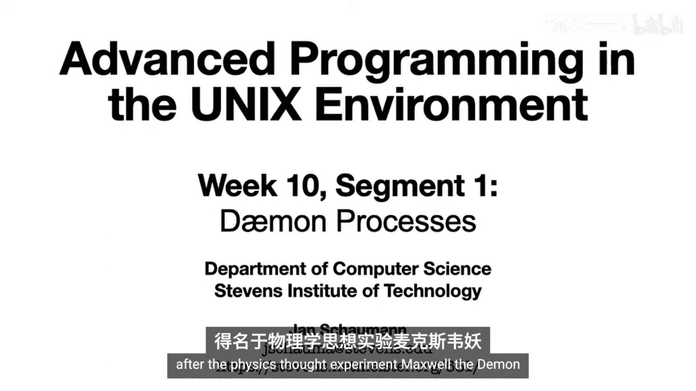
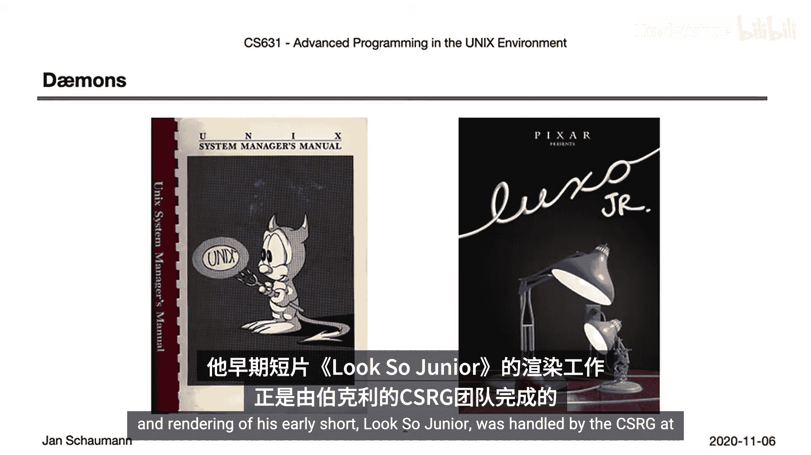
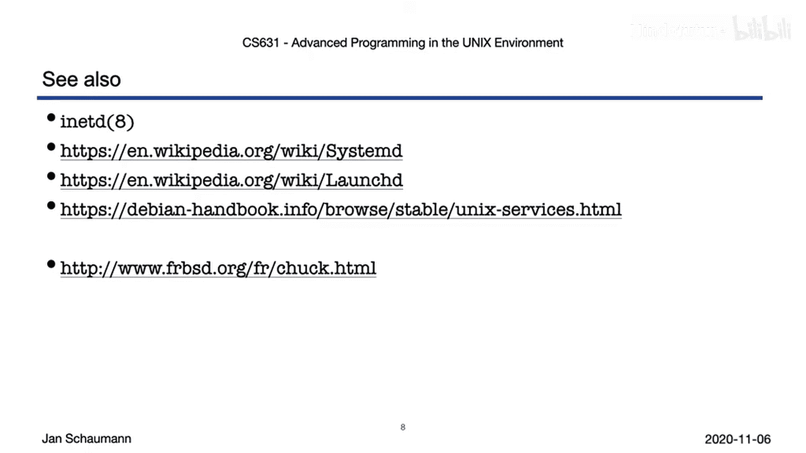

# UNIX高级编程-p58-P58-Week-10,-Segment-1---Daemon-processes--BV1hPuVz8EWS_p58-

Hello and welcome back to CS631 Advanced programming in the UniX En。

After we talked about inter processces communication in the last few videos。

 we are now looking to write an HTTP server as a group project。

We will cover the basics of the H ETP protocol in class。

 but it's also useful to understand what it means to run the service continuously and in the background。

 which is something we typically mean when we speak of a server process。So in this video。

 we'll quickly discuss the details of such processes。

 which traditionally are referred to as demon processes named after the physics thought experiment。

 Maxwell Demon， an agent running continually in the background， performing certain tasks。

The use of the word demon to describe such a process also then led to the illustration of such a demon。

 which in the early days of the B software distribution became the official mascot of BSD。

As a fun side note and an interesting little bit of Uniix trivia。 as I was preparing this video。

 I found out that the original BSD demon was actually drawn by John Lesser， formerly of Pix movies。

He was working with engineers from the Comp science research group at Berkeley at Lucasfil and rendering of his early short Luco Jr was handled by the Sears Rg at Berkeley。

 You see， Eunx is everywhere。

Now the BSD Da looks like this， but anyway。So demon processes have a number of specific characteristics。

 They are designed to offer specific service， and as such， live for a long time。

 That is they may run for hours， days， weeks or months uninterrupted continuously。

They are usually started automatically， when the system comes up。

And only terminate when the system is shut down。In addition。

 they are running in the background and have no controlling terminal。

If you consider these properties， you'll quickly know that there are some pretty important implications。

If you are designed to provide a specific service and you are running for a long time。

 then itd be prudent to follow closely the E philosophy of doing one thing and one thing only。

 That is， you don't want to introduce complexity and keep things as simple as possible。

You will want to write your service carefully and avoid leaking resources。

 as running for a long time will eventually lead you to exhaust them otherwise。

If you leak a file descriptor through some logic mistake on every request your server handles。

 that may not be a big issue when you're testing your service and run it for a few minutes。

But if you're running for hours， days or weeks， you eventually will run a of physcriptors this way。

In this class， we've repeatedly noted the importance of writing code defensively in a robust manner。

 aligning allocation of resources with freeing them， file descriptors， allocated memory， et cetera。

To help you develop such clean coding habits。When your service runs。

 you need to consider the current working directory。

This is not only important if you resolve path names relative to the current working directory。

 but also important as the current directory remains an open handle。If you， for example。

 have an open handle on the directory， then you cannot unman the file system the directory is on。

On many systems， you may have multiple file systems and may want to change them or otherwise have a need to un them without bringing the entire system down。

 But as long as a process keeps the handle open on the directory， you won't be able to do that。

For this reason， it's usually a good idea for a demon to change its current working directory to the root of the file system。

Since you are running without a controlling terminal， there's very limited user interaction possible。

 for example， you can't interactively prompt the user for input。

And neither can you print error messages or any other debugging information to standard at error。

That is， you have to consider some other mechanism of providing such messages if they are indeed necessary or useful for the system administrator。

So being aware of these implications， how do we write a demon？Normally。

 we start by clearing our environment to ensure our service cannot be influenced by anything we do not control。

We fork off the parent process and have the parent process terminate。

 This leads to the child process being orphaned and then reaped by a knit。

 thus allowing it to run in the background and to be controlled by a knit。

We usually set a desirable U mask to ensure that any files created by our process or any child process we might create will get the right permissions。

We then called Se Siid to become the session leader of a new session。

 thereby losing any controlling terminal and allowing all of our processes to remain grouped in our process group and session。

 as we described in week 7 video segment2。We change the current booking directory to a safe place。

 oftentimes the route directory， although you may also want to change it to a restricted directory elsewhere。

Next， we close or redirect to Devile the standard file descript as it would normally be connected with a controlling terminal。

 so that any other processes we create do not erroneously attempt to operate and standard in standard out or standard error。

If you want to perform any logging such as to send system messages to the system logs or to keep track of all of our incoming HTP requests。

 for example， then we need to open those file descriptors before we then finally enter the actual code of a server or service。

Since there are many such services or demons running on our unique systems。

 we have developed a number of additional conventions surrounding the management of these services。

 the start and termination， as well as their configuration。For example。

 we often want to avoid having more than one instance of our servers running。

 And so we often use a lock fire to protect against the second version starting up。

We look at file and record locking in more detail in a future lecture。

 but sometimes it's sufficient to use a simple test for the existence of a file that our process creates and then removes upon termination。

 usually by an exit handler。We also often want to be able to identify the primary process idea of the server。

 since many service and services create many child processes。So for this reason。

 many demons use a pitf to write the pair and process I2。As you can guess。

 you can oftentimes use this pit file as the log file and refuse to start up if the pit file already exists。

 for example。Since we want our service to startup at system boot time。

 we usually provide a system startup file script。These may differ based on the mechanism used to bootstrap the system。

 be that the BSD RRC style startup， system 5 derived in a D startup。

 or more recently using something like system D。Since we have no way to interact with the user。

 our service often relies on a configuration file to read that startup to change its behavior is needed。

By convention， these files are usually found in the Etsy directory named after the service name。

These configuration files may be changed at system runtime。

 so we want an easy way for the service to be restarted and reread its config file。For that。

 the convention is to have a service restored when it receives the hang up signal， Sig hub。

The reason for this is that the hang up signal is something that under normal circumstances is only ever generated when the process loses its controlling terminal。

 But since our red demon doesn't have a controlling terminal。

 it can never have such a signal sent to it other than intentionally by the system administrator。

So in a way， we heedctor away around the absence of a signal that means， yo。

 please restart and reread your config file by overloading the hang up signal。Finally。

 as mentioned before， we need to ensure debugging information or warnings。

 etc are delivered to the system， and the standard way to accomplish this in a service running in the background without a controlling terminal is to use this lock。

Here， let's take a look at what a typical demon process might look and behave like。

Here under the Etsy RCD， we find the startup scripts of all the services which may be started when the system bootss up。

As you can tell， there's a whole bunch of them here。 So let's see what's currently running。

Here in the output from Proc3， we see DHPD， SSHD， power D， ID， PostFix， Chron， and CislockD。

Let's take a look at Sslock。Here in Cislock D dot C。

 we see the initial setup where we change our route。Set the appropriate group ID and user ID。

And then make a call。To the demon library function。Hey， look， that's pretty neat。

 We have a function that does all the heavy lifting for us。

It creates a demon process running in the background。

 closing any filelessscriptors and changing the working directory for us。

One thing to note here is that calling demon changes your process I D since you're forking。

 as we mentioned before。So what does this demon library function look like？

Let's jump into the source。Here we see exactly what we had armedt like before。 We fork。

 let the parent exit and the now orphaned and reap by in child continue。We call setset。

 and redirect the standard file descriptors。After that， we are proper demon。

So we can now write our pit file and begin the actual functionality。

So what does a typical startup script look like？Here at the RCD， says lock D looks like so。

We provide a command name， a pit file， and a config file。Let's look at the pit file。

Looks like Cislog D currently has process I D 21，7，9， which P S can confirm for us。

Let's take a look at the configuration file at Clock。

t conf and add a new directive to log local messages to a new file。

With this change to the config file， we need to have the demon stop and restart rereading the config file for the change to take effect。

So we can simply kill pit 217，9 and then start the executable ourselves。

Note that the command immediately and silently returns to us。

Sinces Loee now runs as a demon in the background， with process I D。2，4，1，0。And， yes。

 it dutifully and correctly noted its pit in its pit fire， good。

To verify that it reread the configuration file， let's send a log message of the given facility into ci log and observe it being lo to the file we had specified。

Hereras。Okay， let's remove this change again。But now to restart。

 we can try to use the system startup scripts。Look at that。

 The script is smart enough to check if Cilog D is already running。 and by inspecting the pitfi。

 it can give you an idea which process you may want to check。So we can run at CRCDs as Lo de Re。

 which will then terminate process 24，1，0 and restart it。

 leading to a new process running in the background。Okay。

 I hope this was a useful demonstration to show how a typical demon， the Slog demon， in this case。

 runs in the background。You should next try to see what happens when you send the hub signal to the demon after you've made a change to the configuration。

 as well as try to trace how the ais could restart the demon in detail。

There are a few other interesting and related links and systems。

 Beg your exploration with these manual pages and links here。In our next videos。

 we'll begin a deep dive of how shared libraries and the executable and linker perform at work。

Until then， thanks for watching， cheer。

