# UNIX高级编程-p60-P60-Week-11,-Segment-2---Of-Linkers-and-Loaders--BV1hPuVz8EWS_p60-

Hello and welcome back to CS631 Advance programminging in the UniX Environment。

Last time we started investigating the executable and linkable format or Elf。

We differentiated between a relocatable object file and an executable。In this video。

 we'll take a closer look at how one becomes the other。

 what tools are needed and how are executable is， well， executed。

In the process we revisit once more a few earlier lectures， in particular。

 we go back to week five where we talked about the compile chain at the job of a linker。

This will help us along our mission of understanding shared libraries。

 Another type of fire described using e。

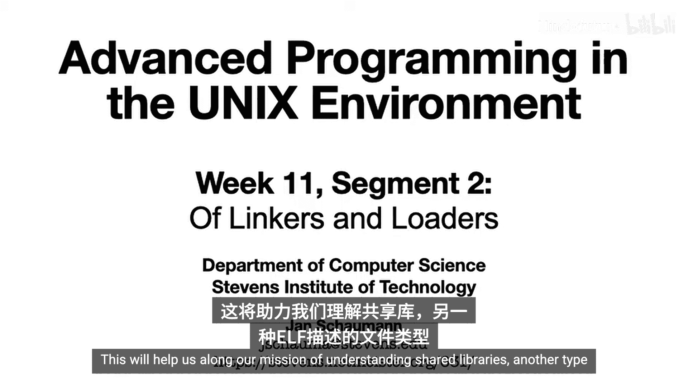

Let's start that we left off our last video。 When we ran the reader of command on an elf executable。

 we noted the different programme headers， including the P and Tu header。

 which we observed to be pointing to a file user lip Zec， L D alpha S O in this case。

So where does that path come from， What does it do and why do we need it？

We didn't specify this past name when we built the executable， did we。

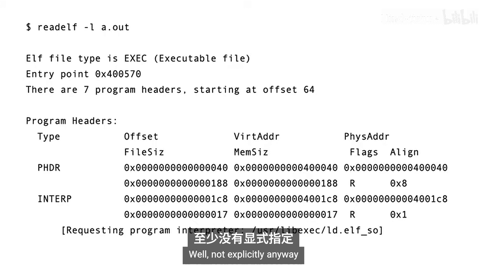

Well， not explicitly anyway， but let's take a step back and review how we build nextecutable from our source file。

We covered this process in more detail in our week5 class。

 but let's recall that the compilation process is a sequence of individual steps。

 each executed by the compile chain， possibly invoking different tools。Specifically。

 we know that in the first stage of the compilation， we invoke the C pre processorcesor， CPP。

 to pull in all our includes expand macros， etcter。

Then perform the extra compilation from Cn to machine dependent assembly。

Then use the assembler to turn this input into an object file and relocatable L file。

 commonly ending in dot O。And only then in the last stage of the compilation process。

 do we invoke the linker to create an executable by combining a number of objects。

 including specifying the dynamic linker option to pull in the runtime link editor， L D Allfzo。

The various object files required for the C runtime startup routine。And the object files we created。

 crypt dot O， Or if we invoke C and let the compiler chain perform all the steps。

 thereby creating a temporary file as shown here。Next。

 we specified that we want to link against Li C and lip crypto。Note， however。

 that we did not tell the link of where to find these files。 We'll see a second how it does that。

And finally， the linker requires the C runtime epilogues to book the start of routine objects。Now。

 taking all these files and rearranging a few bits。

 adding some information about where to find undefined symbols and all that。

 the linker produces the Elf executable。

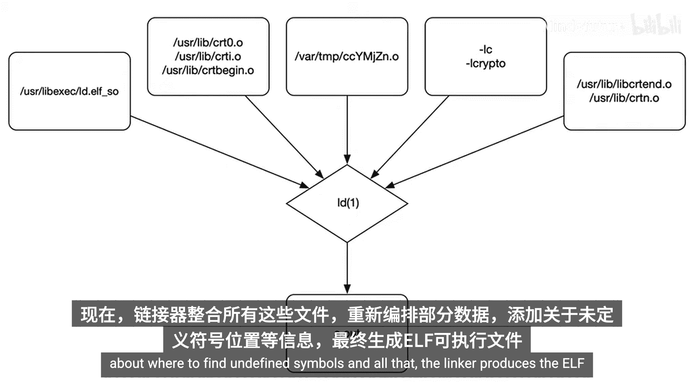

Let's take a look at a practical example。Here， we have a very simple program and uses the crypt library function。

 which we'll call to illustrate the use of a shared library other than the standard C library， Li C。

First， we compile the object file， and then we run the LD command， we just explained。

To specify the dynamic linker， L D L FS O。The C runtime startup routine objects。Our object file。

The libraries to link against。And the sea runan bookends。

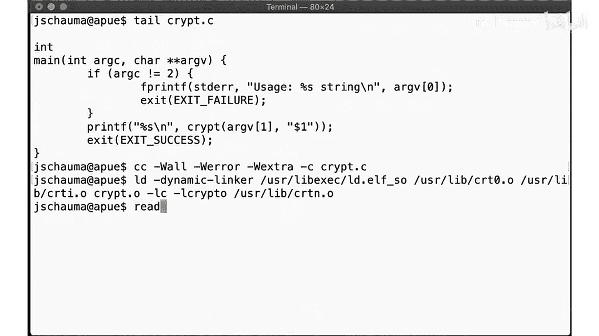

When we run readel， we see that the PT interpret header， the program interpreter。

As said to the dynamic linker， we had specified。

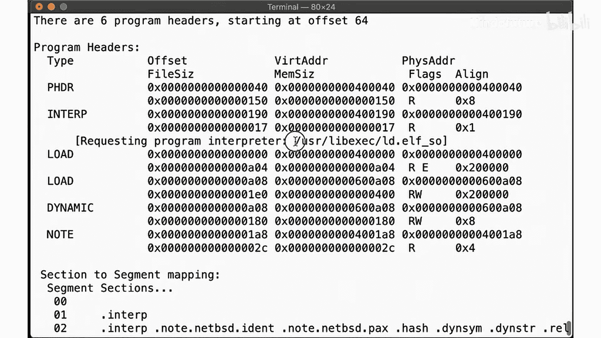

So what is this L D Llf S O thing anyway。The manual page tells us that LD Ls O is the run time link editor。

 a program used to find and load the various shared objects the program needs for execution。That is。

 when we invoke the program， the kernel passes control to this runtime link editor。

 which then uses information from the different e sections to find what other objects to load。

The manual page also tells us how the link error finds the right libraries。 Remember。

 when we invoke L D， we only told it， hey， we need Le crypto。

 but we didn't tell that where that library is found。

So the linker and the link error must have a way to find the actual files。

Let's take a look at the dynamic section of our executable。

Here we see that there are three shared objects marked as needed。 Lipsy dot S， O dot 12。

 Li crypto dot S O 14。And lip crypt thought as o one。So when we run the executable。

We know that this will invoke the runtime link editor。

 which will determine where to find the symbols that we didn't stash into the executable。

 then allow our program to execute。But how do we verify that L D LsO is really executed。

Let's use the K trace utility。 K trace is a tool to inspect what system calls are made amongst other things。

 by the programme。The tracing information is stored in the binary format in a file that you can inspect using the km utility。

Here we go。

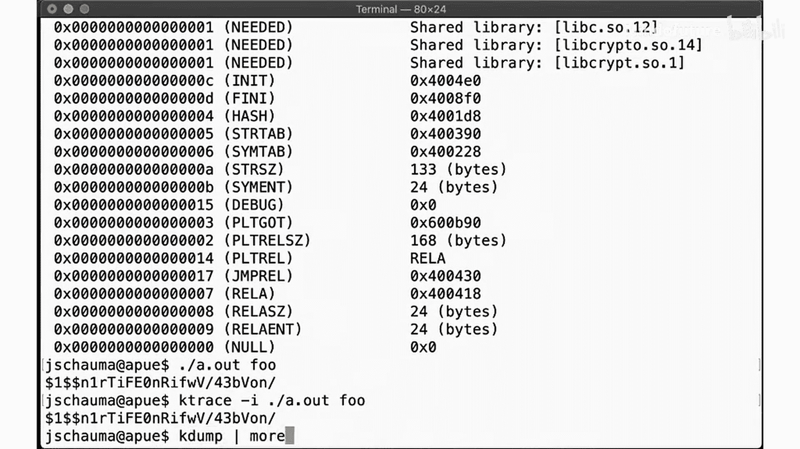

Okay， so we call exact V E to invoke the A do out binary， and we notice that immediately afterwards。

 we see a call to L D L Veso， which proceeds to open L D dot S O dot cov。

And then pulls in Li C dot Eso。Then， lip crypto dot Eso。Let crep dot Eo。

Before then moving on to actually do what we instruct the program to do。All right， so far so good。

 But what if we didn't specify the dynamic linker。LD still succeeds。

 and the resulting file is still an health executable。

But notice that now the interpreter requested is a different program interpreter。Lip L D 64。

 dot S O dot1。Let's see what happens when we execute that command。

We get a failure saying no such fire directory。Let's check where this file L D 604ed as old as one is。

That doesn't exist。 And so K D shows exactly that the programme tried to call the program interpreter。

 that file doesn't exist。 and so execution of a program failed。

But maybe we can avoid using any program interpreter。Let's pass no dynamic linker to LD。

Just like before， we still get an executable still of type health。But this time。

 there's no interpretpeer。So what happens when we execute this binary。

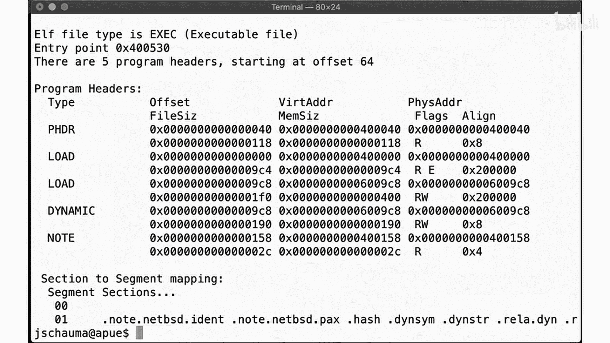

Oh， nice Se fault。There it is。 We try to execute the program。

 but immediately get a segmentation violation because our process is not set up in memory such that it can execute as it missing the various symbols from the shared objects that our link editor would otherwise have provided for us。

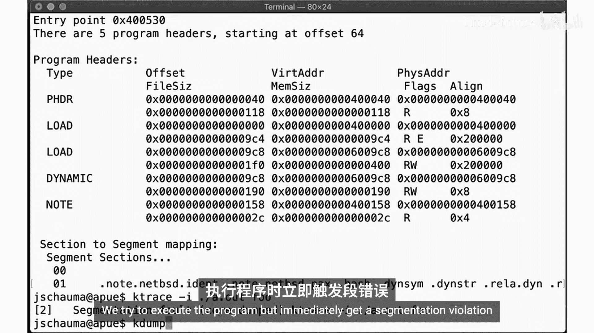

If we go back to specifying the correct dynamic linker， then everything works out again。

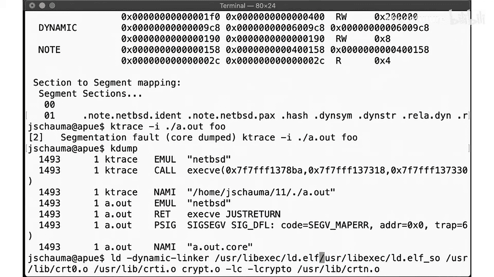

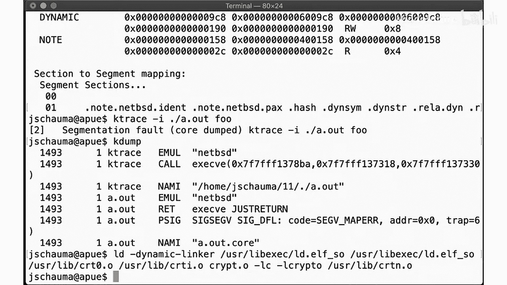

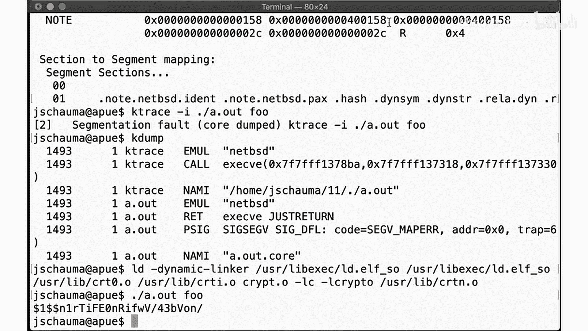

So LD Elf as O， the runtime link error， in a way performs the inverse steps from the linker。

The linker took the various object files and created an executable。

 so the runtime link editor now takes an executable。Inspects the environment。

 its own configuration information found within the executable from the DTR pathth section。

 which we'll see in more detail in our next video and a default location for libraries。

Where it eventually finds the correct she libraries to use。

To then eventually produce the correct process image to load in memory。All right。

 let's take a break here to recap。The linker combines the object files。

 the C runtime prologue and epilogue objects， as well as any shared libraries to produce the executable。

And as we just saw， the loader handles resolving these symbol at runtime by performing certain lookups and then produces the process image to allow execution。

On some systems， Linux most notably， the runtime linkage is itself an executable。

 and you can pass the program file to invoke。Give it a try and build an executable without the programme interpreter。

 It should fail to execute， as we've observed here。

 But if you invoke the loader directly and pass it the executable without the interpreter specified。

 it should still execute。You don't even need execute permissions on the program in question。

 which comes as a surprise to some people。In our next video。

 we'll look more closely at what exactly a shared library is。

 as well as some of the peculiarities of the loading and linking processes。

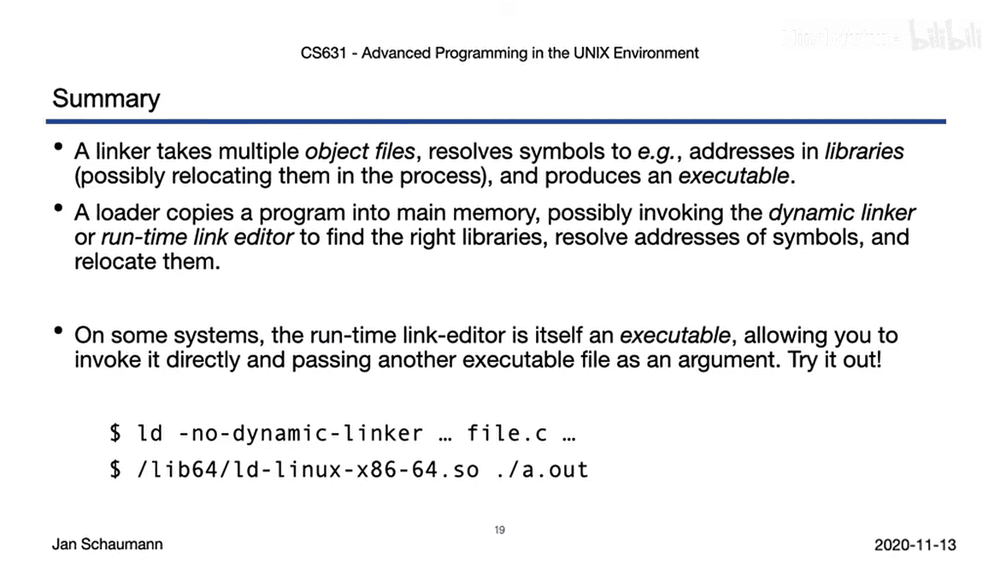

Until the next time， thanks for watching。Yes。