# UNIX高级编程-p61-P61-Week-11,-Segment-3---Shared-Libraries--BV1hPuVz8EWS_p61-

Hello and welcome back to CS631 Adv programming in the UniX environmentviron。In our last video。

 we talk in some detail about the processes involved in creating executables and then executing them。

We discussed the steps involvedva in the linking process where multiple object files are combined。

 and we saw that in an e executable， the PT interpret program header includes the pass name for the program interpreter or runtime link editor。

 which has the job to resolve any undefined symbols at runtime by a shared libraries。

In this video will cover shared libraries themselves。

We'll discuss just what exactly a shared library is， how you create one。

 and how we can influence the behavior of dynamically linked executable due to the way the link editor works。

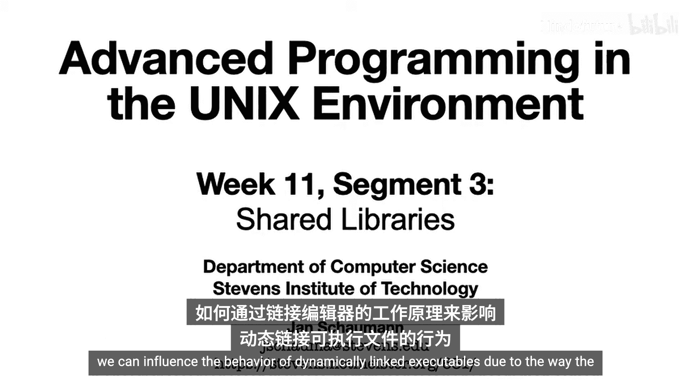

So let's look again at how the linker creates the execute the worm。

 We recall that it inserts the program interpreter， userip Z L Dellfso。

 and then combines the object files with the shared libraries that be told it to link with to create the terribly named A or out Elf binary。

But we really only specified the names of the shared libraries and nothing else。

 So how does the linker use them。And what exactly is a shared library anyway。

 when we discussed the compile chain in week05， we described how the C pre processor pulls in the various C headers。

 And we also saw that those headers only provide macros constants and the forward declarations or function prototypes。

 but not the actual implementation of the functions。That is， when you include standard Iod H。

 you are only providing the forward declaration of， say， F printer， etc ce。

 but not their implementation。The full code to implement F print F has to come from somewhere else。

 the C standard library， in this case。In other words。

 a library contains actual code that can be used by your program， and in fact。

 any code that you did not write yourself has to come from some library。Now。

 to be able to take this code and load into memory for any program executing。

Requires that it users position independent code。Your compiler may already generate this position independent code by default。

 or you may need to specify a special flag， as we'll see in a minute。

Libraries may be static or dynamic， and we'll take a look at the difference between the two in this video。

Dynaically shared libraries can be loaded at execution time by the loader or at will as part of the programme。

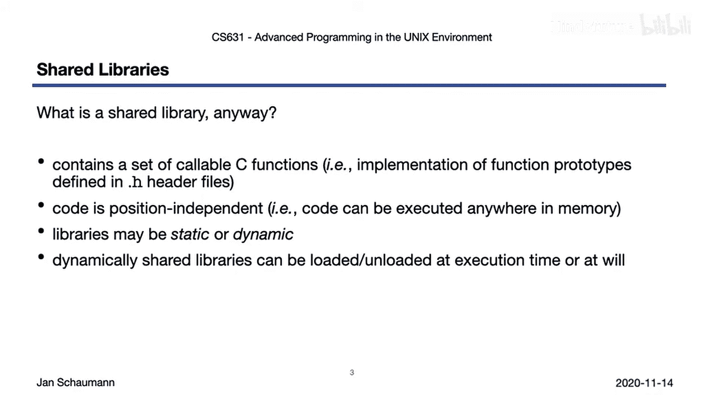

But perhaps it's best to illustrate all that， by example。

Here's our programme crpt at sea from the last video。

 although we added another function to illustrate how definitions in our code identified in the L file。

Anyway， we make use of some standard library functions， such as F printf。

 which we know as a function prototype defined in standard I O。

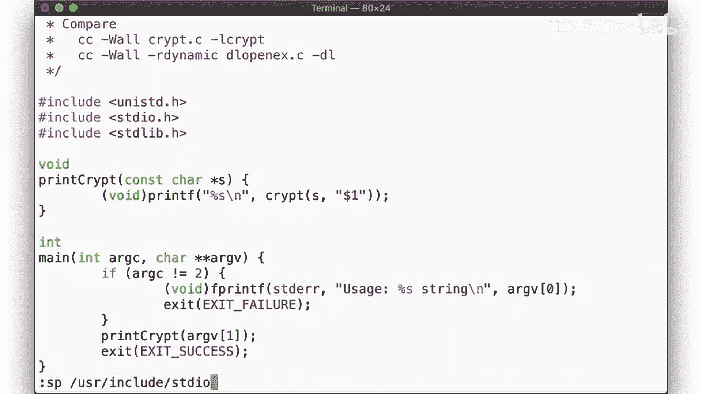

While the crypt library function is declared in the UniSDD header file。

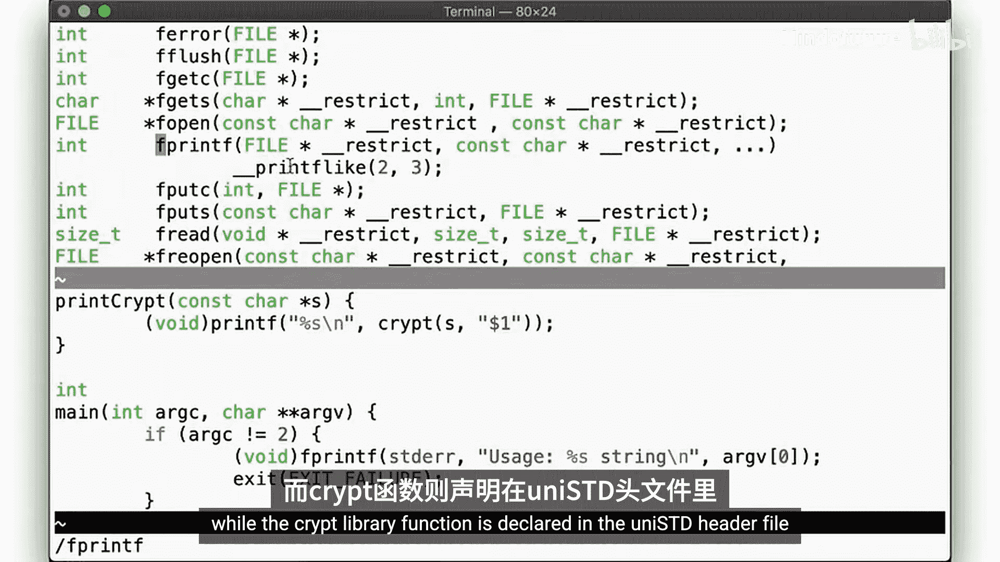

The implementation of F printf is provided as part of the Stanard Sea Library， Lipsy。

While crypt is implemented within the lip crpt library。If we compile the code into an object file。

 everything works without a problem。As the compiler finds the forward declarations and then produces the appropriate dot O file。

But if we try to link the dot all file into an executable。We get an error。

The linker does not find the implementation of the crypt function and then throws this arrow about an undefined reference。

Fortunately， the manual page tells us which library we need to get the implementation of the crypt function。

We need to link with L crypt。So if we do that， the linker succeeds and produces an executable。

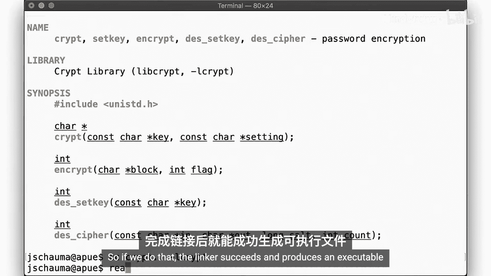

Looking at the symbol table via read of， we can see which symbols are defined and are executable。

Mean is of type function and is defined， as is the function print。

But crypt itself is still undefined， as I F printef an exit。

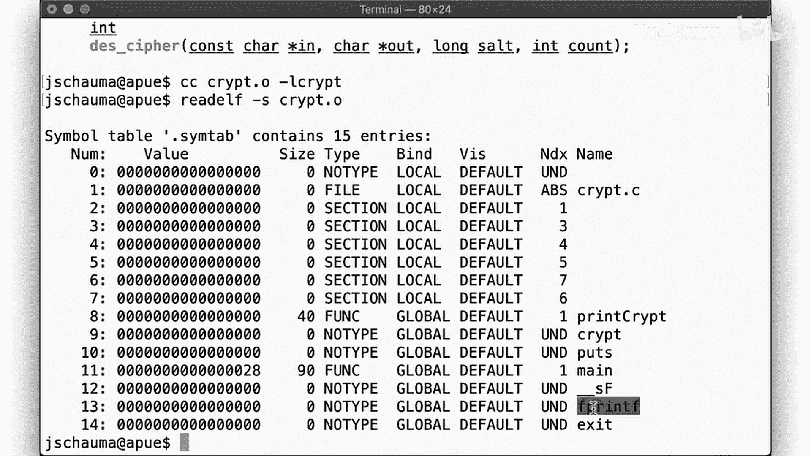

And all the addresses for these functions are 0， too。

How could we create and executable with undefined symbols。Let's try to run the linker ourselves。

If we invoke L D。With just our object file。We get a whole bunch of errors about unresolved symbols。

 many more than we had earlier， including those about the functions from the Standard Sea Library。

So let's try to tell the linker to use Li C。Okay， that's better。 Now。

 we only get the  error about cryptnot being defined， like before。That is our compile chain。

 by default will automatically link against Lipsy， which seems like a reasonable thing to do。Now。

 let's add a crypt to our comment。There， now everything's succeeded。 No more undefined references。

The symbol table for the cryptot O object file contains the undefined references。

 But what about the executable。Rel D S Aloud shows us a large number of undefined references here。

 too。But now we have a bunch of things that are defined。 For example， we have the start routine。

 which we know to be the entry point of our executable at the Hex address 4，0，0，5，50。

Then main is found as a defined function， too。But again， crypt， exit and Fpref。All remain undefined。

Let's look at the dynamic section of the E executable。Now， this is interesting。

 Here we see the executable includes information about what libraries it needs。

Liipea dot S0 at 12 and lip crypt at S o at1。And when we execute the program， everything works out。

So the information included here in the executable informs the loader that it needs to look for these two libraries。

 Liy and lip crypt。

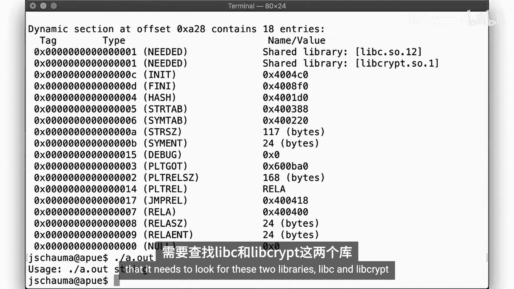

The early D command can be used to show effectively what the loader would be doing as far as the shared libraries are concerned。

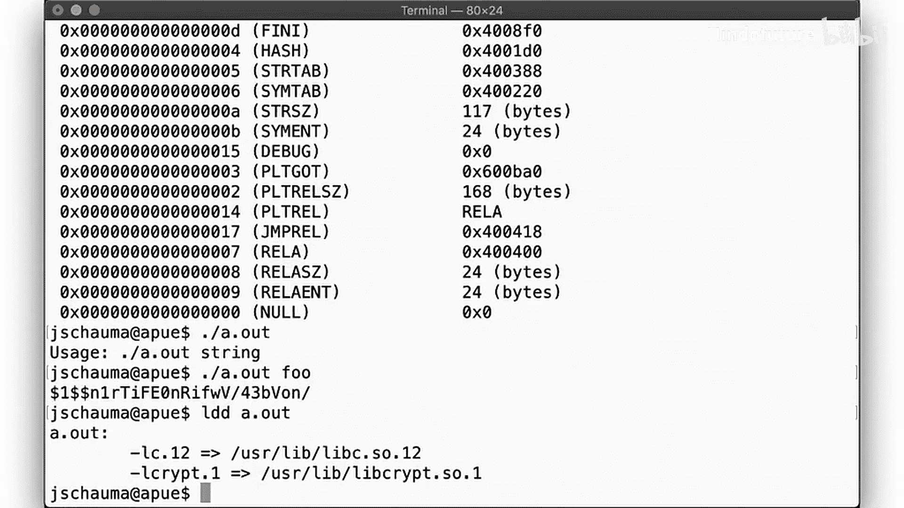

It shows that the8 out executable requires user lip Liy dot S01 ti and user Lilipcrpt dot S0 dot1。

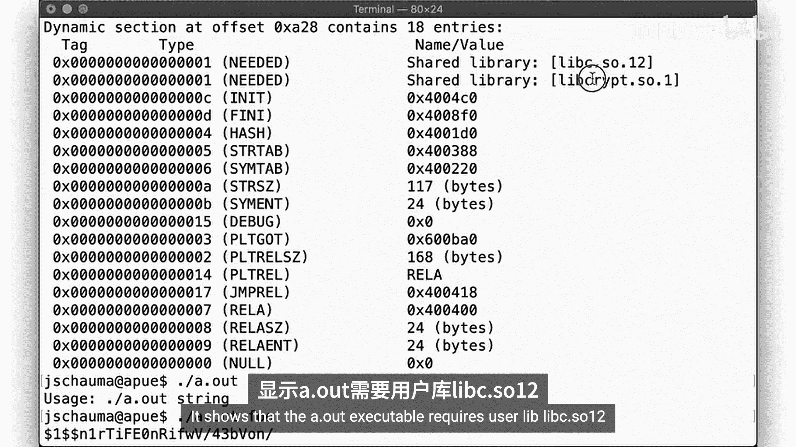

Having found the absolute path of the libraries， the names of which we are contained in the executable is being required。

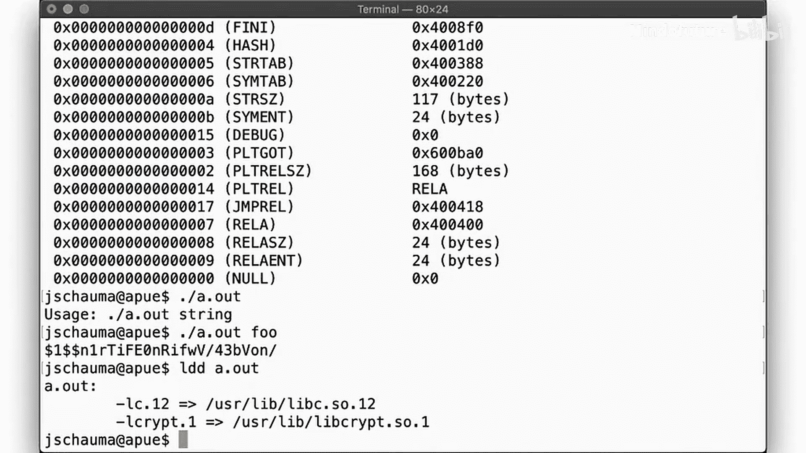

So just as we described in the last video， we saw here that LD F S O had to find the information about the shared libraries from the executable and then use some logic to map it to the actual path names before loading those to resolve the undefined references at runtime。

In other words， the linker and loader again have to work together。At link time。

 the linker resolves the various undefined symbols and makes a note of which libraries are required。

It provides this information in the executable， but does not pull all the actual code into the executable。

The actual code we wrote， everything we have in our object files that we compiled。

 split into the executable， however。If we had used a static library。

 our code would also have been pulled into the executable。We'll see an example of that， in a minute。

But the contents of the dynamic libraries， such as Lipsy or Li crypt in our example。

 are not pulled into the executable。Instead， we only include information about which libraries we need in the executable at link time and the dynamic link at program execution time perform the inverse operation and then load the shared library specified in the program executable。

The runtime link editor， however， is not the only way for you to load shared libraries。

 You can also make an explicit call to the suis course by which this is implemented yourself。

We'll have an example of this towards the end of this video。But first。

 let's perhaps create a more simple example to better illustrate how a shared library is created。

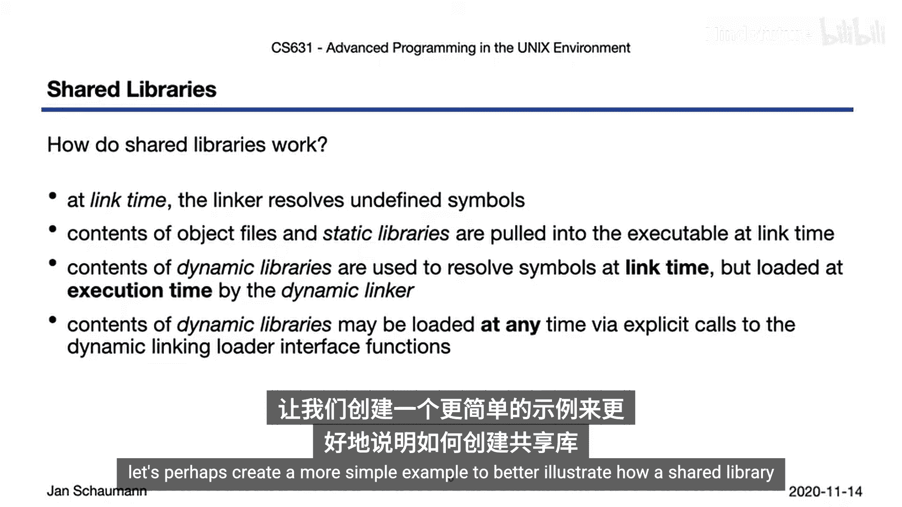

Let us consider this simple program。Main only called three functions。L D test 0。

 L D test 1 and L D test 2。 That's all。The file may not see does not include the implementation of these functions。

 but thus provide the function prototypes necessary to let the compiler create an object file。

This is equivalent to having a custom include statement。

 pulling in a file that provides these forward declarations。E test 1， do C。

 The file contains the implementation of the L test 0 and L test 1 functions。

These functions aren't very exciting themselves， but they will serve our purpose。

EDta 2 then contains the implementation of the equally boring Lta 2 function。

So now if we compile our main do C program。We， of course， fail。

 We have not provided any code to implement the early test functions。

But note that if we had compiled the program into just an object file。

 that would have worked because we did provide the function prototypes。

So if we now compile the L test dot C files into object files and then link main dot O with those object files。

We get a functional， executable。Exciting。So let's take a look at the symbol table。 This time。

 we'll use the N M utility for this。 Again， we see a number of symbols that are defined in the text segment of the programme。

Some that are undefined because they come from a shared library， Liy。

As well as some things defined in the B， S S segment。But this is all just the usual boring stuff。

 We've been building executables like this， the entire semester。Let's change this。

 Let's create a library that provides the L test functions， instead。For that。

 we use the R utility to create an archive that contains the two L test object files。

An archive which quite simply a file that contains a few other files together with a table of content so that you can more easily access the individual files inside the archive。

If we look at the table of contents of this archive， we see that， yes。

 this now contains the two object files。Now， let's look at the symbol table for this archive。

The index tells us which symbols are defined in which file。

 And we also identify that these files themselves still include some unresolved references。

So what can we do with this archive now。If we compile our mean not sea file by itself。We know。

 it'll fail。

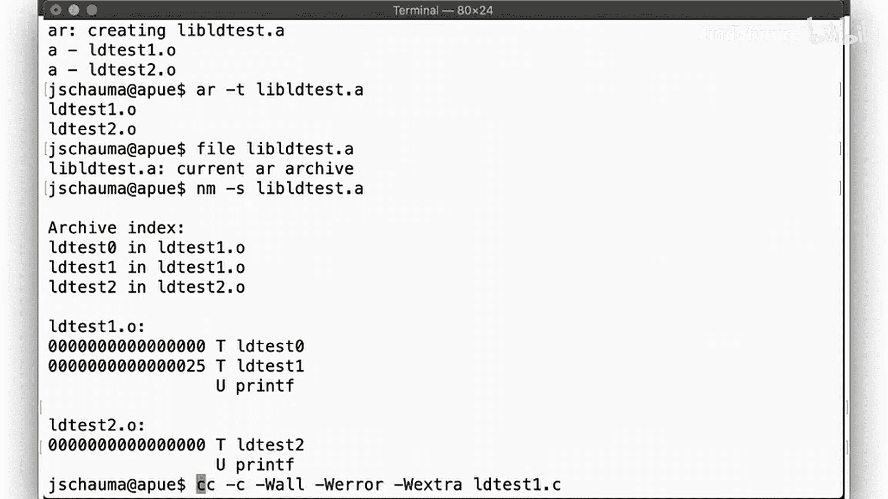

But if we then add the archive as another argument， compilation and linking succeeds。 That is。

 the link I was able to extract the files from the archive。In other words。

 the archive has become a library which just happens to be in the current directory。

But we can stash it somewhere else。 Let's move it here， into T Glip。

Would be nice if we could now use the dash L L D test flag instead of providing a fixed path to the archive。

 right。😊，Unfortunately， the linker， of course， will tell us that it has no idea where to find such a library。

But if we give the linker a hint by specifying the dash capital L flag and tell it to look for any libraries it might need in the Tlip directory。

 Then it succeeds。 and how executable works as before。

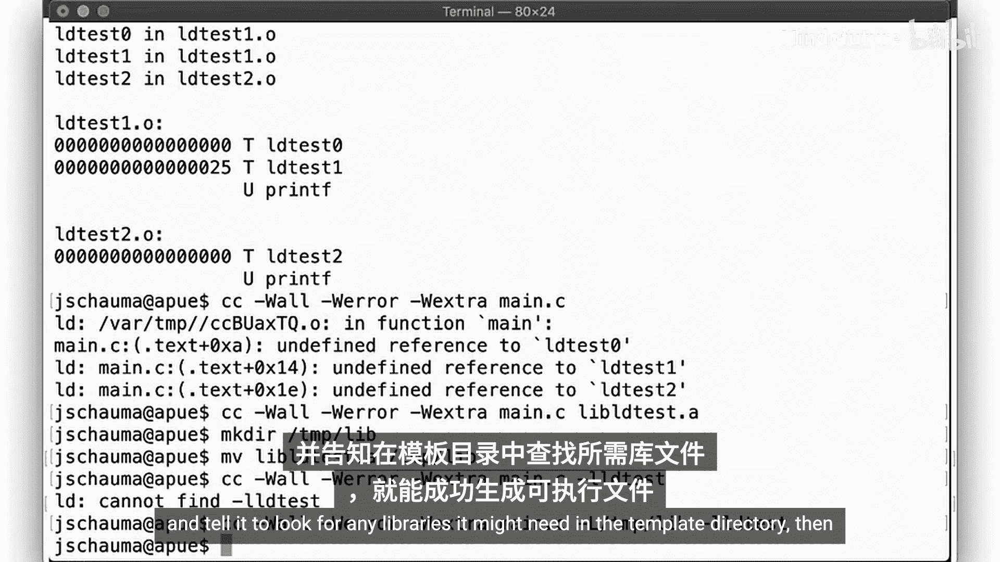

Let's now illustrate the difference between a statically linked。

 executable and the dynamically linked one。We rename this executable and then create a new one。

This one， statically linked。Let's look at the difference。

A or out static is now a statically linked e executable。

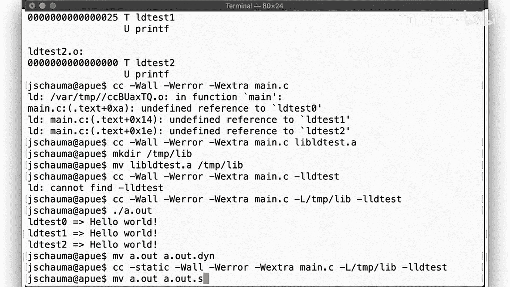

A or Aldine is a dynamically linked E executable。 The dynamically linked executable requires a programme interpreter。

 The statically linked one does not。They both behave the same way。

But the two executables are clearly very different。The dynamic one is much smaller。

Redph tells us that this executable requires Lipsy dot S， O 12 to run。While ado out staticatic。

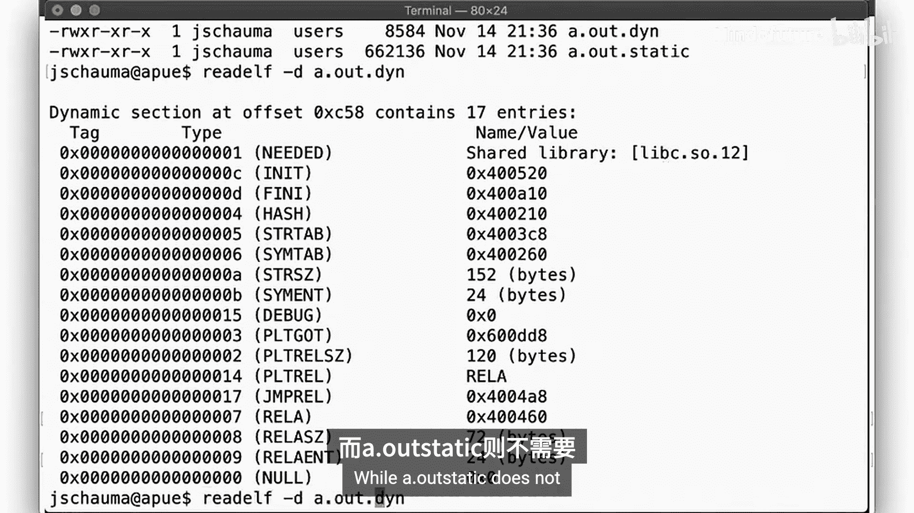

Does not。The symbol table for Ado Al Dine， as as before。With various things being defined。

 including the elitest functions we had placed into the archive。

 while the things from Lipsy remain undefined and therefore require the loading of Lipsy。

The symbol table of8 outstanding static， however， looks a bit different。

It contains a lot more symbols。Including those for all us in the I owe functions。Let's compare。

A out Dine contains 36 symbols。8 do outstanding staticatic，1075。

This explains why the statically linked executable is so much larger and does in fact contain everything from our land Sea library。

 which is why it does not require a program interpreter or a link loader。

Everything it needs is baked into the executable。

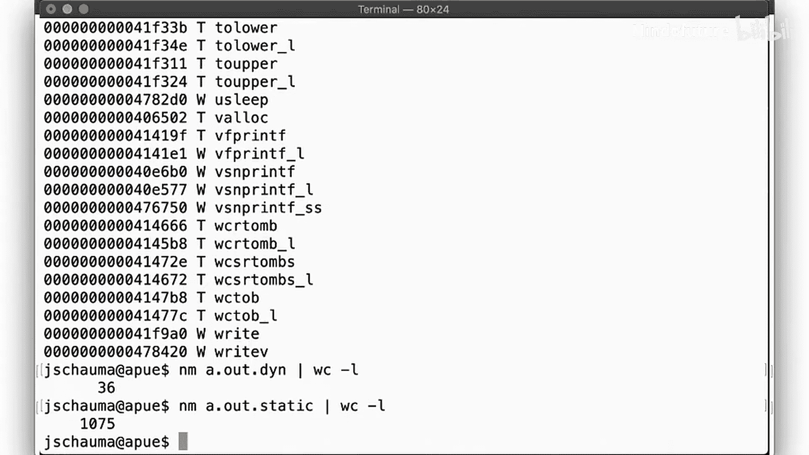

And so what we created here， the L Ld test dot A archive is a static library。As we've seen。

 these libraries， archives are created using the R utility。And typically typically， end on A。Though。

 of course， this being eunuchs， this is by no means a requirement。

An archive really is nothing but a single file that contains other files。

 a concatenation of files with a table of contents if you will。Which， of course。

 explains why linking against such an archive produces one big binary that contains all the contents of the archive and thus does not require a programme interpreter or load。

To go out and find any other libraries at program execution time。Now。

 let's compare this with a dynamically linked executable using dynamic shared libraries。

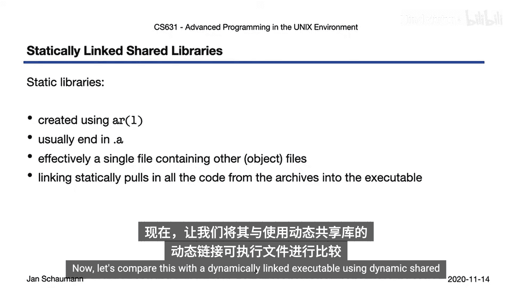

As we said before， in order for a library to be loaded at execution time or even at will during execution。

 it needs to use position independent code。 So we need to use the compiler's F P flag。

The position independent coach resolved its addresses through a game of Thrones。 and I mean。

 the global offset table。So let's use this flag to compile our library files。

Note that our object files now contain in the Elf symbol table。A global offset table reference。

Let's create a shared library。To do that， we use the dash shared flag for the compiler and pass on to the linker。

 the dash S O name flag to specify the name of the shared object we are creating。Per convention。

 the shared libraries are named after the application binary interface promise in a major and minor version number with symbolic links created to allow the user。

 the linker and the loader to find the right library。

So lip L D test dot S O dot 1 dot 0 is now a dynamically linked shared object。As before。

 compiling main not C without specifying the library fails。

Specifying the library name alone isn't sufficient。

 since the linker doesn't know where the library might be。

But if we specify the dash L flag with the right directory。Then， off we go。

Aout is it dynamically linked executable。With user Li Zec， L D Alpha O is the programme interpreter。

So now we can run the program end。😊，Oops， now what。

I thought we had created and executable with the right library。Where has it now failed to execute。

LDD cant tell us where the library is either。Let's look at the library。In the dynamic section。

 it tells us that it needs lip C， No surprise there。

 And in the soname that it's named Lieldister Re ordered that one， as we had specified。

Let's look at the manual page for the link editor。

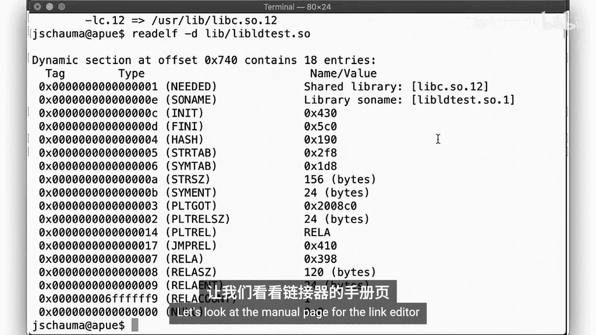

Here it tells us how it's trying to find the libraries at one time。

 It will look at some user defined find paths， the config file。

 any path explicitly specified in the executable。 And if all that fails by looking at user lip。

We didn't specify any place to look for at execution time。

 so it couldn't find it in user it and failed。Let's set the L D library path environment variable。

 as that appears to take precedence in the list of locations。 L D Alsso looks at。

And what do you know？LDD now finds the library， and so does the link editor at execution time， Ray。

So this is great。 We can now specify the directory where to look for the shared library to use。😊。

But this also means that if we had a shared library somewhere else。

 we could make the program use that。And if that she had likely behaved differently。

 then our program would behave differently。Here， let's illustrate this。

Here is an alternate implementation of the L D test function。

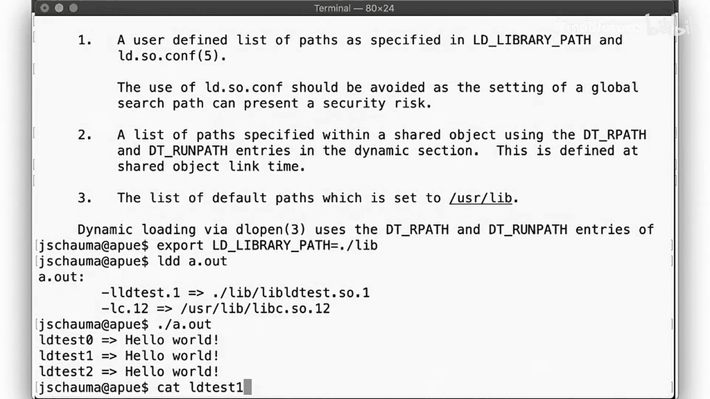

Let's create a new library that uses this code。

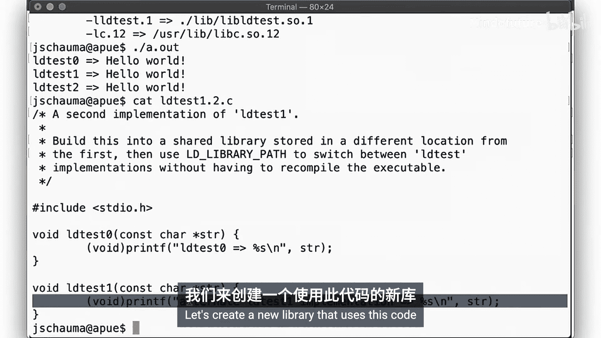

We compile the files as before and create the same set of symbolic links。But this time。

 we'll pretend that this is a minor version increment in the library version。

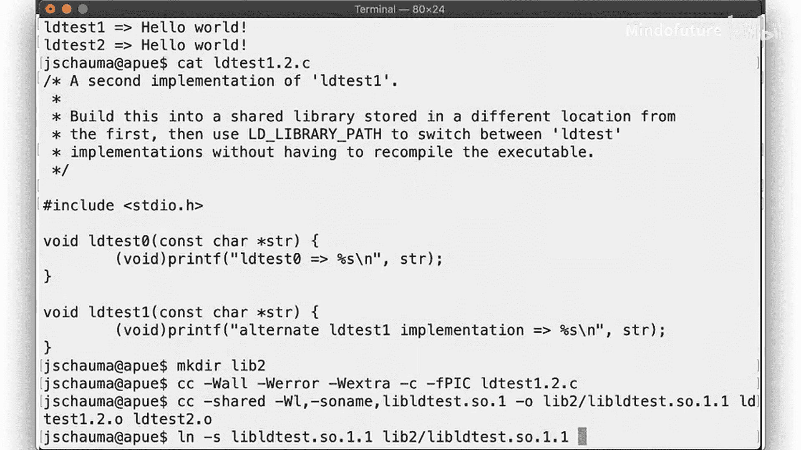

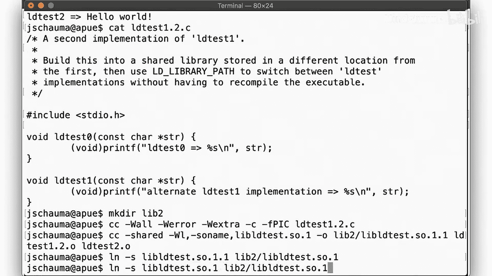

Our El library path still points to dot sledge lip。So our program behaves as before。

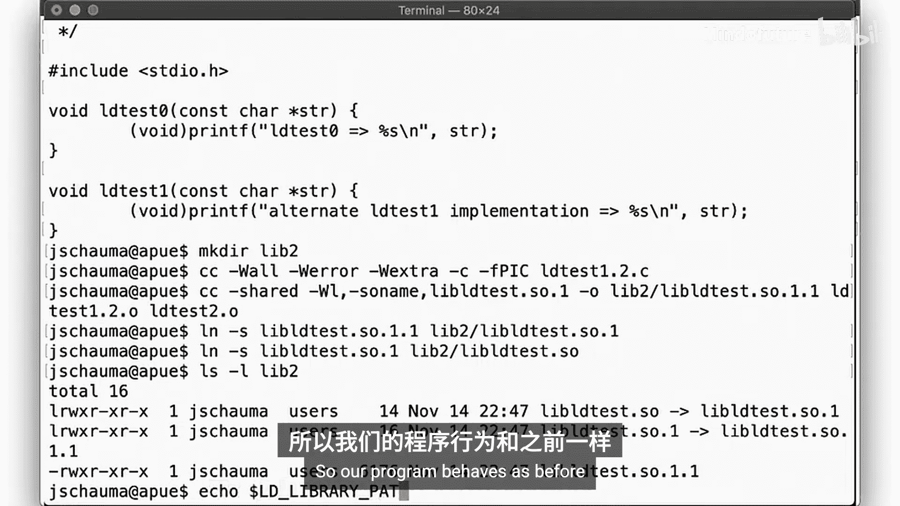

But now， if we'd change the L D library path environment variable to point to the new directory dot slash Li 2。

And our program immediately picks up the new behavior upon execution。

So the thing that's really noteworthy here is that we change the behavior of the executable without recompiling it。

 merely by pointing the L library path variable to a different directory。

But so it seems that we really need to have this variable set。

 which seems a bit annoying and cumbersome。Shouldn't there be a way to execute the binary without having to know where libraries are stored。

 even if they are not in the default library path。Fortunately， there is。

We can pass a special flag to the linker。Dash R path。To instruct it。

 to look for libraries in a specific location。Now， notice。

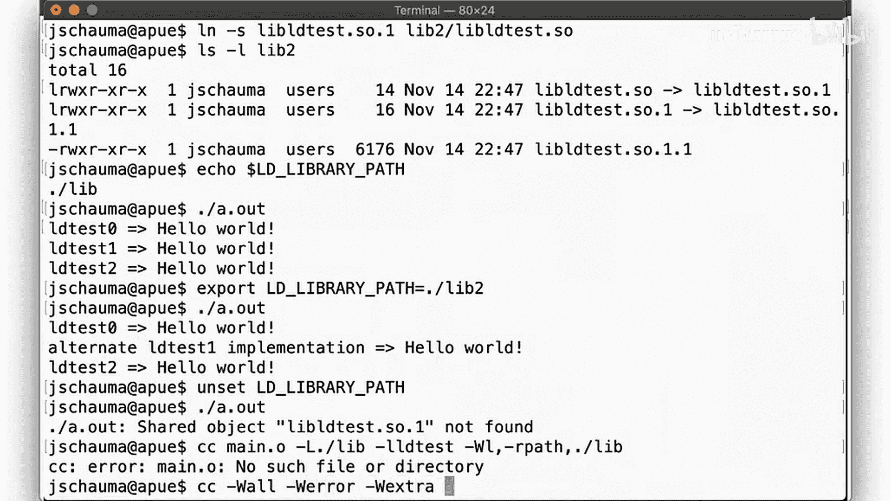

Now， notice that readel tells us not only the library names that executable needs。

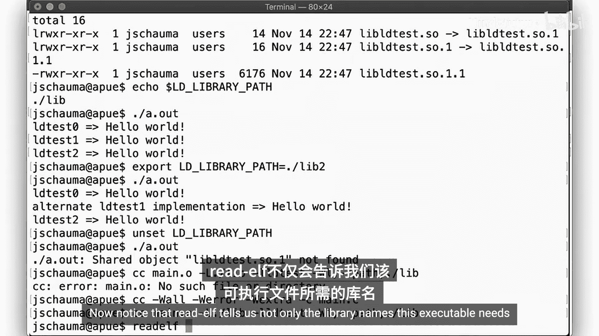

But also the path where to look for libraries， the R path。And just like that。

 executing the program works， even though the early library path variable is not set。

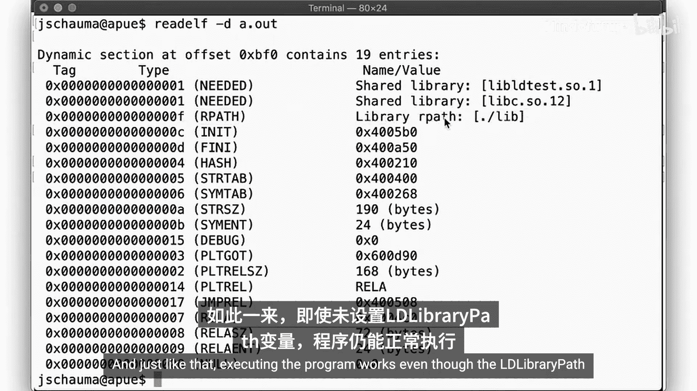

However， even with the R path specified in the executable。

 we can still set the L library path variable and trigger a different behaviour of the executable。

 as the order of lookup， as we saw in the manual page grants the environment precedence over the R path from the binary。

😊。

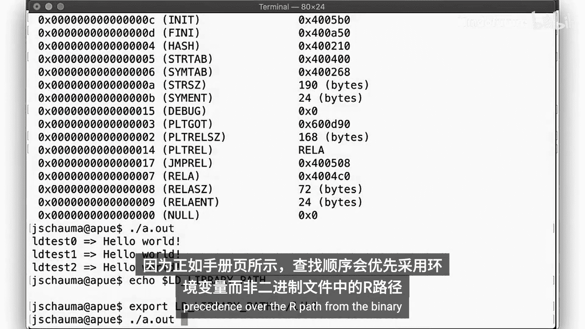

But this could actually have some pretty serious consequences。

Suppose I create a library that implements some of the synyned C library functions， such as printf。

Here， evil at sea， does just that。If we can build such a library and then set the L library path variable to cause my library to be loaded。

 Will that use my printer function instead of the standard C library function。Let's give it a try。

Here， our L test library now includes our evil object。

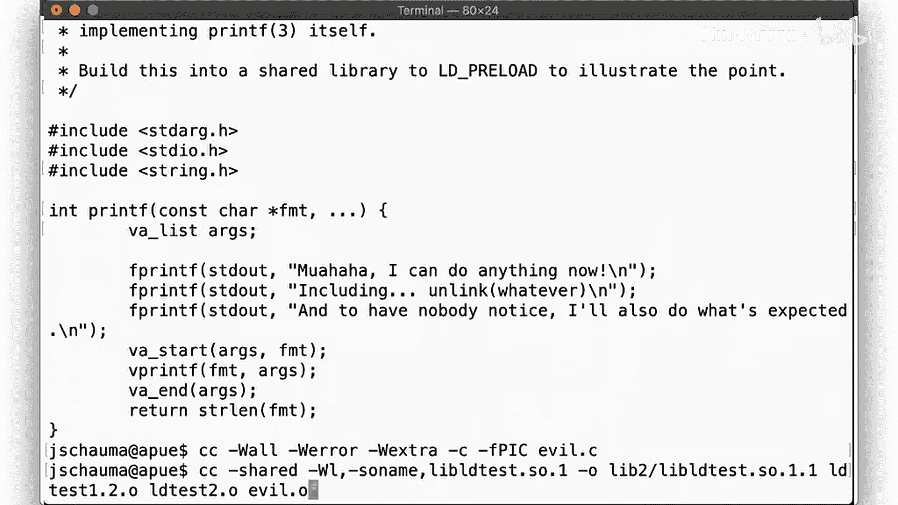

And yes， it looks like when we run it out does indeed call our evil version of printf。Now。

 consider what this means。 If you had a set U I route executable and you could use it to call a library function under your control。

 you'd have instant complete route access。

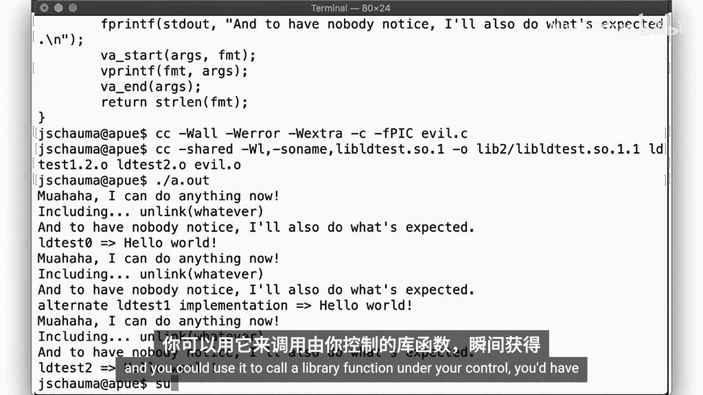

Let's give it a try。

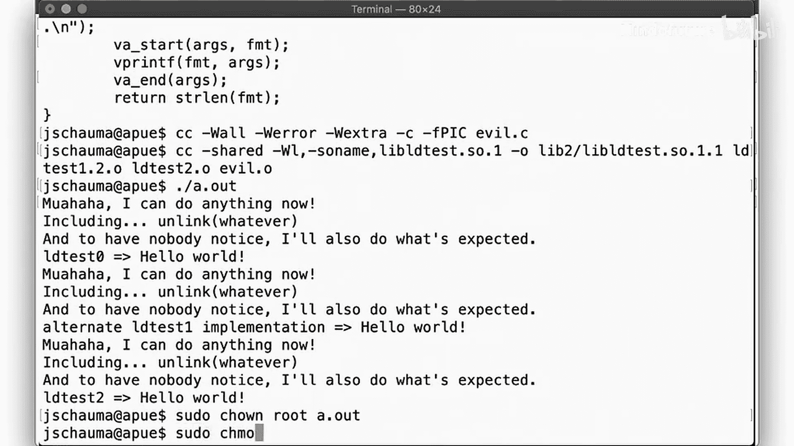

O，8 out out is now set you idea root。 But when we run it， it doesn't call our evil printde。

 even though our L library path variable is set。But if it's not said U I D。Then it does。

So this is a security mechanism the system provides the early library path variable is only honored if the program is not said UI。

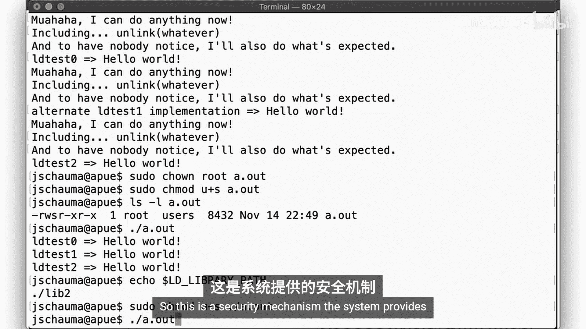

Which makes sense if the programme isn't said U I E， then it already runs with all your privileges。

 and you can trick it into doing anything you can't already do。

But if you have a different E U I from your real U I， then we need to be more careful。 and L alpha。

 though， will not on our L library path。Few。😔。

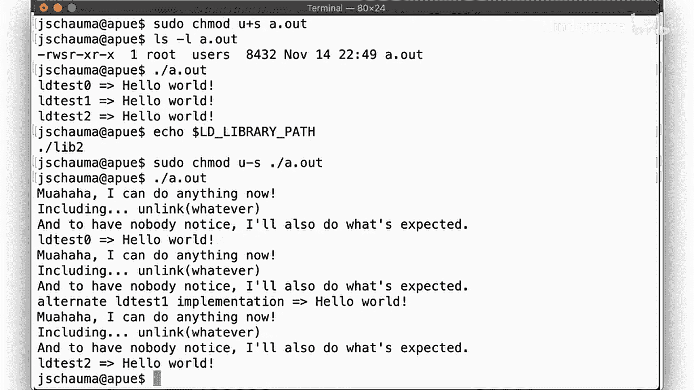

Okay， so in contrast to static libraries， dynamic libraries require the object files to be of position independent code。

We specify the FP flag with the compiler to cause it to generate this position independent code。

Dynamic libraries usually end in dot SO for shared object。And normally。

 have a number of symbolic links to facilitate backwards compatibility in the application binary interface。

The symbols in the dynamic library are looked up at link time， but not resolved until execution time。

This requires the loader to know where to find the libraries。And as we've seen。

 the user and the system administrator may influence the behavior of the loader via different settings。

But we mentioned earlier that libraries may not only be loaded at execution time。

 but also at will at any point during the execution of the programme。What does that look like？

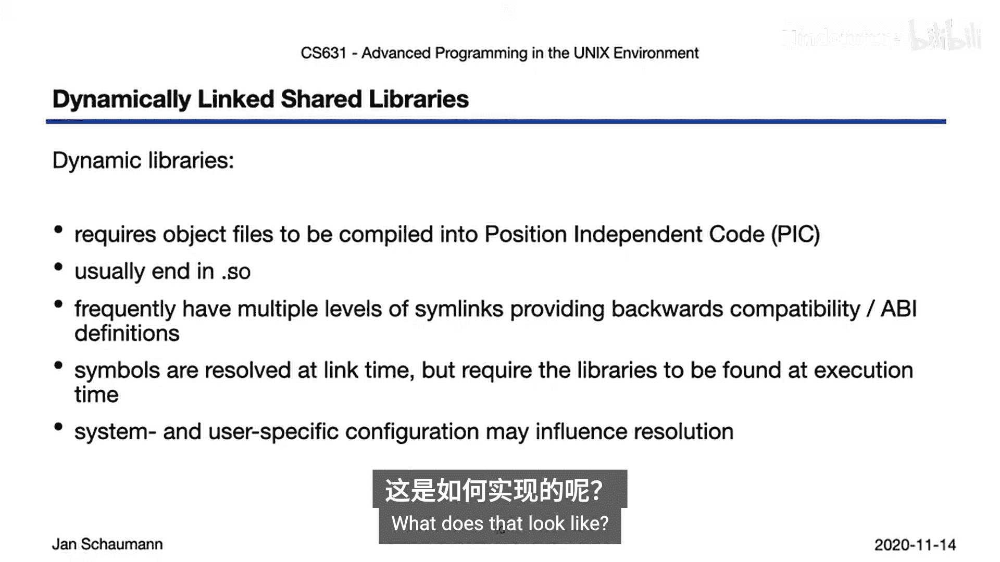

Again， as seen before a few times， our crypt dot C program requires lip crypt to be linked。

And this information is then stored the executable。

But how is this loading of the library and execution time done。

Let's look at the manual page for the De open function。

Which is automatically included in every dynamically linked programme。

This function allows the loading of a position， independent， shared object。

So let's take a look at the DL Openex。 C program， which will illustrate the use of the DL Open call to load symbols and invoke functions from a given dynamic library without linking against it。

Here in print crypt， we now declare a variable underscore crypt as a function pointer matching the prototype。

 We know the real crypt function to match。We call dial open and ask it to load lip crypt dot S O。

 then try to resolve the symbol for the crypt function within that library。

And assign it to our function pointer。If that works out。

 then we can now call the system Cpt function from the lipCpt library via our own underscore Cpt name。

Here， let's compile it。Note that we didn't link against litcrpt， as we had before。

LDD confirms that our program only requires Liy， nothing else。But running it。Still works。

Looking at our symbol table。😊，We also do not see any reference to the crypt function。 And still。

 we are able to call the function。There is， we've shown that we can load a dynamic library at will during the execution of the programme without having to link against it。

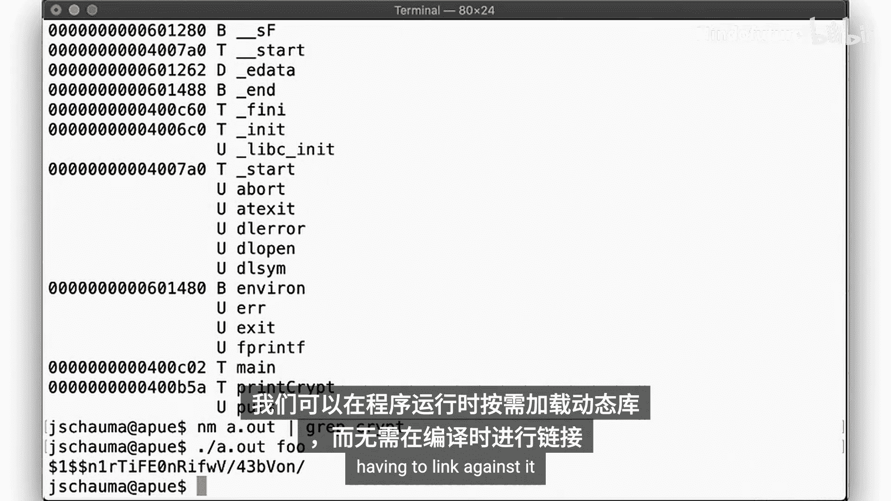

All right。 this brings us to the end of this video。

 We've covered a lot of ground and learned a fair bit about shared libraries。

We've seen our static libraries are really not much more than archives of object files。

 and the code is placed into the executable at time。Tynamic libraries， on the other hand。

 provide hints to the loader as to which libraries should be loaded to perform the lookup of the unresolved symbols。

And as we've seen， the E library path environment variable or the R path flagged with the compiler can change the behavior of the executable and runtime。

Now， before we close out here， please consider spending some time looking at the environment variables that are available and make sure to understand their use cases。

 both valid and those that abuse the feature for nefarious reasons。On Linux systems， or rather。

 on systems using newippsy or M BSD systems。 If the libraries have been compiled with debugging support。

 you can set an additional environment variable， L Dbug with varying results。

Play around with that and see what interesting information you can elicit from the execution of aally linked programme。

There's a lot more to be learned about the binary formats involved here。

 Different tools allow you to see different parts。 Make sure to compare the different tools we've used in this series。

 including Rilf， O B J Dump and N M。There's also another exercise listed on the course website to help you pracise writing a shared library yourself。

 Give it a go。After this， we move on to a bit of a mishmash of topics on the advanced I。Until then。

 thanks for watching， yes。

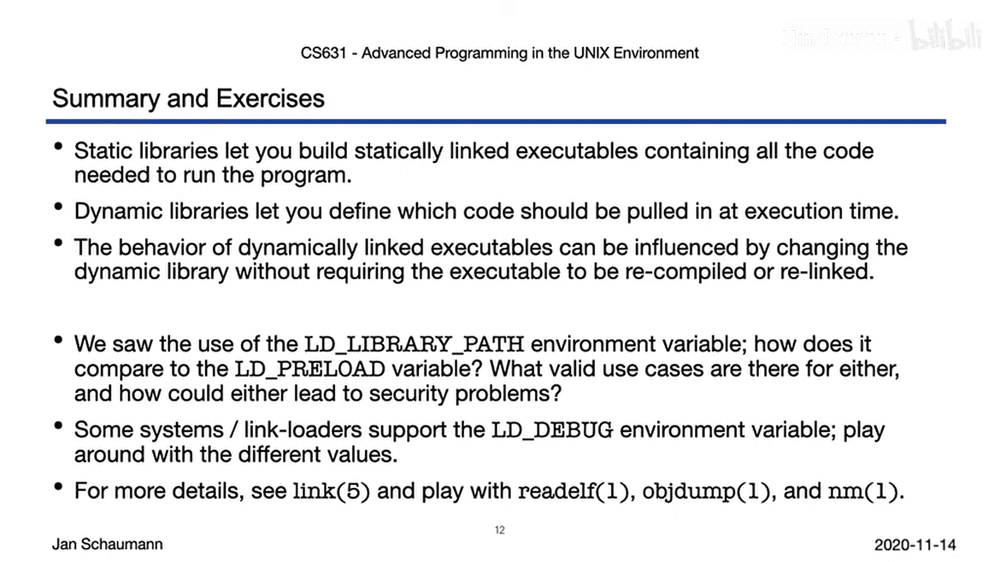