# UNIX高级编程-p62-P62-Week-12,-Segment-1---syslog(3)--BV1hPuVz8EWS_p62-

Hello and welcome to CS631 Advanced programminging in the UniX Environment。This is week 12。

 segment 1。And this week， we'll cover a bit of a hodgepodge of topics。

We'll cover a few topics grouped together as advanced IO and we'll conclude this week's materials with a very high level introduction to basic encryption in the UniX environment。

 but first， let's revisit Cislog。As you may remember from our video on De processes from week 10。

 we identified a need for processes without a controlling terminal to communicate events to the system administrator or the users。

 and we had mentioned the use of Cislog for this purpose。

So why do we need a special demon that logs messages for us？

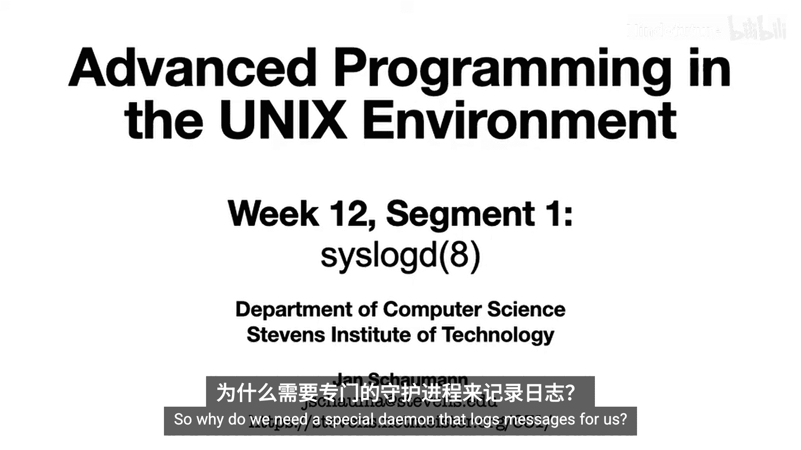

Wouldn't it be easier to simply have a process open the log file the program startup in append mode。

 then write data to it whenever it needs to， and then close it upon exit， seems simple enough？

Now the thing is， a demon may want to send different messages to different places。

 or perhaps it's not the demon itself， but the administrator would prefer if， for example。

 debugging statements went to one file while important messages about certain critical events went to another file。

So no problem， let's have the process open two files and write the messages there as needed。

 problem solved。But sometimes the process wants to also write to a terminal if it has one anyway。

And certain events may be so important that they are written to the serial console。Well， all doable。

But now consider that this is a very common pattern。

 all demons on the system will have this or similar needs。

Not only do they want to write to their own files， sometimes you want to collect errors of warnings from all your demons in the same file。

So now you need to coordinate access by multiple processes to shared resources。

And so the mappings between processes and file increases。And becomes more complex。But not only that。

 you also have to consider that now every process has to have right access to the log files in question。

And most demons run with a dedicated user， so you need to grab granular right access or allow the demons to run with higher privileges。

To write to all the different files and resources。So that gets messy quickly， as you can tell。

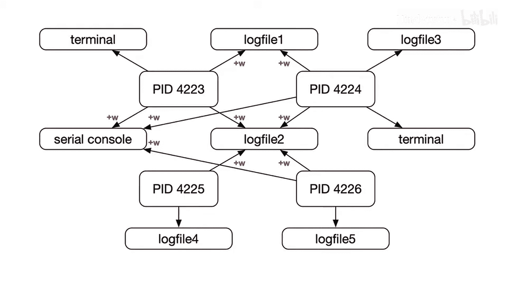

Here， doesn't this look nicer？If we had a central logging facility。

 then we can abstract all the messy work of handling files and all that away from the processes。

You know， do one thing and do it well， then allow the demon processes to simply make a few library calls。

Now that central facility still require the right access。

 but all the individual processes do not any longer。

 which also nicely allows us to run them with very limited privileges。So in a way。

 we can think of the central logging facility of a demon itself that juggles all the different messages submitted to it by the different applications。

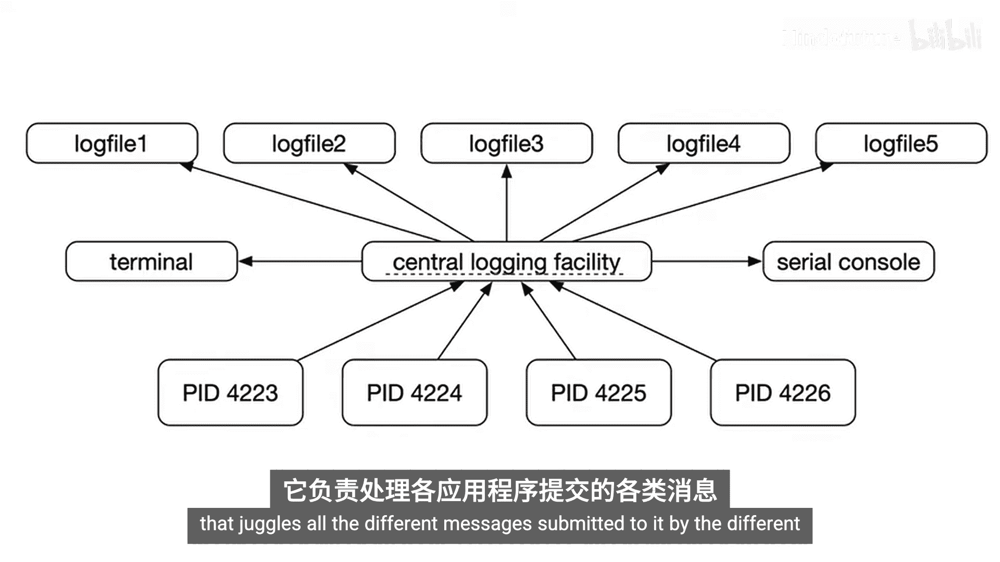

Here's a video of Cslog D， a demon that requisitioned its grooveback in action。

Messages come in and are swiftly filed into the right files。All right。

 let's see what this actually looks like。Here under V log。

 we see a number of files that are regularly and frequently updated。

The names are reasonably self explanatory， there is a maillo， an o log， a log5 forchron。

 and a five for generic messages。Different files have different permissions。

 depending on whether the messages received are considered to be possibly sensitive in nature or not。

So let's take a look at the entries in the Earth log。

Here we see a number of messages from SSHD and some from pseudo。

The regular messages are not sensitive， so we can look at them as a normal user。

We'll notice that the format across the file is consistent。

With a field noting which process logged the message？

Let's see which processes all have been logging information。We extract the fifth field from the file。

And then count each instance。Okay， so a bunch of cislog， NTP， DHCPCD processes。

Let's try to get rid of the process ideas。There that's better。

 so now we see we have around 10 processes that log messages with the most messages coming from the kernel followed by DHCPCD than NBD。

If we repeat this from all the log files， we see a few more demons。Hopefully。

 showing the usefulness of having a central logging facility instead of having each one of these demons implement all the same logic。

😊，How does this Loin know which messages should be sent to which of these files？

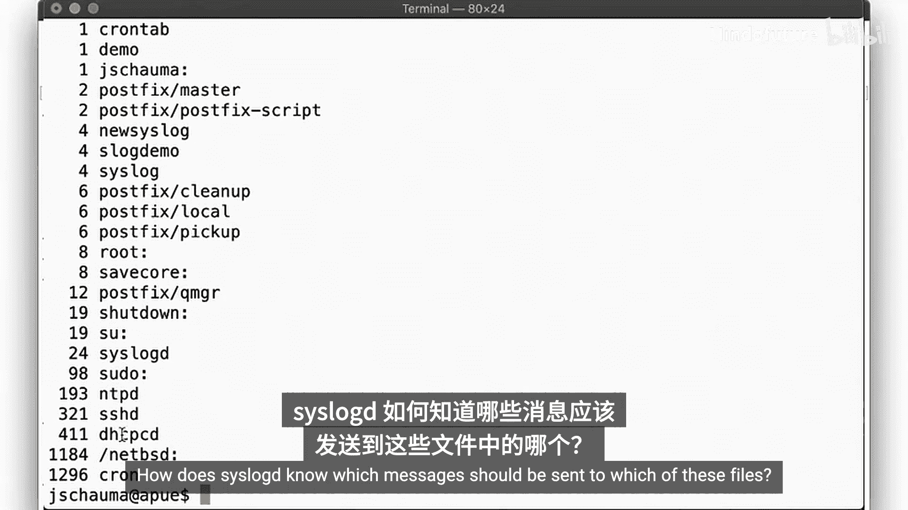

Let's look at etyslog。com。

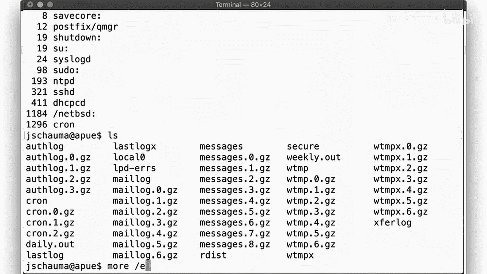

This file shows that there's a simple mapping of messages of certain types of priorities to log files。

We'll see in a few minutes how we can log messages ourselvesse。

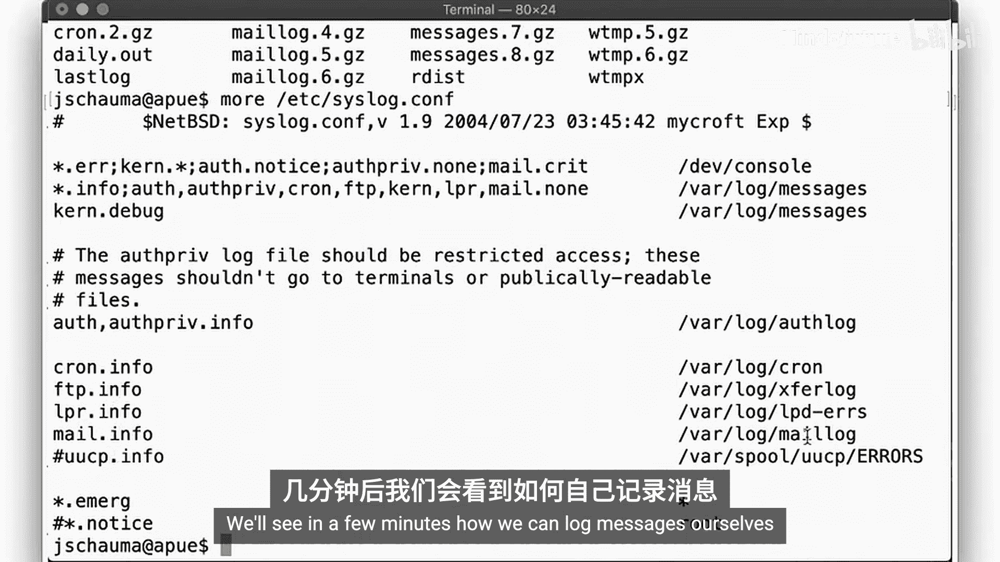

But let's note that there are several ways that messages can be delivered to this central logging facility。

The kernel itself can submit messages by other log function。

 allowing it to not have to implement actual logging logic itself。

Any process on the system can make a call to the SwisL Library function。

 which well see in a more detail in a minute。But in addition to that， that's actually quite cool。

 says log D can also accept messages coming from the network， usually UDB port 515。

This is really useful。Imagine you have hundreds or thousands of hosts。

 you don't want to have to go to each host to investigate what happened on each。

It'll be much easier to collect other logs from all the hosts in one central location and then look at those messages in one place。

So this log D allows for this to happen。So altogether， Sslock kind of looks like this。

Each of the mechanisms by which messages are accepted allows this log to process them in a uniform manner and then distribute them according to its configuration。

 and write them to a file， send them to a user。Or itself sent them to another host。With all that。

 you can build a large scale， complex message logging system for your infrastructure。

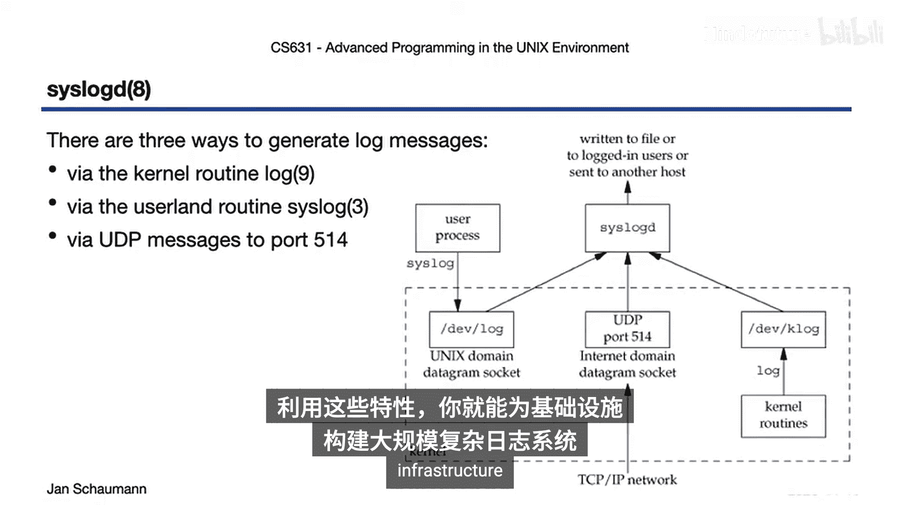

But let's look at how you as a programmer would use this log。

We have two calls to look at Open log and C log。Open log allows it to influence the behavior of the subsequent cause to ci log。

In order to differentiate your messages from those logged by other processes。

 you can pre the string to each message。We've seen that in the example where each demon process used its name for this prefix message。

You can further specify a number of logging options。

 such as to lock the messages to the console or send it out in addition to the files to lock the process ID。

 etc。Next， you specify the so called facility， which is used by C log to determine where to route your message。

Cs log itself is then called whenever you want to log a message。

It hences the message to the Sislog demon tagged with a given priority。

 allowing the demon to separate important messages from those that are informational only or used for debugging purposes。

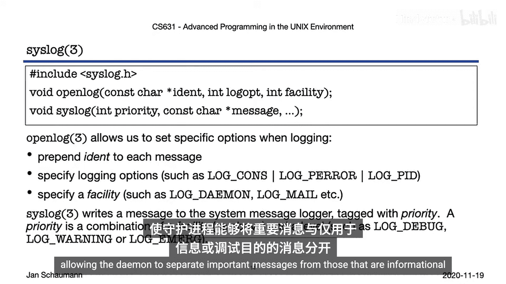

Let's illustrate the use of these library functions with an example。

Here's our main function where we call open Norg。Specifying the program name as the prefix。

 asking Cislock to print messages to the terminal with the process ID included。

We picked the user facility to identify our process as a regular user process。

Then we install a few signal handleers and if we had to ever exit normally。

 close the logs as part of our usual cleanup。Our signal handler then called search lock for each signal it receives using different priorities for each of the signals we're catching。

Okay。指が。We hit control backslash to send Squit。And it is printed on the terminal with a process ID。

But let's see if it also found its way into the log files。Yep， there it is。

Let's try to generate the same signal again。Followed。😮，Paik info。

We can generate s info by hitting control T。Note by the way that on BSD system。

 sending SG info to a process automatically trigger some information about the process to be printed。

 but our signal Haner still loggged its message。Now， let's send it sick user1。

We do this from a new shell。That too gets logged。Now let's try6 user2。Hm， nothing happens。

Let's try again。If we switch back to the program。😮。

We see that it received this signal and Cislock triggered the log into the terminal but nothing shows up in our logs。

Let's send it say quit again。There， that was logged in the fire。

But also note that Cislock edit this statement here。 last message repeated three times。That is。

 Cisloc is smart enough to detect duplicate messages and rather than write those to the file。

 it will wait until the different message comes in。If we send Squi a few times followed by secure2。

 we see them logged over here like this。

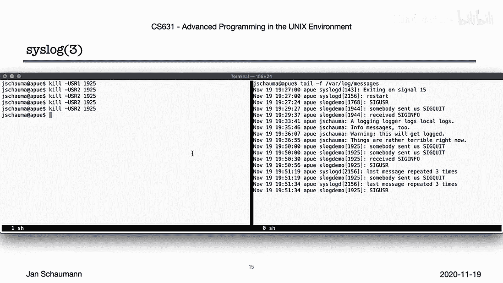

No。Let's take a look at the configuration of Cslog。

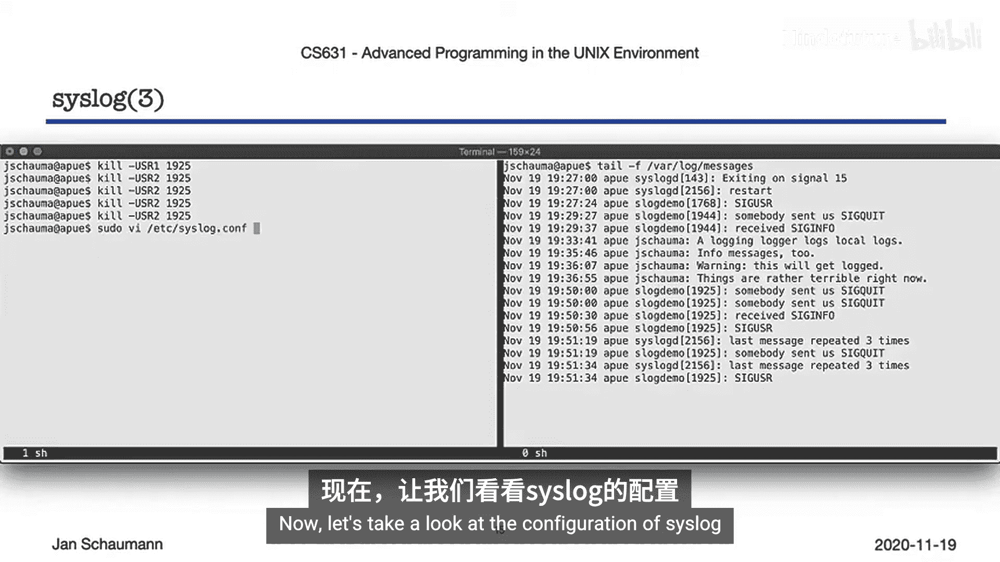

Let's separate our messages into a different file by specifying user notice to go to Var log user messages。

First， we need to create the file。And then restart Cis log D。

We note that Cslog D itself logs messages via Sslog。

I mean now's start our program again and send it to S user one signal。

We see that it still logs to v log messages。But the message is also locked to the fi we specified。

That is， we see that CiissL has the ability to allow logging to multiple files at the same time。No。

Recad that we log the messages for the different signals using different priorities。

And anything matching notice or hire will be logged to the new file。

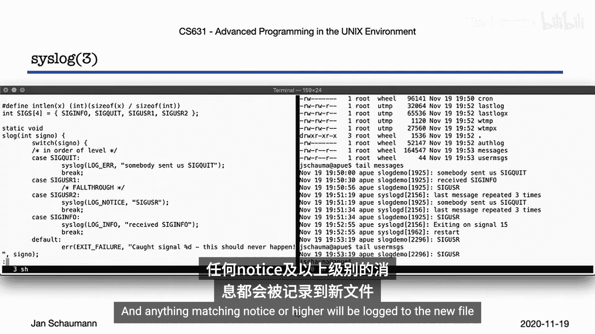

But if we send SIG info， this information is not logged to the new file。Even though， of course。

 the signal is received。And per our open lock directive was locked to the terminal。

Sending Sig user1 again， we don't get another message in our file since the message was just repeated。

 even if sent from a different process， but this Lock Deier reports in Vlog message that the message was repeated。

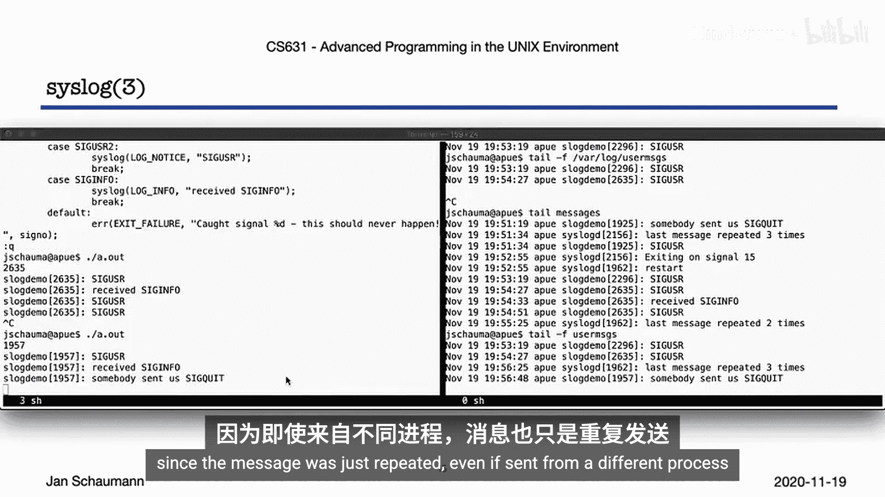

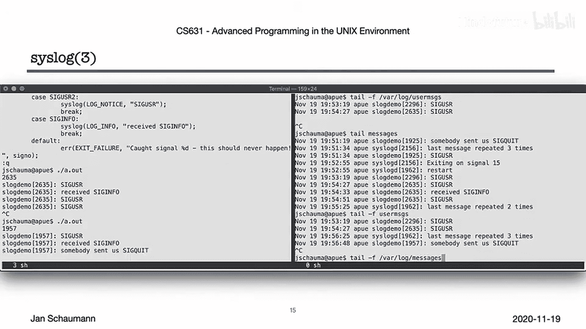

If we send Sigin for it isn't locked because info is of a lower priority than notice and we only instructed Cis log D log notice or higher。

Seecquit， for example， was logged。Since this central logging facility is rather useful。

We can not only log things via the library functions， but also via the command line for that。

 we have the logger utility which provides a simple interface to these library functions。For example。

 we can log a message with a local zero facility and a level of info。

Or we can log a message in the user facility。As before， if it's below notice。

 it won't make it into a separate file， but higher priority messages do get delivered。

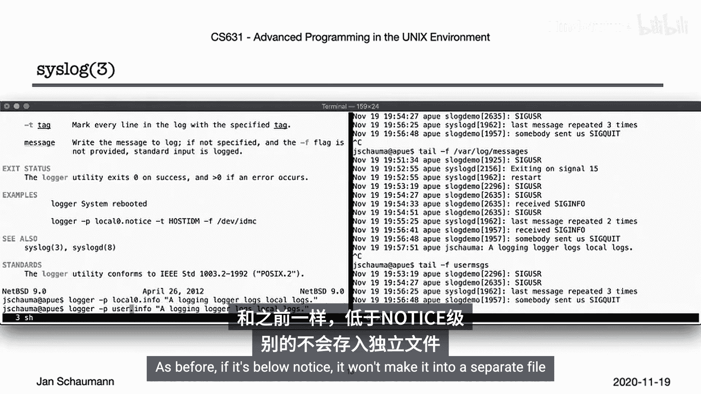

Finally， we can send a message of level emergency， which will be delivered to all logged in users on their terminal。

As shown here。

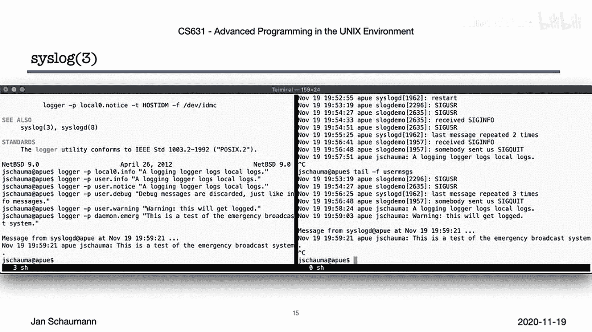

These messages are still logged to the file Vlog messages in addition。Okay。Time to summarize。

SinceL has been around for a while， it's been the defective standard for system logging on Uni systems since the 80s。

CisL has been standardized since then in RFC 5424， which includes a definition of the network packet format。

By default， this lock will use UDP on port 514 for network connections。Although nowadays。

 you may also see C traffic be transmitted over TCP or rep in Tls。Some newer versions of Cslog。

 such as Cislog and G or R CisL have added further enhancements。

But amongst a number of large scale organizations is popular these days to use a different message relay service。

 such as Elasticse or solar， for example。However， it's worth noting that there's a whole lot of equipment out there that simply cannot use anything different from standard RFC 5424 format UnDP to report 515 packets to relay messages。

Network equipment comes to mind。Either way， SL is a very convenient service that exhibits many of the properties of the UniX philosophy and this。

 as we've seen in our code example， rather easy to use。Give it a try。Thanks for watching。Jes。

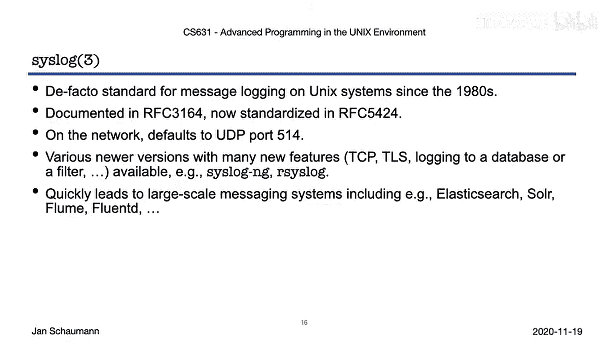