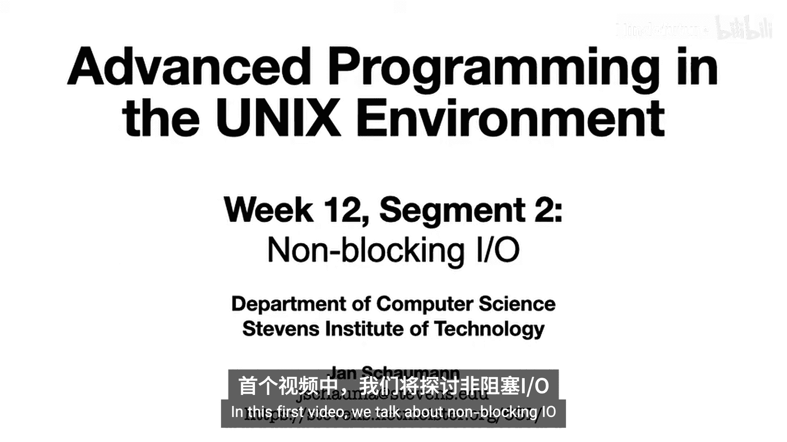
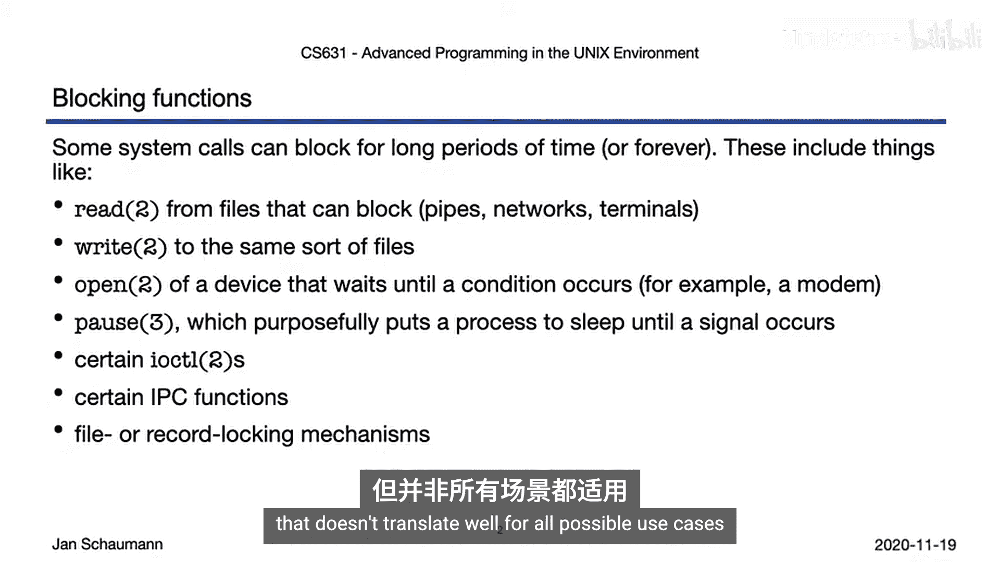
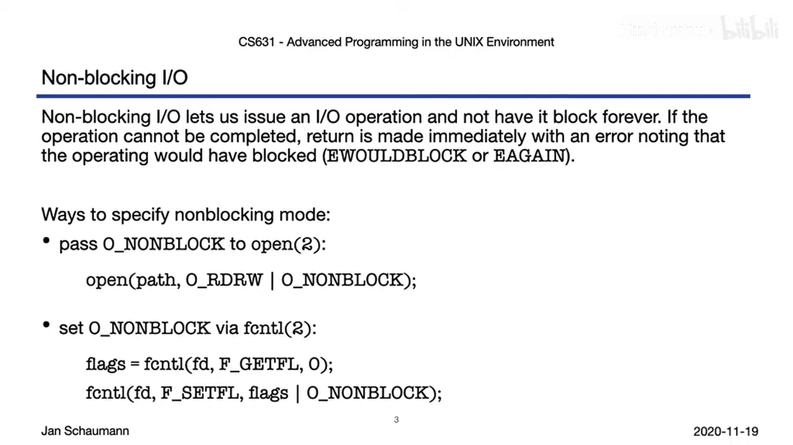
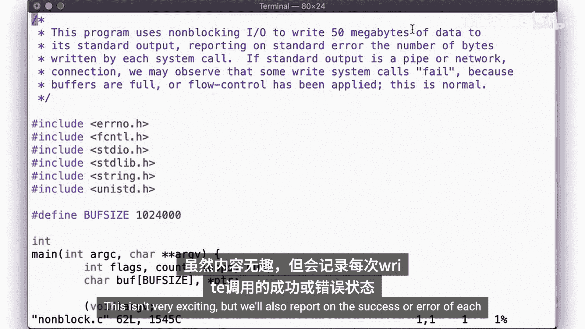
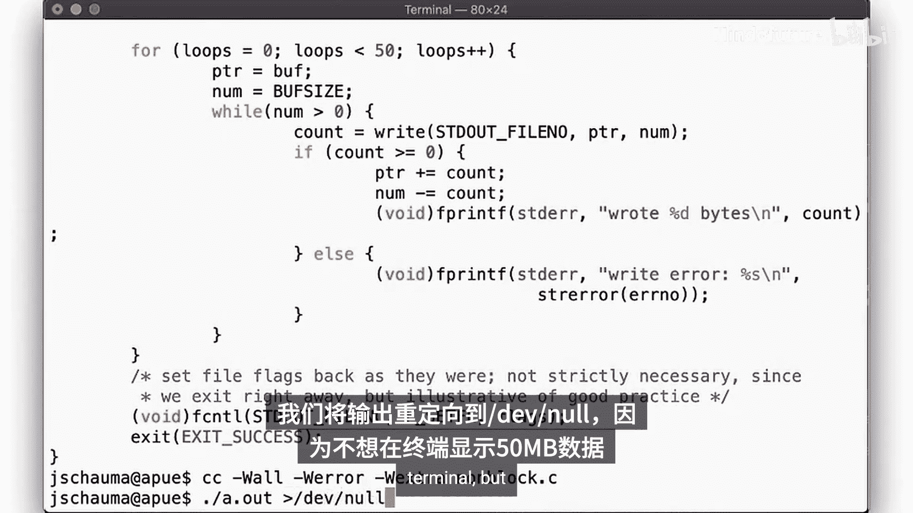
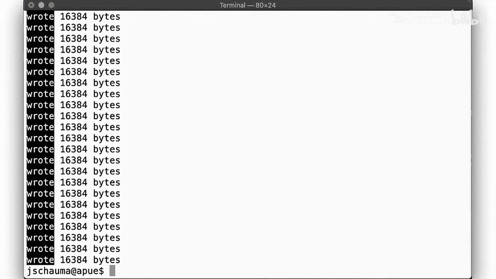
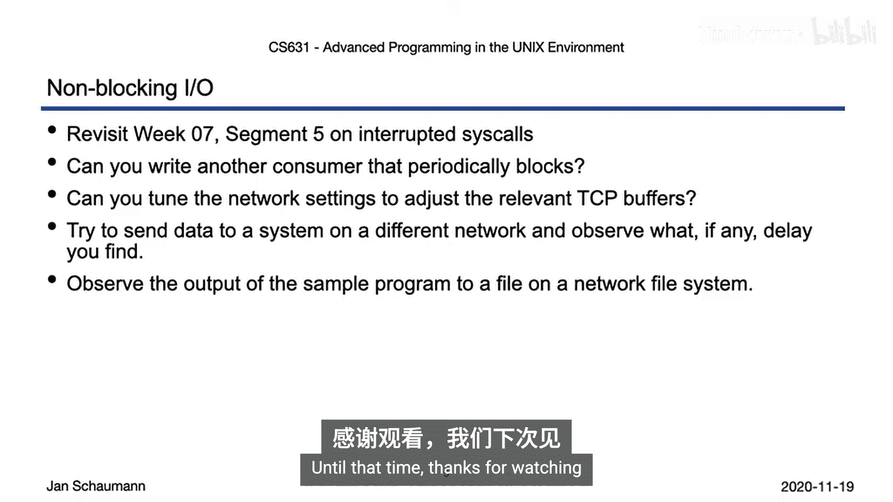

# UNIX高级编程-p63-P63-Week-12,-Segment-2---Non-blocking-I-O--BV1hPuVz8EWS_p63-

Hello and welcome back to CS631 Advanced programming in the UniX Environ。As promised。

 we'll begin a series of short segments on advanced IO， revisiting some topics that we've discussed。

 or at least hinteded before。In this first video， we talk about non blocking AO。

Back in week 7， segment 5， we talked about interrupted system calls。

 we know that a ciisca is more likely to be interrupted if it doesn't complete for a long time and may identify the following candidates of cica that perform IO。

 but that may block for a long time or even forever。We noted that for each of these calls。

 an interruption might lead to a return with an  Erno of E enterter or that the Cisco might be automatically restarted。

But neither solves the initial problem， sometimes you really do not want to block。

 you would like to perform the action and if it can complete， you'd like to know this。

We also hinted at some ways of working with multiple file descriptors that might block on NIO when we talked about multiplexing NIO using select。

 but that doesn't translate well for all possible use cases。

So instead of spaing victim to the blocking IO， we'd like to instead enter non blocking IO。

By using non Bing mode， our system call will immediately return if we can complete the operation and setEno to EWblock or E again。

The twoer values are the same and as so often derive from discrepancies in the early Uni versions before standardization。

They by and large represent the same error condition E again basically says you should try this operation again while E would block most literally says this operation would block。

On most Uni systems the two are equivalent。Anyway， how do we enable an nonblocking mode？

Way back in week two， we already encountered the most trivial way to do that。

By passing O nonblock to the open system call when we open a file。

But we also remember from that lecture that we don't always are in the position to open the file and instead maybe operating on a file scriptor that was open for us。

So in that case。We can use F control to set the same flag。

Here， let's look at an example of doing this and what the effect of setting this flag is。

In this program， we are writing 50 megabytes of data to cement out。This isn very exciting。

 but we'll also report on the success or error of each right call and will enable nonbing mode or not depending on how we're called。

Since we're operating on Standard Out， we have to use F control to set non blocking mode。After that。

 we loop 50 times each time trying to write one megabyte of data。As we know。

 right may return fewer by than we requested or it may fail。

We record a standard error each of these cases。Okay， let's give it a try。We用。

We redirect output to devolll because we don't want 50 me of data written to our terminal。

 but we see that each loop iterates。

And writes1 megaby of data。To verify， that this is 50 iterations。

 let's count the statements printed to standard error。To do that。

 we need to redirect standard error and get it into a pipe while still suppressing our normal standard out。

This shall redirection and location accomplishes that。

Revisit our lecture on file descriptionscriptors and the associated kernel structures。

 the do system calls and think about how the shell implements redirection to understand how this works。

Anyway， 50 iterations as we promised。Now let's try again in non blocking mode。No difference here。

 we're still writing 50 times one megabyte of data。But what happens if we write data into a pipe？

Once again， no difference， each iteration writes one megabyte of data into the pipe。

Now let's try that in non blocking mode。Ohha， something's different。😊，It looks like in nonbing mode。

 we are only able to write 64K bytes on each try， so to get to one Meg。

 we need 15 times 64K plus 4960 bytes。So what happens is that our right system code attempts to write one megabyte。

 but our pipe can only accept 64 k bytes， the size of the pipe's internal buffer。

So ourright returns short and tries again。But our pipe is still continuously consuming the data。

 so we don't really block yet。Let's try to simulate a pipe where the reader is not consuming the data for a while。

 that is literally are blocking consumptions。Here in blocking mode。

We see just that nothing happens for three seconds and the 51 meites succeed。In non blocking mode。

 however。We get a large number of errors， as for threeiseconds our right codes are immediately returning with an error before finally succeeding as before。

 writing 64K size chunks of data。But pipes are not the only IO where we might block。

 let's try some network IO， let's start a new shell and run Netcat and listening mode。

Here we now see our listener on port 8080。And we can write data into Netcat。In regular blocking mode。

 we again see nothing unusual。Let's give it a go in non blocking mode。Aha。

 here we see that riots are performed in 60k chunks， it seems。

Let's do that again and look at the output on standard error。Looks like we managed to write 64K data。

 but then TCP buffering kicked in and we couldn't immediately write more data。A little bit later。

 the receive buffer was drained， we were able to send a few more bytes。Then we are held back again。

 and then we continue writing in 16 case chunks。This illustrates how TCP buffers data and how network IO may at times block。

Okay， so let's recap。To better understand noning mode as always run the examples we've shown here。

Also， revisit the content from earlier lectures we referenced。

Try to come up with other ways that might introduce a delay or block IO。

And perhaps see if you can change the settings on the system to tune the TCP buffers to lead to different throughput in a non locking mode。

You can also try to send data to another host over the network instead of just in the local system。

But try to perform IO in a system that uses a network file system。

You should see some blocking calls in those cases too。NowNext video。

 we'll take a look at record locker。Until that time， thanks for watching。

Yes。