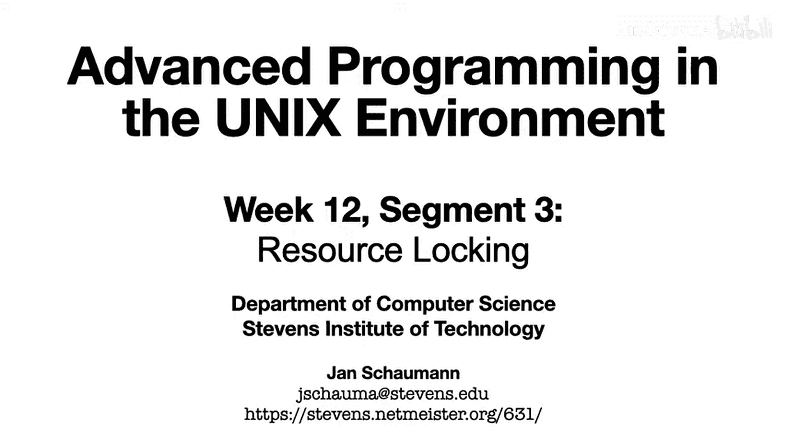
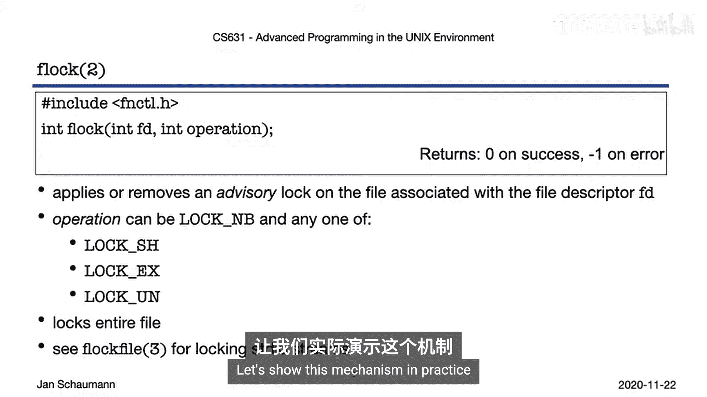
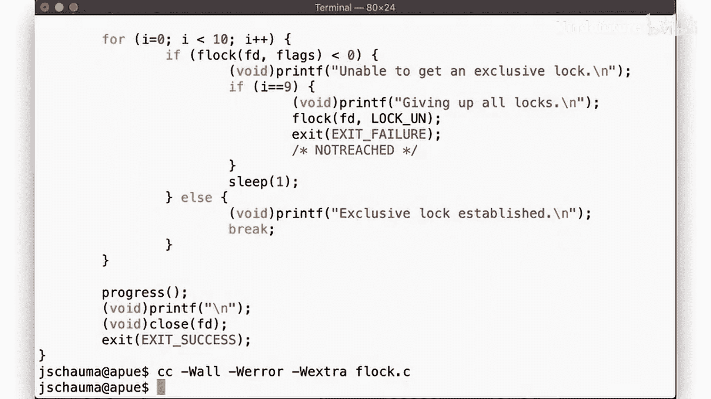
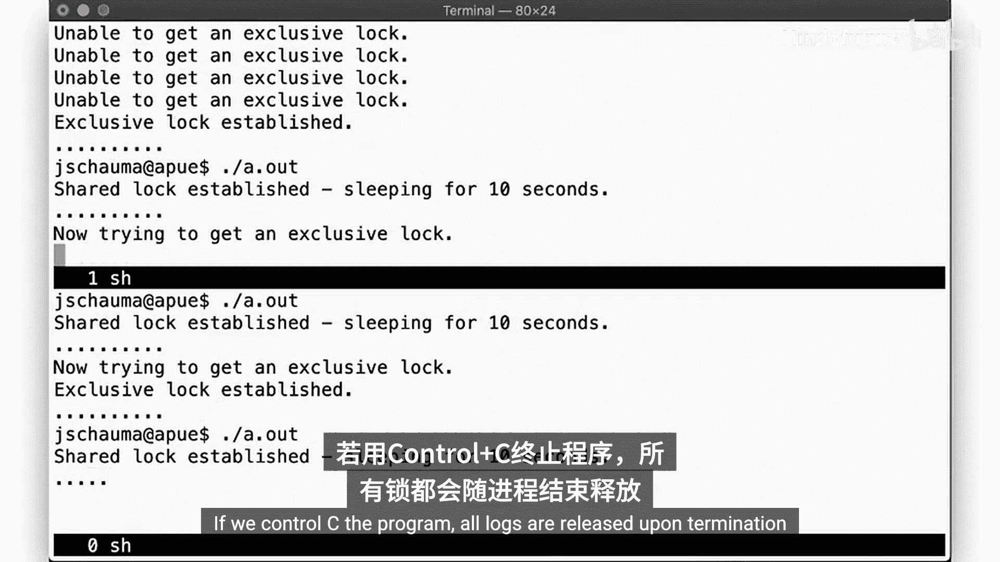
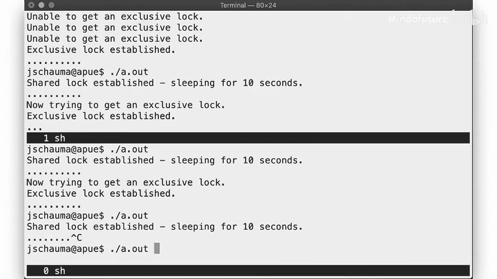
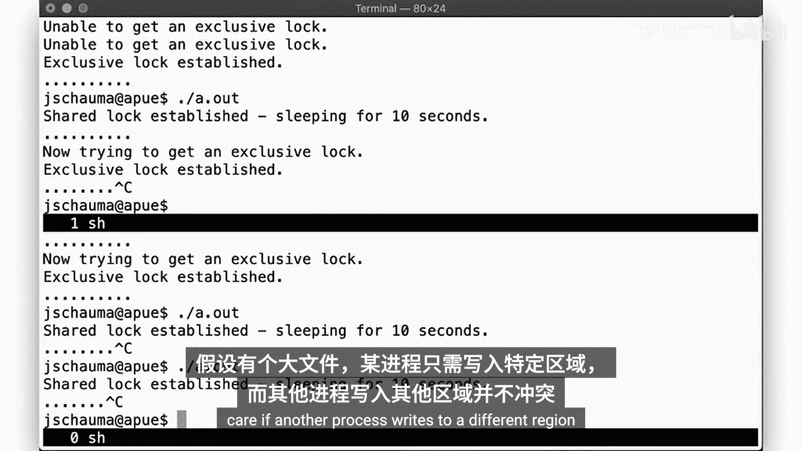
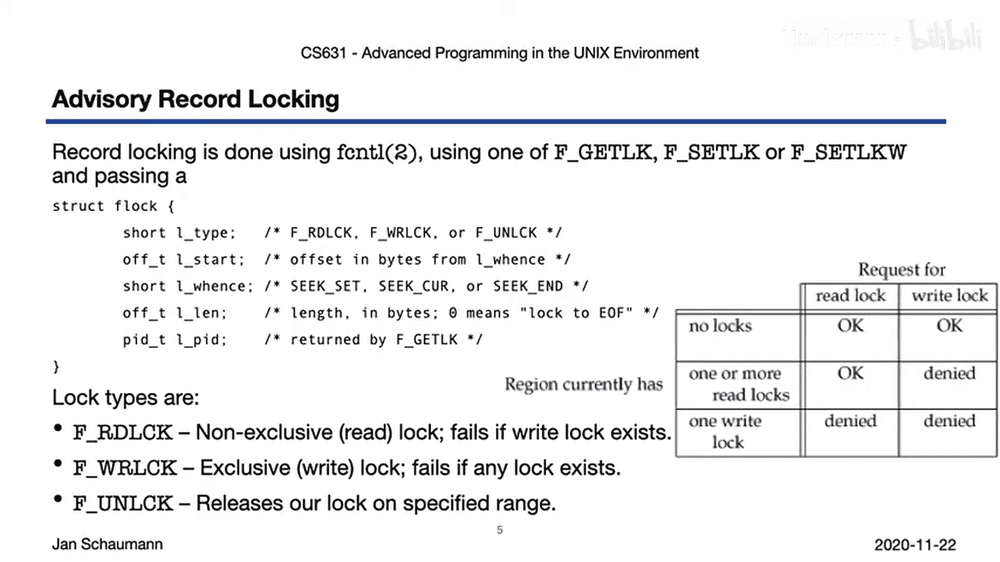
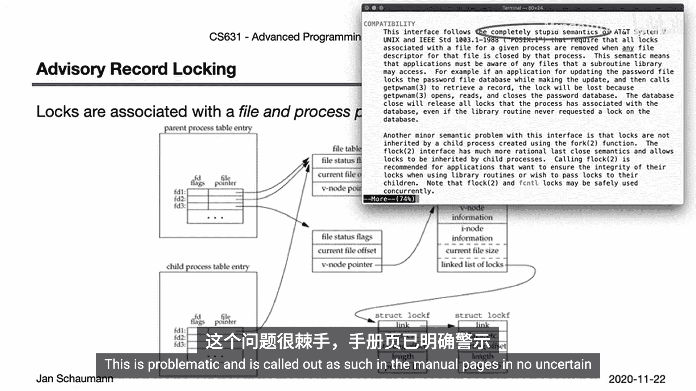
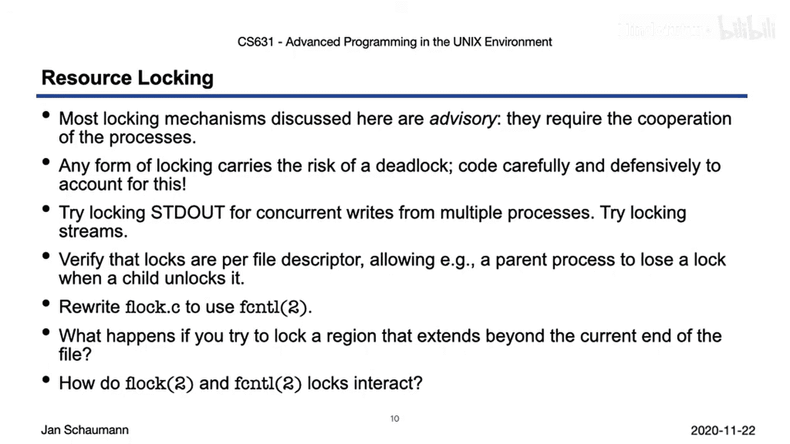

# UNIX高级编程-p64-P64-Week-12,-Segment-3---Resource-Locking--BV1hPuVz8EWS_p64-

Hello and welcome back to CS631 Advanced programminging in the UniX Environment。In this video。

 we continue our discussion of advanced IO after we covered non blocking IO in our last video。

 we'll now talk about resource and record locking。To this。

 we are looking for ways to ensure that multiple processes can safely access a shared resource without running into a race condition。

For all purposes here， we will focus once more on file specific semantics。

 and even more specifically on managing filescriptors。

Let's start by identifying some of the ways in which we can guarantee exclusive access to a resource。

 In so doing， let's clarify and keep in mind that we are talking about protection from simultaneous access by processes with the same effect U I D。

 that by are making access controls and permissions， not an option。

 Although we will look at some related functionality in next week's materials。But anyway。

 suppose you have a fire and you want to ensure that your current process has exclusive access。

 What can you do。One thing we can do is create a new file exclusively and then immediately unlink it。

As we know， as long as we have an open file handler， the file blocks are not released。

And then we can continue to operate on the file handle like any other file descriptor。

Since we ending it right away， no other process can open it。So we know we have exclusive access。

Another way of ensuring exclusive access might be to use a log file。

We test for the existence of a file and if we find it to be present。

 we know some other processes accessing the resource we're interested in， so we bail。And of course。

 instead of using a log file， we can use a se form。

 as we've shown in week 8 to protect the critical region and your code。

But each of these approaches has some drawbacks。 an unlinked file does not exist in the file system。

 for example， while in some unit systems， you can find ways to link the file descriptor into the file system。

 There is no good standardized way of doing that。Using a Se4 or a log file involves managing an additional resource beyond the file we're trying to access and thus adds complexity。

So instead of these， we can use a system call specifically designed to handle locks on file descriptors。

The flock system call。Flock applies or removes an advisory lock on the file associated with a file descriptor F D。

These advisory locks allow cooperating processes to perform consistent operations on files。

 but it's worth noting that they do not prevent the process from accessing the file without using these locks。

That is the locking guarantees similar to semaphoes rely on the processes in question to cooperate。

 to agree to perform these checks。You can apply a lock in a blocking or non blocking manner。

 applying the same semantics as we discussed in a previous video。

 and we differentiate two types of locks。Shared Mars。Or exclusive locks。

Multiple processes may hold a shared lock， but in order to hold an exclusive lock。

 no other lock may exist， not even a shared lock。Think of a shared log as a read log。

 multipleple processes can simultaneously read from a given file without any problems and an exclusive log as a write log where even a read operation might be corrupted by another process writing data at the same time。

If you have a shared lock and you are trying to upgrade to an exclusive log。

 your shared log is momentarily released， and then another process might gain a hold of the lock before you though。

Well see an example of this， in a minute。To unlock the file， you specify Lo an。

The locks controlled by F F lock applied to the entire file。

We'll see in a few minutes another method of applying a lock only to a specific region of a file。

And specifically， since these locks are applied to a file descriptor。

 we also have a way to lock a file stream via the flock file function。But enough talk。

 let's show this mechanism in practice。

Here's our coat， flocked at sea。We have a progress function that just prints a few dots while waiting。

In mainine， we open a file and then request a shared lock on the resulting file descriptor。

After we have established our shared lock， we wait for 10 seconds to let another process try the same。

 then try to upgrade our shared lock to an exclusive lock。When using non blocking mode。

 we print a message on failure。 then try again， but eventually give up to avoid the deadlock scenario。

O。Let's run this program。

We start out in non blocking mode， and our program immediately gains a shared lock on the file descriptor。

We run a second shell and run the same program again， this time in blocking mode。Here too。

 our process can gain the shared lock， showing that two processor can hold a shared lock simultaneously。

Now， up here， our first process is now trying to upgrade to an exclusive lock。

 but will fail since our second process still has a shared lock。

We see the process trying and failing repeatedly， in non blocking mode。Now。

 the second process tries to upgrade its shared lock to an exclusive lock。

 but then the process has to give up its shared lock。

 so our first process can then immediately grab the exclusive lock。As a result。

 the process in the bottom half is now blocking on upgrading its lock。

As soon as the process on the top finishes， the exclusive lock and held is released。

 and the bottom process gains its exclusive lock。Now， starting the same program again。

 we notice that it will block on gaining even the shared lock since the bottom process still has an exclusive lock。

 But as soon as the bottom process terminates， the top process gains the shared lock。

In the bottom half， running the program again gains the shared log as before。

 thus blocking the top process from gaining an exclusive lock。If we control C the program。

 all locks are released upon termination and the top program can immediately gain the exclusive lock。

Likewise， the other way around。Okay， so this showed how we gained a lock on the entire file identified by the file descriptor。

But that can be somewhat of optimal。Consider a large file where one process wants to write to one section but doesn't care if another process writes to a different region。

So for that， we introduce the so called record locking。

 which is done using F control to apply or remove a similar advisory lock。

These record locks can be applied to a region of a file。By specifying astruct flock。

 which uses the offset and when semantics were familiar with from a discussion of the L C call。

Like before。The log type is either a read lock， a right lock， or we can unlock， of course。

Like before， how shared exclusive locks are combined are shown here。

And because you can't have too much of a good thing， we also get the lock F library function。

 not to be confused with the F lock system called we discussed a minute ago。

Lock F locks the region of the file referenced by the file descriptor starting at the current offset and of the specified size。

The options are unsurprising and self explanatory， and we have explicit options for non blocking tests。

Now， with a notion of locks and file descriptors， it's worth thinking about how these behave when we fork another process。

For starters， it seemed reasonable and intuitive that if we call fork。

 the lock is not inherited by the child process。If we did inherit the lock。

 then we'd have two processes， both possibly with an exclusive lock。

 a contradiction of the very notion of an exclusive lock。When we call Zec， however。

 the lock remains in place。 that， too seems logical， but we do have an option to prevent this。

 If a file descriptor had the close on Zac Fl set， then it is， of course。

 closed and there no lock is retained what we call Zec。Likewise。

 all locks on the file descriptor are released when the process termmininates。 That again。

 makes sense and is desirable。We don't want a fire to keep a lock in if the process that applied it has terminated。

But now there's one thing where we run into a situation that's neither obvious nor actually desirable。

A lock is associated with a file for a given process。

 not with a file isscriptor for the specific file， and it is released if any file isscriptor for the file is closed。

Remember this illustration， It reminds us that one in the same file can be opened by multiple processes or within the same process at the same time。

We've previously seen examples of multiple access of the same file leading to problems when we talked about asInc signal save functions and illustrated the problem with a call to the password file functions。

 which when called， open the password database， perform the lookup， then close the password database。

If you gain a lock on the password database and then make a call to say get Pw in them。

 then upon return from that call， your lock is gone。In other words。

 your process needs to know whether any of the library functions you call might manipulate any of the files referenced by the file descriptor on which you have a lock。

This is problematic， and it called out as such in the menu of pages in no uncertain terms。

Now， remember that we mentioned that all of the locking mechanisms we discussed here are advisory。

 That is they require the processes to cooperate。 They do not prevent access to a lockedgged resource by another process that doesn't bother to check for any existing locks。

So why don't we implement mandatory record locking？Well， to some degree。

 some Unix versions implement mandatory locking by overloading group permissions。

If you change a file to be set git， but without group execute permissions。

 and if your O S and file system supports mandatory file locking。

 then this signals to the kernel to deny Res or rights by any process on a file that another process has a lock on。

However， the implementation is subject to a few subtle race conditions。

 which is why even though this feature may be available and is generally advised against relying on。

What's more， it's often possible to circumvent mandatory locking。

 not by manipulating the file itself， but rather the directory entries relating to the file。

If you have a lock on T file， you could still create a brand new file。

 make whatever changes you want， then unlink file and move the new file into place。As you recall。

 removing a file is an operation of the directory， not the file itself。

 So a lock on the file cannot prevent it from being removed from the directory or be renamed。

In this way， you have strictly speaking， violated the phlock。

 the file of scripture you got the lock on was never manipulated， though。

 but the end result is the same。In other words， mandatory locks basically don't work or would be extraordinarily difficult to implement。

This link has some details， but in short， don't rely on mandatory locks。

We'll take a closer look at how we can restrict processes from interfering with one another in the next week。

 though。So， to summarize。Most locking mechanisms discussed here are advisory。

 they require the cooperation of the processes。Since we're talking about coordinating cooperating processes。

 it shouldn't come as a surprise that it's easy to make mistakes here。

 mistakes that can lead to a deadlock。 Make sure to account for this possibility when yourre writing code that handles locks。

To better understand file and record logs， try these exercises。

We saw examples of locking file descriptors referencing files。

 What happens if you try the locks standard out。 What about file streams。

Write some code to illustrate the problem we just discussed about locks being released by a file being closed。

Try to rewrite code from Flock。t C using F control rather than flock。

Thinking about seeking within a fire， we discussed the concept of a sparse file。

 You are able to seek past the end of a file。 Can we lock beyond the current end of the file。😊。

Write some code to give it a try。What happens when you try to apply a record lock on a section of a file that you already have a full file lock on？

How about attempts to lock overlapping regions。As you can tell。

 there's a lot of possibly confusing situations arising and verifying your understanding by writing some code is always the best approach。

In our next video， we'll wrap up our discussion of advanced Io topics with a look at asynchronous and then memory mapped Iio。

 Until then， Thanks for watching， cheers。😊。

