# UNIX高级编程-p66-P66-Week-13,-Segment-1---POSIX-ACLs--BV1hPuVz8EWS_p66-

Hello and welcome back to CS631 Adv programminging in the UniX environment。This is week 13。

 where we will take a look at the various ways in which a process can be restricted from negatively impacting one another。

This allows us to simultaneously take a look back at what we've covered throughout the semester。

 as well as dive deeper into some topics and hint at additional related topics that we do not have the time to cover and full in this class。

The materials of this week will be divided into the following topics。

Permissions and Po access control lists covered in this video。

Changing EUuIs and restricting even roots capabilities。Restricted shelvess。Truths and jails。

Process limits once more。CPU affinity and CPU sets， and finally， control groups， namespaces。

 capabilities， and how all those ultimately lead to containers。

 which have seen a dramatic increase in popularity in recent years。

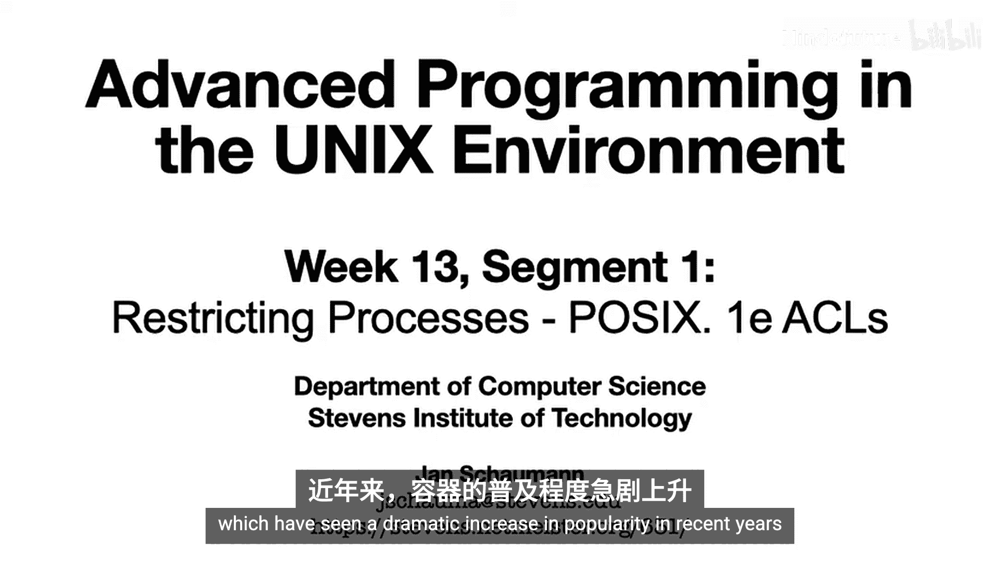

But let us go back all the way to week one。The Uniix family of operating systems has been by nature and from its first conception。

 the multitasking multi user system。This implies the need for a number of concepts such as separate accounts。

 user privileges， file permissions， process ownership， etc。In addition as we've discussed repeatedly。

 all resources available on the system are finiter in nature。

 so there is an inherent competition over these resources CPU time and memory are limited。

 discs fill up， open file Descriptors run out of， etc， etc。

Some of these resources are managed by the system， for example。

 the scheduler places different processes on the available CPUs using an algorithm that ensures that no processes is starved through overus of the resources。

Disk space is finite， but the system may enforce， for example。

 user quotas to ensure that no one user can fill up all available disk space while use more than their share。

The file system itself reserves a certain number of i notess for the super user or system usage so that even a completely filled up system can still run until the administrator can at least clean up things。

Some of these approaches are operating systems specific。

 while others utilize common system calls to reach their goal。In addition。

 standardized approaches and defecto standards also come into play。By the way。

 this lecture has an accompanying long form blog posts， which I recommend you go through as well。

Obviously there will be some repetition， but in these videos。

 I'll try to illustrate a few of the capabilities and practical examples。

As so often it's useful to start by reviewing what we already know。

 you should find that many of the things we've discussed throughout the semester are directly relevant to this topic。

For example， in our video for week2 segment1， we looked at how the system may limit the number of file descriptors and process may have opened。

The Open max do C program illustrated that there may be。

Per process resource limitations retrieved using Getar limit。

A system wide defined value hard coatd into the kernel was derived from a fixed header such as OpenMax from Sslim do H。

As well as system tunable configuration options， possibly changing at runtime from invocation to invocation。

Then。As we discussed the UniX file system， we identified the basic UniX access semantics for file access。

 user， group and other。

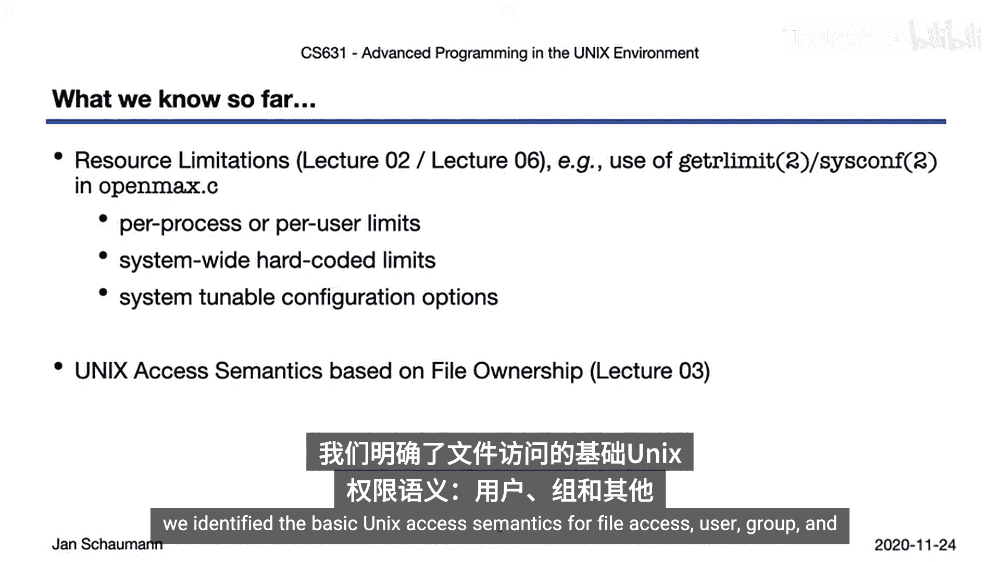

Together with the access logic for directory access outlined in week three segment3。

 the simple model allows us to restrict what resources in the file system a process may access。

We saw that access is determined in a specific order for most specific access to least specific access。

 and by combining group membership and carefully selecting the right permissions。

 we can provide access broadly as needed。However， the granularity of the smartm is somewhat limited。

 as it only allows distinguishing amongst these three sets of users， owner， group。

 and everybody else。Even though a user may be a member of multiple groups。

 there are different limits on the number of groups you may be a member of on a system that uses NF。

 for example， you may be restricted to only 16 groups。

What's more access controlled by a group membership is particularly cumbersome。For starters。

 unlike users， a file can belong to a single group。

So if you want to share your file with members of group A and B， but not with everybody else。

 you are out of luck。In addition， any changes to group membership require action by the system administrator of the system。

Users can self control their group memberships or create new groups at Hc。

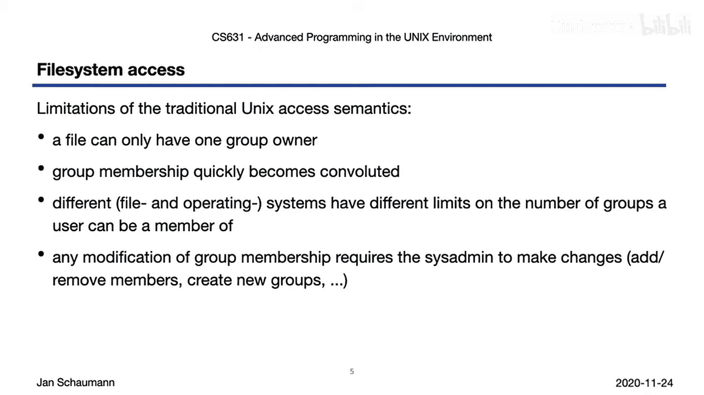

Several UniX file systems overcome this restrictions for the use of so called access control list or ACs。

 most notably by a Po extension， PosX 1E。These echo allow the user to specify more granularity access they wish to grant。

These access control lists are implemented as so called extended attributes。In the file system。

 meaning they require support of the file system in addition to the kernel。In the default LS output。

 the presence of extended file attributebuttees are usually indicated by the plus sign after the usual permission strengths。

And interactions from a user perspective， it' one of the set Faccal and getFaccal tools。

Let's look at a few practical examples on different Unix versions since the implementation of products echos is not quite as uniform as one might like。

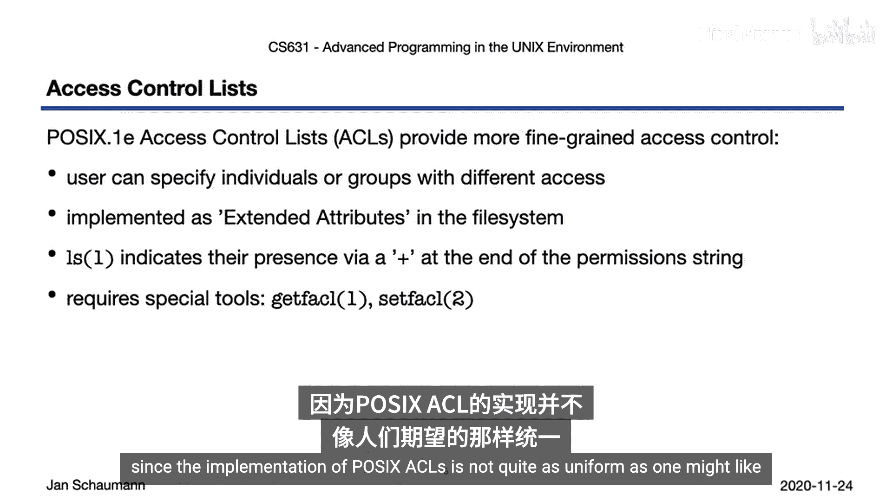

Okay， in this terminal， we'll demonstrate the use of echos on the Linux system。

And a 12 1604 system in particular。My user is a member of a few groups。

 meaning that I can easily share files and grant access to all users who are members of one of these groups at a time。

Let's consider this file simple cat dot C。Right now it has read right permissions only for the owner。

 that is myself。If I want to allow other members of the group， professor access。

I can change the group permissions。And if I want to allow members of the group6XV access。

I can show it to that group。But this means that now members of the group professor no longer have real access。

So how do I get both groups access？

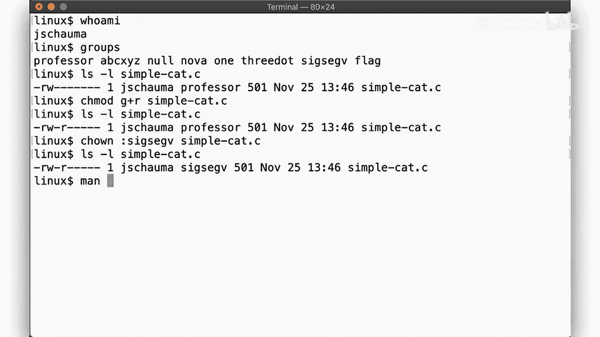

Looking at the manual page for set Fcal， I can find the syntax to grant group access。

Let's give that a try。

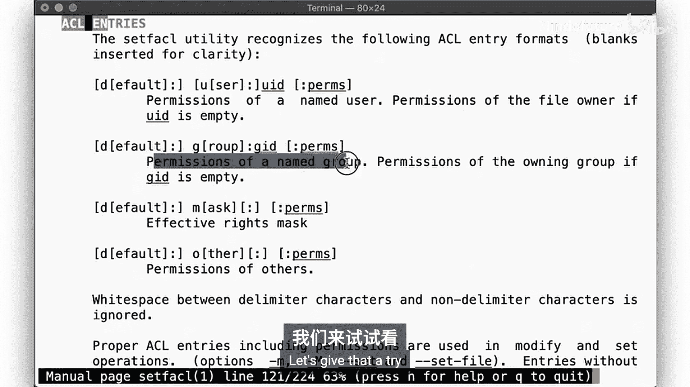

Hm， no luck。Let's see what type of fire system we're on。Oh， and their。NFS， it turns out。

 doesn't support P examples， or rather NFS has its own implementation of Excels。

 which are only supported in the NFSV4 and uses different tools。

 which we do not available on the system。So let's move the file to a local file system。Okay。

 so this is an EXT3 file system that should support products echos， let's try again。Good， no error。

 Let's look at the file again。

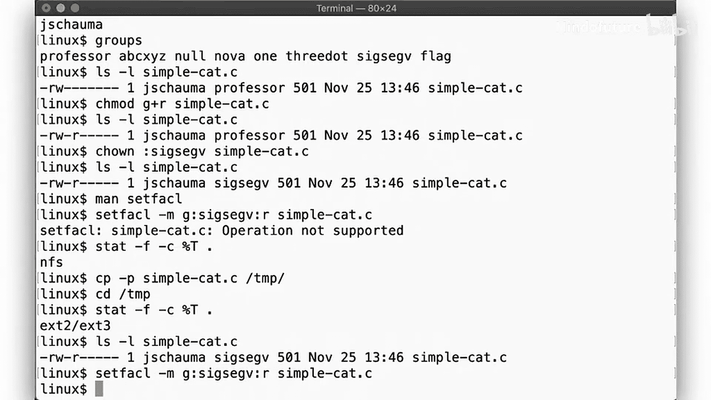

Note that now the LS output shows the plus sign after the permission string。

 indicating extended attributes on the file。

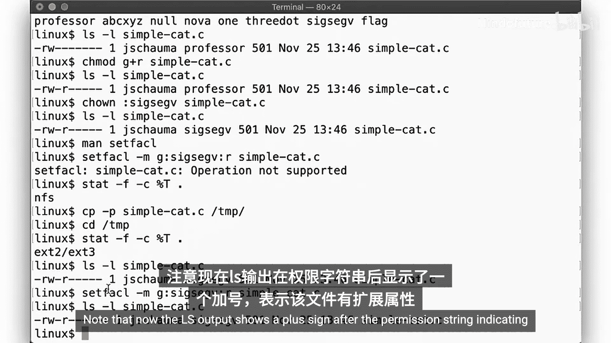

Let's inspect the a to get facultyacult。Here we see that we have group permissionmission for6 Zv。

By wait， we already had group permissions for 6XV， but we wanted to allow the group professor to retain read access。

And let's give that group read access。And now let's look at what get Facle and Ls tell us。

The group ownership of the Fless Pro and the Uni group permissions allow read access。

But the extended attributes also show that now the group 6AC has retained the RE permissions we granted earlier。

Okay， now let's suppose we want to give access to this file to some students in this class。

 let's say Edward and Mingo。Both are only members of the student group and I don't want to give all students access to my file。

 so I don't want to use this group。But with Po exampless， I can also specify individual users。

 so let's give that a try。Okay， that seems to have worked， let's check。Here in Table format。

 it's perhaps a bit easier to read the permissions。

 and it clearly shows that we were now able to provide fine grain access。

What happens if we copy this file？嗯。Looks like we have to do all the work of applying our es again。

 that's lane。Maybe there's a way to copy the echos from one file to the other。Here we go。

 Se Fle can read the echo description from Standardin and apply it。Nice。But even better。

 tools like MV or C are able to copy the echos right away。There。

 all three have extended attributes and get FL shows the correct permissions。

If I want to clear all of the echos， I can do that using set Faccal B。

 and the file will no longer have any extended attributes。Okay。

 we've seen that we can grant granular access using access control list on Linux Now let's compare this to Me OS。

Here we have our simple CA file once more。But now we want to grant access to the W group without changing group ownership。

To do that。😮，We use Smart with a plus a flag。As before， if we run LSL。

 we get a plus symbol indicating that there are extended attributes associated with the file。

But on this system， we don't just get faccal。Instead， we use LS with the E flag。

I know you didn't think it was still possible to find the letter in the alphabet available to use for a flag for a less。

 but look at that we found one。Here， a lesson node tells us that the extended echo rule number0 is to grant read access to the group wheel。

If we then want to make sure that the user demon will not have access regardless of their group membership。

Then I can use this command here。Now， our rule set looks like so。

Themo Manual page includes a lot of information about how echoles can be manipulated。

 as well as which grants are possible。Your node。That we distinguish between the lead operations。

Operations on the filed metadata。Operations on the directory。Operations on regular file。

And so on and so on。It also includes a number of examples which you can play around with on your own。

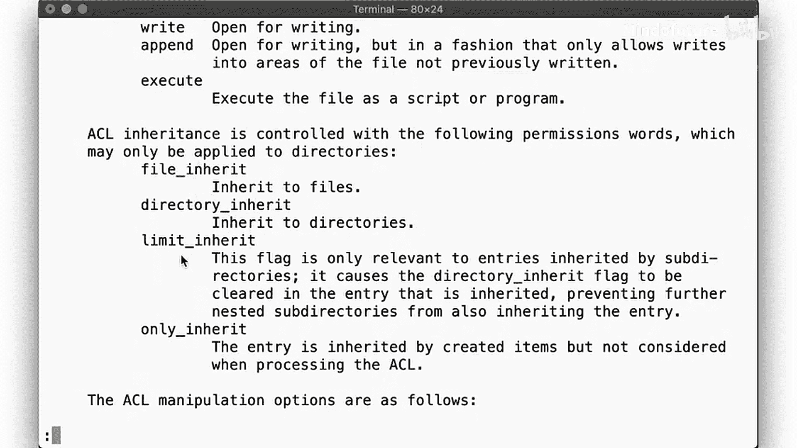

Now， if you want to delete a specific echo。You specify its number using the number sign。

So here we delete the first rule， for example， and so the next rule logically now becomes the first rule rule number zero。

Note by the way， that you must not have a space between the dash A and the number sign。

 remember in Shell， the hash marks the beginning of a comment and you can use comment on the command line as well。

That is， there's a difference。Between this。

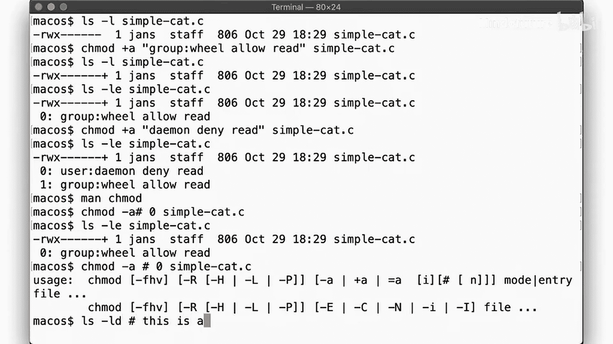

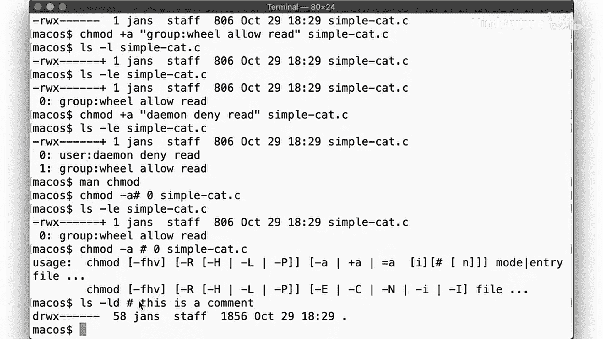

And this。Anyway， to remove all echos on MacOS， you use Smart N and as before。

 the file no longer shows any extended attributes。

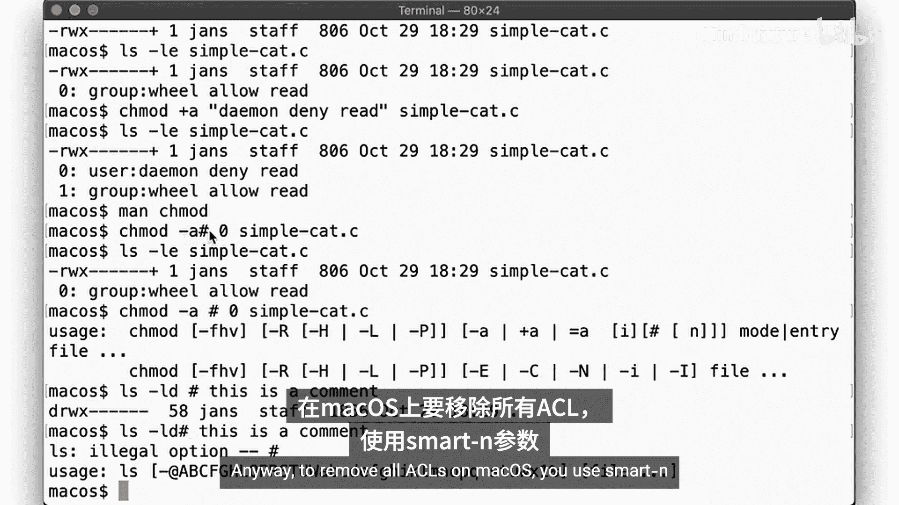

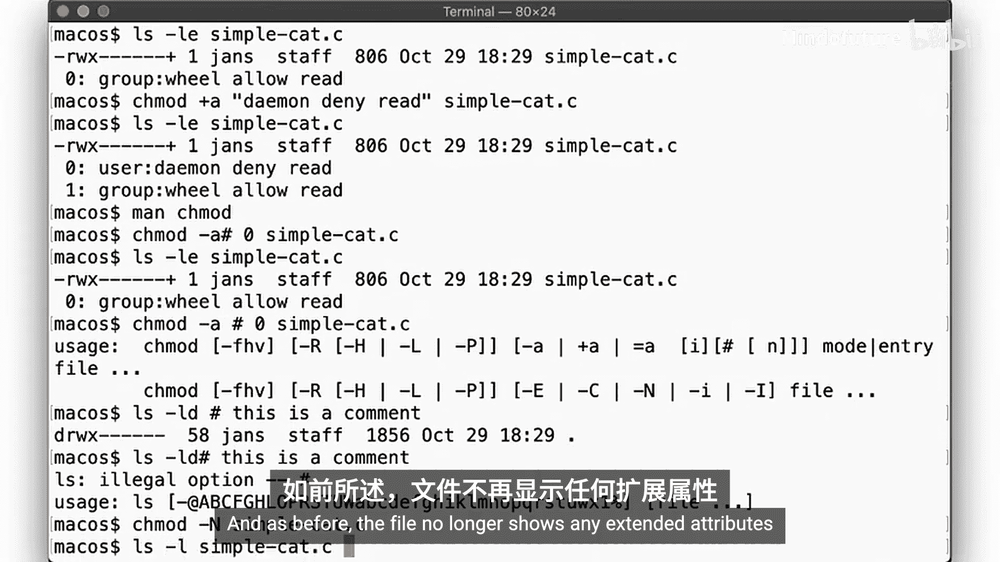

Finally， let's take a look at NetPSD。Even though this is our reference platform we're looking at at last。

 this is because support for PolX Es is not yet in the latest stable version of NeBSD。

 but it will be part of NeBSD 10。0。Here we created a separate VM running NeBSD current。Let's see。

Okay， so here's our file。I want by myself and with group permissions for the group we。

The group staff comprises a few users who I'd like to share access with。

 but since I'm not a member of this group， I can show the file to this group。So let's try set Fcal。H。

 no luck。The root file system here doesn't support echos， as explained earlier。

 the file system needs to support Po echos。Let us use a separate file system on a second disc like we've done before in the past。

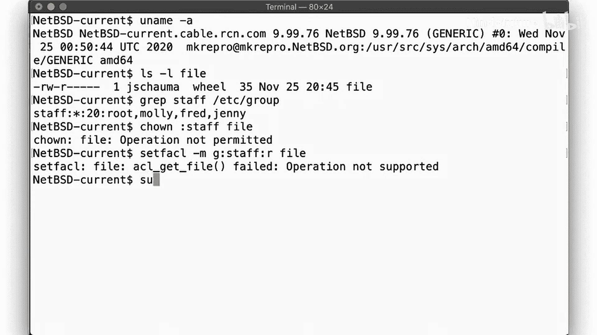

Here we create a new file system on the second disk， WD1。And then。

Call tune to enable plastic cycles in the file system super block。We mount the file system。

And shown it to a regular user。Now we can copy our file to slashMo。And then。

Call set Fcal to share access with the staff group using the same syntch as we did on Linux。

As before， L shows the presence of extended attributes via the plus symbol and get faccal shows the results。

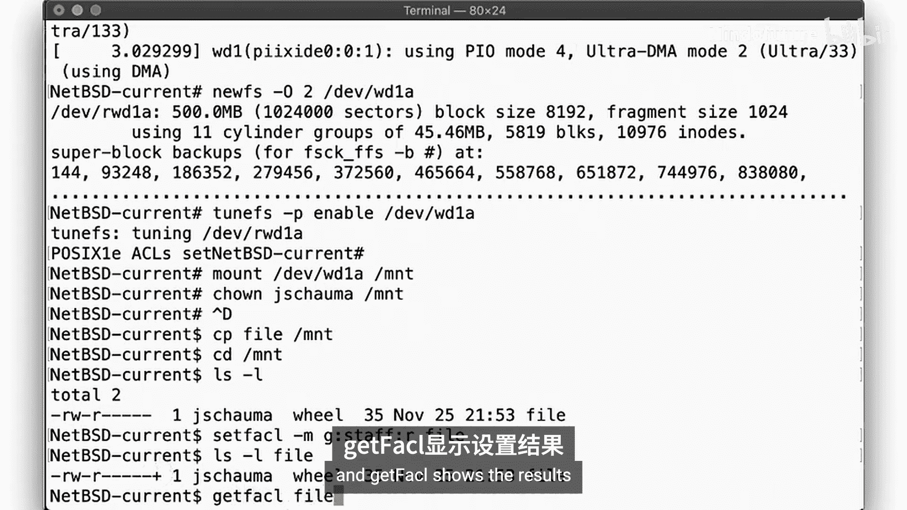

So now Fred being a member of the staff group。Can display the file。But of course。

 Fred still can't write to it。Okay， now let's try to give Molly right access。Oh look at that， Molly。

 who is in the group's staff cannot read the file， this is because her per user echo denies read access。

 even though her group membership would allow it。This reflects how our irregular Uni permissions are applied in order as well。

But her right access works as expected。Now， suppose you want to give everybody in the staff group access。

 but not Jenny。To do that， we use set facle like so。As expected。

 Jenny can read the file despite being in the staff group again because per user permissions take precedence or per group permissions。

So we see that while eccs follow for fine grain excess control。

 they still follow some of the same semantics as we had previously learned。

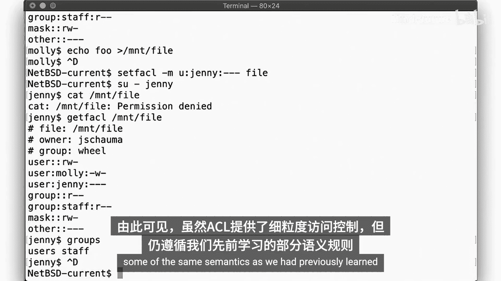

O。Time for a break， let's quickly recap what we learned about Pol echos。

Access control lists are stored as extended attributes in the file system and thus require the support for this in the file system。

Not all fire systems necessarily support them， or they may be disabled as a mount option。

 for example。If you begin to play around with Es， you'll quickly know that you may run into conflicting descriptions。

 what if you want to grant access to all members of a group but one。

To user a take precedence over a group as， the order in which they are applied may play a role here too。

 give it a try and verify what the different outcomes are。

The implementation of products echo may differ from operating system to operating system。

We saw examples from Linux where we use the set Fel and get Faccal utilities。

 and you can see the echomanual page for more details on that platform。And from Mac OS。

 where the echos are applied manipulated using the smart utility and inspected via LS。

Different BSD systems implement E as well， although our reference platform netBSD does only have projects echo in the next upcoming release。

 netBSD 10。0。And we'll use the ga fckle set fckle semantics it imported from freeBSD。

In our next video， we'll revisit effective and real user IDs and how you can elevate privilege using the pseudo and SU commands。

 but we'll also look at how we can restrict your privileges in the same manner。Until then。

 thanks for watching， cheerers。

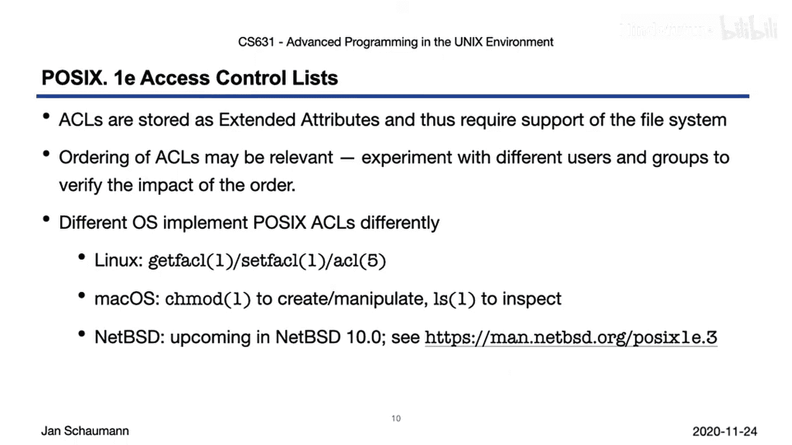