# UNIX高级编程-p68-P68-Week-13,-Segment-3---Restricted-Shells,-Chroots,-Jails--BV1hPuVz8EWS_p68-

Hello and welcome back to CS631 advancedance programming in the UniX Envi。In this video。

 we'll continue where we left off the last time in our efforts to consider the various ways in which we can restrict the process。

In the last video， we saw ways to lock down files using file flags， file systems。

 using mount options and preventing even root from undoing such changes by raising the secure level。

Today we return to a more process focused view， although you will find that we can make use of what we've learned so far and combine many of the methods for increased benefits and security。

Anyway。So previously， we saw how we can restrict what commands a user can execute via file permissions。

 for example。But it gets quite difficult to really restrict regular interactive Unix account with full access to the normal commands。

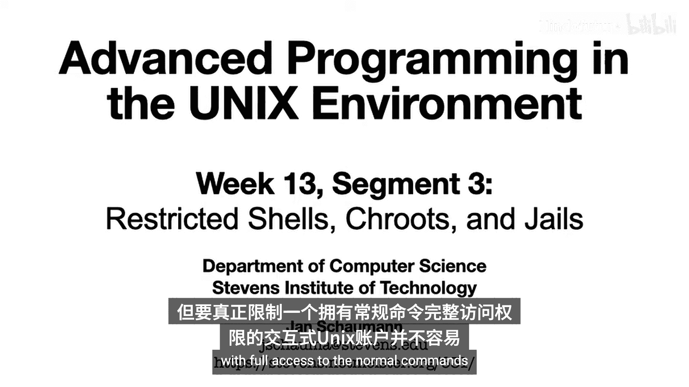

So in addition to tightening the user or group permissions or granting echo。

 we can further lock down just what commands are available to a user through the use of a restricted shell。

A restricted shell is， generally speaking， any shell that limits the user's ability to execute commands。

Having taken a look at how a shell is implemented， we should already have an idea how this might be accomplished。

Just as with a regular shell， there are different variations of the concept of a restricted shell。

 and many of the popular shells， such as bash or the corn shell support this mode。

When running in restricted mode， these shells prohibit amongst other things。

Changing the current working directory that is you can run CD。Changing the end。

 path and shell environment variables。Specifying commands containing a slash。

This is the intended effect of only allowing commands that are found in the default directories in the path。

And prohibit redirecting output into files。With these restrictions。

 you can reasonably control any of the commands the user could invoke by only providing the executables you want them to run into a specific location and setting the path prior to invoking the restricted shell accordingly。

However， as before when we looked at the configuration of Sudo。

 it is up to the administrator to know and understand the command to let the user execute in a restricted environment。

Many commands can be used to shell out， to run other programs or to be used to overcome some or all of the restrictions of the restricted shell。

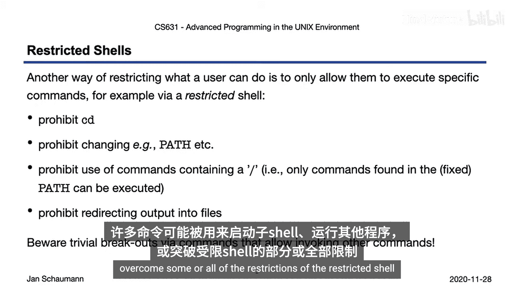

Here， let's take a look at an example。The cornhell offers a restricted mode that is enabled If the shell is invoked as。

 for example， R， K S H。And the protections we just mentioned， are then enforced。

Let's create such a restricted corn shellll。And then change the login shell of user Fred to use this shell。

If we now log in as thread， we can run the usual commands。

Let's look for the said youdi shall We left you from the last video。There it is。But no。

 we can't run it because it's not located in our path。

We can try to be clever and use a relative path， but that doesn't work either。

We can't even change our directory。Let's try to center our path to include slash temp， then。Last。

 fo it again。Let's try to invoke an unrestricted shell instead。 All right， that doesn't work either。

But， wait。S age is in our path。 Can we just run it like that。Oh， look at that。 That works。And， yes。

 now we are in an entirely unrestricted shell again。

 so we can change directories and invoke any command we like。

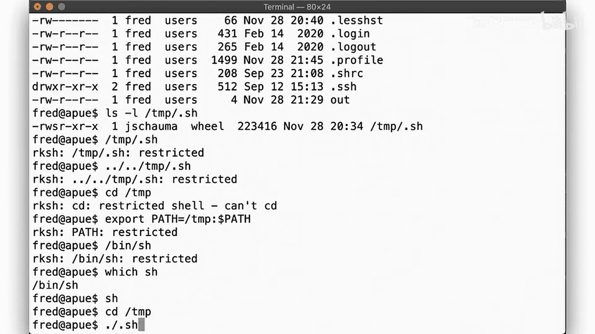

Okay， so we've seen that a restricted shell seems useful initially。

But if we can so trivialally break out of it， well， that's not quite so useful。

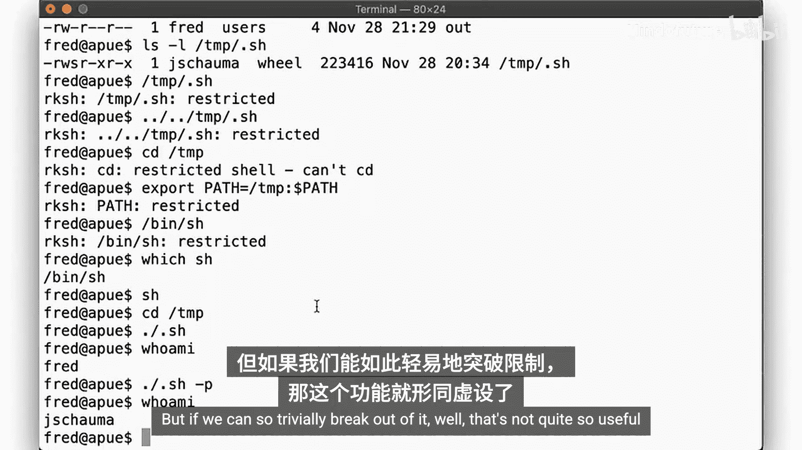

So let's see if we can restrict the restricted shell a bit more。

Let's be more careful about which commands we allow in the restricted shell。

Let's create a new directory。And then place in it all the usual binaries from bin。

But without any shelf。There。Now， let's force Fred's path to point to only this directory。

 Mean with a restricted shell， Fred will only be able to invoke these commands。

As we saw in the menu page， we restricted She reads other commands from the usual profile。So now。

 if we become Fred again。We immediately notice that even at shelf start up。

 certain commands are not found as are not in the directory prepared。

Our path is now user a local urban， and of course， we cant C D。

And we can redirect outputs into any files。But let's see what commands we do have access to。Oh， look。

 there's D D。But with D D， we can effectively redirect the output。

this is an example of accidentally allowing the user to circumvent some of the restrictions of the restricted shell。

But we also still have right access to other profile。And while theres no VI。

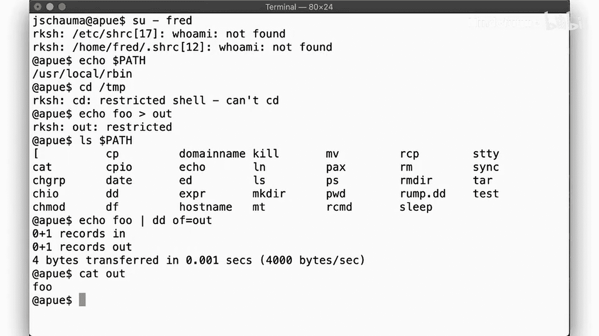

We do have the standard Unix editor。Ed。So we can simply edit this file and remove the last line。

So that now。If we look our。And log back in。We are still in a restricted shell。

 but now our path is no longer pointing to use a local orbit， which of course。

 means we can invoke an unrestricted shell again and gain access to our executable。

So this then illustrates that we have to be very careful about what we make available in the path of the restricted shell。

 as well as that it can be a bit tricky to get this just right。

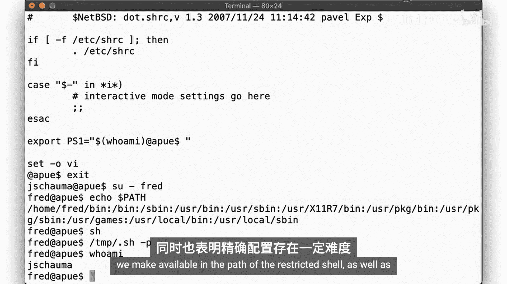

In general， the approach for using a restricted shell is similar to what we started out with。

We create a new directory that will be the new path。

We then have to be very careful about what commands we want to allow， and we link them into place。

We need to make sure that none of these commands can be used to break out of the shell。

 to circumvent restrictions or to even allow execution of another shell。We then set the path。

And prevent the user from making changes to their start files。 for example。

 using the file flags we discussed in a previous video。And then。We hope he didn't miss anything。

As we cover the topics of restricting processes， you'll notice that this is a pattern。

 Getting it right is really quite difficult and requires a lot of attention to detail and a deep understanding of how the system works。

But okay， so with a restricted shell， we can restrict the user's ability to execute commands or even maneuver around the file system。

But at the same time， you may even need to allow the user to change directories to perform my own and local files or to more generally interact with parts of the file system without making available the entire file system。

To overcome this problem， it will be useful to expose a restricted copy or view of the entire file system to the process。

 similar to how you might populate a custom path for a restricted shell。

 You could construct a file system containing the necessary files and restrict the user to only operate within the confines of this changed route。

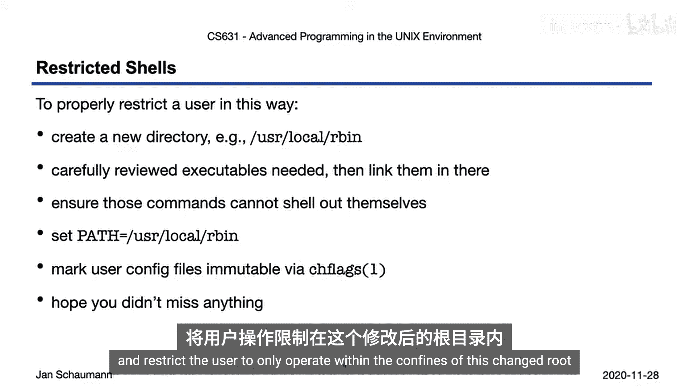

Enter the Tru system call， added to Ex in 1979。The directory name you pass through the Cis call becomes the root directory of the process。

 meaning that all path names will be resolved in this new directory。Now。

 if we resolve all path names under this directory。

 then you need to make sure that all libraries and executables are present in this directory。

 but once you have that set up， you can restrict a process that needs to run with super user privileges。

That is， even if your service requires rude privileges and is compromised。

 the attacker finds themselves in this truth， unable to access any resources outside of the tro。

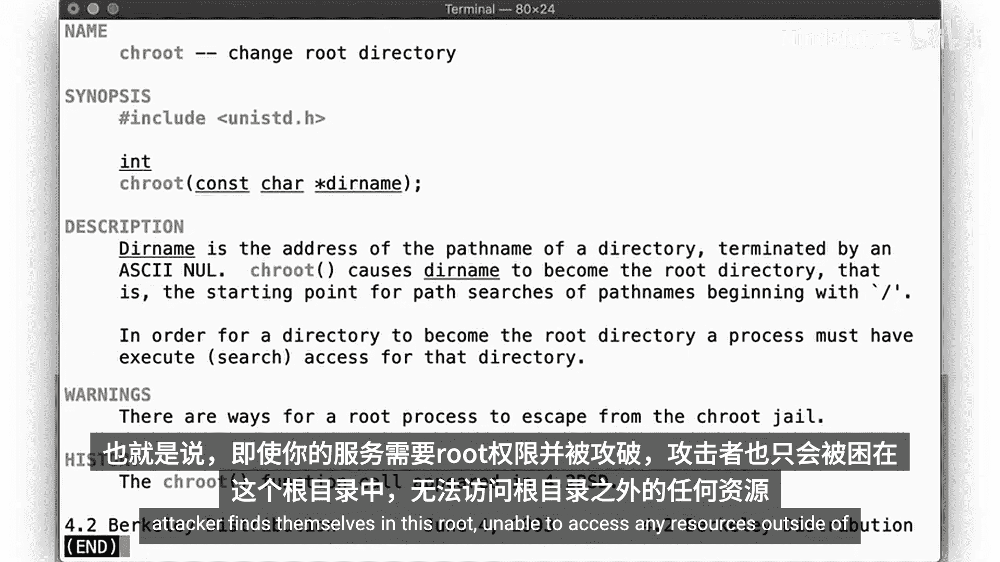

Let's see what that shred looks like in practice。Here we have a script that creates a minimal truth。

As mentioned a second ago， you need to have everything in the truth that you need to run whatever commands you want to allow。

 So for dynamically linked executables， that includes the runtime link editor and all shared libraries executables might need。

Which should look familiar to you from our week 11 videos。The script does just that。

 It determines which libraries are needed and copies them into the truth。When it's done。

 we have a truth in which you can run exactly and only the commands， S， H， P S and I D。Okay。

 so we create a new route。 and now let's look at the files we find in there。We see the link loader。

 the libraries， and the executables。So now we can enter the truth using this command。

We specify an interactive shell as the commander run。And there we are， inside the truth。Where are we。

Slash， no surprise。Who am I。H， right， we didn't copy the who am I programme to the truth。

 so we can't run that command。And we also missing a less。But， here's a little trick。

In case you ever break a as， the shelvess built an echo command can be used in the pinch stick。

We let the shell gl up the wild card and thus get a less functionality to some degree。

And we can confirm that we can only run three programs here， I D EPS and S H。O。So who are we。

I D confirms。That we're root。Note that the output of the I D command gives as numeric user ideas only。

The file needed to translate U Is to user names。 ety password does not exist inside the truth。

When our file system is locked to the directory populated for us invoro AUE。

 but we can change out of that directory。So we really are restricted to this changed route。

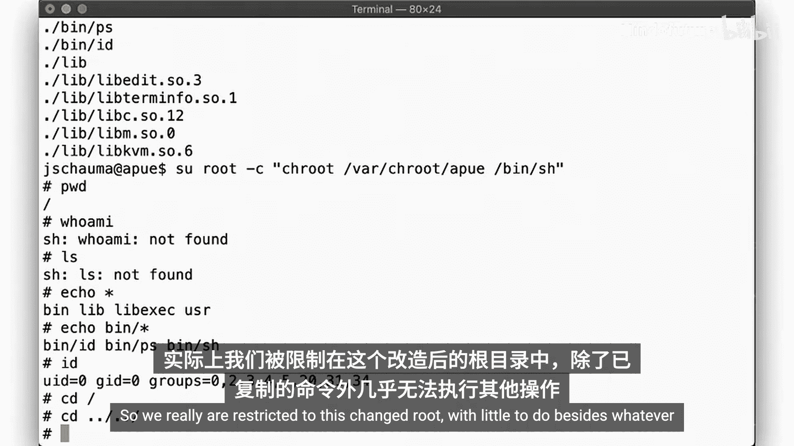

There little to do besides whatever commands we have been copied into the truth from moving around the file system。

 You wouldn't even know that you are inside the sh。

But here's one thing that gives away that you are plugged into the matrix。When you run P S。

 you can observe processes that are running on the system， but that are not within the truth。

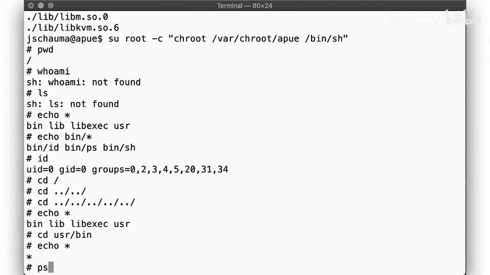

Okay， so its Tru allows us to expose a restricted copy or view of the file system to a process。

This lets you restrict the process's view of the file system hierarchy。

Restrictt which commands can be run by only providing the needed executables。But for this to work。

 you must provide full environment， shared libraries， config files， et cetera。 Then。

 this is a bit of work， and you can easily make mistakes here。

 So be careful to only provide what you really need。

If you wish to make available data from other file systems without having to copy it， and in fact。

 while actually sharing it live， you'd combine your route with null modes and then use certain mound options。

 as we had discussed in our last video to protect that view of the file system。

There are two important aspects， though， that can conceivably lead to an escape from its sh。1。

 a process when entering a sh may still have opened filescriptors that had opened outside of the shute。

 It can be useful， but may also lead to a risk of a shw breakout。

 as it means that now the shrued process can access a resource outside the shute。2。

 as we saw a minute ago， even inside the sh， you may be able to view information about other processes。

 That is your still clearly sharing process based the processes outside your truth。

It be quite useful to be able to restrict the process further。

 to not even let it see that other processes exist on the system。For that。

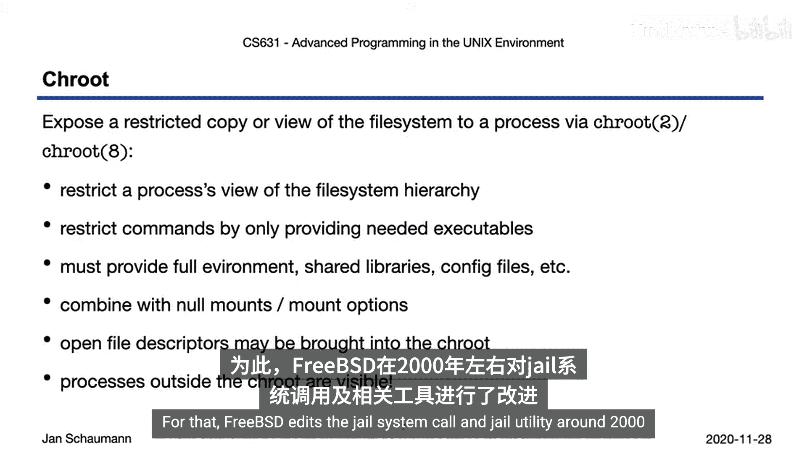

Free BSD entered the jail system call and jail utility around 2000。

And jail restricts the process with respect to the other resources on the system such as that from within a jail。

 it's almost impossible to notice that you are not running on a real system。

You don't get to see other processes， system accounts or Us。 And， of course。

 you get your own sh as well。 In addition， a J may be bound to a particular I P address。

 and network functionality is then also restricted to this address only。

In addition to the true restrictions， we just saw jails and forced a per jail process view。

Prohibit changing cicans or secure levels。Prohibit mounting and unmounting file systems。

Can be bound to a specific network address and prohibit modifying the network configuration。

And disable raw sockets。In this fashion， a jail effectively implements a process sandbox of virtual environment。

 You can even create jails for different O S versions of the parent O S。

 So L as the apparent colonel is capable of running or emulating the environment。

This is particularly useful if you are creating specific built environments for different OS versions。

If you are thinking。Wait， why don't we just use Docker or something like that。

 Then I remind you that this is the year 2000。 Docker didn't exist for another 13 years。

But you on the right track， jails were indeed one of the first approaches of O S level virtualization。

Okay， let's summarize what we've come in today's video。First， we talked about restricted shells。

 which allow you to severely restrict a user， but these restrictions are entirely enforced within the shell。

 not within the O S。Then we look at the should system called a created change route directory。

 a much more powerful way of restricting processes and allowing even processes with E U I D 0 to not look outside of the environment to which we've confined them。

This approach to containing processes has been around since the 80s， but is no longer part of Posss。

 St it is a common way of locking even standard system demons to minimize the attack surface they otherwise expose。

Entering it route requires root privileges。 So it's a mechanism primarily for a root process to lower its own privileges irrevocably。

 a concept you've seen in the past， and well see again in our next video。

But with the ability to carry final scriptureors with the shrod。

 there's the possibility of breaking out of the sh。On the Co website。

 you will find a code example of an old exploit to break out of its sh。

This doesn't work any longer in that B S D， but it's still worth your time to read through it and give it a try。

 perhaps in another platform， to see how it works。We also noted that from within its route。

 we can still see the processes outside。 and so to find a solution to that problem。

 we then mentioned Phbies D jails as one of the first real versions of O S level virtualization。

The solution was followed in 2005 or so by solarlaris containers。

 which built on top of jails and Z F S capabilities and zones。

 and which paved the way for true containers。We look at the additional features and modern Uni systems that allow us to build containers and understand how they are implemented in our next videos。

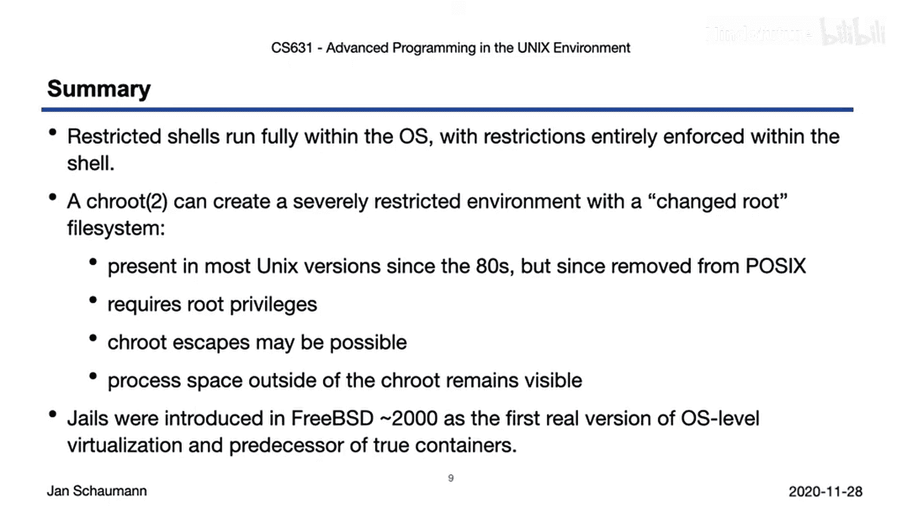

Thanks for watching。Yes。