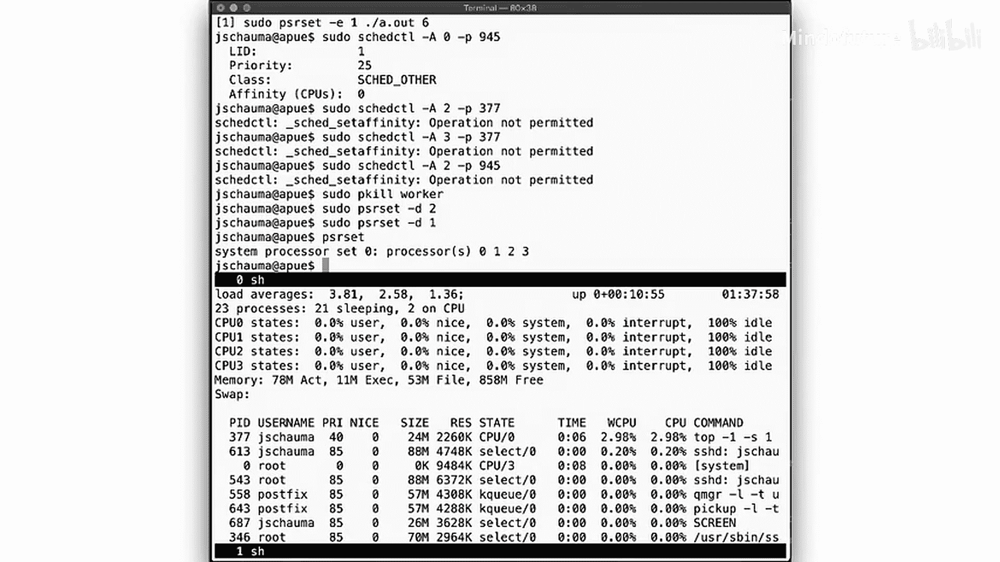
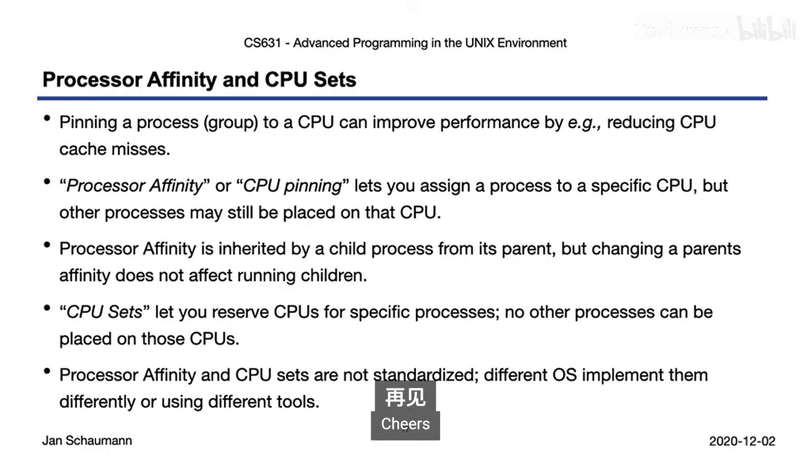

# UNIX高级编程-p70-P70-Week-13,-Segment-5---Processor-Affinity-and-CPU-Sets--BV1hPuVz8EWS_p70-

Hello and welcome back to CS631 advancedance programming in the UniX Environment。With this video。

 we continue our discussion of how to restrict processes picking up where we left off with segment 3 unprocessed limitations。

 in particular with respect to CPU time。In that video。

 we noted that while we can adjust the priority of a process and thereby ensure that the process cannot。

 for example， hog the CPU and starve other processes。

 This priority or niceness does not have any impact on the placement of the process on a given CPU。

In this video today， we'll discuss how we can accomplish that。 But first。

 let's look at a simplified illustration of CPU placement for your common processes。😊。

Let's suppose that we have a system with four CPUs。

And then we have a bunch of processes running on assist。As you can tell。

 this is a fairly typical representation of what you normally find on your netPSD system。

You have a bunch of commands run interactively from a shell。 You have a few system demons。

 and then at the bottom there， we pick a few generic job names that do some CPU intensive work。

Now with your usual time sharing priority based scheduling algorithm。

 any of these processes may be placed on any of the available CPUs。

As work is being completed and as jobs may be preempted and rescheduled， as we saw in our last video。

They may be moved from one CPU to another or new jobs placed on the CPUs as a scheduler sees fit。

But now let's assume that our work at jobs here are all CPU intensive。

By having them get placed on any of the CPUus， you might add up with a fully loaded system。

 And depending on their priority， some of your system drop might not complete as quickly as you'd like。

So let's try to pick these worker jobs and try to ensure that they don't get placed on just any CPU。

But only on CPUs，1 and2。Doing that is called CPU pinning or assigning a processor affinity。

When we do that。The workers are correctly placed onto just these CPUs。

But know that we still have other jobs and CPUs 1 and2。

 The shell and the fine command are not evicted from the CPU。And in fact。

 new processes may be placed on CPUs1 and2 as needed。

 It is only the worker processes that have been bound to the specified CPUus。

 as all other processes can still be placed any way the schedule sees fit。

Let's demonstrate this in practice。Here's a silly little program to pack the CPU and keep it busy。

Before we run it， let's split the screen。And run top in the bottom half。Note that on this system。

 we now have four CPUs available。And we see some of the stinant processes。Now。

 when we start our worker process， we note that after it starts out on CPU 0。

 it is then placed on CPU2， where it continues to run and use up cycles。

Let's place it in the background。We noted it has been moved to CPU3 now。

And then we start a second worker in the background。That one ends up on CPU 2。

And we kick off another one。And another one。Now we have four worker processes。

 and the scheduler distribute them across all four CPUs。If we then run another job。Did he。

 in this case。It has to share the CPU as one of the other processes。And in this case。

 it ends up on CPU2。Our worker jobs all execute entirely in user space。

 but the D D job also executes in kernel space as it performs Io。

 which we see reflected here in the display updated by top。We run yet another job。

 one will itself executes another program over and over。

 and we note that we can observe the placement of the WC program on different CPUus for subsequent invocations。

While our workers are still hogging all four CPUs。Okay， let's kill all these jobs。

And look at ways that we can assign processor affinity。For that， we can use the St control command。

Note that in addition to the affinity， we can also tune the scheduling algorithm。And the priority。

 as well。Let's give it a try。First， let's take a look at the processor affinity of our shell here。

Right now， we have no affinity， meaning the scheduler is free to place this shell on any CPU it'd likes。

Let's run now a worker job。 It ends up on CPU 2。Now， let's try to move it to CPU 3。We can do that。

 Ching CPU ainity requires super user privileges， which makes sense。

 We don't want to allow regular users to move around their jobs and possibly interfere with others。O。

Now we've tried this route。And our worker has an affinity for CPU 3。

And we switched down here that it was moved from CPU 2 to CPU 3。We can now move it back to CBU2。CPU1。

Or CPU 0。 And see it can update below in the top display。

Note that we can choose to allow users to change the CPU affinity。For that。

 we have to change the user set CPU affinity Ciskeal。And now we can move our current shell。

From having no affinity。Over to CPU2。Since CPU U affinity is inherited by a child process from its parent。

 when we kick off a new worker here。It， too， would be running on CPU 2。

So even if we run multiple worker jobs， they will all remain bound to CPU 2。

 with the other CPUs remaining idle。Now， note that while we have bound the worker jobs to CPU， to。

 we can still move other jobs to that CPU as well。Here， removing the top process itself。

Not also that even though a child process inherits its parent processes affinity。

D D here as a child of our shell with an affinity for CPU2， also gets placed on that CPU。

We can still move it off， explicitly。And likewise， can remove the worker jobs to a different CPU。

Okay， so we've seen how to move individual jobs around to certain CPUus by assigning a processor affinity。

But as we've also seen， this allows other processes to still be placed on those CPUus。

 possibly competing with our jobs。Can we reserve one or more CPUus for specific tasks such that no other job can be run on them。

Let's say we want to take our four CPUus and reserve two of them for our broken jobs。

And one of them for our shell。 Then we can do so using CPU sets。When you create CPU sets。

 you will always keep one default set available for any of the leftover processes。

So in our example here， all our system processes。Would end up on CPU0。

We can then explicitly bind our shell to CPU3。Which means that any processes subsequently started by the shell would also be bound to the CPU set。

If we then bind our worker jobs to CPU at1。Then we are looking at a distribution like this。Now。

 note that we can start other drops from our shell。 they will continue to be placed on CPU 3 only。

While any other scheduling that has to occur on the jobs that are not explicitly bound to a CPU set。

Will end up on CPU 0， but no job other than our worker jobs will ever be assigned to CPUs 1 and 2。

Let's run through a practical example to illustrate。

We've extended our little busy programme slightly to make it easier to differentiate the worker jobs。

Now， our program takes an argument of how many jobs to kick off。

Then runs them with an easy to differentiate ArcV0。As before。

 we split our screen to run top completely unironically in the bottom half。I know， I know。Anyway。

Let's start out。With six worker jobs。Which now get distributed across all four CPUus， as expected。

But as we said， we wanted to use CPU sets。So， let's do that。

The PSR set command shows us the current CPU sets， one set， the default set。

 comprising all four CPUus。Now， let's replicate a setup from our illustration。Like before。

 creating CPU sets is not something normal users are allowed to do， so we need pseudo。There。

Now we have three CPU sets， the default CPU set with CPU 0 only CPU set 1。

 comprising CPU 1 and 2 and CPU set 2 with CPU 3。Now， let we run our six worker jobs。

They all end up in the default CPU set on CPU 0。This is because any job that is not explicitly bound to a CPU set can only be played in the default CPU set。

It's not what we wanted。So let's place them on CPU set 1。There， that's better。

 Now we see them distributed across CPUus 1 and 2 only as we had planned。

But note that despite binding the worker to a given CPU set。

We can still explicitly move it to a CPU in a default CPU set。But if we try to move the top process。

 for example， from the default CPU set， CPU0 to CPU 2， then we fail。

CPU 2 is part of a non default CPU set， and so does not allow any jobs that are not explicitly bound to it by other Pi or set command。

Same for CPU 3， which is part of the non default CPU set too。

We can't even move back the process we had removed from the CPU set。

To make the CPUs and the CPU set available for any other jobs， we have to delete the CPU sets again。

At which point all jobs can be scheduled on any CPU once more。

Okay， let's summarize what we've learned。We noted that it can be beneficial to restrict jobs to certain CPUus。

 This can be done for performance reasons。 scheduling processes and threads on the same CPU can reduce the number of CPU cash misses。

 or to ensure resources are used fairly or to prevent a group of processes from interfering with other jobs。

There are two ways we can accomplish this。 The first is CPU pinning。

 where we assign a CPU affinity to a process or process group。

While the specified process will be bound to the specified CPU。

 other jobs can still be placed onto the same CPU， however。As we've seen。

 a child process will inherit CPU affinity from its parent。

 but changing a parent's CPU affinity will not also change that of all its children。

In contrast to processor affinity， CPU sets allow you to really reserve one or more CPUs for specific jobs。

The scheduler will not be able to move any jobs onto those CPUs other than those who have explicitly bound to them。

As before children inherited CPU at placement from their parents。

 and you can explicitly remove a process from a CPU set by changing its affinity。

But to move it back into the CPU set， you need to explicitly call PSR set。Finally。

 none of this is standardized。Different operating systems implement CPU pending and CPU sets differently。

 and are using different command line tools and library functions。

 so make sure to check your specific operating system manual pages。All right。

 this gets us to the end of this topic， Looking back at all the different ways in which we can restrict processes。

 we now should be able to combine them to build really specific environments。But before we do that。

 we'll have to cover just one more topic， control groups， namespaces and capabilities。

We'll do that in our next video。Thanks for watching。Yes。

