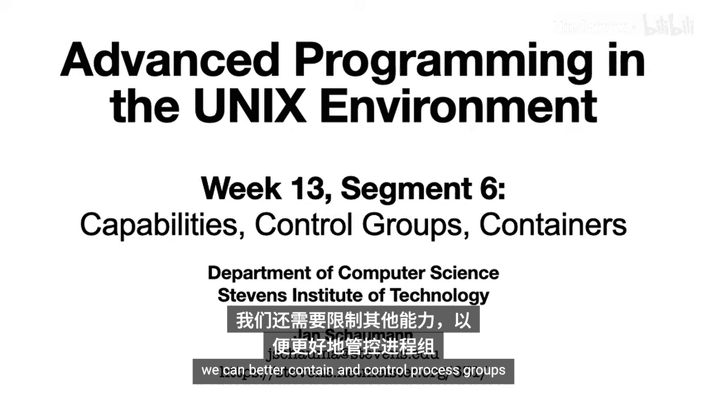
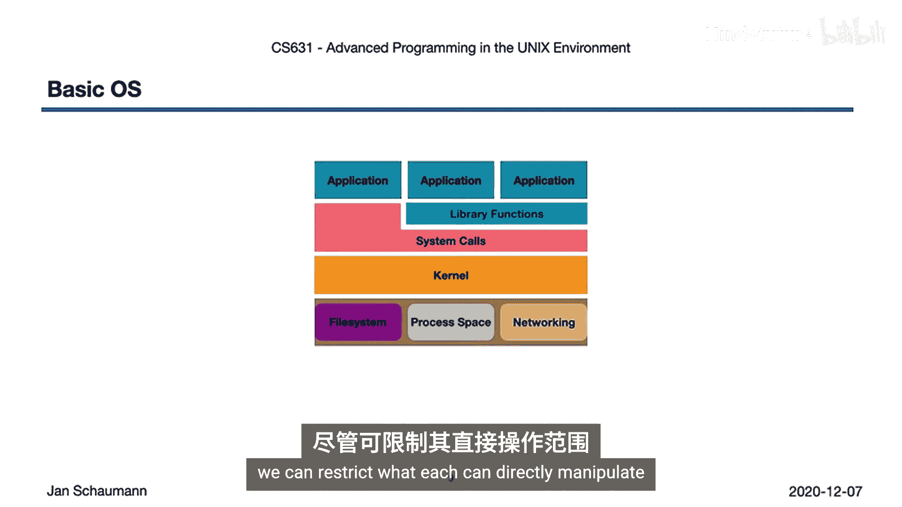
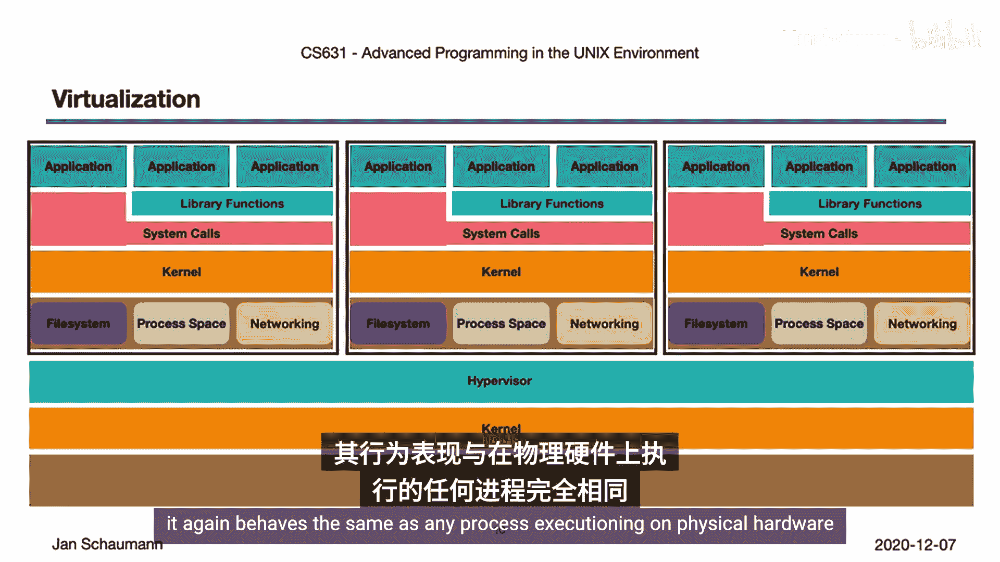
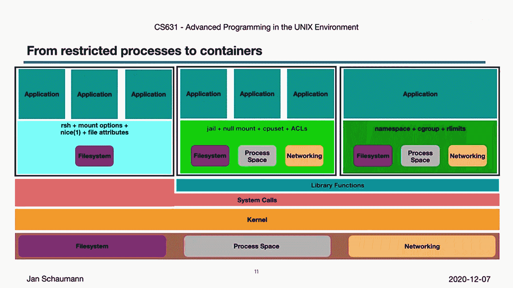

# UNIX高级编程-p71-P71-Week-13,-Segment-6---Capabilities,-cgroups,-containers--BV1hPuVz8EWS_p71-

Hello and welcome back to CS631 Advance programming in the UniX Environ。This is week 13， segment 6。

 and we're completing our discussion on how to restrict processes by looking at Pols capabilities。

 Linux control groups or C groups， and how these and the various other methods we've discussed in the last few videos allow us to build containers like Docker or LXC。

As we've seen methods to restrict CPU usage as well as file system views。

 memory and process table access， well also want to restrict other capabilities such as we can better contain and control process groups。

One approach to define the more generic requirements here are Posic capabilities。In this model。

 rather than trying to specifically solve a given problem。

 as in the case of a restricted shell or arude， we identify the generic capability that a process needs and grant fine grain access controls over these。

For example， the following capabilities may be defined。Kept shing the ability to sh files。

Cpsets at UI to allow at UI。Kep Linux immutable to allow a pent or or immutable flags we've seen in a previous video。

We have a restriction to allow network sockets to bind it to a port below 1024。

Or a restriction to allow interface configuration and rolling table manipulation。

We have a capability to allow the use of raw packets。And we have more collective capabilities。

 such as the capsis admin capability that provides broad system administration privileges such as mounting file system。

 setting host names， handling swap， et cetera。As so often。

 the standard is interpreted and implemented by different operating systems in different ways。

For example， on freeBSD， Capsicum implements a capability and Sbox framework。

NetPSSD and MeOS implement a kernel authorization framework called KO。

 with Linux systems you can read about this implementation in the capabilities manual page。

Another way to part the system and restrict visibility of resources by processes and process groups are Linux namespaces inspired by Bell La's Plan 9 operating system。

Using namespaces， one process may view components of the system either differently from or not at all than other another process group might。

These resources may exist in multiple name spaces， which allows for a high degree of flexibility in carving up the system to only expose what's needed to a given process group。

The different types of resources made available at namespaces are mo points。Process I visibility。

A virtualized network stack whereby each namespace has its own set of I P addresses。

 its own routing table， firewall rules， et cetera。System 5， I PCC visibility， Semaphos。

 She had memory and message Q kernel structures。A unique next time sharing name。

 space allowing for different host and domain names。

User namespaces that allow mapping of different user Is such that， for example。

 the root account is map to a non privilegevileged account in a given name space。

And namespace to allow different processes to utilize different system times。And finally。

 so called control groups。Now， these control groups or C groups or process containers。

 as they were initially called， allow for isolation of the different resource utilization we've seen。

Memory limits。CPU utilization， prioritization and limits。

Accounting that is keeping track of which processes utilize which resources in what ways。

And process control， allowing for suspension， interruption。

 application checkpointing and restarting of processes。Sea groupss were redesigned at least once。

 and version 2 now supports the following controls。The ability to schedule tasks。

CPU and memory utilization。The activity of control groups themselves tasks in a frozen group could then not be scheduled。

 for example。Large page support and usage。 B device I O。Memory， kernel memory and swap memory。

The ability to monitor threads。Restrictions on the number of processes available。

As well as remote directory memory access。C groups are implemented as a virtual file assistant。

 often using the Ss FS C group mount point and thus allowing for enabling of different controllers using mount options。

He is an example of restricting memory usage of the current shell。

Creation of a new C group is trivially done by creating a new directory in a pseudoophil system。

 placinging the process idea of the shell into it， and then adding a conveniently human readable restriction。

The menu page is actually very detailed in extensive here。

 and I recommend you take the time to read through it。Now， containers at last are。

 as the name suggests a way to contain processes。 That is。

 they provide an isolated execution environment on。

 and this is the important distinction from full hardware virtualization。 the same operating system。

 providing a lightweight approach。In order to contain the process。

 you might use a null or union mount to provide the right file system to you。

Restrict the processes in the utilization to avoid interference with the parent system or other processes。

Restrictt fire system visibility beyond the assigned views。

Restrict processes from what other processes they can see。

And restrict processes from what they can do。Even though we've discussed many ways to apply such restrictions in this context。

 scene groups and namespaces are frequently discussed together as they complement each other well。

In fact， the combination of C groups and namespaces forms the basis for many operating system level virtualization and container technologies such as Cor Os。

 LX C or Docker。Consider the basic operating system with a layer distinction we've used from the beginning of the semester。

We have hardware at the bottom， a kernel managing the hardware。

 a set of system calls as the interface into the kernel。

 as well as a number of library functions to allow applications to execute within the OS。Now。

 access to the hardware includes broad access by the kernel， but also means that processes due。

 by and large， retain the same view of the hardware。The file system。

 process space and networking capabilities are the same for each process。

 even if we can restrict it what each can directly manipulate。

In full hardware virtualization， things are a bit different。

 We still have hardware and the kernel managing it。But then we have a slim s on top of that。

The hypervisor。Which virtualizes the hardware and makes it available to each VM。Within the VM。

 each operating system sees only what the hypervisor makes available。

But within each application within that OS， it again behaves the same as any process executing on physical hardware。

When talking about lightweight OS level virtualization with another different situation。Then this。

 we start out again with the basic view we're familiar with。

But we can now apply the various lessons from this series of videos， and， for example。

Use a restricted shell in combination with certain mound options and a fixed CPU priority。

 as well as some file attributes， to craft a restricted view of the file system and restrict process execution capabilities。

Or we can use a jail in conjunction with CPU sets andles to restrict the process。

 file system and network view of certain processes。

Or we can create a per process or per process group restricted environment consisting of finely tuned namespaces。

 C groups and resource limits。And that is really all containers are processes running on our general purpose Uni operating system that we have restricted such that they can see or access all the resources。

That they are contained to only the views we allow。Note， however。

 that unlike with full hardware virtualization， containers are still processes or process groups。

That is， they are still running on the same colonel as the host or parent。This is both an advantage。

 Iniation of the virtual environment is much faster than， for example， booting a virtual machine。

But also as limitations， you can only run a container of the given o， not another o。

But that sums up our tour for all the various ways of restricting processes。

 the techniques and technologies that lead up to the ever popular containers。

There are many other related approaches， and we only have just scratched the surface。

 but I hope that you've at least seen that there is no magic。

 Everything we've covered in this semester so far should enable you to better understand。

 say Docker and friends。😊，Perhaps the most important lessons to draw here are that most process restrictions can be circumvented in some way。

 that the goal is to voluntarily restrict yourself。

 such that a compromise cannot gain an attack or elevated the privileges that you may have felt previously。

Understanding Unix processes and base semantics are critical in setting up and configuring such restricted environments。

That and that we've actually come a pretty long way from our first lecture。

Perhaps go back and revisit some of the topics now with an eye towards these concepts。Either way。

 thanks for watching。 And until next time， cheer。

