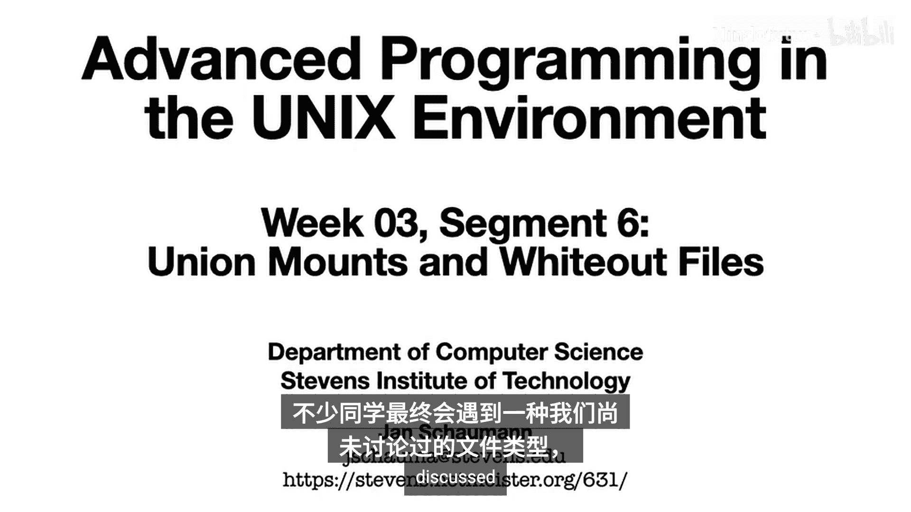
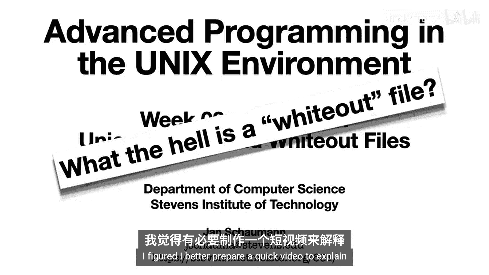
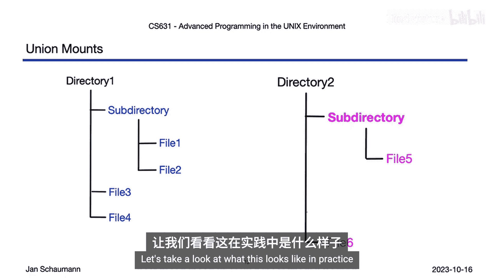
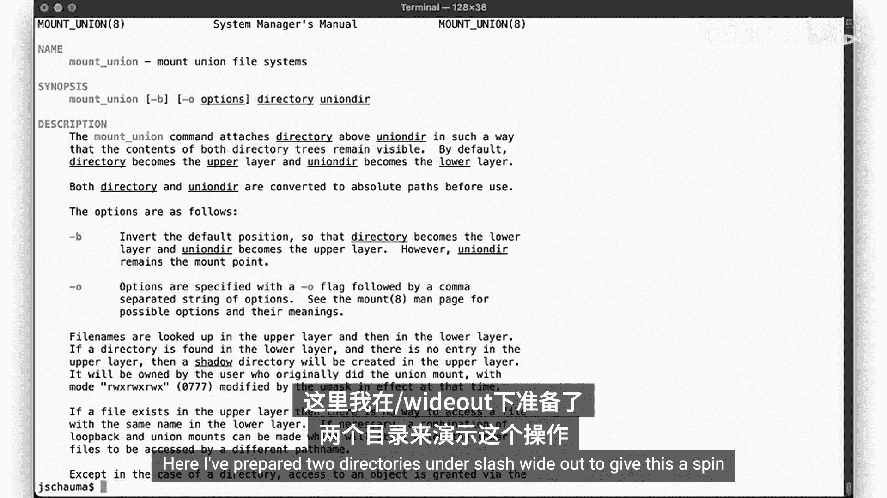
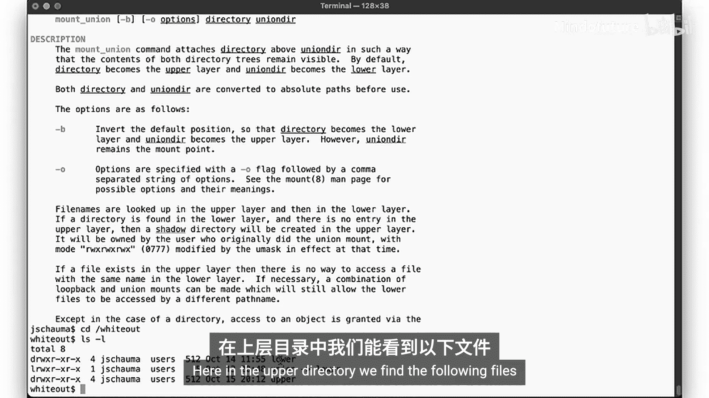
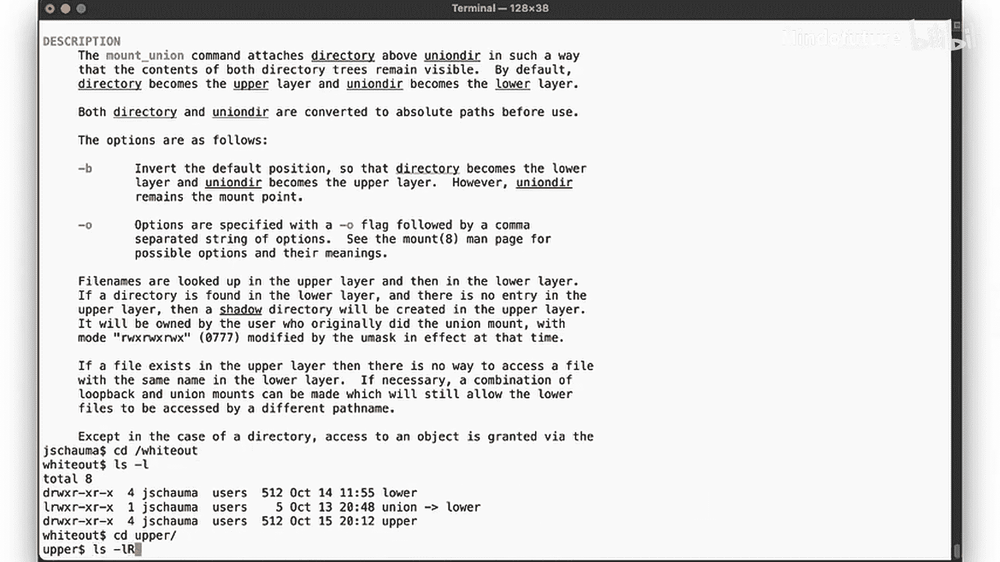
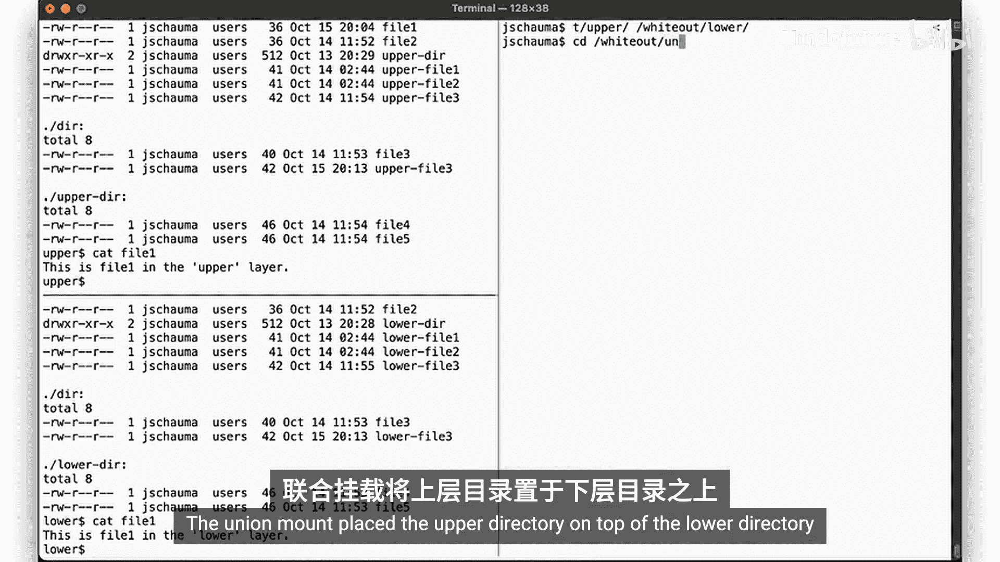
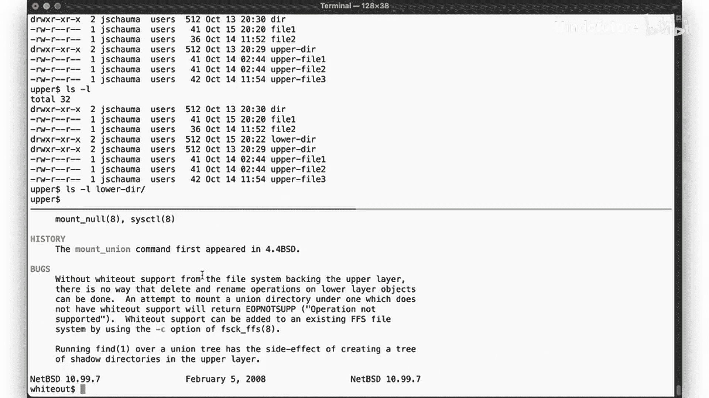
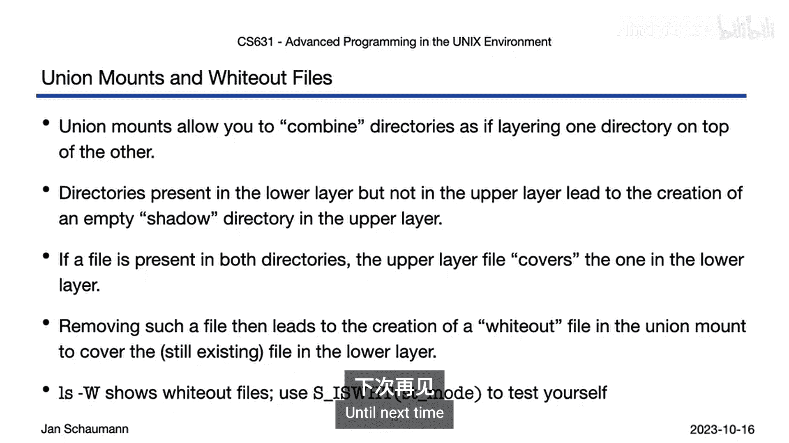

# UNIX高级编程-p72-P72-Week-3,-Segment-6---Union-Mounts-and-Whiteout-Files--BV1hPuVz8EWS_p72-

Hello and welcome back to C 631 Adv programming in the Unix environment。

After having discussed all the different aspects of thestruct stat in our previous videos。

 many students eventually stumble upon the type of fire that so far we have not yet discussed the so called white out file。

And because what the hell is a white out fire is an actually frequently asked question。

 I figured I'd better prepare a quick video to explain。 So let's dive right in。

Remember this slide from week 3， segment 1。We talked about how thestruct that provides us with all the meta information of a file。

 including the S mode， which includes the file permissions together with the file type。

We then noted the different types of files we might encounter。

 ranging from the regular file or the directory to a socket or symbolic link。

But we didn't mention this other type of file that you might encounter in some Unix versions。

 depending on whether the O supports a certain type of file system。It's called a white out fire。

 and it does。 what exactly。In short。A white out file is used to hide a lower layer file when the corresponding upper layer file in a union mountund has been removed。

Okay， but what is a union mount。Let's illustrate。Suppose you have a directory like this with a subdirecty and a few files。

And you also have a second directory like this。Using a union mound。

 you can combine these two directories to make the joint cons available in a single place。To do that。

 you effectively mount one directory on top of the other。

 thereby yielding the union of both the directorys contents， showing both sub directory 1。

 sub directory 2 and all the files 1 through 9。So that's pretty neat。

But what happens if you have two directories like this。Note that here in directory 2。

 we have a sub directory and a file 3， just as we do in directory 1。

So what happens if a union mount these two directories。Here's what that might look like。

 We more clearly see the concept of the union here。 Sub directory。

 which exists in both directory 1 and directory 2， will contain file 5 from directory 2。

 as well as files 1 and 2 from directory 1。 While the other files are available in the union directory as well。

But note that file 3 made available here is file 3 from directory 2。

 as that is in the top layer of the union mount。 We mounted directory 2 on top of directory 1。

 So directory 2 is file 3 covers up file 3 present in the lower layer。Now。

 suppose we went ahead and removed file 3 within this directory。

That would delete file 3 from directory 2。But we know that in this lower layer over here in directory 1。

 we still have a file called file 3。But we just deleted file 3。

 So if now the file from the lower layer appeared， they would be rather confusing。

So we need a way to cover up the file in the lower layer to hide its existence when viewed inside the Union mount。

For that， we deploy a white out file。That is， the union file system realizes that the upper layer has removed a file still present in the lower layer。

 and on the fly generates a wide out file to hide it。Once you unmanund the union file system。

You are left with your two original directories， and the wout file disappears。At least。

 that's the theory。Let's take a look at what this looks like， in practice。

We start by taking a look at the manual page for Mountund Union。

 which describes exactly what we just talked about。

You mount one directory on top of the other so that the contents of both become visible。

Here I've prepared two directories under slash wideout to give this a spin。

A lower directory and an upper directory， which will mount on top of the lower directory to create the union。

Here， in the upper directory。

We find the following files。

2 directories， a few regular files， and some files in the subdirecties。Now， in the lower directory。

 we have a similar set of files。Note that we have some files here that are named the same as in the upper directory。

Jerd。Fi 1， file2。And 5，3 found in the dearest sub directory。The files file 4， and file 5。

Are distinct， as they are found。Indifferently named subdirecties。Now。

 let's look at file  one in each directory。In the lower directory。

 it conveniently tells us that this is file1 in the lower directory and vice versa in the upper。Okay。

 so now let's create the union mount。For that， we run the Mount Union command。

And change into the resulting directory。Note that we have created a symbollink named union。

 pointing to the lower directory。The union mount placed the upper directory on top of the lower directory。

 but using the union slink makes it more obvious to remind us where we are。

Okay， so now running L S dash L in this directory， we see the expected union of all the files。

We see De fire1 and 2， as well as the lower and upper files and directories。And yes。

 inside the subier， we also find the union of the two layers， file 3。

 as well as the upper and lower file 3。Now， if we cat file one here。

We see we are looking at the file one version from the upper directory。

Just as for file 2 and de slash file 3。While de s lower file 3， of course。

 is the file from the lower directory。And deer slash upper 5，3 from the upper directory。

So we are seeing as promised the union of these files with the upper layer covering the lower layer for files that are named the same。

No。Let's look at file 1。And see what happens when we remove it。There。No surprise。

 The fire is no longer present。And if we look separately in the upper directory。

 we of course also don't find it there。Now， let's have a second look at our files here。This time。

 we're using the W flag to Ls。To enable listing of white out files。And then， we see。

That there appears this file named file 1， which is of type W and has0 heart linkss and 0 byte file size。

We can't remove this file， and it really isn't there。

 It only exists in the union mount to cover up the still existing file 1 from the lower directory。

Next， we'll unmount the union file system again。And look at the files in the lower directory。

Note that in the lower directory， file 1 still exists。But it no longer exists in the upper directory。

Our file removal in the union took place in the upper directory。

 but left the file in the lower directory untouched。Okay。

 now let's mount the Union file system once more。耶维尔。If we now edit file 1 in the union directory。

We will end up creating it in the upper layer。And we will obviously no longer have a wide out file in place。

Unmounting the union fire system again。We see that file 1 in the lower directory， remains once again。

 untouched。While the newly created file does indeed remain in the upper directory。

 even after the union file system has been unmountunded。Oh， and one more thing。

 notice that here in the upper directory， we suddenly find a directory named Lowderre。

That looks just like the one from the lower directory。In there， we have two files。

But here in the upper version of lower deer， there are no files。 What happened。

Let's remove the directory to see how we ended up with it being in our upper directory in the first place。

And after removing it， we again mount the union file system。And check。Nope， no lower de here。

 So that's good。Our union looks just like we'd expect as shown here on the right。

If we now look in the upper directory。We find that all of a sudden， the lower deer has reappeared。

But in the upper directory， there are no files in it。 While in the union directory。

 there are the files that we expect from the lower directory。

Let's take another look at the manual page to see if that helps us understand what's going on here。

As we know， it tells us that file names are looked up in the upper layer and then in the lower layer。

But also notes that if there is no entry in the upper layer。Then a shadow directory will be created。

And that is what we are seeing here。These shadow directories I created the first time you are accessing the lower layer directories。

So traversing a union mount will then create the whole hierarchy in the upper layer。

As noted here in the manual of page， as well。

All right， so let's recap。Union mounts， if supported by the O S in question。

 allow you to combine directories as if layering one directory on top of another。As we've just seen。

 so called shadow directories may be created for any directories not found in the upper layer。

If a file is present in both layers， the upper layer version effectively covers up the bottom layer。

And removing such a fire then leads to the creation of a so called white out fire。

 The thing that started this whole discussion。The dash W flag to L S lets us see white out files。

 and we can test a given file struck stat S T mode for this file type by using the S is white macro。

  similar how we use macros to test for different file types。

Support for such white files and union file systems is， however， operating system dependent。

The examples I gave here are， of course， from our reference platform。

 net BSD and other Unix versions may or may not support these in the same or different way。

 So make sure to check your manual pages。And there you have it， white out files and union modelss。

Go ahead， give it a try yourself and write some code to detect and display such files for yourself。

Until next time， just。

