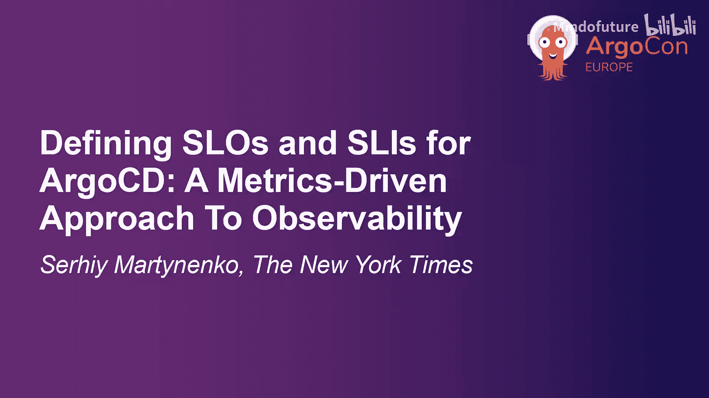
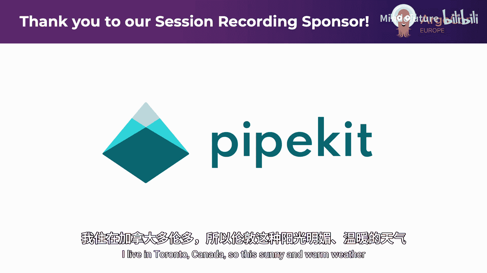
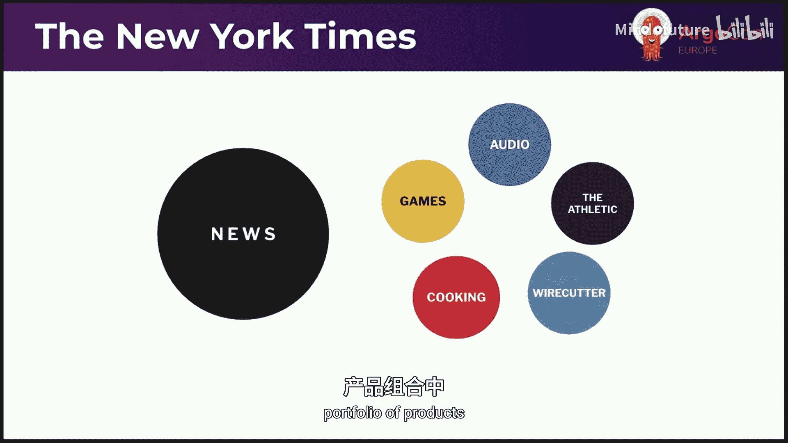
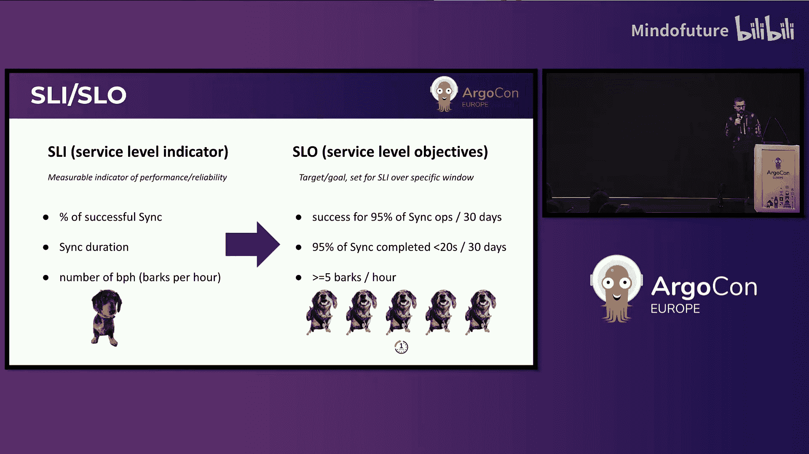
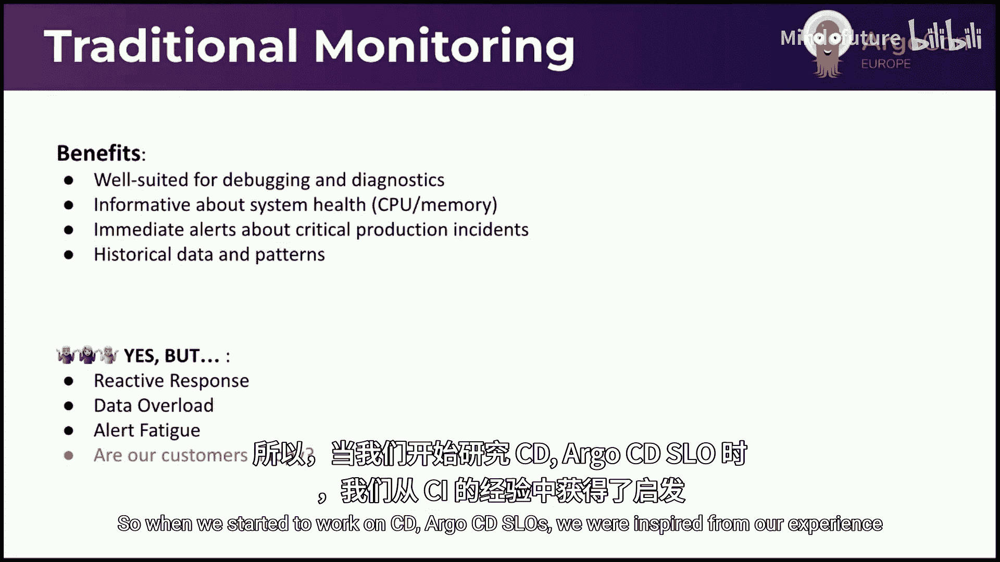
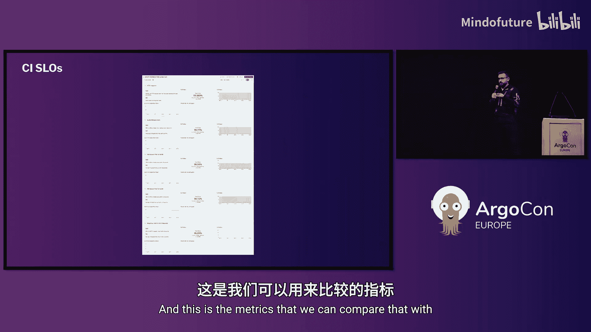
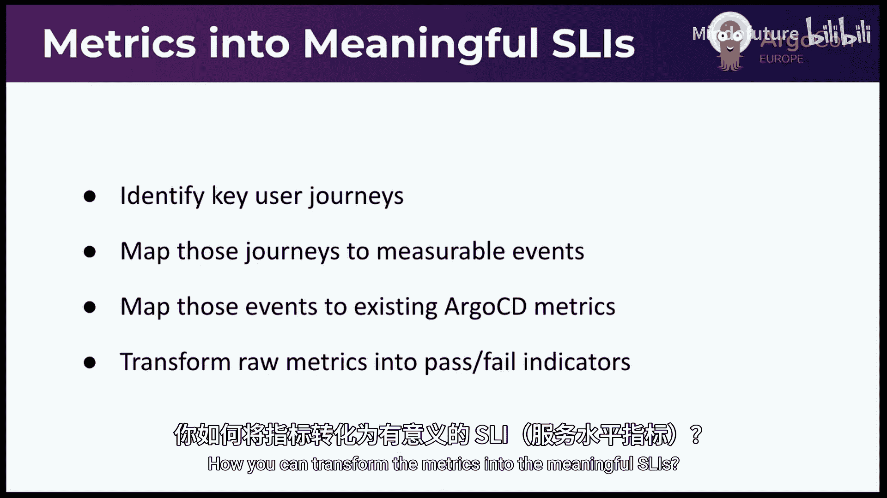
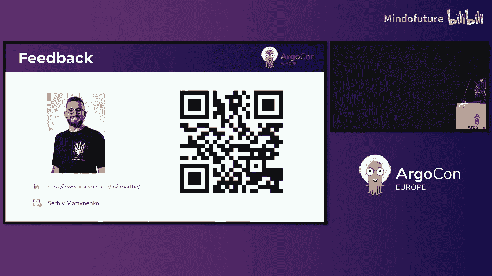

# ArgoCon-2025-Europe-大会-｜-云原生-｜-CICD-｜-架构-｜-k8s-｜-docker-｜-devops-｜-kubernetes-p01-P01-Defining-SLOs-and-SLIs-for-ArgoCD---A-Metrics-Driven-Approach-To-Observabili--BV1Xr5vzGEyK_p1-

Hi， yeah。 my name is Serhi。 I work with the York Times。 I live in Toronto， Canada。

 So this sunny and warm weather that London is famous for is like a big pleasure for me。😊。

My team where I work is called application delivery。

 and we are responsible for the experience of application delivery in our IDP。嗯。This is my dog。

 I just realize think that he's cute， and I miss him。

呃。So the question that I often receive at Cu Con is。

 why do you need such an complicated infrastructure。

 Why do you have so many engineers in just a newspaper In 2025， New York Times is modern a newspaper。

 We are digital media with a strong focus on technology。 So that reflects in our。

Portfolio of products。 besides the news and interactive articles。

 you can find yourself playing the games， including the worldlo。

Listening to audio podcasts and also my favorite is cooking and wire cutter。

Our GCD plays an essential role in our I DP and deployment process。

 Our colleagues have given wonderful talks in the previous years。

 Ill share some links to them at the end of the presentation。😊。

So let's touch base on some important concepts， for example。

Service level indicators is a measurable metric that indicates the performance or reliability of your system For Argo C。

 the examples might be the percentage of successful scene operations or S duration for my dog。

 it would be like the number barks per hour。 service level objective is the objective like the target that you set for your SLI that should be achieved over some period of time for Argo for our examples。

 it would be that 95% of scene operations should be successfully completed under 20 seconds per last 30 days and my dog should bark at least five times per hour。

So the traditional monitoring approach was a great backbone for many years for system reliability。

 It's a great tool when you need to debug some incident or performance degradation。

 You can build the dashboard where you will display and see at one glance。

 all the system information like CPU memory consumption， network data， some cloud metrics。

 and also the application and application logic metrics like the number of active users。

 number of go routines， etc。😊，Usual everyone is excited about the immediate alerts that you receive over the weekend from your pager duty about some critical incident that might be annoying that it greatly reduce the time to respond for the incident and having the historical data and charts gives you like this ability to analyze and finds the patterns from our experience in our team。

 for example， having the CIA charts and CIA data from the long period of time。

 we found some unusual spikes of bills that were triggered by the pendaboard。

 So we we tracked down it to depend pendaboard and then adjust the schedule and now the pendabo sends those updates over the weekend or in the night。

😊，That's a great benefits of traditional approach。 But there is always some drawbacks。

 It tends to be the reactive response。 You receive the alert。

 and then you start to investigate the issue。 That means that there is already some impact for your customers。

Or like the opposite situation， you have so many alerts and they are triggered so often that you just hit the snooze and wait till they will be resolved by themselves。

 So that's like the big problem with alerts， the alert fatigue and data overload。

But one of the biggest problem is does those metrics， Does it answer the question。

 Are your customer happy with your service。So S S I and the Slo approach transforms the way how we look at the service reliability。

 We should choose the customer focused metrics， those that would be important for them and useful。嗯。

Having the error budget gives you like the tool and framework， how you can。

Have the data driven approach to choose the priorities for the next work。首先。So error budgets。

 is simple words。 If you have your SL O 99。9%， then the remaining 0。

1% of time or error events or successful events is your error budget。

 It's something that you assume is acceptable level of degradation of the service。

 And then you start to improve your reliability of performance only when you are out of the budget。

 So this gives you like this freedom to innovate。 if you。

 if your budget is healthy you can ship new features， experiment innovate。

 if you are out of the budget。 then probably it's a good idea to focus on reliability and performance。

 And also one thing it gives you the the clear way to communicate use。

Service users and managers on what should they expect in simple words， like you on the planning， say。

 yes， we can spend like five weeks improving this and these parameters。

 but that would only help us to reduce the down time of the service for two hours per month。

 Does it worth it or not。So when we started to work on C D， R C D S Os。

 we were inspired from our experience with C I。😊。

This is some screenshots of real world。 Some of the dashboards that we had for droneron is the systems that we use。

As you can see theres like very important information for us as operators。

 We can see what's going on。 But when we showed these dashboards to our users and customers。

 They were like， oh wow， that's impressive。 And they never open it again because it's too much information for them。

 They have their own tasks。 They have their own code based own dashboards。

 they don't have time and mental capacity to understand all this data。

 and still we were receiving pretty much similar similar complaints from multiple teams。 Hey。

 our builds are too slow。 our bills take too much time to start。

So we transformed and changed a little bit our approach and defined multiple simple SOs that were clearly explained。

 And we had this like simple dashboard to show the status of them。

 This gave us like the great way to communicate with our management and with our dev teams。

 This is the level of service and performance reities that you should expect。 And this is。

 the metrics that we can compare that we。😊。

So when I started to work on ArgoCD S O Os， I just opens the list of all available metrics。

 They are in the docks， or you can he the endpoints in the cluster， use your Argo installation。

And this is not the full screen shot， but there's like where dozens and dozens of indicators and targets were way off。

 And it didn't help end users to。Better understand the health of our system。

 So we did like a step back and decided to think what would be the better approach for this work。

How you can transform the metrics into the meaningful S Ls。

First of all， you need to identify the key user journeys。

 So you think about the critical paths that your users take in your system to achieve the objectives that they want to then you map those journeys into some measurable events on each step。

 and then those events should be transformed into the available metrics from ArgoCD or systems near the ArgoCDs that would help you to build the metrics and transform them into some Boolean indicator fail or pass。

 So then you can calculate the percentage of successful events or failed events。

Once we defined our indicators， we should set the targets， the objectives for them。How。

 how we can do that。 first of all， let's analyze the historical performance。 Having this thing。

 we can set the objectives that would be achievable and would make sense for us as an platform engineers。

 But also， we need to consider the user expectations and business requirement。

 We need to be good enough for them to use our system platform。

It's a good advice to start conservative and achieve those lower targets before moving like to higher。

 higher targets。 And， of course， different components of our system might have different targets because of different。

Importance in this critical past。Oh yeah。 And last。

 we always need to communicate with the customers and adjust based on their feedback。

So here's the simplified version of deployment in the flow inside the Argo C D。 Basically。

 Argo triggers the detection。 It might be go through the web hook notification or pulls the data from Github。

 then fetch the source of Giths repository， manifest generation happening through the he and customize。

Then application controller reconcile gets the lifestyle state of the application and calculates the de that should be applied。

 Then Kubernetes API is used again for update and creates a new resources assess the health of those resources。

 and then the S is completed， the post sync hook is fired。

 And if some con notification were configured。 They are sent to the target。Destinations。

Let's think about the common bottlenecks that might happen in this flow。 You have the Gi operations。

 so some。Large repositories network issues。 The big amount of repos at the same time might be the reasons So those requests will be。

EWill take significant time。The manifest generation helm and complex helm charts might take a lot of time to process。

Re resource updates and reconciliations， they heavy rely on how fast is Kubernetes API。

 So if your cluster is slow， your destination cluster is slow。

 then it will significantly increase the whole process of deployment。

 And last but not least at least our users， they get used to check the status of deployments from U。

 So if U I is not available or it's slow， it makes them con anxious。

But another thing that we need to keep in mind is that's our view on the deployment journey and the flow as the platform engineers。

 We know all these components。 But for a lot of developers， They want simplicity in their case。

 they commit and pushed the changes。 then the black box doing the black box magic。

 and then it is deployed to environment。 So the important questions for them。

 did my code was successfully deployed how long it was taken how long。

E until my changes own the environment。 And can I check the status of the deployment。

So we started to work on improving those list of S Ls and S L Os。 First of all。

 we removed some unnecessary and un useful indicators。 For example， in our case。

 application set is used only for creating the new service and theboarding process to our IP is built that way there as。

Steps that take significant time。 So we basically never receive the complaints about application set and service onboarding。

 So we decided to hide them， at least for now。Next thing was revisiting thequeries for some SL I。

 and this screen， you can see the application sync successful count。 So first。

 I was counting all the events。 But then we realized that our single ArgoCD。

 it handles deployments to production and non-product environment， including ZPR environment。

 And those are designed at supposed to fail sometimes。 So at the bottom screen。

 you can see that I choose all metrics for the destination cluster of production targets。

And last some of the indicators， I just combined them into more complex query。 So， for example。

 the G request performance was calculated separately for。Different type of request。

 But you can create the。Same query with different targets in， and combines that into one indicator。

So here's the list， the full list of revisited S L Os。

 And you can see that some targets are still of。For example， is the notification delivery。

 but that's the problems that we will work on。 So let's go over some of the。I， SLs。For application。

 for user applications， the application health is calculated and seems success rate。

 As I explained already， those queries are designed to calculate only production environment applications。

The Reos server Git request performance is something that we already saw on the previous screens。

 but also another SL I was the pen and Git request。

 It calculates as the maximum value over the five minute intervals。

 and it helps you to cage the events， they are not even covered by the first SL I。

 So in case of some stuck problem。Pending Kubernetes request is the same approach。

 but for Kubernetes API request， the reliability of Kubernetes request， as you can see。

 the 404 is calculated here as a successful event because we expect that not of all of resources present on the target cluster before we have the deployment。

 So that's a success。Another two S L S for application controller is the re performance。

We have the two different SL for that。 One is the for production and one for non production environments。

 because for non production， I can imagine that that's fine。

 if the reconciliation will be a little bit slower。Q wait times。 This one is a big query， and。

As you can see， it different types of。Work queue calculated。

 but at the same time with different targets。 This reduce the visibility into the SLO。

 So if your error budget is breached， you can't see from one from the first side。

 how and what was the reason。 But for that， we build the dashboard。

 And some additional charts were supplemented to SLO。 So as you can see on the left side。

 there is one number with error rate。 and thats your SLO budget is out of the budget。

 But on the right， you have the chart for different type of the events。

 and you clearly can see that a reconciliation queue is the problem in our case。

 And we need to improve that thing。So what are the possible next steps for us iss obviously the continuous improvements。

 We need to think about SLO， revisit them and have the communication with people who would be looking at them。

 Upate the dashboard with more examples like on the previous slide where you have supplemental charts for the single SO。

Use the C metrics， in our case。Maniff generation is happening inside one of the C I steps。

 So I want to use the metrics from C I to calculate the performance and reliability of the steps that are related to Giths process。

One of the ideas that I also have to leverage the web hook notifications inside the Argo to build the service that would receive all these web hooks and calculate some additional advanced metrics。

 It might be。En to end deployment time or the time when how long the application were in out of syncic state maybe be some Dora stuff like the deployment frequency。

Yeah， that conclusion。 So first of all， you need to be very careful and choose the right metrics and queries that would represent the potential problems in your system。

It's a good idea to set up alerts on the error depleting。 You will receive this notification early。

 and you can be proactive in work on working on system reliability and performance。

 continuous improvements and communication with stakeholders of your SLOs。😊。

Im really a big fan of infrastructure as a code approach， and having the。

Terrraform code helped me a lot， like， to iterate and have them。Least of iteration。 And I。

 I was always be able to go back， you know， all these benefits of terraform。Simple S O Os is the。

Screenshots， the last screenshot and the approach that I like。 You have the one simple an number。

 and then you have more additional information near that that will explain for your customers how。

 how to do that。This is just a promo of talks from my colleagues。 Please consider visiting them。

 One of these talks is today at Argocon and other in the following days。

The list and links for some of the talks from previous years at CCF events。

 where you can find more about how our platform is built， how ourCD is used。Oh。

Big thanks to Luke Phillips and Markne for helping me presenting this。

 helping to to do this work and who is not here。 unfortunately， and the whole up delivery team。

Thanks for your attention。 Feel free to message me in Linkin， CNNCF St。

 Slack and Skenzi S code to send me a feedback。 I am always happy to answer the questions。😊。

Thank you。

