# ArgoCon-2025-Europe-大会-｜-云原生-｜-CICD-｜-架构-｜-k8s-｜-docker-｜-devops-｜-kubernetes-p02-P02-Progressive-Delivery-With-Argo-Rollouts-and-Kubernetes-Gateway-API-for-Multi--BV1Xr5vzGEyK_p2-

Good morning， Argo Kang， who is still excited to learn a little bit more about Argo and Kubernet Gway API and It Ambm mesh。

😊。

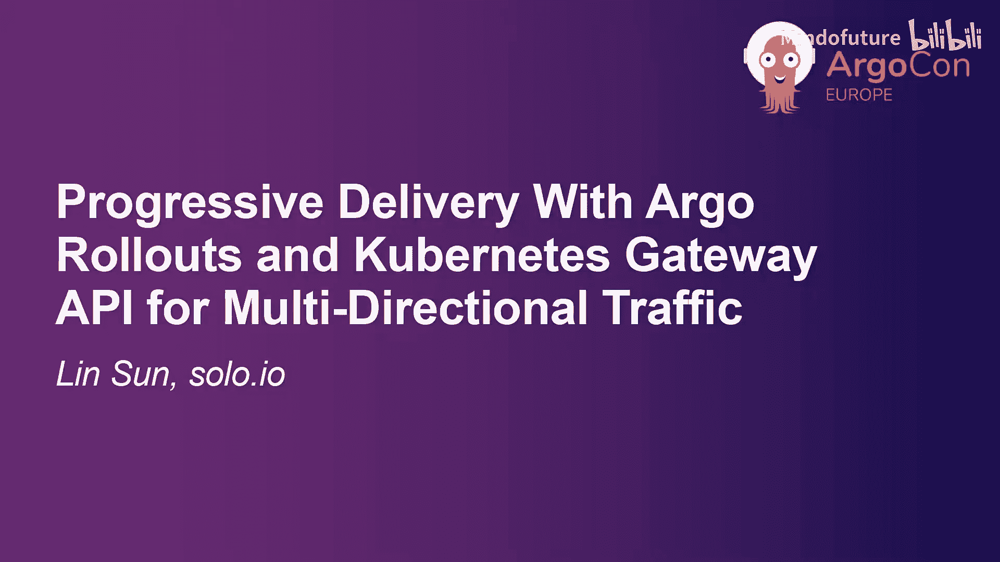

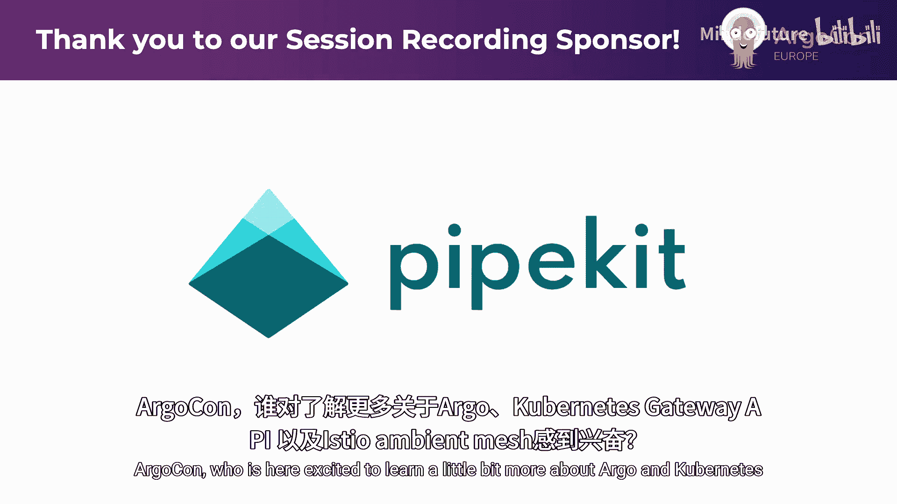

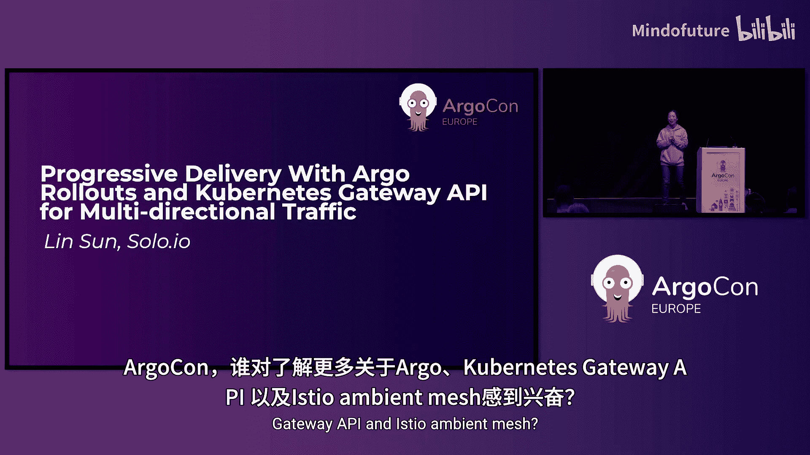

Yes。😊，Allright。My name is Lynn Song。 I'm the head of Open source with Solo I O。

 I come from a small town in the east coast of the America called Ke in North Carolina。

 Those of you who knows Red Hat Headquarter。 It's about 25 minutes from the small town。 I live。

 Raleigh。😊，A little bit fun fact about my company， which I actually just learned about today。

 So this morning， I went to the metrics website about the company contribution for all the CNNCF projects。

 And I was shocked to find out my company is the1s。 So we have about 1，50 employee。

 I was very proud as head of open source to see that we are the 1 largest contributor to the CNC F。

 all the CNCF projects combined。😊。

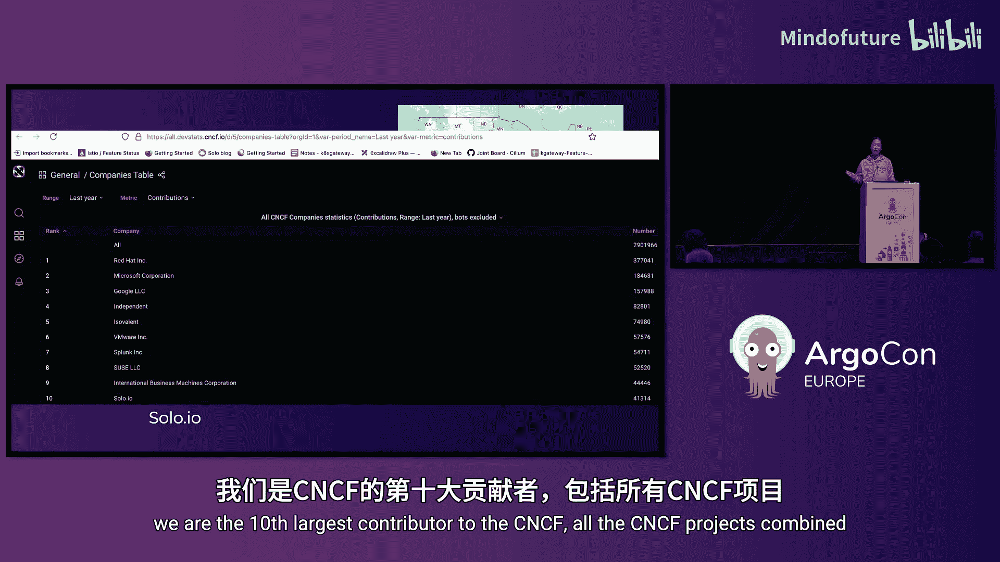

Alright， today， I'm going to talk to you about Kubernet Gateway API， It MBBA and Argo Roout。

 and also generative AI actually develop a demo application myself。

 So I'm going to show all that to you。 How many of you are familiar or using Kubernetes Gway API。😊。

Alright， many of you， awesome。 How many of you actually heard about It Ambience service mesh。😊。

Alright， awesome。 And how many of you are using Istio Amben or tried it。 A couple of you， Asome。

 and how many of you tried Argo rollout with Kubernet Gway API So far。 Well， a couple of you。 Great。

 Thank you for all these innovators。 So a couple of things。 I want to quickly jump on。😊。

So if you go to the Ago rollout document， you can see the instructions on how to enable Ago rollout with Kubernetes gateway API。

 a little bit cave with the instruction is you do have to install the config map with the plug with the gateway API plug。

 This is after you install the ago rollout controller。 I believe you also have to install。

You also have to kind of bounce the deployment off and also install the， the。

 the plug with the in container， so。When I tried this。

 it didn't work initially because I made a typo So checking out the logs was super helpful for me。

 And quickly， I think most of you understand Istio Amben。

 when I ask just quickly for those of you who don't familiar with Itio Amben we introduce a new mode in 2022。

 I believe， yes， so 2022， we launched Istio Amben as a technical preview in Itio community and it went to GA in Sal Lake City Kecon last year So what's interesting about Istio Amben is instead of having Cycar proxy we are running node proxy for layer4 traffic that handles mutual Tls and simple authorization policy using a Z tunnel component called Ztt tunnel So when we initially wrote Z tunnel。

😊，It's the envo proxy。 But then we find out the envo proxy was a little too heavy weight for our purpose。

 and we rewrite it using rust。 The other interesting portion of ambient because were not running psycho and somebody still have to do layer 7 processing。

 We believe the right architecture with layer 7 processing。

 is you have a layer 7 proxy per per tenant and your tenant could be based on your service or your name space。

 which is probably a more common one or multiple name space as part of your tenants go。

So for your tencope， you are going to have so this is a diagram of Z tunnel for the pods sharing on the same node。

 And this is a diagram for the waypoint in proxy。 So based on the tencope。

 you feel comfortable you are running your own layer 7 proxy outside of your application pod。

 Allright， so that's enough introduction of isstio ambient。

 And let's actually jumping into a live demo。 So think across I noticed the Wifi hasn't been great this morning。

 So which me good luck。 So in this demo， we're going to go through a couple of components projects。

 first of all， we're gonna use Kubernetes forcon and I already talk about istio gaveway API Argo。

 we're going use all that。 we're going use flanno as a C it's all running on my machine using a kind cluster we're going use。

😊。

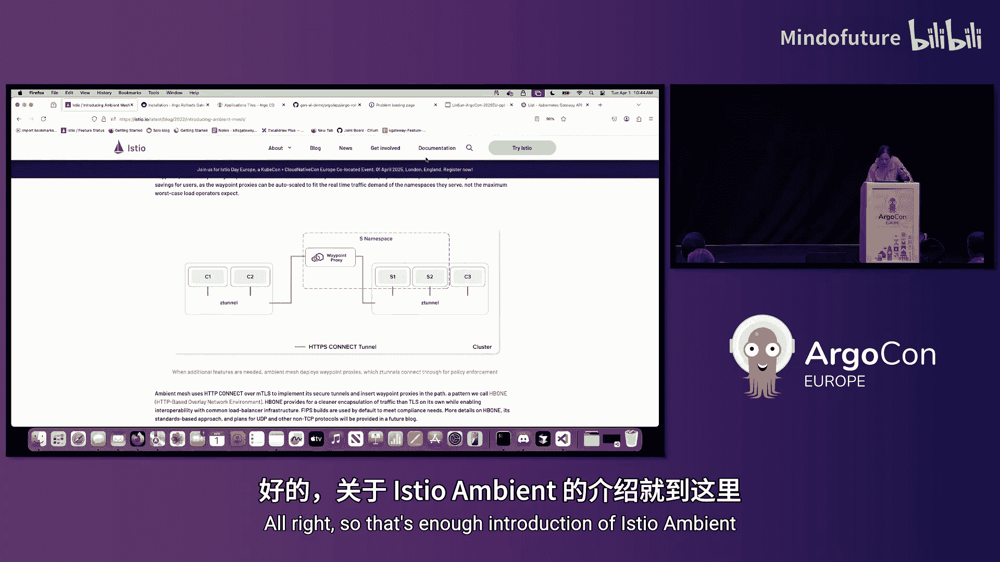

So who write the。The generative AI application using streamlight to front the U I。Wow。

 this sounds like a song competition。 Can you guys hear me in the back。Yes， okay， great。

 And we're gonna use premises and kli to help us visualize the traffic for the large language model。

 We're gonna use ama。 What I love about aama is you can easily run it as a docker container locally on the machine。

 it could it could work with open AI too， but it just easier to run that way。 Allright。

 so let's jump into the demo。😊。

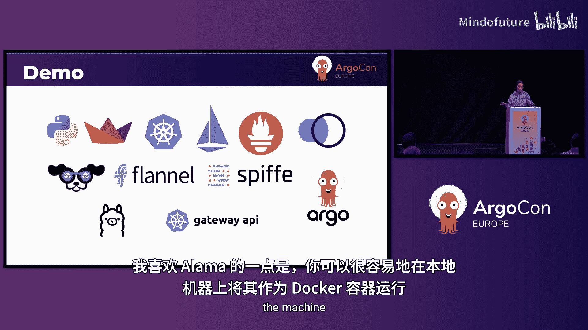

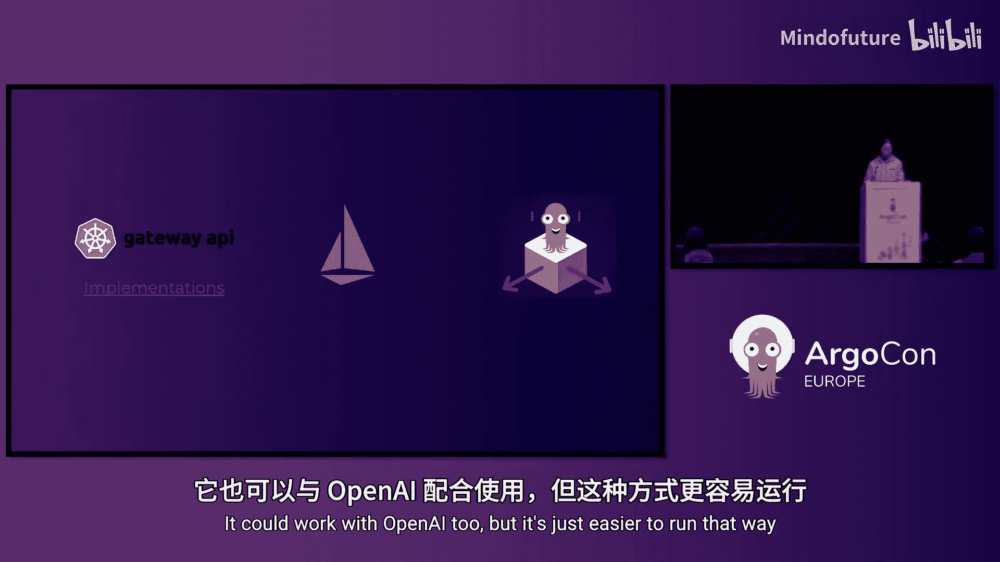

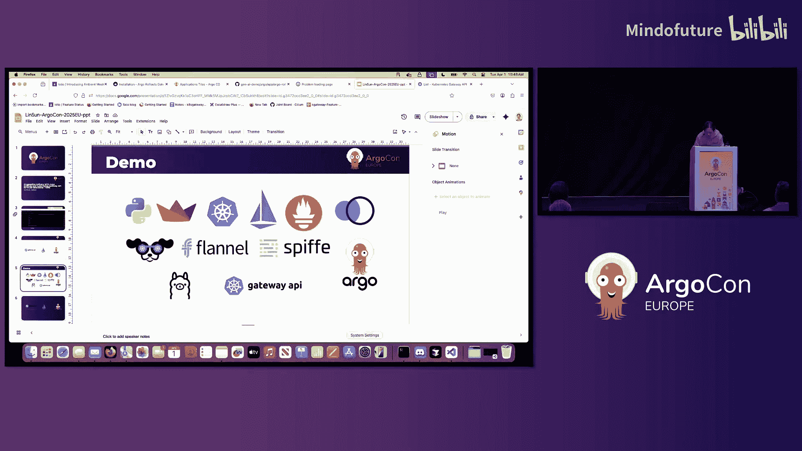

So first I like to show you my kubernetes cluster。 I got everything pretty much installed just to save time。

 So as you can see， I got Argo rollout installed。 I got Argo Cd installed。

 I got a simple client application， which is pretty much a core command to allow us to send some core request。

 I got my demo AI application installed。 I also have a couple of waypoint。

 which is the layer 7 proxy。 We talk about commonlyly deployed per namespace。

 So I have a waypoint proxy deployed in my default namespace。

 which is where I run my demo AI application。 I also have the waypoint deployed in the egress is still egress namespace。

 because I'm running a Lama outside of my Kubernetes cluster。

 so I want to control traffic going to my large language models similarly as。

When you're calling open AI outside of your Kubernetes cluster， I got It ingress gateway deployed。

 which controls all the incoming traffic coming into my demo application。

I see I also got ist ambient installed。 I got the zero trust tunnel。

 which is the layer  for proxy that handles all the layer for traffic upgrade to Mi Ts on on the node for all the parts ambient on that node。

 I also got premises running and also the kli， which is a U I for It。 What else I have it running。

 That's about it。 Allright， so the first thing I want to show you is we're gonna to take a look at the namespace。

 sorry， this is a typo。 I think I want to do namespace。 Alright。

 so I want to show you on the default namespace。 in order to enroll my application into ambient。

 there's no need to restart the application because we don't run psychos anymore with ambient。

 So all I did was label the namespace with。😊，Me play mode ambient。

 and I also labeled the namespace with I do I O slash used waypoint to say。

 I want to use the waypoint for that particular namespace。

 So I already labeled that for the default namespace。

 I also made similar label for the egress namespace。

 which I want to control all the traffic going to Lama And the other thing I did is I have a simple service entry resource。

 did I mis type again。 Let me double check。 I think might be called service entries。Okay。

 let's see if this works。 Alright， so I have this simple service entry resource deployed。

 If you are familiar with Et service entry controls traffic going outside of your cluster。

 when your application needs to reach external services。 In this example， I mentioned to you。

 I have aama running。 by the way， this is my aama。 and you can see we can interact with my aama running locally here。

 but it's outside of Kubernetes cluster。 I have a couple of large language model already loaded into myalama。

 which is NAma 32 and lava， we're going to use in the demo。😊，Allright。

 so the service entry controls traffic， basically when the application calls this aama。

 which runs my host Dakoda internal on this port， it should goes to the egress waypoint and then forward the request to the actual destination which is my aama right so that's kind of the environment I have oh the other thing is I want to show you I do have a gateway resource already deployed so let's see I think I have gateway class deployed。

 so I have the egress class that the controls external traffic going outside of my cluster。

 I have ingress class that controls incoming traffic because the talk is about multidirection traffic so the ingress controls incoming traffic from outside of the cluster into the class。

I also have the generic waypoint class which controls eastwe traffic within the cluster All right。

 so the other thing I have is so I have this gateway resources if you are not familiar with gateway Kubernetes gateway resources you can see it's a reached version1 last year。

And what I love about Kubernetes gateway resources it' a status field。

 which is really helpful with debugging so you can see right now I don't have IP address so we're going do poor forwarding that's just because my environment but you can see the resources accepted and I makes most report on port 80 right I think we have enough explanation about my environment let's jump into the demo of the application so the first thing I'm going to do is I want to reach my demo application from the It Ingress Gway so I'm going to run poor forwarding of the port 80  to 8099 Oh the other thing I forgot to show you is I do have HTTV route deployed to config the traffic from my Itio Ingress Gway to my demo application on port8。

Remember we exposed port 80 so the demo application also runs on port 80 you can see I canfig when the traffic comes to the issue in Gr Gway on the port 80 which is defined in the gateway resource please forward the traffic if it's pass a prefix starts with slash。

 please go ahead forward the traffic to the demo application。

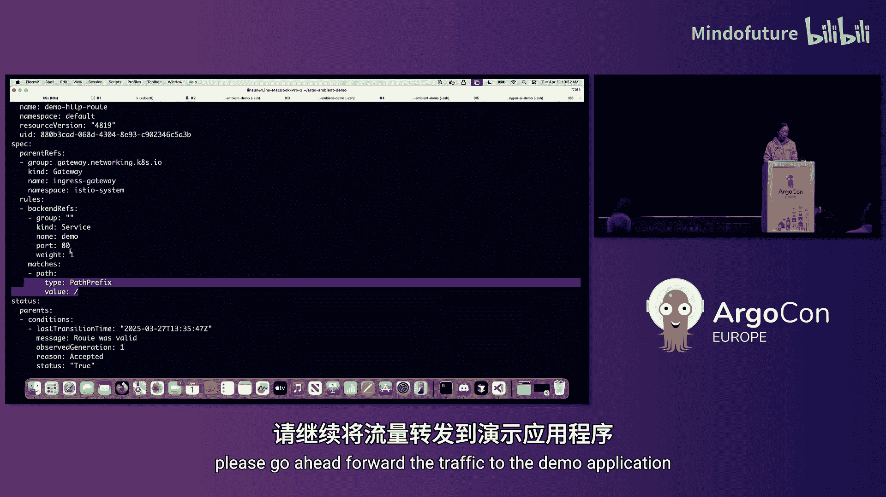

Alright， let's jump into the demo application so we just enable the forwarding so I'm going to refresh。

 This is my version two of my demo application just to simplify the time I'm just going to jump into version 2 for now so the first thing we're going to do is have you all been exploring central London so I'm going to ask what if I can type what are the top three things to do in London。

😊，Alright， so what's going to happen is the traffic is going to hit my I ingress Gway and then hit my demo application and then control the traffic through the egress and then to the Alama。

 which I'm using the Nama model alright， so how many of you have visited Buckingham Palace？Alright。

 a couple of you。 Wow， nice。 How many of you have explored British Museum。😊，Awesome。

 and how many of you have taken a ride on London Eye。😊，Alright， awesome。

 Now the next question I'm going to ask is， what is Argo rollouts。😊。

Cause I want to see if it's smart， you know。 Alright， actually， it doesn't know。 Okay。

 that's kind of disappoint pointing。 Okay， let me ask。 Does it know what is。MBMash。Alright。

 I guess that's not entirely right either。 So you can see large language models。

 Sometimes it's aivum。 So it knows some things。 sometimes it doesn't know。 So the other fun exercise。

 by the way， we should be able to visualize the app here。

 Let me actually show you now that we generate some traffic。😊。

Fing across so typically these dashboard works is when there's enough metrics。

 it can start generate the dashboard right so I want to show you what my application looks like So what we're going to do is we're going to enable security So you can see this is my application I just showed you right so let me enlarge this a little bit。

 So the application goes from my ist Ingress Gway， which is the central point through mutual here as to my demo application and then to the waypoint and through the waypoint and then goes to the external ama right So this is all good。

 Now the next thing I want to show you is。😊，Because I'm not happy with the application。

 So I want' to come up with the newer version of the application。

 So what I did is I try to create using rag right because my large language module doesn't understand the domain specific knowledge right ask about Argo It doesn't rollout。

 It doesn't know we ask about MmbM， it doesn't know So what I want to do is I want to be able to kind of kind of ask。

 you know， if I can send you some documents， can you be able to understand Okay so we don't have the Ra module deployed。

 which is why we're getting this error， by the way。

 So we're gonna use ago rollout to deploy that this is why Argo comes in。

 So I already have my application in my Github repository。

 this is my ago application just so everybody knows its。

Application to roll out the rag microservices and we have the rag rollout components。

 which essentially deploys my own rag service and version one of it and I have my canary and stable strategy。

 that's for future because I'm not happy with the first version of the rag we're going to use the second version。

 So let me jump on due to the time to actually do this quickly。

 So we're going to do this and we're going to change to automatic if it works and we're going to need to specify the reposory。

 So I'm going to copy my demo application URL because I don't want to type right and we're going to specify using the latest。

 and we are going to specify the。The overlay pass， if I got it correctly。

 I think it's this customized file that contains all the resources I want the Ago application to deploy and the demo cluster is going to be my Kubernetes cluster and I want it to deploy into the default namespace。

 I think it looks good。So finger crossed。 And let's go ahead deploy dancing。Alright。

 so what it's going to do is going to wow， that's kind of fast。 Wow， kind of surprising。

 So let me go there and see if it actually deploy my。

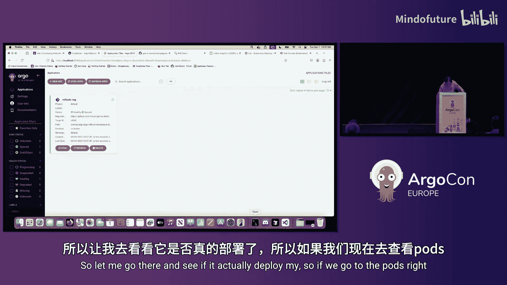

So if we go to the parts right now， we should be able to see the Ra microservice deploy， right。

 Allright， that looks right。 So so whats。😊。

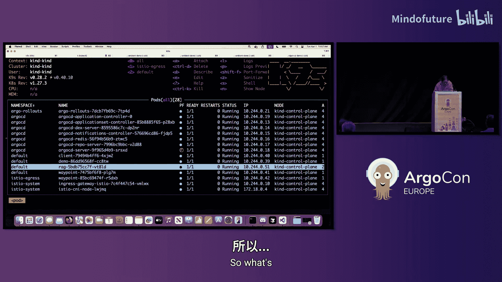

Essentially doing is I was able to use Ago rollout and based on the resources I specify in my repository。

 it deploys the Ra rollouts for me it deploys the A template for me which I want to use is still successful rate to measure the 400 and 500 long 500 code was good response code and check the failure rate and。

And I also have the services for canary and stable for my rag。

 I also have the route to configure when the past prefixes slash goes to my stable and canary service on port 80。

 Allright， let's see if this works。 actually。 So what we are going to do is。😊。

We're going to try this one Okay， so this is what didn't like about this Ra version one because it doesn't support TX T file。

 So what we're going to do is we're going to try a PDF file hopefully it works better and because I send specific document regarding MBmbM mesh now I'm hoping finger crossed it's going to be a little bit more intelligent when I ask what is NmbM mesh。

Alright， let's see if it's right。 So N B S is a new pattern for managing and secure。😊。

Communication between microservices， based on traditional service mesh concept。

 but a simpler and lighter architecture that removes the need of psycho proxy。 Allright。

 so this service is working， but I'm not entirely happy right， because it doesn't take T X T。

 which is a common document format in addition to PF。 So to fix that。

 I actually deploy a newer version push the newer version of rag V2 into my Docker hub。

 So let's use Argo rollout to roll it out。 see if we can get that done together。 Allright。

 so the first thing we are going to do is we're going to specify the new images。

 So we're going to say Kubernetes ago rollouts。 Let's set the image of rag to version2。

 and I'm going hit the enter here。 So once。😊，This is hit versionrg 2 and Virg 2 is hopefully is starting to creating and pending the wfi here。

 Hopefully we're going to be able to get the version 2 created pretty soon。Alright。

 I guess it still coming up。 Yeah， it's trying to pull the image。

 So let's be a little bit patient in the meanwhile。 when you do Argo rollout， remember。

 I have the A template， right， so we can't do Argo rollout without any test because if we do that。

 the rollout is gonna fail。So I'm going to get prepared for that。

 So first I'm going to prepare to kind of send the documents in TXT file whenever this thing comes up。

 Oh my gosh， if we can come up if not， we have to pull out the recording。

 unfortunately because the Wi-fi seems pretty bad to download the image here。 Okayright。

 I think we're having a little bit challenging to download the image here。

 this is a little bit unfortunately I thought I actually preloaded the image。

 So let me actually switch to demo recorded demo for this portion。 let me see if I have my demo here。

 I apologize for that Allright， so we are going to roll out to the version two of the application。

 So this is pretty much towards the end of the demo alright。

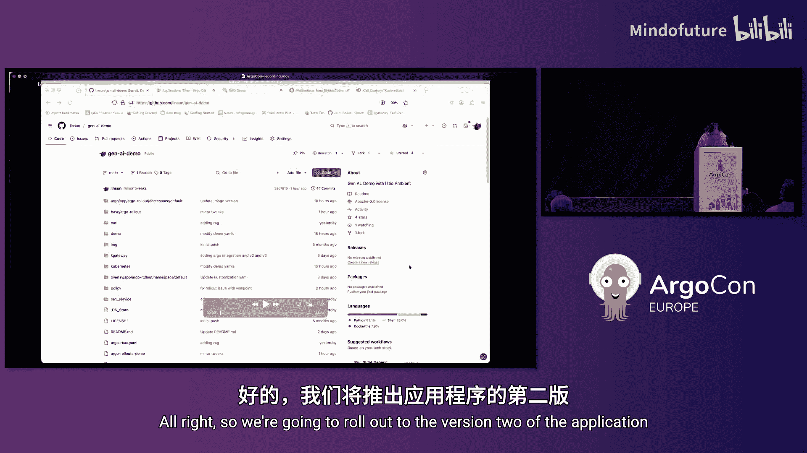

So， allright， so this is me setting up the version 2。 You guys all saw that。And。Alright。

 so you should see version 2 spin up right away。 The image is actually not that big。

 but we know the conference Wifi has been pretty challenging today。 So once the version 2 comes up。

 we're gonna do some test really quickly So you can see I'm starting to see the document is processing correctly now。

 especially when I canary roll out the new version。

 I specified when you use this header X canary rollout rollout canary， it always goes to version 2。

 Now we're going generate some load。 by the way， you can see I'm getting some invalid file type。

 that's when it goes to version 1 right because version 1 doesn't understand T XT and version 2 can understand now we're asking the version 2 specific question about ambient and it's just recurring us that so we can generate some traffic。

😊，All right， the next thing we're going to do together is now that we have OA version 2 rollout。

 we're going to check the rollout dashboard together。

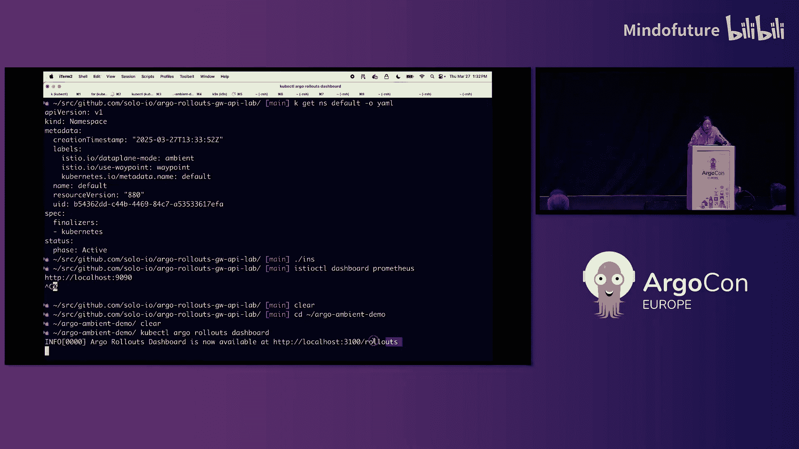

All right， so let's go out to check out the rollout dashboard。

You can see the rollout dashboard is coming up。And it's right at the age because what I did is I want to manual testing set the canary header。

 And now I'm going to promote it。 And for the next two phases of testing。

 I'm not going to do a manual promotion。 So we can see the test is going what we are going to do is hit the promote button to promote to the next phase。

 which is set to 60% progress。 And once the 60% successfully， you know。

 gone through the testing of the canary version didn't generate error rates。

 we're going promote to the next stage which is 100%。 okay， here。

 what we are doing is we're going to check out the metrics in premises。

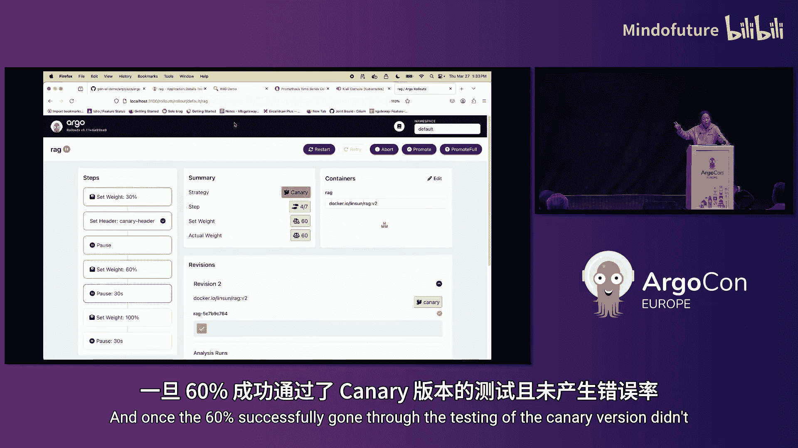

So that's bear with me。 So what we're doing is pull forwarding。

 I'm actually actually going move forward a little bit faster because time constraints here right。

 let's see。

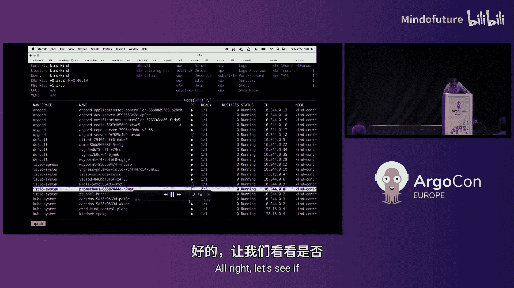

Okay， so you can see this is my canary version。 I'm getting 200 reply。

 That's how Ago Roout was very confident to promote to the next stage for me so that it can progress from 60% to 100%。

 so it can promote version 2。 Allright， this is actually my dashboard looks like by the way。

 you can see the canary version has been promoted。 we can have traffic coming into both canary and stable version and the traffic is all secure through mut T Ls。

 at the end， we should be able to also see the canary being promoted to stable and the old stable being removed。

😊，And you can see we're using the gateway API to control the ingress traffic through Istio Ingress gateway。

 And then we're also using gateway API to control east West traffic using the waypoint deploy in the default namespace。

 We're also using gateway API Gway resources to control the egress traffic through service entry。

 So the graph actually shows pretty nicely。 we have control point。

 and we were able to use gateway API to and HP routes to roll out a newer version of the Ra demo successfully。

 So this is a right， so you can see the last version， the second version was roll out successfully。

 and we should be able to get some describe of ambient。 Allright， so we did get what is ambient。

 And that looks pretty right。 Allright。😊，Last thing I want to do。

 I know I'm running out of the time to close out the demo。

 I want to analyze the mood of the audience。 So， so what I'm going to do is I'm going to connect you to my phone and alright。

 alright， and I'm going to try to point you all， if you enjoy my session。

 we're gonna analyze your mood for you。 So alright， let me take a picture。 Yes。😊，Alright。

 and let's see what Allava says from Alama。 Alright， See from a conference in a large hall， right。

 there's nothing engage and focus。 Okay， that's all I can ask for。 Alright。

 I think I'm coming to the end of my session。 What I want to let you know is I want to give you a challenge Yeah after you see what I build with Gaway API and Ben Argo rollout Kubernetes premises。

 I want you to challenge yourself， build something cool。 Maybe well see you at the next Argo account。

😊。

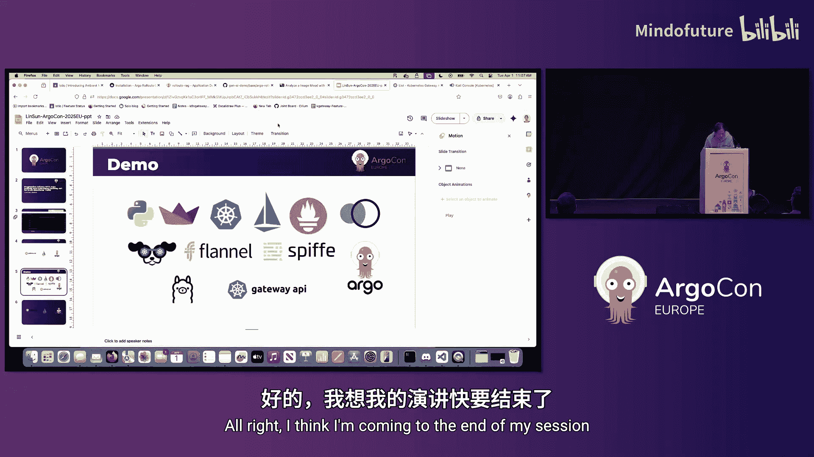

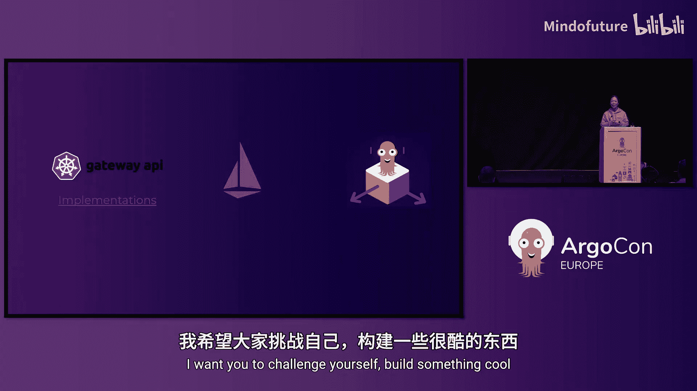