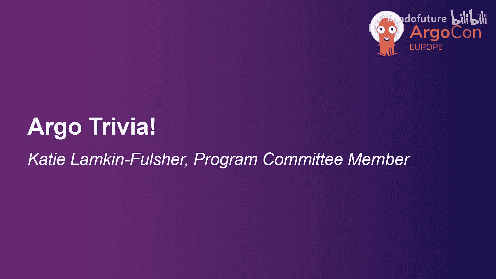
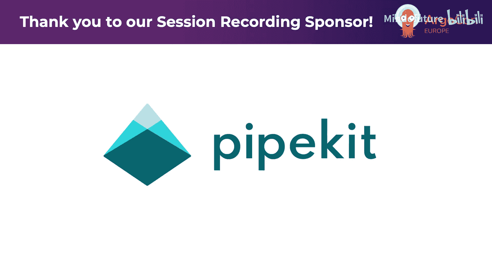
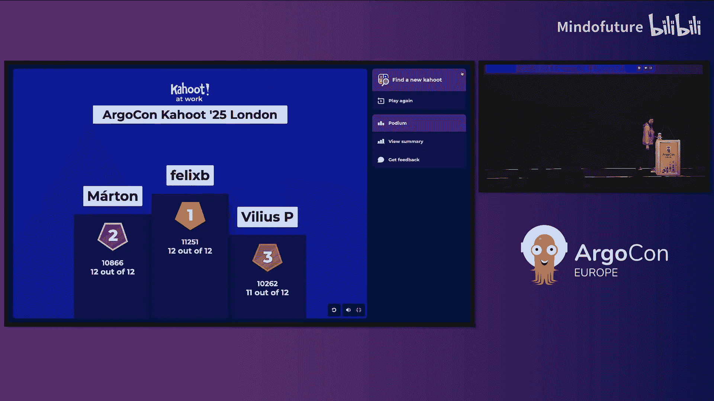

# ArgoCon-2025-Europe-大会-｜-云原生-｜-CICD-｜-架构-｜-k8s-｜-docker-｜-devops-｜-kubernetes-p03-P03-Argo-Trivia!---Katie-Lamkin-Fulsher,-Program-Committee-Member--BV1Xr5vzGEyK_p3-

Okay， let's get started。

Oop， actually we got a few more， oh we broke  a00， good job guys。Anyone else？3。Two。

 I still see a couple of phones all wait。Also， if you win and you come up to the podium and I know you。

 I'm not giving you a prize。All right。We're getting started。Argoconcaooot， London。 welcomee。

 everybody。 Let's kick it off。So first question， what is the Argo project？

So you'll see colors and shapes up on the screen， you'll see the same thing on your phone。

Click the correct answer when you know it， you get points for correct answers and you get points for speed。

 so you have to get it right and if you do it fast that gets you more points。All right。

 a majority got it correct。Felix B in the lead。Question two。

 which Argo subproject is primarily used for declarative GiO based continuous delivery？

Was this too easy？We're starting easy， we'll get there， we'll get there。I try to be encouraging。

Very nice。Felix， keeping in the lead。What feature of ArgoCD enables automated synchronization of application manifests within a Git repository？

That was a little tougher， It was a little tougher。Felix。

 impressive with a change in the leaderboard。🎼Ourrer rollouts provides which advanced deployment strategies。

 We've had a couple rollouts talks this morning。 Let's see if people are paying attention。

Blue greeneen and canary。O， change the lead。🎼It's close， guys。 It's anyone's game。

 What is the main use case of Argo workflows。🎼Yeah。You guys are fast。

I would need the full 20 seconds。Nice majority got that one。Oh。Villiaus in the lead。

In Arrgo rollouts， which Kubernetes resource does it extend for progressive delivery？Deployment。

 that was a little tougher， We're getting a little tougher。Ooh， slight change。

 but top three remain the same。What role does an event source play in Argo events？Nice。

 people know Ago events。Leader board remains the same。Very close。

Which is not a valid trigger in Argo events。How many people know Ago events？Yes feel confident。Oh。

 this one got a few people。Oh， quite the change， Felix B coming back。

What is the primary advantage of using Argo workflows for Kubernetes native workflow orchestration？

Besides the fact that it comes from the best open source project。Yeah。Now one got a few people too。

O Felix and Vliaas from Rayon，1 and 2。How does ArgoCD detect drift in Kubernetes applications？

Movingwing into some of our intermediate questions here。Wow！冇。😮，All right， two more questions left。

 what is in the Argo mascot's helmets？This is probably the toughest question。🎼天没有。Oh。

Octopuses live in water， guys。Space octopus。Oh， Felix remaining in the top。And last question。

 last but not least， where was the first Argocon held？For those of you that are OGs。🎼You'll know。

We'll see if this shakes up the leaderboard。It was virtually。All right， let's look at our podium。

Third place is Viious。Very nice second。Martton， okay， and first。As Felix B。

 congratulations to our podium people， please meet me after this session， you'll come get your swag。

Just for everybody's knowledge， our next talks。We'll start apologies。

In 10 minutes And here in room A you have a million ways to promote between environments promotionmotions is a big theme that's happening amongst the Acon as you can see there are many talks by it so this is a great one to attend and then in room D we have auto scaling and progressive delivery another very popular topic and very big theme for a lot of people that are introducing progressive delivery into their workflow Thank you so much everybody winners find me over here in the right corner of the room Thank you。

