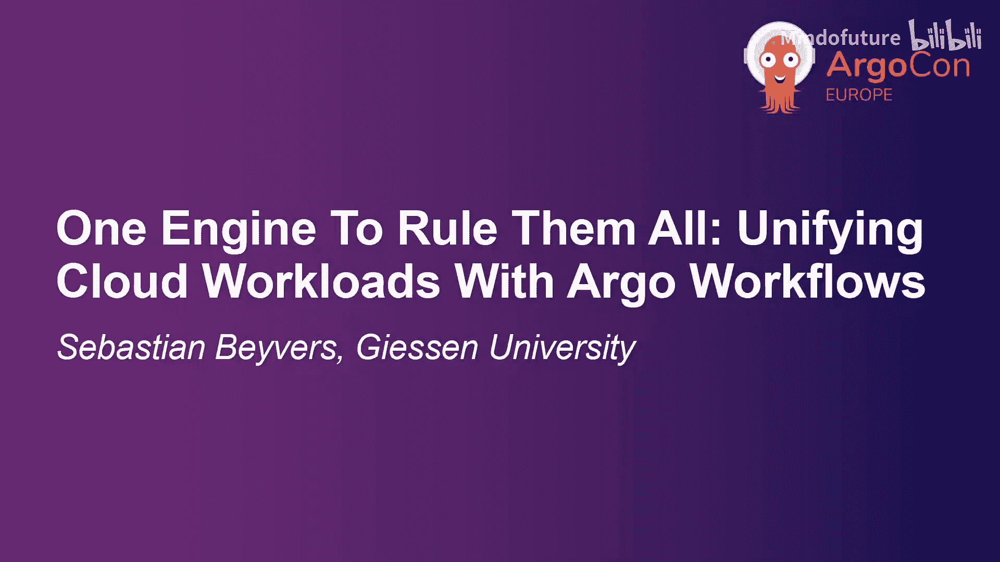
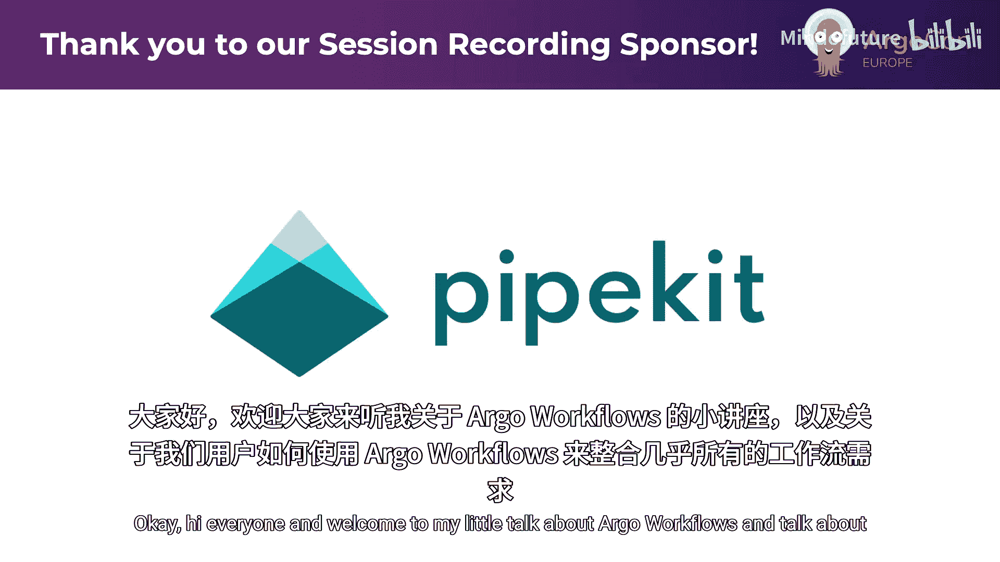
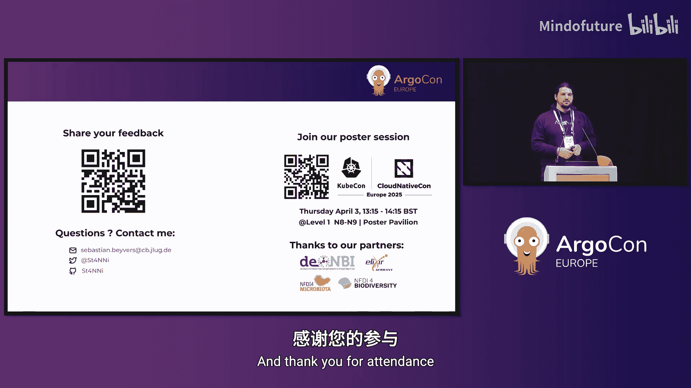

# ArgoCon-2025-Europe-大会-｜-云原生-｜-CICD-｜-架构-｜-k8s-｜-docker-｜-devops-｜-kubernetes-p05-P05-One-Engine-To-Rule-Them-All---Unifying-Cloud-Workloads-With-Argo-Workflows----BV1Xr5vzGEyK_p5-

Okay， hi everyone。

And welcome to my little talk。About AGgo workflows and talk about how we as a user can use AGgo workflows to consolidate almost all of your workflow needs。

First of all， a little bit to myself， I'm Sebastian。

 I'm a distributed systems researcher and DevOps person from Geson University in Germany。

 and we do all kind of stuff with cloudout， especially from a compute perspective because I'm originally I'm a bioinformatician and so I do really heavy number crunching for sequences and all this kind of stuff。

 and so I need quiteper compute capabilities。Let me guide you a little bit through the agenda today in the first session I will a little bit introduce the background and what we are dealing with and why we came up with our ideas。

 then a little bit we will talk about our problem and how Ago workflow might solve this problem so the solution for that。

 and then a lot of examples for implementation guidelines and how we implemented this in a NAV but maybe quite approachable way。

And afterwards， we will go a little bit through our results and what what we achieved with this and。

 and so on。A little bit of a background， so our university Sugeson。

 you see here in the middle of Germany， is part of a larger network in Germany where we provide a community cloud for life science researchers so researchers can come to us and get storage。

 compute all this kind of stuff and they can use that to make whatever they want as long as they have research focus and they get it totally for free。

 so they can say okay， I want 10 VMs to do some number crunching or something like that and then they come to us and they get them as they like。

We provide an open stack environment we really heavily invested in Kubernetes and so this is the reason why we talk about Ago workflows here。

 and we also have quite a few HPC instances and also VMs for users to use when they just want to have a single VM to do some compute to deploy a service there。

And our ago workflow journey started around five years ago。 actually。

 I wrote my master's thesis about this topic。All doubts with how can we use Kubernetes for compute jobs。

 how can we utilize the whole Kubernetes infrastructure and especially ago workflows for our compute needs we were quite successful with this we have a few I think almost 12 clusters now up and running that do some number crunching with ago workflows the largest one has around 5k course so it's quite a large ago workflow cluster and if I talk to people that do more with ago workflows under the hood they say okay this is quite large and we also have some jobs that or some workflows that run quite long for days or weeks and also some workflows that have quite a huge number of potds so I think the largest I've seen has was around 30k pots for ago workflow which was quite an accomplishment but also quite a struggle to get it running。

And working in our environment。primarily we use this for analysis workflows， so users come to us。

 bring their data， get some analysis， and afterwards they get some results， visualizations。

 all this kind of stuff back。And one really useful pattern we developed here was the pattern here on the right where you have the Kubernetes cluster。

 a web front end that has some website where user can just upload their data and this is all back by a really。

 really simple API and this API。Talks to Ago workflow cluster and talks scheduled Ago workflows all based on workflow templates。

 I think there's also the next talk is also about workflow templates I think in the other room。

 so when you want to learn more about workflow templates then you can look at that at this talk and。

By using this， we have a quite approachable system where we can provide on demand compute for users。

And our API back end is really depth simple， it's just an API and some calls to the AG API or to the Kernetes cluster to schedule the workflow and retrieve the results afterwards。

What were the reasons why we chose Agoflows， I will just quickly skim a little bit through here it's really flexible。

 you can do almost everything with this。It's really extensible。

 there's a plugin system workflow templates which are really nice to have building blocks for your workflows。

 you have easy API access and you can also via labels and annotations。

 store some data with your workflow which makes it quite convenient because then your backend doesn't need to have a database。

 you can just put everything in Kubernetes and store it there as long as it's not something confidential or something security relevant。

Almost fine to do this。Then the event system is also quite so via events and scheduling from external sources and event triggering of event trigger at workflows it's also quite convenient to have because then you can have more deeper automations with external world like message queuees and so on。

As I've said， we have deeply invested in Kubernetes and so having the almost de facto standard workflow engine for Kubernetes as ago workflows there's almost no other choice to do here。

This is also quite a big positive for using Ago workflows and there is a larger ecosystem which makes it quite convenient。

 for example， there's the Python Library here and there are the AgoCD integrations， Ago rollouts。

 the previous talk was about that and so it's quite convenient to have something in place。Overall。

 we like our workflows quite a lot， but our。Our reality looks a little bit different。

 we have many users， most of these users are PhD students that come with their own really nice ideas and bring their own some kind of workflow engine with it and so we have a really。

 really large patchwork of so many workflow engines。

 so many tools and environments we all have to manage and most of them will get lost after a little bit of time but many of them we need to maintain even if the person who developed it initially is long gone。

And so we have quite a large burden to manage older systems that are already in place and that we now need to either migrate or integrate in our existing infrastructure。

And this is a little bit so the promise of a public cloud。

 so when you go to large cloud providers you get everything under one roof。

 everything together and everything as a nice packaging with a nice API。

 but when you do this on your own you do have something like that where you have all these kinds of tools that are specialized for one specific case or one specific topic。

 but are not really that easy to integrate and introduce a lot of burden to people to maintain。

The pros are obvious you get independence and sovereignty when you do this because okay you have everything in your own hand and you can build the system you want to have you can have really specialized solutions here you can have much greater data protection when you want that but the cons are also really large。

 the mental overhead to maintaining tens or 15s or 20th of workflow systems in parallel is quite huge and this needs large human resources。

 this needs many resources that are develop four specific tool and specialized people that aren't really that easy exchangeable。

And the onboarding time is really really large， so when a new person comes to us and new PhD student starts their work。

 getting them onboarded in the maze of tools we have already in place is quite tricky and quite hard。

So。Then I think two years ago we had this idea。Can ourgo Workflows be a universal scheduling engine for everything we do？

And the initial answer to this question was maybe。On the second thought it was maybe yes。

 so then we had another thought and thought okay， how can Ago Workfors do this so what would be needed to have Ago workforcefors as our universal cloud managing engine？

So we came up with two strategies， the first is migration。

 so put the thing we have and make avaflow from it and the second strategy is integration because there are quite a few things we can't really that easily migrate because there are requirements。

 there are some additional boundaries we can't really break to make avaflow out of everything。

We did both。So for strategy migration， okay it it's quite simple。

 you take the workflow you have and try to mimic or integrate this in an Ago workflow。

 just write your Ago workflow YaO， possibly use the workflow template for this because then you have something reusable that you may integrate with other things and may easily be adaptable。

 I think this is quite straightforward because converting something is always an option but it is also the most costly option because you need to put heavy work into it and you need to understand the previous developer that developed the original workflow to make it work in the same way it was working before。

And the second strategy is integration。And integration just keeps the system in place that already is in place。

 don't touch it， just use Argo workflow as your trigger to trigger the workflow and monitor its status and afterwards collect the results or put the input data there。

 run the workflow in a main step and afterward finalize and get the data back to your cloud environment。

And。This works for some of these cases， this works quite well。

 it's a little bit naive and it also has some drawbacks which I talk about a little bit later。

 but I think it's quite a good way to do this。So we came up with a little bit of a decision metrics。

 Is it easy to。Are heart requirements for the existing system， for example， regulatory requirements。

 or does it need to be the existing system， I think when the answer is yes to that。

 there is no other option than integration because you can't migrate it because you have heart requirements。

For really complex workflows and really thinnicky and niche workflows， it's also quite tricky to do。

And so then integration may be also a better strategy。

Do you have sufficient team expertise for the existing solution if you have 10 engineers working on it。

 I think there is no really real reason to migrate it。

 but if there is only one PhD student that will be gone in three months。

 then there is quite an emphasis to migrate it right away because when he will be gone。

 I think the whole pipeline might be gone。U。Yes， and then quite a few other things is your pipeline portable。

 do you have container rice pipeline already in place because migrating everything to container is also sometimes a little bit tricky。

 and so then there might also be quite an effort to integrate it more than migrate it。

We tried to migrate some of our HPC workloads， so we have a large slum cluster in our Institutestitute and we quite successfully rewrote many of our workflows to AGgo workflows because they were really straightforward data in do something with the data results out and this can be really easily mimicked with Ago workflows and there are no real challenges。

I think the main challenges we had here was a shared file system。

 so our Slom cluster has one shared file system where every node can put data wherever they want。

 they have one volume where each node can access the data and when you do this with Aworkfors you might not have this or you need to ship data to an S3 bucket and retrieve it。

 you could have a readwrite many volume if you like。

 but I am not really convinced that this is the best solution from a performance perspective。

Shared permissions are also sometimes a little bit annoying to have because then you need to migrate all your users that do stuff with your HPC system to your Kubernetes cluster。

 and you need to mimic your robot based access control and all this kind of stuff。

In our internal system we also have some internal database up and running which don't really have access or our Kubernetes cloud infrastructure doesn't really have access to these databases and so there are also some migration efforts and specialized hardware is always a problem when we have some node that have FPGAs。

 GPUs and this kind of stuff we need to have the same capabilities in our Kubernetes cluster。

 and for some really specialized hardware， there is not really always an option to do this。Okay。

 so now now I've talked a little bit about migration。

 I think it's quite straightforward because just we write it in Argo integration。

 I think is also quite straightforward because we chose a really nice way。 So here we have a。😊。

A snippet from a template section from a workflow I just focus on the steps on the dark steps。

I developed here or integrated here。 I just have some input artifact from some cloud environment。

 from some S3 bucket or whatever。 then I have a really。

 really simple deian or alpine or whatever image that just，Puts the data in the H PCC environment。

I think it's quite。Quite easy to do。 And it's really nice and might not be the performance optimal way。

 but it is the easiest way to do this。 And so it it has really low maintenance and developer effort。

In the second thing， I just run my Slom command， I just do S batch， and run my slom command。

 and with the minus minus weight parameter， I can trigger the workflow to weight for completion。

And afterwards， I have a proxy workflow in my ago clusterster that mimics this current status of my sLt workload。

 and so I have a system that I can use for that。And in the finalized step， I just get back my data。

 my results from my shared environment， from my shared HPC environment。

 and I just get back my results and put it back to S3 of wherever you want to have your results back。

When we look at stuff like Apache airflow， we had quite a few Apache airflow workflows and what is quite trivial when we had lots of Apache airflow workflows that just use some Python functions and did some stuff with Python functions and when we look at Ha which is a Python library that can be used to make a build and run ago workflows。

 then you can see that migration here is quite trivial because in most of the cases you can just reuse your functions and just use the same functions you already have in place。

 you only need to change a little bit on some places and it's really easy to migrate。

 it takes one day of time and then you have most of your Apache airflow workflows migrated here。

 which is quite convenient。And integration is a little bit similar to the SLM case。

 so we also have an airflow workflow or an airflow deck that we already registered in ourFflow instance。

 then we just run it and wait for completion， just pull it every five seconds and get back your results afterwards。

 which is also a naive way to do this， but it's convenient and quite straightforward way to do this。

And there is also a sparkark example， I don't really want to jump really heavily in this sparkar example because there are quite good block entries from the Pi people。

 there was also I think two years ago a talk about that。

 so there are already lots of resources in place that talk about how sparkar integration with A workforceflows can work。

 mostly it revolves around creating a resource。So there is the Cubeflowlow Spark operator and using this you can just create a sparkar application resource and monitor its status。

 which is quite convenient and quite easy to do。U。And we also migrated some of our functions。

 we had previously some of mainly used Apache open whiskk for this。

 and we had some mostly Python functions， again， bioinformaticians love Python and in this regard we had many Python functions and migration was quite easy because we now use an UV template。

 UV is a quick and easy。Extension or you can replace PP with this and what's quite nice about UV is that you can create inline dependencies in your script and so it already it builds your environment when it get run and tears everything down afterwards and you don't need to create specialized container for this。

 you don't need to deal with Conda environments and all this kind of stuff which is quite tricky to do when you have finicky Python environments。

You can also do this with other programming languages， Rass， JavaScript。

 whatever there are quite a few examples for this as well。

 and we were quite happy with this because we could have a workflow template for run something in Python。

And it was easy to do， and we have one template that we can just reuse to do something in Python。

 and the user just needs to provide that script and the header with their dependencies they need to do their stuff。

In the end， you get something like that， a unified developer experience。

 you get your Ago dashboard and you have all your workflows and everything you have at hand in one need and easy to maintain UI and for us it's quite important because we want to track KPIs。

 we want to have metrics and all this kind of stuff and so it was quite hard to maintain all these kind of UIs and all these kind of systems spread around our infrastructure and now we can have a single entry point where we can see who is running what。

And then we have a little bit that what is promised by the large car providers。

 everything under one roof。There are a few limitations and challenges here if you have some workloads that need to have low latency。

 then maybe our workflow might not be the best fit here if you have some stream processing environments that constantly needs to process a stream environment then is also a little bit challenging。

You get some performance overhead here because you do some work。

 especially from the integration part， you do some work where you don't need to have done some work in the first place。

 but you get something back from this work。As I've said。

 specialized hardware is a little bit of a problem and maintaining and managing multiple ago workflow instances are also sometimes a little bit tricky because it is not that easy to have a federation of Ago workflow instances together。

So， in the end。Our workforceflows for us could be used as a unified scheduling engine。

Workflow templates were really， really beneficial for that because it made onboarding time quite easy because we had a collection of workflow templates for all the stuff we want to do。

 and so users just need to use them when they are already in place。And Kubernetes can replace。

 at least in some ways， our HPC workloads， we had privilege in place。A little bit too as an outlook。

I have a little wish list to Argo and what I want Argo workflows to do in the next in the future。

 so better synchronization between different Argo workflow clusters would be quite convenient。

 so having a proxy Argo workflow cluster that just mimics the state back to the initial Argo workflow cluster would be quite convenient。

A little bit smarter request and resource limits would also be quite convenient because we had the problem that some of our workloads were unpredictable in their resource requirements from 10 gigs to 100 gigs of RAM and everything in between were used by them and so having this a little bit more fine- tuned based on the previously requests would be quite nice because we have some clusters where many users are using this。

 there is also this project called Q where you can have a batch system or a batch scheduling system in your Kubernetes cluster and integrating this with Agoworks would be quite nice because then you can have a more deeper prioritization between the jobs from different people and different priority levels。

And a better data management integration withfuse would also be quite convenient。

 but we are working on this， we are currently developing a tool that does a little bit of fuse magic in your Kubernetes cluster where you can have a persistent volume claim that just uses the fuse mount internally to mount an external storage solution。

Yeah， and that's also my personal wish list， but I want to do all my stuff in Argo。

 but I'm nowhere close to do this， but maybe in the future this will be done and I want to have some more tools that automate the translation progress process from the one to the other。

 especially for the tri examples。airirflow to Ha。 I think it could be quite convenient to to have some conversion in place that will be automated。

😊，And yes， when you want to share some feedback， there is a QR code for feedback and also the session slide when you have any questions contact me and we also have a poster presentation on Thursday so when you just want to step by we can talk about this。

 but also on our poster topic where weve tried to do a little bit more of data management and thank you for attendance。

